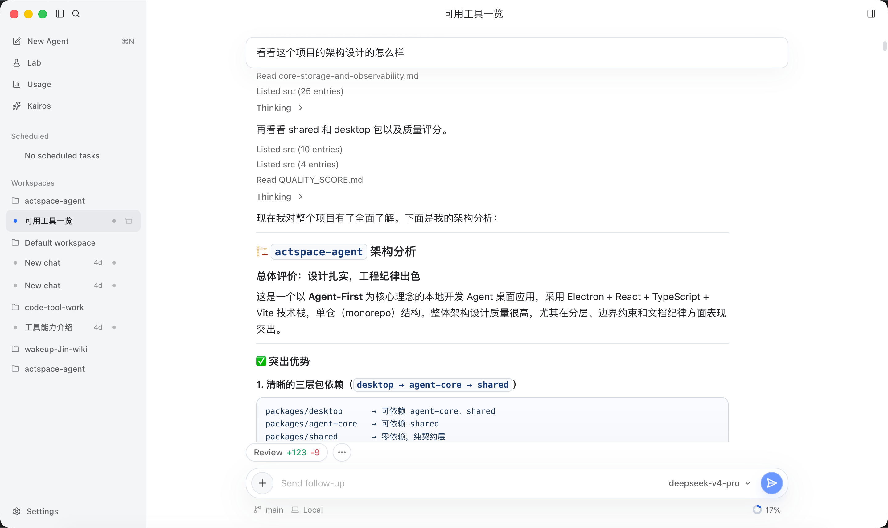
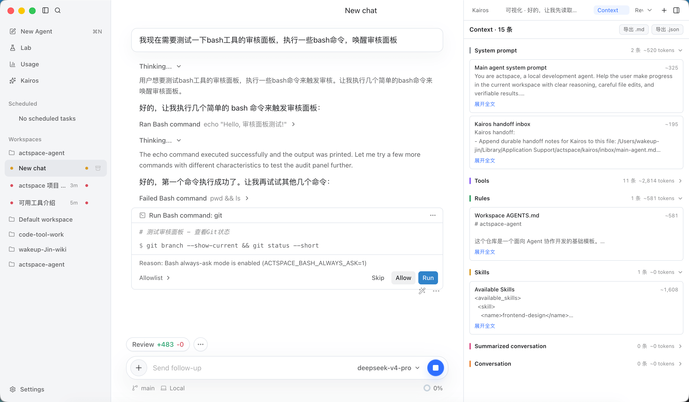
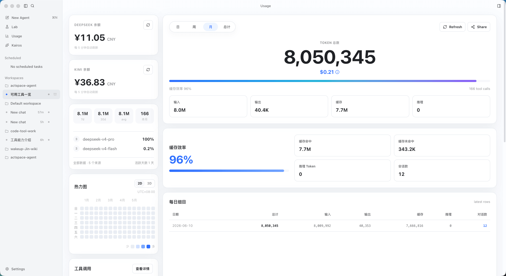
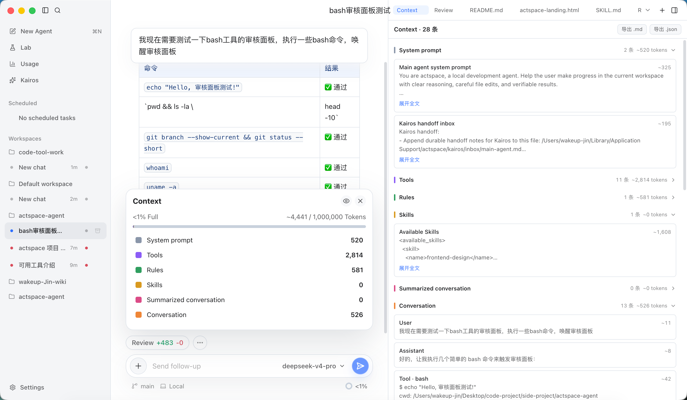
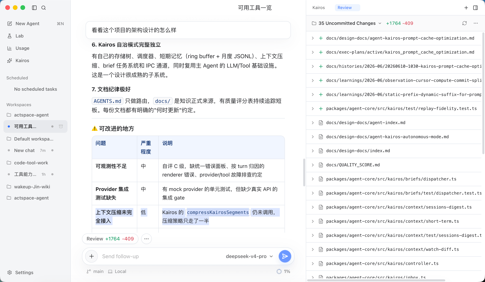

<p align="center">
  
</p>

<p align="center">
  模型的运行空间——从 Coding Agent 开始
</p>

<p align="center">
  <a href="#开始使用">开始使用</a> ·
  <a href="#当前架构">当前架构</a> ·
  <a href="docs/design-docs/index.md">设计文档</a> ·
  <a href="#许可证">Apache-2.0</a>
</p>

<p align="center">
  
</p>

## 什么是 Actspace

**Act + Space = 运行空间。**

Actspace 是一个本地优先的 Agent 桌面应用，也是一套可观察、可扩展的 Agent Harness。当前 v2 从 Coding Agent 场景出发，通过 Session Journal、Prompt / Context assembly、Tool Runtime、LLM adapter 和 Agent Loop 让模型在明确的 Host 能力边界内执行任务。

## 当前设计原则

- **简约干净**：优先采用小而明确的抽象，不建立第二套 Agent engine。
- **上下文可观察**：每次真实模型请求的 request snapshot、usage、工具调用和 Agent Run 层级都由 Session Journal 派生。
- **成本可控**：统一记录输入、输出、缓存和费用数据，并支持 DeepSeek、Kimi、OpenRouter 等模型来源。
- **本地优先**：持久会话写入 `sessions-v2/<sessionId>/journal.jsonl`；旧 `sessions/` 数据原位保留，但 v2 不读取也不迁移。
- **真实插件包**：Session、LLM、Prompt、Context、Tools 和 Agent Loop 是独立 workspace package，并由 Cordis 管理插件生命周期。

## 当前能力

- Desktop 与 CLI 分别使用 `desktop` / `headless` Profile Bundle，共享任务服务与可替换 Harness；本机 Desktop 内嵌运行，远端由独立 Agent Host 持有任务生命周期。
- Desktop 通过 WSS 或 SSH 隧道连接自管 Host，统一展示本地/远端会话，支持远端审批、取消、附件上传与结果访问。
- 持久 Session Journal、恢复、Fork、Compaction、Inbox、Todo 与一次性 Agent / Explore Subagent。
- DeepSeek、Kimi、OpenRouter 模型配置，以及 provider 级代理和 usage 统计。
- 文件读写、Grep / Glob、Bash、Web、图片分析和图片生成等工具能力。
- 工具参数校验、策略、审批、执行、结果与 Session-owned artifact。
- 固定 Desktop renderer，通过 Runtime Projection 展示消息、工具、Context、Usage、Trajectory 和诊断数据。
- Browser Bridge 保留为顶层 Host capability；真实 Chrome 链路仍属于独立发布验收门禁。

Team、Room、Kairos、Lab 和 fs-watch 不属于当前 v2 已交付能力。未来能力以 [`docs/roadmap.md`](docs/roadmap.md) 和对应 execution plan 为准。

## 开始使用

```sh
git clone https://github.com/WakeUp-Jin/actspace-agent.git
cd actspace-agent
pnpm install
pnpm dev:log
```

Desktop 的模型、搜索和图片服务凭据在应用内“设置”页面配置，由 Electron main 写入权限为 `0600` 的 `<userData>/secrets.json`。Desktop 不读取仓库 `.env` 中的 provider key。

CLI 通过当前 shell 的显式环境变量读取 provider 配置。先在本机安全地设置 `DEEPSEEK_API_KEY`，再运行：

```sh
env LLM_PROVIDER=deepseek node apps/cli/dist/cli.js run --input "hello"
```

运行 CLI 前先执行 `pnpm --filter @actspace/agent-cli... build`。无真实 provider 时可使用 CLI `--mock` 验证 Runtime、Session 和输出契约。完整参数以 `node apps/cli/dist/cli.js --help` 为准。

常用验证：

```sh
pnpm check:docs
pnpm check:repo
pnpm typecheck
pnpm test
pnpm build
```

打包当前平台的桌面应用：

```sh
pnpm package:desktop
```

## 截图

<table>
  <tr>
    <td align="center"><br><sub>工具执行与审批</sub></td>
    <td align="center"><br><sub>Usage 与缓存统计</sub></td>
  </tr>
  <tr>
    <td align="center"><br><sub>Context 请求快照投影</sub></td>
    <td align="center"><br><sub>Review</sub></td>
  </tr>
</table>

## 当前架构

```text
Desktop 本机 / CLI -> App Service -> Agent Service -> Run（固定 Harness）
Desktop 远端 -> Client -> WSS / SSH -> Agent Host -> App Service
Agent Service -> Session -> Storage port -> JSONL
Host capability -> browser-bridge
```

仓库采用 `pnpm workspace` 多包结构：

- `apps/desktop`：Electron main、preload 和固定 renderer。
- `apps/cli`：managed ESM CLI Host。
- `apps/site`：Astro 官网和公开内容。
- `packages/runtime`：唯一 `bootProfileRuntime` 装配、Projection 与有序 shutdown；领域行为留在各自插件。
- `packages/agent-host` / `client` / `agent-service`：进程与认证接入、客户端连接、内容队列与统一任务调度。
- `packages/harness-control`：组合准备、授权、启用与恢复；Run 固定当前组合，后续 Run 可采用新组合。
- `packages/session/storage` / `jsonl` / `persistence`：存储中性契约、文件实现与 Session 业务语义，保留未来数据库接入边界。
- `packages/core`、`packages/session`、`packages/llm`、`packages/context/*`、`packages/prompt`、`packages/tools`、`packages/subagent`：领域 package 与真实 Plugin Entry；`packages/context/engine` 是上下文管理引擎，其余同级目录是按类型拆分的 Context 插件包。
- `packages/shared`：跨进程和 Host-facing 公共契约。
- `browser-bridge`：独立 Go / Chrome Extension Host capability，不属于 pnpm workspace plugin 目录。

当前事实入口：

- [架构总览](docs/ARCHITECTURE.md)
- [Agent Host 配置与连接](docs/design-docs/agent-plugin-runtime/agent-host-guide.md)
- [Agent v2 设计入口](docs/design-docs/agent-plugin-runtime/README.md)
- [包结构与真实插件包规范](docs/design-docs/agent-plugin-runtime/agent-spec-package-layout-and-plugin-packaging.md)
- [Session 格式](docs/design-docs/agent-plugin-runtime/agent-spec-session-format-v1.md)
- [Tool Runtime ABI](docs/design-docs/agent-plugin-runtime/agent-spec-tool-runtime-abi.md)
- [存储与可观测性边界](docs/design-docs/core-storage-and-observability.md)
- [文档导航](docs/README.md)

## 一些闲谈

<p align="center">
  
</p>

我很喜欢市面上的很多 Agent 产品，也希望拥有一个能按自己的想法持续构建的运行空间：让模型获得清晰的上下文、可靠的工具和可验证的执行边界。

无论应用如何变化，Actspace 都会尽量保持**简约干净、上下文可控、成本可控**。

<hr/>

<p align="center">「不诱于誉，不恐于诽，率道而行，端然正己。」</p>

## 致谢

- [上下文工程与运行空间实践指南](https://github.com/WakeUp-Jin/Practical-Guide-to-Context-Engineering)
- [agent-harness-dev](https://github.com/WakeUp-Jin/agent-harness-dev)
- [code-develop-harness-init](https://github.com/WakeUp-Jin/code-develop-harness-init)
- [Linux.Do 社区](https://linux.do/latest)

## 许可证

Actspace 采用 [Apache License 2.0](LICENSE) 授权。允许商用、修改和分发，但分发时需要保留许可证、版权声明和 [NOTICE](NOTICE) 中的归属声明。
