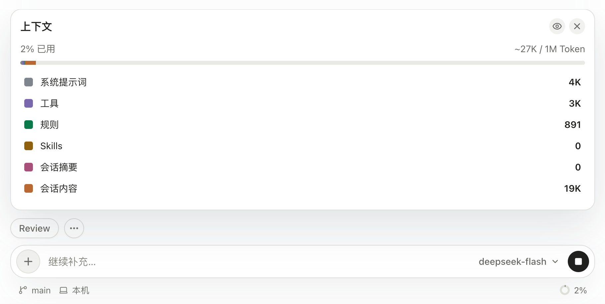
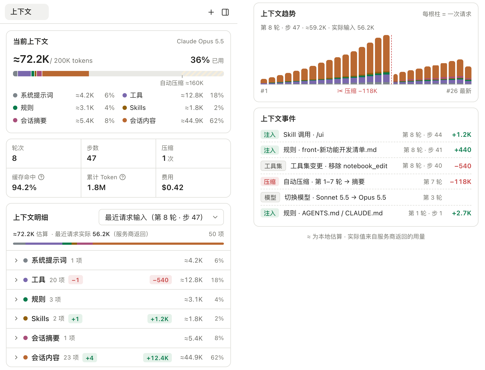

模型每次请求看到的上下文包括系统说明、工具定义、规则、Skill 提示、历史消息以及必要的摘要。聊天窗口显示的全部历史，与这次实际发送给模型的内容并不总是相同。

## 查看当前上下文

点击输入框底部的上下文状态，可以看到这次占用了多少、按分类怎么分布。需要深入检查时，在弹层里展开，或者从右侧工作台的「+」打开「上下文」，进入上下文面板。

*输入框上方的上下文占用与分类。*

排查“模型为什么不知道这个信息”时，先确认文件或工具结果是否进入该次请求，再看是否经过摘要。附上一个路径并不等于完整文件已经被读取。

## 上下文面板

上下文面板只看占用，从上到下分五块：

- **当前上下文**：已用多少、上限多少，分段条按系统提示词、工具、规则、Skills、会话摘要和会话内容着色；条上的刻度是自动压缩的阈值。
- **会话统计**：轮次、步数、压缩次数、缓存命中率、累计 Token 和费用。
- **上下文明细**：选一次请求（默认是最近一次），按分类展开到每一项。和上一次请求比，增加和减少的项数与 Token 会标出来，比如这次多加载了一个 Skill、少了一个工具。
- **上下文趋势**：每根柱是一次请求，能看出上下文怎样增长、在哪一次被压缩下来。
- **上下文事件**：Skill 和规则什么时候被注入、工具集何时变化、何时自动压缩、何时切换模型，按时间倒序列出，并带上 Token 增减。

带「≈」的数字是本地估算；“实际”是服务商返回的用量。两者有差异时，以实际值为准。会话的原文不在这里，要逐条回看，用[执行轨迹](../agent-turn/#记录与观察)。

*上下文面板。左栏是当前上下文、会话统计和上下文明细，右栏是趋势与事件。（示例数据）*

## 渐进披露

Skill、规则和文件不会一开始全部放进上下文，用到时才注入。每一次注入都会出现在上下文事件里，所以可以对照着看：某一轮多出的 Token 来自哪个 Skill 或哪份规则。

## 上下文占用与累计 Token

上下文占用描述单次请求的内容规模；会话累计 Token 包括多次请求的消耗。前者用于判断离模型容量还有多远，后者用于了解工作成本，两个数字不能互相替代。

容量依据实际请求对应的模型事实。旧会话缺少容量记录时，可能显示 0，不能据此认定请求没有使用 Token。请求的输入、输出和缓存用量见[使用统计](../usage/)。

## 何时压缩

长任务积累大量消息和工具结果时，可以在输入框执行 `/compact`，把较早内容整理为摘要；运行时也会依据压缩策略处理上下文压力。压缩依赖可用的摘要模型，请先检查相关模型用途配置。

摘要是结构化的，固定分成几节：目标、重要细节（约束、决策与原因）、工作状态（已完成、进行中、受阻）、下一步，以及相关文件和它们为什么重要。文件路径、命令和报错原文会照原样保留。

压缩减少后续请求需要携带的历史，但不会删除原始会话日志。摘要仍可能遗漏细节，关键约束最好写入项目文档；压缩后继续任务时，可以补充明确目标，并让 Agent 重新读取需要精确依据的文件。
