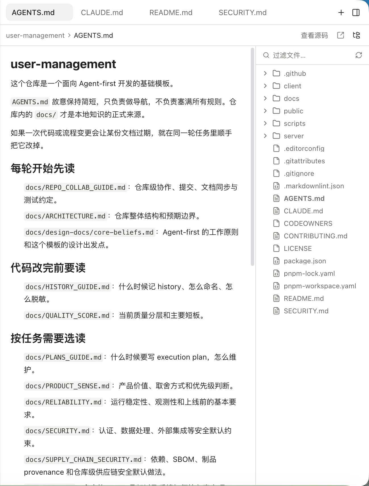

右侧工作台用标签页承载 Markdown、图片、代码审阅和上下文等对象。你可以从工具记录、回复下方的交付卡或文件树打开内容，边看结果边继续对话。

## 打开文件

展开右侧面板，从工作区文件入口浏览目录并选择文件。Read、Write、Edit 等工具记录和回复里的文件链接也可以直接打开对应文件。

再次打开同一个对象时，优先回到已有标签页，便于保留当前阅读位置。面板宽度可以按工作需要调整。

## 哪些文件在应用内预览

应用内只渲染两类文件：Markdown 用排版后的文档阅读，图片直接预览。其他文件交给系统：

- HTML 用系统默认浏览器打开，页面的脚本、相对资源和完整布局都按浏览器的方式运行。
- 代码、PDF、表格等文件用系统里设置的默认应用打开，例如用你习惯的编辑器看代码。

如果系统里没有任何应用能打开某个文件，会弹出一个小对话框，可以选择一个应用打开、在 Finder 中显示文件；没有安装 VS Code 时，还会提示可以安装它来打开代码文件。

远程 Host 上的文件不能交给本机应用，仍然在右侧面板里预览文本和图片。

*文件页签、Markdown 预览与工作区文件树。*

## 预览与审阅

文件预览用于阅读当前内容，检查修改前后差异请进入[代码审阅](../review/)。

如果文件未找到，确认当前会话的实际目录。Worktree 与原仓库是不同的文件夹，同名文件也可能内容不同。
