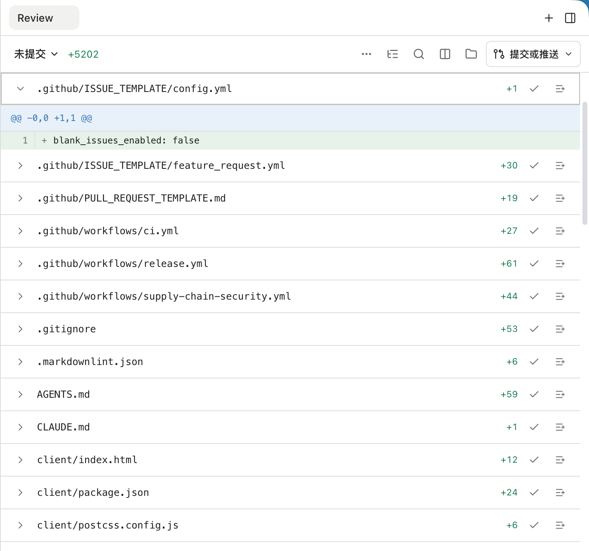

在右侧工作台打开「改动」标签（也叫审阅，英文名 Review），可以查看当前工作区的文件差异。先选择要审阅的范围，再逐个检查文件，避免把之前已有的改动混进这次任务。

## 选择变更范围

| 范围 | 用来回答的问题 |
| --- | --- |
| Uncommitted | 当前目录有哪些尚未提交的变化？ |
| Unstaged | 哪些变化还没有进入暂存区？ |
| Staged | 下次提交将包含什么？ |
| Committed | 已提交的变化是什么？ |
| Branch | 当前分支相对已配置上游有哪些变化？ |

可用范围取决于目录是否为 Git 仓库，以及当前是否具备相应比较依据。「改动」面板只用来查看，不会改动暂存区或工作区；某一轮 Agent 改了什么，看回复末尾的本轮改动卡。

*Review 未提交范围中的文件列表与新增行差异。*

## 检查改动

选择文件后阅读具体差异，确认内容和任务目标一致。需要提交或推送时，使用顶部工作区菜单。

不同会话如果共享同一工作区，也会看到同一批文件变化；要隔离并行任务，使用[Worktree](../workspaces/)。

## 差异为空时

检查范围是否正确、当前是否有 Git 仓库，以及分支是否配置了上游。改动不会实时监听：每轮 Agent 结束、打开面板和手动刷新时更新；在外部改了文件后，请手动刷新。对于生成的非 Git 文件或会话产物，可以直接从[文件预览](../file-preview/)打开。
