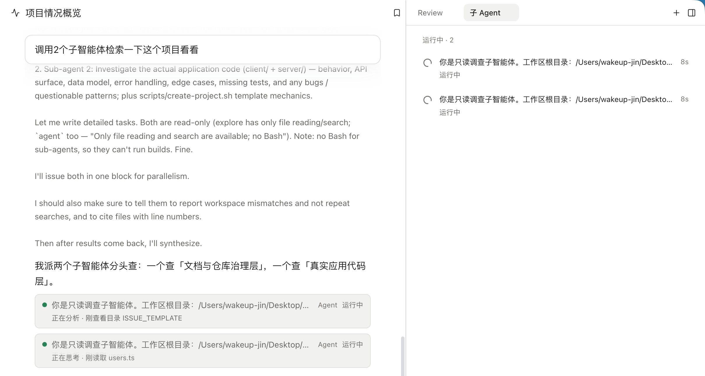

子智能体是主 Agent 派出去的帮手。每个子智能体有自己的对话和执行记录，做完后把结论交回主会话。适合把几项互相独立的调查或修改拆开，同时进行。

## 怎样使用

直接说清楚要拆什么。例如：“分别查登录流程和权限判断的入口，整理相关文件，先不要改代码。”或者：“让两个子智能体分别改 A 模块和 B 模块的测试，各改各的文件。”

是否派子智能体、派几个，由主 Agent 决定，也由它汇总结果。每个会话最多同时运行 10 个子智能体。子智能体不能再派子智能体。

## 两种预设

| 预设 | 能做什么 |
| --- | --- |
| 通用 | 和主 Agent 一样的工具，可以改文件、跑命令 |
| 探索 | 只读，只能读文件、列目录、搜索 |

在计划模式下派出的通用子智能体，也只拿到计划模式的工具，不会改文件。

主 Agent 还可以用 **Fork** 派一个继承当前对话的子智能体：它能看到你们已经谈过、做过的内容，适合“基于现在的情况试另一种写法”“回头审一下刚做完的部分”这类任务。Fork 沿用主会话的工具和模型。

## 默认在后台运行

子智能体默认在后台运行：主 Agent 派出后立即继续，不用等。子智能体完成时会自动通知主 Agent，主会话空闲时也会被叫醒，接着处理结果。主 Agent 也可以选择等它做完再继续。

之后主 Agent 还能：

- 给运行中的子智能体补充指示（插话）；
- 给已经做完的子智能体继续派活，它记得之前做过的事；
- 停掉某个子智能体，之后仍可续派；
- 让子智能体之间互相发消息。

应用退出时还在运行的子智能体会标为“中断”，重新打开会话后仍可以继续派活。

## 不会弹审批

子智能体不能向你请求审批。沙箱和你在会话里已经给出的授权沿用主会话的，不能新增授权。需要审批的操作会直接失败，失败原因会写在结果里，由主 Agent 决定怎么办。几个通用子智能体同时改文件时，让它们各管各的文件，避免互相覆盖。

## 在右侧查看

打开右侧的“子 Agent”面板，每个子智能体一行，显示种类、描述、状态、使用的模型和第几轮。运行中的可以点“停止”。点开一行可以看它的对话和执行过程。

*主会话子任务卡片与右侧运行列表。*

对话里每次派出子智能体都有一张卡片，显示任务描述、种类和“后台”标签；点击卡片会在右侧选中它。

## 执行记录，主 Agent 也能读

每个子智能体的执行过程会写成一份 Markdown 记录（`transcript.md`），每做完一步就更新一次，不用等它结束。记录的路径会交给主 Agent：启动时、查询时、完成通知里都有。主 Agent 想核对子智能体是怎么得出结论的，可以直接读这份记录，不必只相信最后那段总结。

## 子智能体用哪个模型

打开“设置 → 模型”，在“用途”里找到“子智能体”，选一个模型；默认是“跟随主智能体”，即用主会话当前的模型。主 Agent 为某一次委派指定的模型优先于这里的设置。“设置 → 子智能体”里有两种预设和并发上限的说明。

旧版本里“子 Agent 探索”用途的模型不会带过来，升级后这一项从“跟随主智能体”开始。

## 可选：交给 Codex 或 Claude Code

如果本机装了 Codex 或 Claude Code，可以在“扩展 → 插件”里打开“Codex 子智能体”或“Claude Code”（默认关闭），让主 Agent 把任务交给它们。

- 它们用本机已安装并登录的命令行，不是 ActSpace 自带的。本机找不到命令时，插件页会提示不可用。
- **它们不经过 ActSpace 的审批和沙箱**，按它们自己的权限和模型设置运行。打开插件就表示你接受这一点，打开前请想清楚。权限可以在插件设置里调整。
- 一次调用只跑一轮，做完就结束，不能续派。
- 它们的执行记录是各自命令行自带的会话日志（一种每行很长的 JSONL 文件），路径同样交给主 Agent；右侧面板只显示最终回复和这个路径。

## 限制

- 单个子智能体最多 1000 步。主任务等它的同步调用超过 30 分钟，会转到后台继续。
- 失败、被中断或达到步数上限时，已有的部分结果可以帮助判断下一步，但不能当作已完成的结论。
- 博客中的多智能体协作文章是设计探索，其中的 Team、Room 等不是当前子智能体的操作方式。
