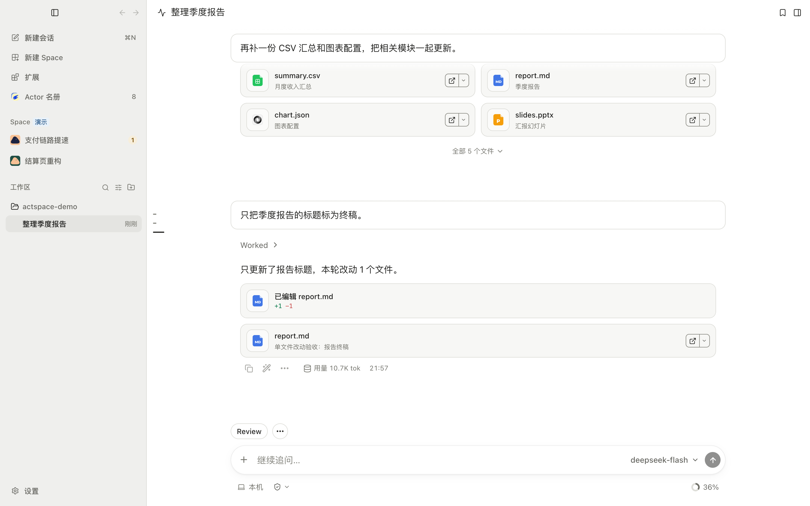

ActSpace 是一个桌面 Agent 应用。选定本地目录、连接模型后，你可以让它理解项目、修改文件、执行命令，再回到工作台检查结果。会话记录保存在本机；模型请求会发送到你配置的服务商。

这是今天的 ActSpace。它接下来要去哪里，见下文[产品理念](#产品理念)。

## 从第一项任务开始

1. 按[快速开始](../getting-started/)启动应用。
2. 在[模型设置](../configure-a-model/)中连接服务商，并启用一个对话模型。
3. 打开工作区，新建会话，描述想完成的任务。
4. 查看工具执行过程，在需要时批准操作，并检查生成的文件或代码差异。

第一次可以从“读一下这个项目，说明启动方式和主要目录”开始。具体操作见[完成第一个任务](../first-task/)。

*左侧是工作区与会话，中间是对话：每轮回复末尾列出改动、交付文件和用量。（示例数据）*

## 按任务查找功能

| 你想做什么 | 阅读入口 |
| --- | --- |
| 选择目录、隔离代码改动、继续之前的任务 | [工作区与 Worktree](../workspaces/)、[会话管理](../sessions/) |
| 切换模型、了解上下文和费用 | [模型选择](../model-selection/)、[上下文与压缩](../context/)、[使用统计](../usage/) |
| 读写文件、运行测试、收集网络资料 | [文件工具](../files-and-search/)、[Bash](../bash/)、[联网工具](../web-tools/) |
| 审阅变更、预览文件、手动运行命令 | [代码审阅](../review/)、[文件预览](../file-preview/)、[交互式终端](../terminal/) |
| 复用工作流程、委派研究、练习英语 | [Skills](../skills/)、[子 Agent](../subagents/)、[英语辅助学习](../english-learning/) |

## 产品理念

> **唯变所适。每一个问题，都有它的空间。**

ActSpace 想成为的是**会自我进化的 Agent 运行空间**。

“唯变所适”出自《易·系辞》，意思是没有可以当作固定法则的东西，只能随变化而调整。任何解法都只在某些前提下成立，所以不存在一个能解决所有问题的 Agent。ActSpace 的名字就是定位：Act 是运行，Space 是空间，也就是承载模型运行的那一层 harness。

ActSpace 的一切都是插件。模型之外的部分，包括工具、上下文和行为方式，都由插件组装而成。每一部分都可以替换，空间就能随问题调整自己：加上需要的，去掉多余的。

它的成长路线是：**从 Agent 开始 → 在场景中长成 Actor → 和你的 Actor 直接对话 → 在空间里一起解决专业问题。**

- **Agent**：打开应用时所有人拿到的同一个起点，不需要任何设置。
- **Actor**：在某个场景里由 Agent 长成，有自己的名字、能力和记忆。专门的问题，需要专门的个体。
- **Space**：把几位 Actor 聚到一起，解决跨越多个场景的专业问题。

围绕这条路线，我们沿三个方向迭代：

| 方向 | 状态 | 说明 |
| --- | --- | --- |
| 上下文管理引擎 | 已上线 | 长任务的结构化压缩、渐进披露和可检查的上下文，见[上下文与压缩](../context/)。 |
| Harness 自进化 | 进行中 | V1 已经可以在会话里让 Agent 新增或修改工具，见[让 Agent 新增工具](../harness-tools/)；失败触发派生、沙箱评估后由你决定接受还是撤销，是下一步。 |
| Actor 与 Space | 进行中 | Actor 名册与多 Actor 协作的 Space，目前是桌面应用里的前端演示，数据是模拟的。 |

每个方向的进展见[开发计划](../../roadmap/)。

## 当前能力范围

当前文档介绍 v2 桌面应用和 CLI。内置子 Agent 用于只读检索与分析；博客中的 Agent Team、Agent Room、Kairos、记忆和评估模块文章包含历史探索或独立项目设计，不表示这些能力已成为桌面应用入口。

遇到连接或执行问题时，先看[常见问题](../troubleshooting/)。需要修改 ActSpace 本身，进入[开发与贡献](../contributing/)。
