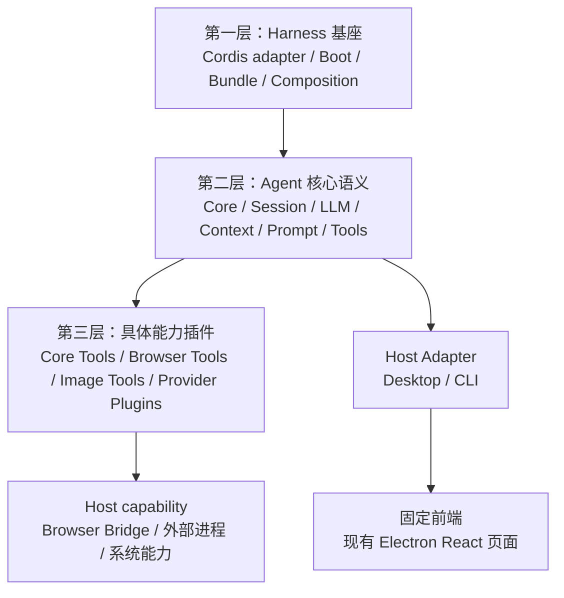
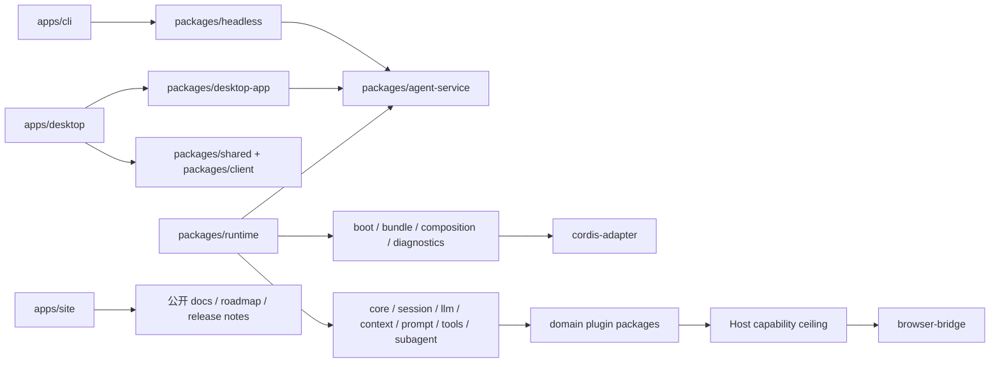

# ActSpace v2 包结构与真实插件包规范

> 状态：已实现并通过 workspace、应用构建与 package boundary 验证（2026-08-30）。Profile-first Runtime 决策已替代早期通用 Runtime facade / `@actspace/host` 目标。
>
> 本文解决两个容易混淆的问题：ActSpace v2 的源码如何按 DSH 的方式分组，以及“插件”如何成为真正可装载、可诊断、可卸载的独立包，而不是一个巨大 ESM 包里的内部目录。

## 1. 决策摘要

ActSpace v2 采用 DSH 风格的领域包结构，但不复制 DSH 的 `vendor/`，也不建立一个承载所有代码的 `harness/` 或 `plugins/` 总目录。

固定规则如下：

1. `vendor/` 不进入 ActSpace v2。Cordis 使用精确锁定的 DSH 发布包；只有未来明确维护 fork 时才允许引入 `vendor/`。
2. 不建立承载所有源码的顶层 `harness/` 总目录。Runtime 内部的 `src/harness/` 按执行装配职责分组；`boot` 与 `harness-control` 分别提供组合装配与选择服务，应用操作由 `agent-service` 及 App Service 提供。
3. 不建立通用 `plugins/` 目录。插件是 Runtime ABI 中的身份、manifest、behavior entry、codec entry 和生命周期，不是文件夹名称。
4. 采用 DSH 的领域分组：`core`、`session`、`llm`、`context`、`prompt`、`tools`、`subagent`、`compaction`、`desktop-app` 和 `client`。
5. 每个可装载、可替换或可独立验证的领域包都必须拥有自己的 package boundary 和 Cordis Plugin Entry。Session、LLM、Prompt、Agent Loop 不是“插件之外的特殊代码”，而是默认 Profile 中的核心语义插件。
6. 具体能力插件按领域放置，例如 `packages/tools/filesystem-read`、`packages/tools/browser-tools`，不放入一个含义模糊的 `packages/plugins`。
7. Browser Bridge 是独立的 Go + Chrome Extension Host capability，顶层目录使用 `browser-bridge/`，不伪装成同进程 TypeScript 插件，也不放入通用 `plugins/`。
8. Desktop 的页面、样式、布局和现有固定前端信息架构不改变。只允许调整 Host、IPC、投影和 Runtime 加载边界。
9. 可运行、打包或部署的产品入口统一进入 `apps/desktop`、`apps/cli`、`apps/site`；`packages/` 只保留可复用库、领域包、Plugin ABI package 和共享契约，且不得反向依赖 `apps/`。

## 2. 三层架构与目录的关系

目录分组与运行时插件身份是两套正交分类：



第一层决定插件如何被发现、校验、装载和关闭；第二层提供 Agent 的产品语义；第三层提供可选的具体能力；Host capability 由 Host 适配器管理，不能被同进程插件 ABI 偷换成安全沙箱。

“一切皆插件”表达的是第二层和第三层都通过统一生命周期进入 Runtime，而不是要求所有源码都位于 `plugins/` 目录。

## 3. 当前目录来源

顶层结构由[仓库架构](../../ARCHITECTURE.md)维护；完整 package、exports 与 manifest 清单由[契约矩阵](agent-contract-matrix.generated.md)生成，避免维护第二张会过期的目录树。

Host、Task 和 Harness 分别有 `agent-host`、`agent-service`、`harness-control` 包；`runtime/src/startup`、`session`、`harness` 按装配职责分组。`session/storage` 提供中性后端契约，`jsonl` 是生产实现；这些目录不构成通用插件总目录。

## 4. 什么是一个真实插件包

每个需要被 Loader 装载的包必须是独立 workspace package，而不是 `@actspace/runtime` 内部的一个目录。它至少拥有：

```text
packages/<domain>/<package>/
├── package.json                  # 独立版本、exports、依赖和 plugin metadata
├── src/
│   ├── manifest.ts               # JSON-safe Static Manifest
│   ├── plugin.ts                 # Behavior Entry，只有 activation 时产生副作用
│   ├── codec.ts                  # 需要 durable event 时提供纯 Codec Entry
│   └── index.ts                  # 领域公共 API，不暴露裸 Cordis Context
└── tests/
    ├── contract.spec.ts
    └── lifecycle.spec.ts
```

实际文件名可以在实现计划中统一，但职责不能合并：

| 入口 | 作用 | 约束 |
|---|---|---|
| Static Manifest | 身份、版本、runtime contract、Host/frontend requirements、Entry 与 codec 声明 | 不执行行为代码，不包含 secret 或函数 |
| Codec Entry | Session event schema、criticality、decode、project、migration | 纯函数，不启动资源，不注册行为 Service |
| Behavior Entry | 注册 Service、Tool、Prompt、LLM、Agent 或其他贡献 | 只能在 activation Effect 中获取资源和注册贡献 |
| Public API | 供其他领域包消费稳定契约 | 不导出 Fiber、Context、插件私有对象 |

核心语义包和具体能力包都遵循同一 ABI。区别只在默认组合中的 required/optional 状态和可替换级别：

- `packages/session/journal` 是 required core plugin；
- `packages/llm/pi-ai` 是可替换 Provider plugin；
- `packages/tools/browser-tools` 是 optional capability plugin；
- `browser-bridge/` 是由 Browser Tools Provider 管理的外部 Host capability，不是第二套 Loader。

## 5. 依赖边界



约束如下：

- 上游 Cordis 类型与实现经 `cordis-adapter` 收口；领域 Behavior 可以消费其公开 `CordisContext` 类型，不能绕过包 exports deep import 上游内部文件。
- Agent 领域包依赖 ActSpace 自有契约，不依赖 DSH Agent Core 包。
- 具体工具包依赖 `tools/runtime`，不访问 renderer。拥有持久领域状态的工具（如 Todo）可通过 Session 公共契约追加自己的 codec 事件；通用工具执行终态仍由 Runtime/Loop 提交。
- Desktop App / Headless 消费 `agent-service` 与领域包的公开 exports，不反向依赖 Runtime 装配实现；Electron/CLI Host 提供能力、进程和输出边界。
- `apps/` 可以消费公开 package exports；任何 `packages/` manifest 都不得依赖应用 package，应用之间也不通过 sibling `src/` 耦合。
- `client` 只消费固定 Projection DTO；后端插件不携带 React、CSS、HTML 或 renderer JavaScript。
- `browser-bridge` 不进入 pnpm 的 TypeScript Agent package 图；它通过 Host capability 和协议适配接入。

## 6. 包版本与插件版本

包版本和插件身份必须同时存在，但不能互相替代：

- npm/package version 描述发布制品的版本；
- `plugin id` 描述 durable event namespace、Entry identity 和诊断身份；
- `runtimeContract` 描述与 ActSpace Plugin ABI 的兼容范围；
- `event schema version` 描述 durable event 数据版本；
- Cordis version 描述生命周期基础设施版本。

一个 package 可以只提供公共库，不成为可装载插件；一个可装载插件包则必须同时提供 Static Manifest 和 Behavior Entry。不能通过“所有 workspace package 都自动当插件”降低准入边界。

## 7. 已完成的单包结构迁移映射

迁移前 `packages/agent-runtime/src/` 的职责已按下面的规则拆分；本表用于追溯来源，不表示该旧目录仍存在：

| 迁移前路径 | 当前目标包 | 迁移原则 |
|---|---|---|
| `src/plugin/` | `packages/cordis-adapter/`、`packages/composition/`、`packages/boot/` | 将 ABI、来源和生命周期基础设施拆开，不保留大一统 plugin 目录 |
| `src/composition/`、`src/profiles/` | `packages/bundle/`、`packages/composition/` | Profile/Bundle/Patch 仍共用 composer，但不拥有领域插件实现 |
| `src/session/`、`src/projection/` | `packages/session/*` | Journal、raw JSONL、projection 成为独立 Session plugin packages |
| `src/llm/` | `packages/llm/*` | Service、pi-ai 和 fallback transport 分离 |
| `src/prompt/`、`src/scope/`、`src/skills/` | `packages/prompt/`、`packages/context/`、`packages/core/scope/` | Context 与 Prompt 所有权分开 |
| `src/tools/`、`src/plugins/core-tools/` | `packages/tools/runtime/`、`packages/tools/filesystem-read/`、`packages/tools/filesystem-search/`、`packages/tools/filesystem-write/`、`packages/tools/shell-tools/`、`packages/tools/web-tools/`、`packages/tools/image-generation/`、`packages/tools/image-inspection/` | Tool Runtime 契约和具体 executor 分开 |
| `src/plugins/browser-tools/` | `packages/tools/browser-tools/` | Browser 具体工具成为领域插件，不使用通用 plugins 目录 |
| `src/agent/` | `packages/core/agent/`、`packages/core/agent-loop/`、`packages/subagent/` | Registry、Loop、Subagent 按独立替换边界拆分 |
| `src/runtime/`、`src/boot/` | `packages/runtime/`、`packages/boot/` | Runtime 提供生产 BootedRuntimeProfile，App Bundle 拥有产品操作；packages/boot 提供 Harness/Run 生命周期契约，不再提供旧 Profile 启动门面 |
| `browser-bridge/` | `browser-bridge/` | 顶层使用产品能力名称，保留独立 Go/Extension 构建边界 |

旧 v1 Session 只保留一份迁移参考数据，不由新 Runtime 读取或导入。新格式只使用 `sessions-v2/<id>/journal.jsonl`。

## 8. 前端边界

这次包结构调整不改变现有前端视觉产品：

- 不改页面布局、颜色、组件样式、交互信息架构或现有工作台的固定壳；
- 允许修改 Desktop main/preload 的 Runtime 加载、IPC adapter 和 Projection DTO；
- 后端插件的 `frontend.required=true` 在固定前端中拒绝激活，optional frontend contribution 只记录诊断并忽略；
- 前端产品概念使用“扩展”时，文档可以称为 Extension；它不等同于后端 Plugin ABI，也不允许后端插件注入前端代码。

## 9. 明确排除

- 不复制 DSH Agent Core 包；
- 不引入 `vendor/` 源码镜像；
- 不保留单一大 `@actspace/agent-runtime` 承载全部领域实现；
- 不建立通用 `packages/plugins/` 目录；
- 不把 Browser Bridge 当作同进程安全沙箱；
- 不通过包拆分引入前端插件加载、HMR、在线 reconcile、插件市场、签名和不可信代码隔离；
- 不在这次重构中修改现有前端样式和布局。

## 10. 验收标准

完成这次结构重构后，以下事实必须可以由仓库和测试证明：

1. `pnpm-workspace.yaml` 能发现每个领域插件 package，且没有一个包通过相对路径读取另一个包的 `src/`。
2. 每个 required core plugin 都能单独运行 manifest、codec（如有）和 behavior contract tests。
3. Loader 只通过 Static Manifest 发现候选，Behavior Entry 激活由 Cordis Effect 管理，dispose 后没有残留 timer、watcher、subprocess、lease 或 registry contribution。
4. Session、LLM、Prompt、Tools、Agent Loop 都可以在 Base Profile 中作为独立 Entry 诊断、禁用、替换或恢复；缺少 required provider 时 Boot fail-closed。
5. Desktop 与 CLI run 使用 Profile Boot 和各自的 App Service / runner，不实现第二套 Agent Loop 或 Session writer。
6. `browser-bridge` 的 Go/Extension 构建仍可独立验证，并通过 Browser Tools Adapter 接入，不依赖前端插件加载。
7. 旧单包内部路径、通用 `plugins/` 代码入口和废弃 Kairos/fs-watch/eval 可达路径在源码、构建产物和 workspace manifest 中消失。
8. 现有前端页面截图在浅色、深色和普通工作流下与重构前布局和样式一致；这属于接入验收，不允许用 UI 重设计替代。

详细执行顺序、文件所有权、验证命令和回滚规则见 [包拆分与真实插件包化执行计划](../../exec-plans/completed/20260824-actspace-v2-package-layout-and-plugin-packaging/README.md)。
