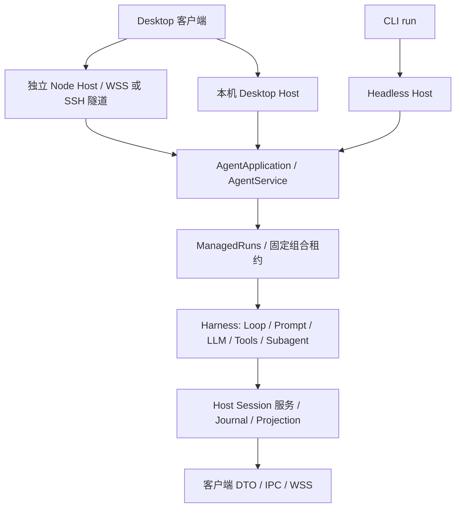

# ActSpace v2 总体架构

状态：2026-10-04 按 P1–P5 源码校准。P4 本机夹具验收已完成；P5 自动化与 Computer Use 分别见 [执行摘要](../../exec-runs/20261003-agent-harness-host-refactor/phase-5-summary.md)，不代表真实云部署或 Provider 验收。

## Host、Harness 与 Run

Host 是稳定承载基底，拥有进程、存储、凭据、连接和生命周期；Harness 是其上独立装配、可以替换的插件组合；Run 是持有固定 Harness 组合的一次执行。三者不是同一个“可自进化对象”。

未来先让 Harness 演进，Host 基底不轻易变更。Loop 也属于可替换组合，但不在任务执行中切换。新 Run 选最新成功启用的组合，旧 Run 保留旧树至结束；同一 Session 可以跨 Run 更新组合，子 Run 独立选择。当前只准备这种环境，不实现自进化工具。

图中的共享节点表示实现复用，不是跨进程共享 live Context。Cordis 是插件化基底；模块化优先，不按包数量判断精简。Patch 产出完整新定义后独立装配，不共享旧插件实例，详见 [Profile/Bundle/Patch](agent-spec-profile-bundle-patch-layering.md)。

## 职责与源码入口

| 模块 | 职责与边界 | 源码 |
| --- | --- | --- |
| CLI 适配器 | 参数、输出/退出、managed Runtime 加载与 Host ports | `apps/cli/src/runtime-v2/{host,host-adapter,host-command}.ts` |
| 独立 Host | 认证、网关、文件、订阅、维护；drain/强停/诊断 | `packages/agent-host/src/{bootstrap,lifecycle}.ts` |
| Desktop Host | Electron、Main-only 凭据、IPC、本机能力与远端连接 | `apps/desktop/src/main/runtime-v2/` |
| Runtime / Boot | Profile composition、可信 codec 发现、Cordis 装配和 shutdown | `packages/runtime/`、`packages/boot/` |
| Harness 控制 | 固定产物、候选验证、授权启用、恢复与选择 | `packages/harness-control/` |
| 应用和调度 | AgentApplication 应用操作、AgentService 任务调度、ManagedRuns 持有运行实例 | `packages/agent-service/`、`packages/runtime/src/harness/managed-runs.ts` |
| 客户端策略 | Desktop 标题/辅助文本；Headless 单次任务/信号/退出 | `packages/desktop-app/`、`packages/headless/` |
| Harness 领域 | Loop、Prompt、Context、LLM、Tools、Compaction、Subagent | 对应独立 package |
| Session | 接纳、持久化、checkpoint、投影 | `packages/session/` 及 Runtime Session controller |
| 固定 renderer | 展示 DTO，提交意图，不执行插件代码 | `apps/desktop/src/renderer/` |
| Browser Bridge | 外部 Go/Chrome Host capability | `browser-bridge/` |

依赖方向为 `Runtime → agent-host`；Host bootstrap 通过注入 `bootRuntime` 获取窄端口，不能反向 import Runtime。Node 端口直接从 `@actspace/agent-host/node-ports` 消费，CLI 不保留空转发层。

## 输入、事件与持久化

输入队列保存内容，消息交付时读取当前模型等配置。运行中不切 Chat/Plan/Agent 模式；同会话下一条独立任务可以改变模式。应用操作、调度与执行有真实职责，不为减少层数而合并。

Cordis 原生事件是唯一插件事件机制：通知 `emit` 不等待观察者，注册处隔离异常；干预用 waterfall/serial；必须完成的动作如 `session.checkpoint.flush()` 用 Service。资源回收对应监听、timer、任务和租约的所有者，不承诺撤销文件或网络已发生的副作用。

Journal 是恢复事实源，Projection、live progress 和 diagnostics 各自分离。`session/event` 的内存接纳通知不等于 fsync；真正持久化由显式 checkpoint 保证。Session Format v1 仍是当前格式，名称中的 v1 不意味着过期。

## 阅读路线与非目标

- [Runtime 与 Composition](agent-target-runtime-architecture.md)：Profile 启动与生命周期。
- [Cordis ABI](agent-spec-cordis-event-abi-and-eventhub-retirement.md)、[Loop surface](agent-spec-agent-loop-cordis-surface.md)：事件与屏障。
- [Host 指南](agent-host-guide.md)：连接、附件与维护。
- [测试策略](agent-testing.md)：包、进程和真实 UI 的证据边界。
- [设计决策](agent-harness-host-refactor-decisions.md)：讨论历史；最新简化结论覆盖共享实例探索。

手机 Web 前端、自进化源码工具、Member/Room/Team、远端终端/Git 后续单独设计。P5 保留设置、凭据、prompts 与远端连接，未执行用户历史重置；不批量删除 tmp、包或用户工作目录。

## 独立 Host 装配与退出

CLI `runtime-v2/host.ts` 保留 managed Runtime 加载、Profile 和模型/工具端口组装；`agent-host/src/bootstrap.ts` 拥有认证、网关、订阅、上传维护与启动失败回收；`lifecycle.ts` 协调状态、诊断、drain 和强停。模块通过 `HostRuntime` 端口连接，不引入 agent-host 到 Runtime 的反向依赖。

正常停止等待任务、子 Run 和后台 shell；强停保留截止退出。上传维护停止调度后等待当前 pass 完成，再释放相关资源。重试 stop 不重复释放。用户命令、WSS/SSH、配置与数据路径不变。

启动、配对和停机命令见[Host 使用指南](agent-host-guide.md)。
