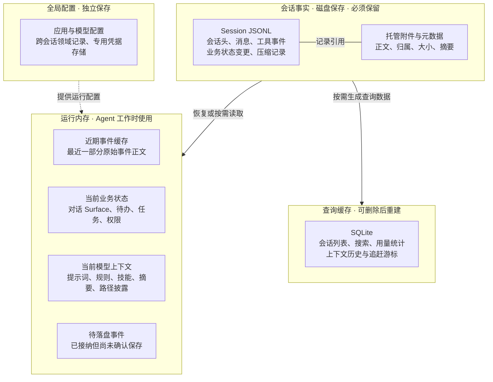
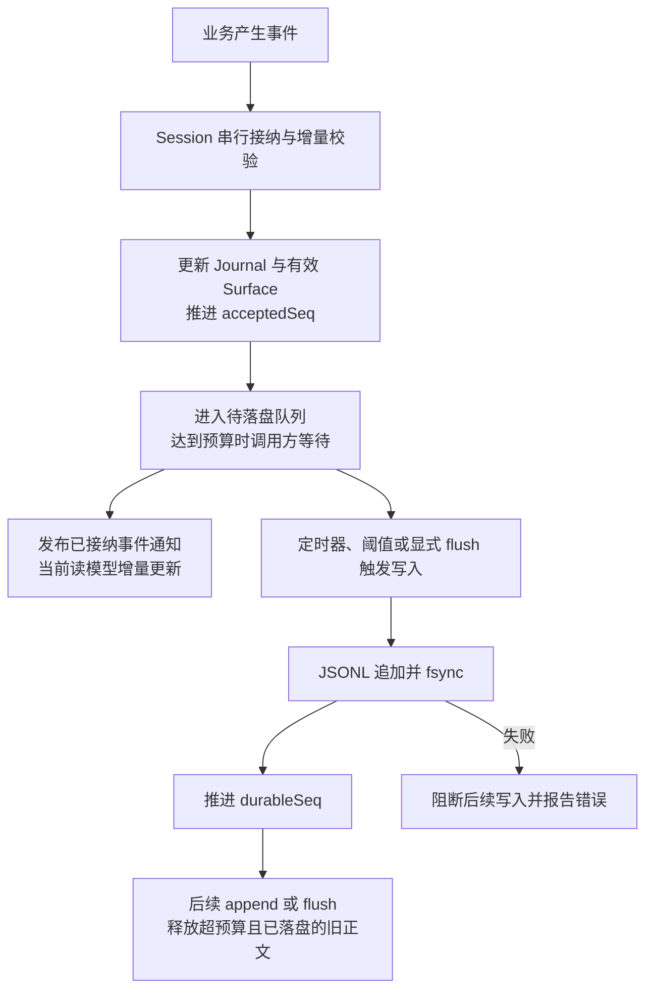
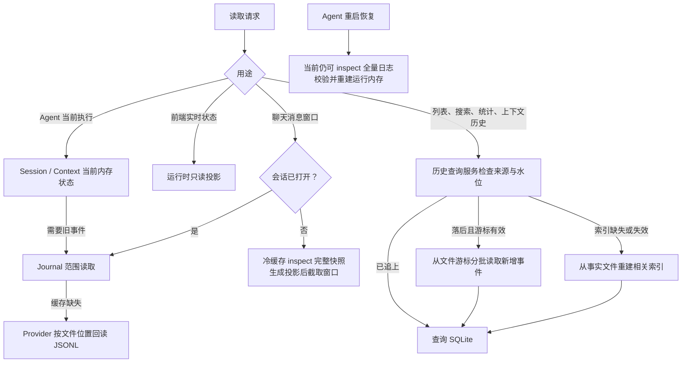

# ActSpace 数据存储结构与职责

状态：2026-10-18 已确认架构，Session 增量写入、近期正文释放与当前状态投影已实施并完成本轮自动化。本文是当前结构入口；模块 API 与资源边界见[存储职责与决策记录](core-data-storage-responsibilities.md)，验证证据见[执行摘要](../exec-runs/20261018-session-storage-refactor/execution-summary.md)。尚未完成的冷读优化与产品级验证单独列明，不以架构确认代替验收。

决策沿革：原讨论确认完整 Session 数据包为事实来源，随后存储重构交由独立任务实施；Context Step 与面板工作并行维护。本文现根据已交付实现更新，原有职责分工不变。

## 结构总览

图只表示存储归属与依赖，不表示每条事件的写入时序。Session 数据包是逻辑边界，附件当前仍位于独立的 `artifacts-v2` 目录。



投影是由事件计算出的状态。例如日志保留“新增待办 A、完成待办 A”，内存保留“A 已完成”。近期事件缓存、当前业务状态、模型 Context 和待落盘队列不是同一份数据，也不能使用同一套淘汰规则。

## 1. 已确认的核心约束

> Session 的 JSON/JSONL 与配套内容构成完整的会话事实来源。运行内存、SQLite 查询索引和投影检查点均为可重建的派生层；清除这些派生数据后，系统仍能从权威数据恢复约定的会话信息，不丢信息、不改变业务含义。

任何属于会话、需要跨重启保留、不能可靠地从已有事实推出的信息，都必须进入 Session 持久记录。SQLite、运行内存和检查点不能拥有独有的持久会话事实。模型执行从内存 Session/Context 取输入，不等待历史索引；必要的 Session 持久化屏障仍然保留。

跨会话业务数据归对应领域的 JSON/JSONL 权威记录，SQLite 同样只承担可重建索引。凭据使用专用凭据存储，不复制进聊天日志。此规则是 ActSpace 选择的目标，不是所有系统或 DeepSeek Harness 都必须遵守的通用规则。

允许临时流式状态和计算中间结果只存在内存；它们不能被标记为已经可靠保存。完整恢复是恢复已确认持久化的业务状态，不保证崩溃前最后一个未提交字符仍在，也不重跑历史工具的外部副作用。

当前实现依据：[存储与可观测性边界](core-storage-and-observability.md)、[Session 持久化契约](agent-plugin-runtime/agent-spec-session-core-persistence-separation.md)、[三类读模型](agent-plugin-runtime/agent-spec-runtime-projection.md)。Step 增量更新、压缩和披露面板决定继续维护在 [07 决策记录](上下文管理引擎设计/上下文管理引擎V2/07-Step增量更新与披露面板决策记录.md)。

## 2. 完整 Session 的边界

完整会话采用以下逻辑边界：

```text
Session 数据包
├── journal.jsonl     结构化会话事实、关联与内容引用
└── artifacts/        引用的图片、附件、大工具输出等正文
```

这是逻辑完整性边界。本轮未搬迁目录，当前 concrete artifact store 位于独立的 `artifacts-v2`。Session 的 JSONL 导出接口不等于包含所有附件的完整备份包；不能只备份日志而遗漏其唯一正文。

结构化事实进入日志，大内容由配套存储承接，日志记录稳定引用及完整性校验信息。需要保留的内容不能只引用可能被清理的临时文件。恢复、复制和分叉都必须覆盖所需内容及归属校验，不能因更换目录或原会话被删除而留下悬空引用。

不要求把用户整个 workspace 复制进 Session。若历史请求或工具结果需要保留某段当时的文件内容，应保存实际使用的内容或受管副本；仅保存路径、hash 或可被删除的外部版本号，不能保证恢复正文。凭据不属于历史请求正文的保留范围。

恢复一个会话需要完整 Session 数据包；恢复整个应用需要所有领域权威记录、受管内容及专用凭据存储。两者均不以 SQLite 查询索引仍然存在为前提。

## 3. 各存储角色

| 角色 | 保存什么 | 能否独有需要恢复的会话事实 | 丢失后的处理 |
| --- | --- | --- | --- |
| Session 日志 | 消息、工具结果、状态变更、请求信息与内容引用 | 可以，是权威来源 | 真实数据损失，需备份保护 |
| Session 配套内容 | 图片、附件、完整大输出等 | 可以，是数据包的一部分 | 真实内容损失，不能当缓存清理 |
| 运行内存 | 当前状态、已加载内容、计算中间结果 | 不可以 | 从权威记录恢复 |
| SQLite 查询索引 | 检索文本、明细、统计、关联、分页索引 | 不可以 | 从权威记录及内容元数据重建 |
| 投影检查点对象 | 某个事件位置的 reducer 状态与版本；当前用于派生缓存，不新增独立 JSON 检查点文件 | 不可以 | 校验后使用；失效则丢弃重算 |

SQLite 可以是历史列表、筛选或统计的主要读取路径，但不能成为任何这些业务事实的唯一保存位置。不允许业务操作绕过权威记录，直接改索引来形成持久状态。

## 4. 哪些事实必须保存

| 类别 | 应保留的事实 | 可以派生的结果 |
| --- | --- | --- |
| 消息 | 用户输入、最终模型回复、需要保留的修改/替换 | 消息数、列表预览 |
| 工具 | 调用 ID、参数、结果、错误、时间与完整内容/附件引用 | 调用次数、累计耗时 |
| 执行过程 | Turn/Step 开始、结束、取消、失败及关联 ID | 当前状态、已完成轮数 |
| 用量 | 请求报告的 Token、费用及来源；估算费用所依据的价格与规则 | 总 Token、按天费用汇总 |
| 模型请求 | 模型身份、实际参数、上下文窗口、恢复与追溯所需的实际输入记录 | 模型使用分布 |
| 上下文管理 | 压缩结果及替换范围、补充内容、披露状态的恢复依据 | 面板统计、趋势、占用估算 |
| 会话功能 | 标题、置顶/归档、模式、待办、目标、委派等变更 | 列表展示、进度展示 |
| 恢复与关联 | 父子关系、分叉关系、已接纳消息的身份 | 关联查询索引 |

此表是完整性核对清单，不代表每项已有事件或接口，也不要求引入尚不存在的产品功能。

上下文状态必须能够由数据包恢复：摘要结果不能靠再次调用模型重新生成；活跃/睡眠路径若依赖不能稳定重算的决策，就记录该决策或状态变化。确定可重算的状态可以只保存输入事实和必要的语义版本，不要求每 Step 重复落一整份 Context。

费用重建不能因当前价格更新而悄悄改变历史账单。需保存当时费用结果或足够的计算依据，并区分 Provider 报告与估算；实际字段待源码审计。

历史请求所用规则、工具定义、模型参数等，不能通过读取今天的配置冒充当时内容。保存范围和编码尚待确定，但不能以此为理由只把唯一证据放在 SQLite。新请求选择旧配置还是新配置是后续运行策略，不改变历史证据的完整性要求。

## 5. 写入：接纳和可靠保存是两个阶段



- `acceptedSeq` 是已接纳水位，`durableSeq` 是可靠保存水位。已接纳通知、实时展示和 append 返回均不能单独当作 fsync 确认；可靠保存由 awaited `flush` 屏障确认。
- 默认写入延迟定时器为 200 ms，队列预算为 128 条 / 256 KiB，显式 flush 可提前触发。背压计入待写和在途批次；200 ms 不是磁盘完成时限，单个大事件或未保存批次可超过预算。
- 涉及托管附件时，先保存正文、元数据并 fsync，再取得引用写入事件。附件成功而日志失败可能留下未引用内容；这不等于已实现通用垃圾回收。
- LLM dispatch、工具执行和后续安全边界继续等待各自持久化屏障；SQLite 不参与这些完成条件，也不会因每条实时事件自动启动索引。
- Journal 校验或 Surface 发布失败回退本次接纳；事件已经接纳后发生持久化失败，则保留失败状态并阻断写入，不能把两种失败都描述成自动撤销业务。

Step 工具批次完成后的 Context 更新与自动压缩见 [07 决策记录](上下文管理引擎设计/上下文管理引擎V2/07-Step增量更新与披露面板决策记录.md)。压缩改变后续模型输入，不删除旧日志；近期正文释放也不会代替模型上下文压缩。

## 6. 读取：执行、实时展示与历史查询分别路由



Agent 执行、上下轮衔接和恢复不查 SQLite。当前前端也不是所有读取都走 SQLite：实时状态取内存，聊天窗口走 Session，列表/搜索/统计/上下文历史走查询服务。Context 面板没有实时实例时，允许显示最近请求并标记 last-request / stale。

查询服务以来源 stamp、codec/投影版本、水位与游标判断追赶或重建。打开的 Session 查询来源以 durableSeq 为上限。索引落后时可返回同步进度或带状态的旧结果，不能冒充完整统计；降级读取有预算限制，不保证任意规模都能立即回退成功。

当前 Journal 文件范围读取是 Host 注入的同步接口；查询索引的 `readEventBatch` 则由 JSONL Worker 分批读取。这是两个不同用途的端口。冷打开、冷会话浏览和全量导出仍可能完整读取日志；本轮没有新增文件检查点，也没有承诺所有读取都是增量或异步。

## 7. 模块分工

职责名称不代表需要新增同名服务或 package。

| 模块 | 职责 |
| --- | --- |
| 业务插件、Context Engine | 定义事实和事件；只更新受影响模块；需要保留的结果提交给 Session |
| session/journal | 接纳、校验、排序与会话语义 |
| session/persistence | 协调写入、持久确认、恢复和分叉 |
| session/storage、session/jsonl | 实际保存/读取、游标、租约及物理恢复 |
| Artifact Store | 内容持久化、完整性、会话归属与引用生命周期 |
| session/projection | 可复用的事实计算规则和投影语义 |
| 投影检查点对象 | 保存与恢复派生状态，不接受独立业务修改；当前没有新增文件写入器 |
| 历史查询服务 | 统一查询契约，选择内存、SQLite 或事实读取路径，报告完整性与进度 |
| SQLite 索引模块 | 查询表、索引及处理水位，不接受业务事实直接写入 |
| 前端 | 调用后端接口，显示结果、版本与同步状态 |

现有 UsageReadModelService 已涉及会话目录、Usage 和 Context 历史。名称与职责是否调整，待审计后决定。内存、SQLite、检查点应共享业务计算语义，避免各自维护一套不一致规则；具体代码复用方式仍待设计。

## 8. 现有实现的核对清单

下列是长期完整性与产品级核对清单。本轮自动化覆盖见执行摘要，不能把已通过的包测试等同于清单全量或真实界面验收：

- SQLite 重建是否保持费用依据、请求去重、历史模型信息和其他业务含义。
- 会话功能是否存在只保存在索引、内存或旁路文件的权威事实。
- Context 的压缩、补充、活跃/睡眠状态是否具有完整恢复依据。
- 内存和历史投影的计算语义是否一致，检查点是否可安全失效重建。
- artifacts-v2 与 Session 日志分离时，完整保存、复制、导出、分叉和恢复是否覆盖所有引用。
- `global-usage-reset.json` 已退役：首次查询不再创建统计起点，旧文件保留但不参与统计。历史请求和 Token 以 Session Journal 为准；SQLite schema 10 重建曾被截断的派生索引，时间范围只在查询时应用。
- 暂存输入、临时输出与正式受管内容的转正、保留和清理边界。
- 无索引、索引落后、损坏及查询预算不足时，是否正确区分未完成和真实空结果。

后续验证应包含：保留权威数据，清空派生数据后重建，比较会话状态、请求证据、历史统计和内容引用；覆盖缺失附件与不兼容检查点。该验证是后续计划，不在本轮操作用户实际数据。

## 9. DeepSeek Harness 的参考作用

证据为本地 tmp/deepseek-harness 的 d743267388，仅静态核对。借鉴它的 Session 持久化、内存投影、派生检查点和查询边界；不据此断言它全部业务存储符合本文的 JSON 权威来源原则。

- session-projection 按事件推进各 unit，未改变的状态可复用引用。
- projection cache 经 storage-domain 保存，cachedSnapshot 从内存表读取；base 配置每 200 事件/5000ms 节流，并有强制写入点。
- 普通冷观察与 Agent resume 仍有 handle.read(0, undefined)；检查点不等于消除了完整日志读取。
- 正常请求从 session.deriveMessages() 读取消息。
- base 默认 openAt: never 关闭 SQLite 全文搜索，精确读取仍可用。
- 通用 storage-domain 可以接 JSON 或 SQLite；ActSpace 本次明确收窄为 JSON/JSONL 等权威来源加可重建 SQLite，不照搬其全部介质自由度。

源码入口详见 [07 决策记录](上下文管理引擎设计/上下文管理引擎V2/07-Step增量更新与披露面板决策记录.md)。

## 10. 交付状态与后续边界

2026-10-18：用户确认四块存储的架构与职责。已完成的增量校验、持久写入背压、已落盘正文释放、当前业务投影和附件 fsync 见[实施计划](../exec-plans/completed/20261018-session-storage-refactor.md)及[执行摘要](../exec-runs/20261018-session-storage-refactor/execution-summary.md)。

- Journal 默认近期正文预算为 512 条 / 4 MiB，只释放 durable 前缀；无历史回读能力的临时或内存后端不能丢掉唯一事实。
- 4 MiB 不是进程内存上限。当前 Surface、业务记录、去重 ID、文件位置索引和工具视图仍有各自开销。
- 冷恢复、冷会话分页、显式导出仍可全量加载；新文件检查点、物理分段和附件目录迁移均未实施。
- 完整附件备份/通用垃圾回收、全应用事实字段审计及真实 Provider、Electron、断电验证不因本轮存储测试通过而自动视为完成。

后续优化应根据冷读和恢复测量另行确定，不能修改“Agent 不依赖 SQLite、Session 文件与附件保存完整事实”的边界。
