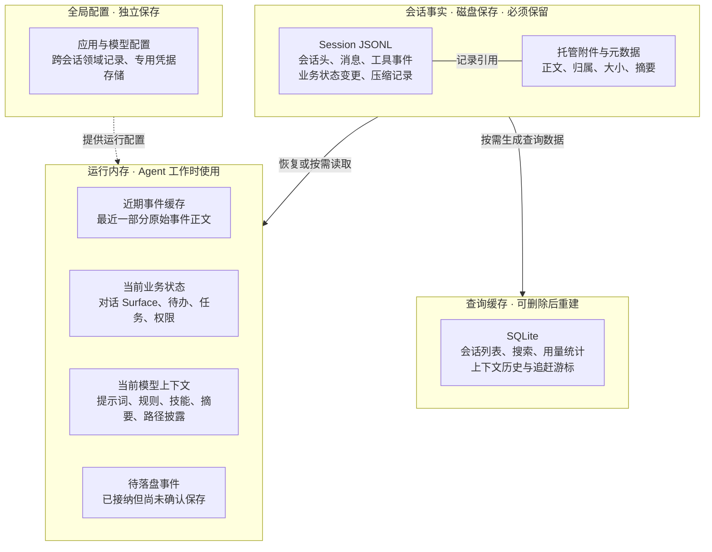
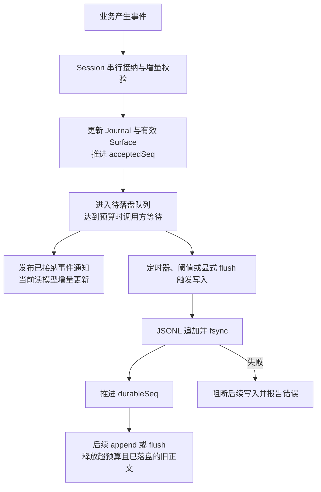
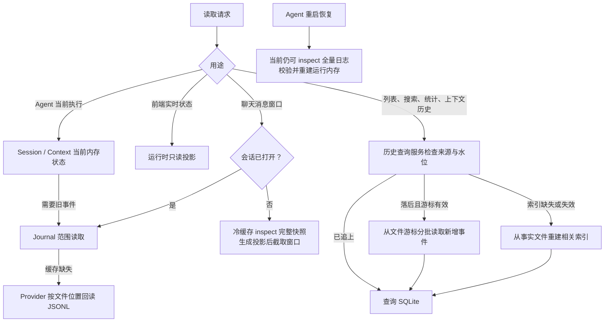
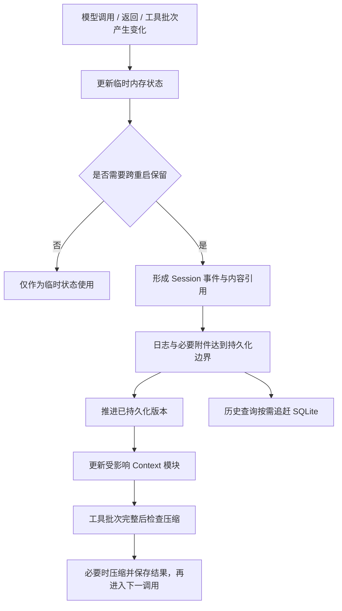
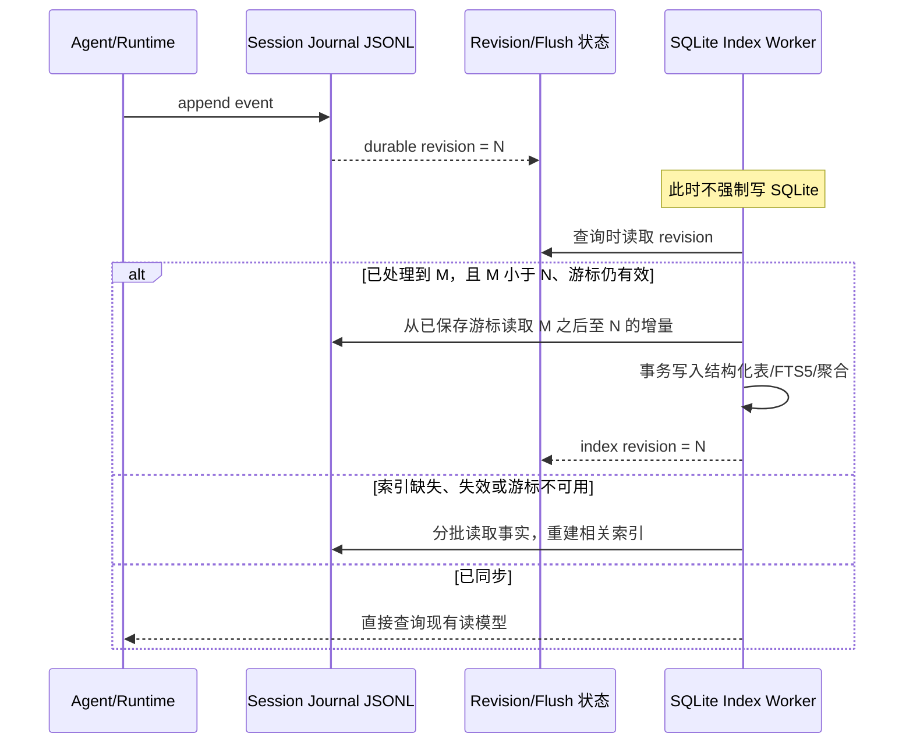
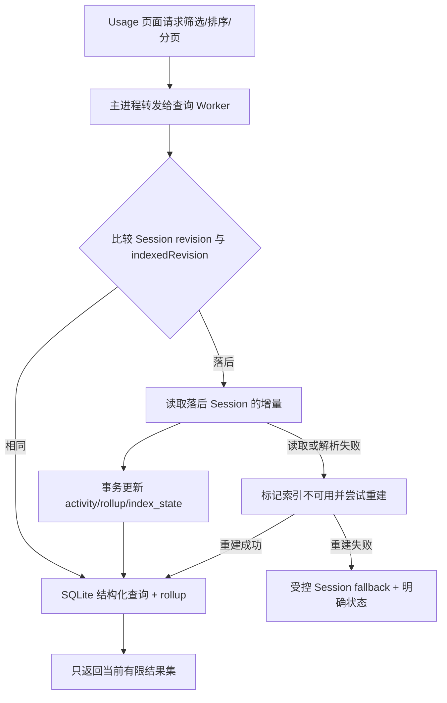
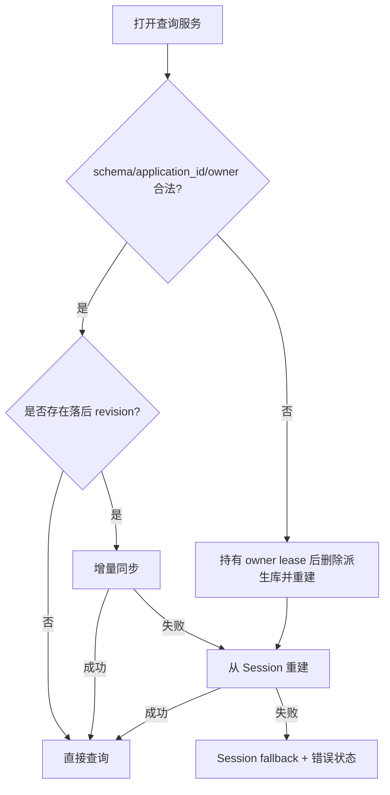
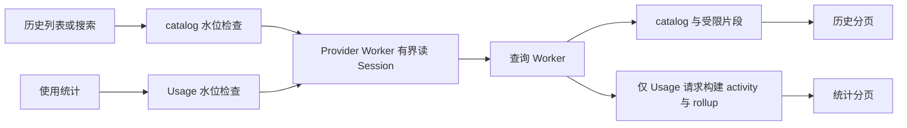
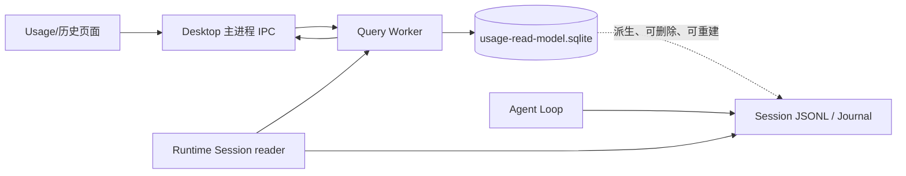
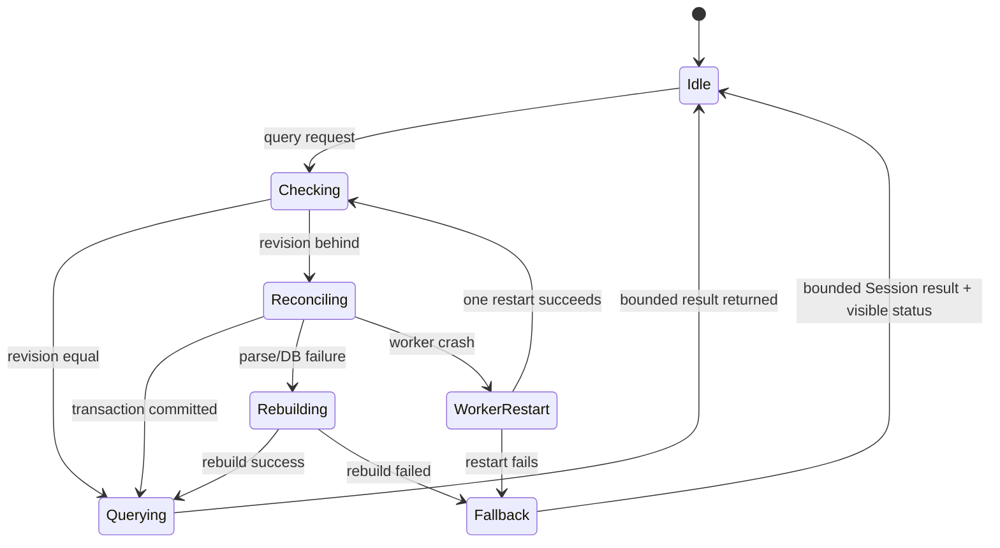

# ActSpace 数据存储结构与职责

本文是存储归属、读写路由与资源边界的现行设计。验证证据见[执行摘要](../exec-runs/20261018-session-storage-refactor/execution-summary.md)与[实施计划](../exec-plans/completed/20261018-session-storage-refactor.md)；决策依据（Q1–Q14）、运行态实现落点、SQLite 查询读模型与查询 Worker 见本文第 11–16 节。冷读优化与产品级验证单独列明，不以架构确认代替验收。

## 结构总览

图只表示存储归属与依赖，不表示每条事件的写入时序。Session 数据包是逻辑边界，附件当前仍位于独立的 `artifacts-v2` 目录。



投影是由事件计算出的状态。例如日志保留“新增待办 A、完成待办 A”，内存保留“A 已完成”。近期事件缓存、当前业务状态、模型 Context 和待落盘队列不是同一份数据，也不能使用同一套淘汰规则。

## 1. 核心约束

> Session 的 JSON/JSONL 与配套内容构成完整的会话事实来源。运行内存、SQLite 查询索引和投影检查点均为可重建的派生层；清除这些派生数据后，系统仍能从权威数据恢复约定的会话信息，不丢信息、不改变业务含义。

任何属于会话、需要跨重启保留、不能可靠地从已有事实推出的信息，都必须进入 Session 持久记录。SQLite、运行内存和检查点不能拥有独有的持久会话事实。模型执行从内存 Session/Context 取输入，不等待历史索引；必要的 Session 持久化屏障仍然保留。

跨会话业务数据归对应领域的 JSON/JSONL 权威记录，SQLite 同样只承担可重建索引。凭据使用专用凭据存储，不复制进聊天日志。此规则是 ActSpace 选择的目标，不是所有系统或 DeepSeek Harness 都必须遵守的通用规则。

允许临时流式状态和计算中间结果只存在内存；它们不能被标记为已经可靠保存。完整恢复是恢复已确认持久化的业务状态，不保证崩溃前最后一个未提交字符仍在，也不重跑历史工具的外部副作用。

当前实现依据：[存储与可观测性边界](core-storage-and-observability.md)、[Session 持久化契约](agent-plugin-runtime/agent-spec-session-core-persistence-separation.md)、[三类读模型](agent-plugin-runtime/agent-spec-runtime-projection.md)。Step 增量更新、压缩和披露面板决定继续维护在 [07 决策记录](上下文管理引擎设计/上下文管理引擎V2/07-Step增量更新与披露面板决策记录.md)。

## 2. 完整 Session 的边界

完整会话采用以下逻辑边界：

```text
Session 数据包
├── journal.jsonl     结构化会话事实、关联与内容引用
└── artifacts/        引用的图片、附件、大工具输出等正文
```

这是逻辑完整性边界。本轮未搬迁目录，当前 concrete artifact store 位于独立的 `artifacts-v2`。Session 的 JSONL 导出接口不等于包含所有附件的完整备份包；不能只备份日志而遗漏其唯一正文。

结构化事实进入日志，大内容由配套存储承接，日志记录稳定引用及完整性校验信息。需要保留的内容不能只引用可能被清理的临时文件。恢复、复制和分叉都必须覆盖所需内容及归属校验，不能因更换目录或原会话被删除而留下悬空引用。

不要求把用户整个 workspace 复制进 Session。若历史请求或工具结果需要保留某段当时的文件内容，应保存实际使用的内容或受管副本；仅保存路径、hash 或可被删除的外部版本号，不能保证恢复正文。凭据不属于历史请求正文的保留范围。

恢复一个会话需要完整 Session 数据包；恢复整个应用需要所有领域权威记录、受管内容及专用凭据存储。两者均不以 SQLite 查询索引仍然存在为前提。

## 3. 各存储角色

| 角色 | 保存什么 | 能否独有需要恢复的会话事实 | 丢失后的处理 |
| --- | --- | --- | --- |
| Session 日志 | 消息、工具结果、状态变更、请求信息与内容引用 | 可以，是权威来源 | 真实数据损失，需备份保护 |
| Session 配套内容 | 图片、附件、完整大输出等 | 可以，是数据包的一部分 | 真实内容损失，不能当缓存清理 |
| 运行内存 | 当前状态、已加载内容、计算中间结果 | 不可以 | 从权威记录恢复 |
| SQLite 查询索引 | 检索文本、明细、统计、关联、分页索引 | 不可以 | 从权威记录及内容元数据重建 |
| 投影检查点对象 | 某个事件位置的 reducer 状态与版本；当前用于派生缓存，不新增独立 JSON 检查点文件 | 不可以 | 校验后使用；失效则丢弃重算 |

SQLite 可以是历史列表、筛选或统计的主要读取路径，但不能成为任何这些业务事实的唯一保存位置。不允许业务操作绕过权威记录，直接改索引来形成持久状态。

## 4. 哪些事实必须保存

| 类别 | 应保留的事实 | 可以派生的结果 |
| --- | --- | --- |
| 消息 | 用户输入、最终模型回复、需要保留的修改/替换 | 消息数、列表预览 |
| 工具 | 调用 ID、参数、结果、错误、时间与完整内容/附件引用 | 调用次数、累计耗时 |
| 执行过程 | Turn/Step 开始、结束、取消、失败及关联 ID | 当前状态、已完成轮数 |
| 用量 | 请求报告的 Token、费用及来源；估算费用所依据的价格与规则 | 总 Token、按天费用汇总 |
| 模型请求 | 模型身份、实际参数、上下文窗口、恢复与追溯所需的实际输入记录 | 模型使用分布 |
| 上下文管理 | 压缩结果及替换范围、补充内容、披露状态的恢复依据 | 面板统计、趋势、占用估算 |
| 会话功能 | 标题、置顶/归档、模式、待办、目标、委派等变更 | 列表展示、进度展示 |
| 恢复与关联 | 父子关系、分叉关系、已接纳消息的身份 | 关联查询索引 |

此表是完整性核对清单，不代表每项已有事件或接口，也不要求引入尚不存在的产品功能。

上下文状态必须能够由数据包恢复：摘要结果不能靠再次调用模型重新生成；活跃/睡眠路径若依赖不能稳定重算的决策，就记录该决策或状态变化。确定可重算的状态可以只保存输入事实和必要的语义版本，不要求每 Step 重复落一整份 Context。

费用重建不能因当前价格更新而悄悄改变历史账单。需保存当时费用结果或足够的计算依据，并区分 Provider 报告与估算；实际字段待源码审计。

历史请求所用规则、工具定义、模型参数等，不能通过读取今天的配置冒充当时内容。保存范围和编码尚待确定，但不能以此为理由只把唯一证据放在 SQLite。新请求选择旧配置还是新配置是后续运行策略，不改变历史证据的完整性要求。

## 5. 写入：接纳和可靠保存是两个阶段



- `acceptedSeq` 是已接纳水位，`durableSeq` 是可靠保存水位。已接纳通知、实时展示和 append 返回均不能单独当作 fsync 确认；可靠保存由 awaited `flush` 屏障确认。
- 默认写入延迟定时器为 200 ms，队列预算为 128 条 / 256 KiB，显式 flush 可提前触发。背压计入待写和在途批次；200 ms 不是磁盘完成时限，单个大事件或未保存批次可超过预算。
- 涉及托管附件时，先保存正文、元数据并 fsync，再取得引用写入事件。附件成功而日志失败可能留下未引用内容；这不等于已实现通用垃圾回收。
- LLM dispatch、工具执行和后续安全边界继续等待各自持久化屏障；SQLite 不参与这些完成条件，也不会因每条实时事件自动启动索引。
- Journal 校验或 Surface 发布失败回退本次接纳；事件已经接纳后发生持久化失败，则保留失败状态并阻断写入，不能把两种失败都描述成自动撤销业务。

Step 工具批次完成后的 Context 更新与自动压缩见 [07 决策记录](上下文管理引擎设计/上下文管理引擎V2/07-Step增量更新与披露面板决策记录.md)。压缩改变后续模型输入，不删除旧日志；近期正文释放也不会代替模型上下文压缩。

## 6. 读取：执行、实时展示与历史查询分别路由



Agent 执行、上下轮衔接和恢复不查 SQLite。当前前端也不是所有读取都走 SQLite：实时状态取内存，聊天窗口走 Session，列表/搜索/统计/上下文历史走查询服务。Context 面板没有实时实例时，允许显示最近请求并标记 last-request / stale。

查询服务以来源 stamp、codec/投影版本、水位与游标判断追赶或重建。打开的 Session 查询来源以 durableSeq 为上限。索引落后时可返回同步进度或带状态的旧结果，不能冒充完整统计；降级读取有预算限制，不保证任意规模都能立即回退成功。

当前 Journal 文件范围读取是 Host 注入的同步接口；查询索引的 `readEventBatch` 则由 JSONL Worker 分批读取。这是两个不同用途的端口。冷打开、冷会话浏览和全量导出仍可能完整读取日志；本轮没有新增文件检查点，也没有承诺所有读取都是增量或异步。

## 7. 模块分工

职责名称不代表需要新增同名服务或 package。

| 模块 | 职责 |
| --- | --- |
| 业务插件、Context Engine | 定义事实和事件；只更新受影响模块；需要保留的结果提交给 Session |
| session/journal | 接纳、校验、排序与会话语义 |
| session/persistence | 协调写入、持久确认、恢复和分叉 |
| session/storage、session/jsonl | 实际保存/读取、游标、租约及物理恢复 |
| Artifact Store | 内容持久化、完整性、会话归属与引用生命周期 |
| session/projection | 可复用的事实计算规则和投影语义 |
| 投影检查点对象 | 保存与恢复派生状态，不接受独立业务修改；当前没有新增文件写入器 |
| 历史查询服务 | 统一查询契约，选择内存、SQLite 或事实读取路径，报告完整性与进度 |
| SQLite 索引模块 | 查询表、索引及处理水位，不接受业务事实直接写入 |
| 前端 | 调用后端接口，显示结果、版本与同步状态 |

现有 UsageReadModelService 已涉及会话目录、Usage 和 Context 历史。名称与职责是否调整，待审计后决定。内存、SQLite、检查点应共享业务计算语义，避免各自维护一套不一致规则；具体代码复用方式仍待设计。

## 8. 现有实现的核对清单

下列是长期完整性与产品级核对清单。本轮自动化覆盖见执行摘要，不能把已通过的包测试等同于清单全量或真实界面验收：

- SQLite 重建是否保持费用依据、请求去重、历史模型信息和其他业务含义。
- 会话功能是否存在只保存在索引、内存或旁路文件的权威事实。
- Context 的压缩、补充、活跃/睡眠状态是否具有完整恢复依据。
- 内存和历史投影的计算语义是否一致，检查点是否可安全失效重建。
- artifacts-v2 与 Session 日志分离时，完整保存、复制、导出、分叉和恢复是否覆盖所有引用。
- `global-usage-reset.json` 已退役：首次查询不再创建统计起点，旧文件保留但不参与统计。历史请求和 Token 以 Session Journal 为准；SQLite schema 10 重建曾被截断的派生索引，时间范围只在查询时应用。
- 暂存输入、临时输出与正式受管内容的转正、保留和清理边界。
- 无索引、索引落后、损坏及查询预算不足时，是否正确区分未完成和真实空结果。

后续验证应包含：保留权威数据，清空派生数据后重建，比较会话状态、请求证据、历史统计和内容引用；覆盖缺失附件与不兼容检查点。该验证是后续计划，不在本轮操作用户实际数据。

## 9. DeepSeek Harness 的参考作用

以下为外部参考快照（DeepSeek Harness 仓库提交 d743267388，仅静态核对，不在本仓库内；本地曾克隆到 `tmp/deepseek-harness`，该目录被 gitignore，新克隆没有）。借鉴它的 Session 持久化、内存投影、派生检查点和查询边界；不据此断言它全部业务存储符合本文的 JSON 权威来源原则。

- session-projection 按事件推进各 unit，未改变的状态可复用引用。
- projection cache 经 storage-domain 保存，cachedSnapshot 从内存表读取；base 配置每 200 事件/5000ms 节流，并有强制写入点。
- 普通冷观察与 Agent resume 仍有 handle.read(0, undefined)；检查点不等于消除了完整日志读取。
- 正常请求从 session.deriveMessages() 读取消息。
- base 默认 openAt: never 关闭 SQLite 全文搜索，精确读取仍可用。
- 通用 storage-domain 可以接 JSON 或 SQLite；ActSpace 本次明确收窄为 JSON/JSONL 等权威来源加可重建 SQLite，不照搬其全部介质自由度。

源码入口详见 [07 决策记录](上下文管理引擎设计/上下文管理引擎V2/07-Step增量更新与披露面板决策记录.md)。

## 10. 交付边界

已完成的增量校验、持久写入背压、已落盘正文释放、当前业务投影和附件 fsync 见[实施计划](../exec-plans/completed/20261018-session-storage-refactor.md)及[执行摘要](../exec-runs/20261018-session-storage-refactor/execution-summary.md)。

- Journal 默认近期正文预算为 512 条 / 4 MiB，只释放 durable 前缀；无历史回读能力的临时或内存后端不能丢掉唯一事实。
- 4 MiB 不是进程内存上限。当前 Surface、业务记录、去重 ID、文件位置索引和工具视图仍有各自开销。
- 冷恢复、冷会话分页、显式导出仍可全量加载；新文件检查点、物理分段和附件目录迁移均未实施。
- 完整附件备份/通用垃圾回收、全应用事实字段审计及真实 Provider、Electron、断电验证不因本轮存储测试通过而自动视为完成。

后续优化应根据冷读和恢复测量另行确定，不能修改“Agent 不依赖 SQLite、Session 文件与附件保存完整事实”的边界。

## 11. 每轮变化：计算位置与持久化位置分别决定

“内存能不能处理”是资源问题，“重启后需不需要恢复”是持久化问题。内存计算便宜，并不意味着可恢复状态可以只保存在内存。

| 状态 | 计算/使用位置 | 持久依据 |
| --- | --- | --- |
| 流式回复草稿、临时 UI 进度 | 内存 | Q3：不承诺逐字符恢复；未提交部分不能宣称已保存 |
| 最终模型回复、工具结果 | 内存参与后续模型输入 | Session 事件及必要附件 |
| 请求身份、模型参数、用量、结束原因 | 内存推进执行和实时展示 | Session 事件；历史费用应有稳定依据 |
| 待办、目标、模式、会话级设置 | 内存中的业务投影 | Session 状态变更事件 |
| 活跃/睡眠路径、压缩替换与补充内容 | Context 内存状态 | 足以重建的事件、决策与内容引用 |
| 累计 Token、轮数、耗时 | 统一规则计算；实时可在内存累计 | 原始事件可重算；SQLite 保存查询结果 |
| 历史搜索、跨会话分页、大规模聚合 | 历史查询服务 | SQLite 派生结果及来源水位；原始事实仍在日志 |



图不要求每个字符单独落盘；具体确认时机见第 12 节 Q4；工具外部副作用还需要 Q10 的恢复规则。

## 12. 决策记录 Q1–Q14

本表保留各决策的原建议措辞作为依据。其中“需确认/另定”的扩展能力不等于已实现；具体代码落点、资源边界和验证结果见第 14 节。

| 编号 | 决策问题 | 已接受方向及原讨论依据 |
| --- | --- | --- |
| Q1 | “内存处理不了就用 SQLite”是否允许 Agent 内部执行读 SQL？ | 保持执行链路不依赖 SQLite。大历史通过分批日志读取、内存淘汰与文件检查点解决；SQLite 承担产品历史查询的大计算。若要例外，必须明确调用范围及无 SQLite 时的行为。 |
| Q2 | “业务设置用 Session”是否包含用户全局设置？ | 会话设置如模式、目标、模型覆盖进入 Session；应用默认模型、工作区登记、跨会话任务等保存为独立领域 JSON/JSONL。会话记录实际使用的有效配置，凭据仍走专用存储。不要把全局设置绑在某个偶然会话上。 |
| Q3 | 完整恢复需要保留最终结果，还是每个流式片段和历史请求精确正文？ | 建议保留已接受消息、最终结果、工具完整输出、失败/重试的必要事实和实际请求内容依据；逐字符流式片段默认不保证。历史还原目标是还原已保存输入输出与状态，不保证外部模型再次调用得到相同结果。精确请求范围需确认。 |
| Q4 | 用户消息何时算发送成功？落盘失败后还能否进入下一步？ | 区分已接纳和已保存。可可靠恢复的发送确认应在持久化后；持久化失败不进入依赖该事实的下一步，可展示未保存草稿并重试。流式输出可批量提交，频率通过测量确定。 |
| Q5 | 修改会话设置或全局默认值，在当前 Step、下一 Step 还是下一 Turn 生效？ | 当前在途请求固定配置，后续请求按明确规则生效并记录实际选择；安全相关撤销单独定义及时生效规则。会话覆盖优先于全局默认，历史记录不随今日默认改变。 |
| Q6 | JSON 投影检查点现在启用，还是仅预留？保存什么？ | 先统一检查点契约与兼容校验，是否启用及阈值由冷恢复测量决定。需要备用加速就必须实际写入；只预留接口不提供恢复收益。执行恢复所需检查点不能只能从 SQLite 取得。 |
| Q7 | Context 已压缩、前端历史已走 SQLite 后，运行时是否仍随完整历史增长？ | 结论：先消除全量重复校验和计算，再释放已持久化旧事件正文；保留当前状态、未完成事务和近期窗口，完整历史通过文件范围读取。模型 Context 压缩独立；不改变日志格式、分段或删除历史。 |
| Q8 | 前端能否先显示落后的历史统计？ | 可以，但标明统计截至位置、同步中、部分结果或失败；新产生的内容由实时投影显示。SQLite 不可用时有界降级或重建，不能返回伪完整的零值。 |
| Q9 | 附件共享、分叉、导出、删除如何保持完整？ | 保证逻辑数据包闭合，可使用独立存储加引用收集；分叉不能因父会话删除丢内容。暂存转正式后才写可靠引用；垃圾回收需识别所有有效引用和在途写入。具体去重/复制与物理目录另定。 |
| Q10 | 工具已执行但结果未落盘，重启后如何处理？ | 记录调用身份及可恢复状态；恢复历史不自动重放外部副作用。不确定的调用明确标记，由工具按幂等查询、补结果或人工处理恢复，不能默认再执行一次。 |
| Q11 | Agent 能否显式调用“搜索历史会话”工具，间接使用 SQLite？ | 作为可选工具可以单独讨论；必须区分工具能力失败与核心执行失败。保守基线暂不新增此例外，也不让工具索引结果自动成为下一轮的完整会话来源。 |
| Q12 | 跨会话操作、父子会话、全局任务由谁拥有事实？ | 每项事实确定一个所有者，其他地方保存稳定引用。跨领域操作记录操作 ID 和恢复依据，不以两处独立写成功作为隐含原子性保证；避免为了全局查询把可变事实复制到每个 Session。 |
| Q13 | 旧版本日志、缺失附件、索引独有旧数据如何迁移？ | 先审计和备份，显式版本化；无法恢复的信息标为缺失，不编造历史。只有确认无独有事实后才允许丢弃旧索引。损坏日志与损坏缓存分别处理。 |
| Q14 | 哪些文件进入完整备份？哪些可以清理？ | 全应用备份包括 Session 数据包、全局领域记录、专用凭据和必要装配记录；SQLite 与检查点可排除。删除、保留期限和脱敏分别定义，不能把带正文的派生缓存当作不存在隐私内容。 |

### Q7 澄清：压缩、历史查询与运行时成本是不同问题

Q7 的出发点：模型 Context 由压缩控制，前端历史由 SQLite 查询，统计应增量，因此需要说明剩余问题。这个目标分工成立，但不能据此判定当前实现的全部运行成本已与历史长度无关。

| 对象 | 随历史增长意味着什么 | 本项是否要求新设计 |
| --- | --- | --- |
| 模型实际 Context | 压缩后只使用保留内容与摘要，不等于完整日志 | 不另设计一套；沿用已确认的 Step 安全点压缩方向 |
| 前端历史 | SQLite 可加速分页/筛选；接口分页与前端渲染范围仍需正确实现 | 沿用历史查询方向，不把 SQLite 当无限量前端渲染的替代品 |
| 磁盘 Journal | 完整历史随事件追加增长，即使旧内容不再进入模型 Context | 正常保留事实；本项不提出删日志或强制分段 |
| 运行时全量事件与计算辅助状态 | 即便模型只用小 Context，程序可能仍保留并扫描完整历史 | 这是本项真正需要审计和测量的范围 |

实施前的静态证据（以下描述保留作为问题来源，不再代表重构后实现）：

- `packages/session/session-journal/src/journal.ts` 的 `#events` 保留事件数组，与 `#surface` 分开。`append()` 构造 `nextEvents = [...this.#events, event]`，调用全量 `validateSessionEvents` 并计算有效事件；`events` getter 还复制一次数组。数组复制不表示每次深拷贝全部历史正文，但仍随事件数量增加引用复制与遍历工作。
- `packages/session/session-journal/src/invariant-validator.ts` 的 `validateSessionEvents()` 遍历所给事件序列。把前端查询迁至 SQLite 不会自动消除这一执行写入路径成本。
- `packages/session/session-projection/src/facts.ts` 的用量总数使用增量替换公式，但 `selected` 保存按请求记录、`requests` 保存关联；更新中存在对象展开和 `Object.values(selected).some(...)`。因此“总数增量”不等于“所有中间状态和每次更新都固定成本”。
- `packages/core/runtime/src/session/session-controller.ts` 已对 live model 应用水位后的事件，但读取 `journal.events` 的数组复制和 Journal 自身成本仍独立存在。

这些是代码形态证据，不是性能测量；尚未证明在用户当前数据规模下构成可感知瓶颈。

建议把 Q7 收窄为：保持 Context 压缩、SQLite 历史查询和完整 JSONL 事实源；另行测量长会话的运行时内存、每次追加/校验、统计辅助状态与冷恢复成本。根据证据决定是否做增量校验、受控历史保留或按需恢复，不提前批准新文件格式、分段和迁移。Q7 已确认并实施，结果见第 14 节。

## 13. 产品级完整性核对与验收边界

增量运行态重构已完成，自动化证据见[执行摘要](../exec-runs/20261018-session-storage-refactor/execution-summary.md)。更广的产品级核对仍按事实清单推进：业务字段 → 唯一写入者 → JSON/JSONL 事件或领域记录 → 所需正文 → 内存计算 → 可选 SQLite 投影 → 恢复方式。

下列是完整性验收目标，不能全部标记为本轮已验证，也不授权操作真实用户数据：

- 禁用 SQLite 后，Agent 可以创建、恢复并继续执行会话；正常上下轮读取不会访问 SQL。
- 仅保留权威文件和受管内容，重新建立内存、索引、检查点后，状态和历史查询含义一致。
- SQL 延迟/失败只影响历史查询，不吞掉已保存消息，不阻塞无关执行。
- 检查点失效、日志损坏、附件缺失分别有明确行为。
- 中途崩溃不导致重复工具副作用、错误发送确认或分叉附件丢失。
- 使用当前配置重建旧数据时，不改变历史模型、费用及请求证据。

当前实现未新增数据库或文件检查点写入器，也未移动附件目录。真实 Provider、Electron 和断电验证未执行；已验证项及剩余限制以执行摘要为准。

## 14. 运行态实现落点与边界

| 模块 | 当前职责与实现 |
| --- | --- |
| Journal | `SessionEventValidator` 增量校验；失败只撤回触及的关系、事务与 seq；Surface 在事务完整后更新。普通追加不重放旧事件。去重 ID 保留，已结束 request/tool/inbox 的过程记录释放。 |
| JSONL provider | 文件仍为原 `journal.jsonl`；物理句柄不常驻全量正文，也不在每批追加重编码全历史。`JsonlEventHistory` 保留字节位置，用固定 fd 回读范围；索引不另存权威数据文件。 |
| Session Persistence | accepted 与 durable 分离。默认 200 ms 延迟定时器、128 事件 / 256 KiB 写入预算，生产者等待慢磁盘；失败保留 blocked 状态。达到 durable 边界后允许 Journal 释放旧正文。 |
| Journal 近期窗口 | 默认最多 512 条、序列化正文预算 4 MiB；仅淘汰 durable 前缀。未保存事件及校验器里的未完成事务仍保留；临时 Session 或没有历史读取能力的 provider 不丢弃唯一事实。 |
| 当前业务状态 | `journal.project()` 首次分批重放，此后只处理水位后事件。Inbox、Todo、Workspace、权限和消息去重采用当前投影；Task 更新从已有快照归并新增事件。 |
| Context | Reducer / Disclosure 按序号范围迭代；Supplements 缓存当前状态并保留重锚需要的最后持久版本。压缩摘要从当前 Surface 定位，无需每 Step 扫全部历史。 |
| Runtime Projection | 完成定义注册后 `seal()`，不留第二份完整重放正文；仅保留 512 条事件指纹用于重复投递核对，超出证明范围明确要求 resync。未完成投影事务仍留存。 |
| 实时统计 | `providerUsage` stateVersion=2；Step 结束后释放请求关联与用量纠正缓存，总量留存；已知费用计数增量维护，零费用与未知费用不混淆。旧 checkpoint 不匹配时重建。 |
| 前端查询 | 保留现有 SQLite 查询协议。`flush` 不再主动全量重建冷历史缓存；实时数据来自 live model；打开会话的窗口从 Journal 按范围读取，冷缓存仍全量 inspect 后分页。SQLite 查询时按来源水位追赶，实时事件不强制触发索引。 |
| 附件 | 保留 `artifacts-v2` 布局、归属和摘要校验；Desktop 与 Node 都在返回可靠引用前 fsync 正文、元数据和目录。已有 fork 复制/重写协议继续使用。 |

### 历史读取契约

- `readEvents(start, end)` 是显式、可能触发文件 I/O 的完整范围读取，end 不包含在范围内；缺失或不匹配报错，不把近期窗口伪装成完整历史。
- `iterateEvents()` 每批最多 128 条，供冷初始化或增量调用方使用；Host 文件读取每页约 256 KiB，单个大事件可以超过页预算。
- `eventsAfter()` 返回指定水位后的事件；`latestEvent()` 使用事件类型的轻量 seq 索引。旧 `events` getter 仅作兼容完整读取，生产热路径已迁移。
- JSONL 回读目前是 Host 注入的同步范围读取，避免改写现有同步业务接口；频繁当前状态使用内存投影，冷恢复/显式历史读取可能占用 Host 线程。不能宣称这是异步流式冷启动。

### 不应夸大的结论

4 MiB 约束的是近期事件的序列化正文，不是 JS heap 或进程总内存。当前 Surface、业务记录、去重 ID、字节索引和前端工具视图仍可能随有效业务规模增长。未启用压缩时，Surface 自然也会增长。显式全量导出/检查、现有冷打开 `inspect()` 仍可临时加载完整日志。当前没有增加文件投影检查点，也没有改变物理日志格式或保证所有历史操作 O(1)。

十万条普通事件验证覆盖增量校验次数、文件完整回读、近期正文上限、关闭重开和 seq 连续性；它不是十万次真实模型/工具调用的内存基准。具体命令与结果见执行摘要。

## 15. SQLite 查询读模型

### 要解决的问题

使用统计、历史搜索和过去会话查询最终可能面对百万行甚至千万行数据。改版前的实现以 JSON 数据为基础，在分页请求时会重新扫描、过滤、排序和聚合全部候选行，再截取当前页。分页只减少 IPC 返回量，没有减少计算量，因此数据增长后会出现 CPU、内存和响应时间一起上升的问题。

目标是同时保留两件事：

- Session 文件仍然是用户可以检查、备份、迁移和恢复的可读事实源。
- SQLite 只承担可重建的查询读模型，让筛选、排序、分页、全文搜索和聚合不再扫描完整 JSON。

这不是把 Session 迁移成 SQLite，也不是维护两份独立事实。SQLite 丢失时，系统可以从 Session 重建。

### 核心决策

整体存储归属见本文前 10 节。本节只说明查询加速，不代表所有前端读取都经过 SQLite；实时状态与聊天窗口路径见第 6 节。

#### 事实层与查询层

```text
sessions-v2/<session-id>/journal.jsonl       <- 结构化会话事实，可读、可重放
artifacts-v2/                              <- 被 Session 引用的正式正文与元数据
runtime-v2/usage-read-model.sqlite           <- 派生查询索引，可删除、可重建
```

Session Journal 继续负责 Agent Loop、恢复、上下文、轨迹详情和持久化语义。SQLite 保存用于查询的结构化字段、聚合结果、搜索文档和每个 Session 的同步水位。

SQLite 文件不可直接当作 JSON 打开，这是数据库文件的正常属性；用户仍可直接查看原始 JSONL。为了保持可理解性，系统还应提供导出 JSONL、索引状态和重建入口，不能让 SQLite 成为唯一可解释的副本。

#### 写入不是应用层双写

每条事件只由 Session 持久化路径写入一次。写入成功后，Session 暴露持久化 revision 或单调递增的事件水位。SQLite 索引在查询触发时观察这个水位，发现落后才读取新增或变化的 Session 内容，并在一个 SQLite 事务中提交索引更新。

因此，写入路径是：



这样做的关键收益是：没有查询者时不做索引计算；Agent 写入也不需要等待第二份存储完成。代价是第一次打开使用统计或历史搜索时可能触发同步，由 Worker 分批处理。游标有效时只读取落后的部分；索引缺失、版本变化或游标失效时，需要重建相关索引。

#### Revision 与水位

每个 Session 至少需要两个可比较的值：

- `sessionRevision`：Session 已经 durable 的最新 revision。
- `indexedRevision`：SQLite 已经提交到的最新 revision。

查询开始时比较二者。相等表示索引可用；不相等表示需要同步。同步提交成功后，才推进 `indexedRevision`。如果进程在事务中断，水位不会提前推进，下次仍会从安全位置重试。

Revision 不是另一套事件事实，也不是“索引版本替代 Session 版本”。它只是判断派生读模型是否落后的水位。若某类旧 Session 没有可靠 revision，索引器必须退回到保守的文件元数据/内容校验，并在无法确认时重建该 Session 的索引。

### 各个读取场景的归属

| 场景 | 首选来源 | 说明 |
| --- | --- | --- |
| Agent Loop、恢复、上下文组装 | Session | 保持后端语义不变，不能因为 UI 索引损坏影响 Agent 运行 |
| 使用统计页面 | SQLite | 结构化筛选、排序、分页、聚合；查询前按 revision 懒同步 |
| 历史搜索、查询过去会话 | SQLite + FTS5 | 先返回匹配的 Session 摘要和游标；选中某个会话后再从 Session 读取详情 |
| 轨迹详情 | Session | 轨迹需要更完整的事件信息；SQLite 可以保存检索所需的摘要或定位信息，但不取代详情事实源 |
| 轨迹列表/跨会话筛选 | SQLite 可选 | 如果当前页面和轨迹使用同一批 Journal 事件，可以复用索引；详情仍回到 Session |
| SQLite 不可用或同步失败 | 受控 Session fallback | 只允许有限、可取消的降级读取，并把“索引不可用/正在重建”报告给 UI |

历史页面可以把单页上限从当前很小的页面值调大，但“直接全部返回”只适用于会话摘要、日期、模型、计费和命中片段等轻量行。不能把千万条事件正文一次复制到 IPC 和渲染进程；选中会话后再读取详情，仍然是必要的边界。

### SQLite 读模型的内容

当前读模型（版本号以 `apps/desktop/src/main/runtime-v2/usage-read-model-schema.ts` 的 `PRAGMA user_version` 为准，现为 18）限定用途，不复制完整 Journal：

- `session_catalog`：标题、workspace/worktree、pin/archive、时间、会话类型、完成 turn 数和源 revision。
- `usage_activity`：时间、model/provider/tool、token、费用、状态和有限 `row_json`。
- 小时、日、全量 rollup 与 run 去重表：累计指标查询不扫描明细；滑动时间窗口的边界小时回查明细以保持精确。
- `usage_search_dimensions` / `search_documents`：按 model/provider/connection/tool 组合去重的 FTS；避免每条 activity 重复保存相同搜索文本。
- `session_search` / `session_excerpt_search`：标题、每条 user/assistant 消息的前 512 字符，处理字符串和 text block，脱敏后索引。它是历史片段搜索，包含已被上下文压缩替换的历史消息；不是完整正文搜索。
- `usage_projection_*`：受控大小的 step/call 关联事实，用于跨批次重试、终态和 run 关联，复用原 Usage 投影口径。
- `index_state`：Usage 和 catalog 分别保存 committed revision、Provider cursor、物理 stamp 和独立 codec digest。catalog 水位不冒充 Usage 水位。

WAL、单 Worker 写连接、独立 SQLite owner lease、application id、schema 版本和文件权限 0600 均已接线。摘要行标记为 browse-only，不对整份 Session 的关系完整性作承诺；打开会话时仍由原 Session 恢复路径决定写入权限。

### 三种查询流程

#### 使用统计



#### 历史搜索

FTS5 只匹配词项、短语和可索引字段；分页使用稳定排序键加 cursor，而不是 `OFFSET` 扫过前面所有行。查询返回 Session 摘要和命中位置，用户打开会话后再按 Session id 读取完整 Journal。

FTS5 的限制必须在产品行为中体现：默认 tokenizer 适合词项/短语搜索，不等同于任意子串搜索；统计条件仍用普通索引列，不能把所有条件编码成全文查询。

#### 索引损坏或版本变化



Fallback 是正确性保险，不是常态路径。它必须限制最大读取量、支持取消，并告诉用户当前结果可能较慢；不能静默把全量 JSON 扫描放回每一次分页请求。

### 实际查询链路与验收状态

Main 通过 App/Runtime/Provider 的有界读接口取得批次，JSONL 解析在 Provider Worker，SQLite 投影和查询在查询 Worker。每批最多 256 个物理事件、目标 256 KiB；单行最多 1 MiB。Main 不调用完整 Session inspection，不解析旧 JSON usage cache。插件服务层转发这些能力，真实 Cordis 路径已有回归测试。

历史摘要/搜索与 Usage 各有独立水位。只浏览历史时构建 catalog/片段，不构建 activity/rollup；Usage 打开后才计算其缺失增量。两者共享完整事实前缀，但不会重复累计已投影的 metadata。



数据库失败后重建一次；再次失败时最多从 1,000 Sessions 读取合计 5,000 events / 8 MiB 精简状态，在 Worker 中复用原投影并建立请求级内存 SQLite，继续使用相同的 FTS、游标和聚合 SQL。完成或失败均释放临时状态。超限明确报错，旧 JSON 文件保留但不是主查询或无限 fallback。请求队列最多 8 个，单次响应最多 1 MiB / 500 条明细；多 workspace 初页合计也不超过 500 条，未加载分组保留后续分页入口。

Workspace admission 继续从 Session 事实恢复；启动时只按批读取 workspace 相关字段，不完整重放 transcript/Usage，也不把 SQLite 当权限事实源。Provider 支持按事件类型过滤返回，但 cursor 仍跨所有物理事件推进。

当前已按联合计划恢复测试与测量。已完成的百万行 Worker 热查询达到初始目标，但真实 Journal 的 1,000 行增量尚未达到 250 ms 目标；M/L/XL 和真实 Electron 验收不能用小数据结果替代。最新数值、失败项和环境限制见[执行摘要](../exec-runs/20261011-usage-sqlite-read-model/execution-summary.md)。

### 一次性实施的验收边界

该改动按一个完整变更集实现，不拆成先写入、再读取、再 Worker 的长期迁移。必须同时满足：

1. Session 写入、flush、revision 语义保持兼容，Agent Loop 的读取路径不改为 SQLite。
2. Usage、历史搜索和过去会话查询通过同一查询服务完成按需同步、游标分页和结构化过滤。
3. SQLite 删除、损坏、schema 变化、Worker 重启后可以从 Session 重建。
4. 增量同步只处理落后的 Session；无变化查询不重新扫描全部数据。
5. 轨迹详情仍能从 Session 得到完整内容；索引中的摘要丢失不影响打开会话。
6. JSONL 仍可直接查看和导出；SQLite 只是本地派生文件。
7. 通过小数据、十万行、百万行规模的查询/重建基准，并验证 IPC 返回量有界。

不在这次范围内：把 Session 迁移为 SQLite、把完整 transcript 复制进 SQLite、修改 Work/WorkHub 的持久化协议、让 Agent Loop 依赖 FTS5、或为了“全部返回”取消 IPC 和 UI 的结果上限。

### 当前实现补充

- SQLite 读模型：activity 行、去重维度 FTS、catalog 标题/受限消息片段 FTS、小时/日/全量 rollup、run 去重计数、增量关联状态与水位。维度 FTS 不为每条请求重复保存相同 model/provider/tool 文本。
- Provider 的轻量 Query Source 只返回必要 Header 字段、完整前缀 seq 和物理 stamp；128 个描述符一批。Provider Worker 缓存最多 10,000 项/16 MiB 编码量，单批结果最多 2 MiB。打开的 Session 由 Runtime durableSeq 限制，恢复与 Agent 仍读 Session。
- 标题和片段搜索只作用于本机索引。片段最长 512 字符；它不承诺覆盖消息全部正文，点击会话读取原始详情。搜索结果每页 50 条、上限 500，翻页替换结果列表。
- 首次同步、重建、查询与 fallback 状态可见；取消 SQL 查询通过终止查询 Worker 实现，Provider 批读和同步在批次边界检查取消。SQLite 所有者租约防止另一个 Worker 删除活动库。
- Flush 不再主动初始化没人读取的全局摘要缓存；已有缓存仍在 flush 后更新。Journal append/fsync、checkpoint 和 Agent 读取协议保持不变。
- 未打开的其他进程文件以完整前缀供查询，不把它当作跨进程 fsync 确认。文件被替换、截断、同水位 stamp 改变时重建对应 Session。
- 全量查询摘要的复杂度主要取决于不同维度组合数；极高基数与按会话标题筛选仍可能更慢，需要在验收记录中保留边界。

#### 后台历史恢复边界

`session_catalog.has_pending_tasks` 来自 Worker 对任务 accept/claim/cancel/finish/recover 事件的增量投影；`catalog_pending_tasks` 只保存尚未完成任务的 id/run id/state，不保存任务正文，不参与调度。侧栏仅用这个提示决定是否补齐后台任务徽标，选中会话、实时事件和确有待处理任务时仍走原 Session 读取与恢复。继承的其他 Session 任务不计入提示。旧调用方没有该字段时保持原行为。

真实 Electron 压测还修复了子智能体恢复扫描：没有 delegation/requested 的父会话直接返回；其余会话通过 Provider Header lineage 排除无关文件，匹配的子会话依然完整校验后才允许恢复写入。该优化不引入 SQLite 恢复依赖。

#### 查询补充

Activity支持精确`model`/`providerId`与range/status/kind/FTS组合；旧statistics接口保持原有整段范围汇总语义。标题命中全部catalog可直接使用全局rollup，部分命中在SQLite TEMP表中一次聚合，再复用摘要、费用和维度计算。仅保留最近一个TEMP结果，`total_changes()`变化即失效；不会把匹配行数组送到Main。时间窗口变化也会产生不同缓存键。未筛选Tab计数继续走全局汇总。

旧statistics总览另有`usage_run_cardinality`，按天和全量维护精确运行身份数；同一运行的LLM/工具混合只计一次，删除最后一个kind才递减。读模型在空表阶段创建辅助表与触发器，后续随批次维护，避免每次总览重新对全部运行去重；滑动时间窗口仍使用精确边界查询。

## 16. SQLite 查询 Worker：兼容性、资源和使用边界

这里的“Work”按 Worker 理解，即 Electron/Node 的 `worker_threads`，不是 WorkHub 或多智能体 Work 功能。WorkHub 的兼容性另行讨论，不属于本次 SQLite 读模型方案。

### 结论

索引同步和重查询放进一个长期存活的查询 Worker。Worker 不是等数据达到某个神奇数量才启用的开关，而是查询服务的执行边界：主进程负责 IPC、生命周期和权限；Worker 独占 SQLite 连接，读取 Session、做增量同步、执行 FTS5/聚合查询并返回有界结果。

这样做的理由是 SQLite 本身可以很快，但同步的 Journal 解析、FTS5 批量导入、重建和聚合会占用 CPU；同步的 SQLite 查询 API（例如 `DatabaseSync`）还可能直接阻塞 JavaScript 线程。若等到百万行再补 Worker，通常会把 UI 卡顿、取消、重启和打包路径问题一起推迟到风险最高的时候。

### 执行边界



主进程不在每个分页请求中自己执行 SQL 聚合；它仍通过 Runtime Session reader 获取可验证的 Journal-derived activity 投影，再把落后 Session 的变更批次发送给 Worker。这样不会让 Worker 绕过 Provider/Session 边界。Agent Loop 也不经过 Worker 读取上下文。Worker 只服务前端查询和后台索引维护。

Worker 任务包括：

- 比较 revision 并做增量 reconciliation。
- SQLite schema 校验、WAL 初始化和索引重建。
- 使用统计的结构化查询、rollup 查询和 FTS5 搜索。
- 受控的批量导入、游标分页和结果裁剪。

Worker 不负责：

- 接管 Session 的写入或 flush。
- 修改 Agent Loop 的恢复、上下文和轨迹事实读取。
- 自动重放不确定的副作用。
- 把完整 Journal 或无限结果集复制给渲染进程。

### 什么时候必须使用 Worker

实现上统一使用 Worker；下面的数值是容量和路由的经验阈值，用于压测、限流和是否允许主进程内联小查询，不是 SQLite 的硬上限：

| 信号 | 建议处理 |
| --- | --- |
| 任何全库重建、FTS5 批量导入、跨 Session reconciliation | 始终在 Worker |
| 索引行数超过约 50,000，或索引文件超过约 20–50 MB | 始终在 Worker，结果分页 |
| 单次查询 p95 超过 16 ms，或同步/聚合超过 100 ms | 保持 Worker，增加取消和进度状态 |
| 单次导入超过 1,000–5,000 行 | 分批事务提交，避免一次构造巨型数组 |
| 低于上述规模 | 仍可走同一 Worker；只对测试或极小查询允许内联适配器 |

16 ms 是保持交互流畅的帧预算参考，100 ms 是用户明显感到等待的参考；它们需要在目标设备上用真实数据校准，不能当作承诺的绝对性能。

### 内存与 CPU 影响

Worker 有独立 V8 isolate 和 SQLite 连接，会增加固定进程开销。实际数值取决于 Electron 版本、SQLite 构建和查询结果，设计上按“几十 MB 级固定开销”预留，不能把完整百万行 Journal 一次读入内存来换取速度。正确的控制方式是：

- 按 Session、按批次读取；单批约 1,000–5,000 行，完成一批就释放对象。
- 查询只选择页面需要的列；详情正文按 Session id 回读。
- SQLite 使用事务和索引完成过滤/排序，返回结果硬上限和字段大小上限。
- FTS5 导入不建立无限大的临时 JS 数组，使用批量绑定。
- 同一时刻只允许一个 rebuild；普通查询可以排队但不能无限堆积。
- 提供取消信号；页面关闭时取消未开始的查询，重建则在安全批次边界停止。

因此，Worker 的内存成本是一个可预测的固定成本；不用 Worker 的代价则是把不确定的扫描和解析成本放在主进程，直接影响 UI 和 IPC。最终发布前必须记录 macOS/Windows 目标构建下的 Worker 常驻 RSS、重建峰值 RSS、CPU 时间和查询 p95。

### 兼容性与打包约束

`worker_threads` 是 Node/Electron 内置能力，不需要部署外部服务，也不改变 Session 文件格式。主要兼容性风险在工程集成：

1. Worker 脚本必须有稳定的构建产物路径，开发环境和打包后的 `asar`/resources 路径都要能定位。
2. Worker 与主进程之间只传可结构化克隆的数据，不传数据库连接、文件句柄或巨型对象。
3. SQLite 文件只能由一个 Worker 拥有写连接；其他查询通过消息进入同一 Worker，避免多连接同时迁移 schema。
4. 数据库使用 WAL 和明确的 schema/application id；版本不匹配时关闭旧连接并重建，不在未知 schema 上继续写。
5. 应用退出时先拒绝新任务，再等待安全批次完成并关闭 SQLite；不能强杀后假设 revision 已推进。
6. Worker 崩溃最多自动重启一次并重新校验索引。重启失败时进入可见的 Session fallback；不自动重放 Agent 或 Work 的副作用。

已有的重型 diff/大 JSON 处理 Worker 经验可以复用这套边界：Worker 崩溃只影响派生查询，重建最多自动尝试一次，事实数据不被 Worker 修改。

### 查询、失败和恢复状态



失败路径必须区分三件事：

- 查询没有命中：正常空结果。
- 索引暂时落后：等待同步或显示同步状态。
- 索引损坏/Worker 失败：重建，失败后才降级 Session。

这能避免把“当前没有数据”和“查询系统坏了”混成同一种空白页面。

### 验收和基准

Worker 相关验收至少覆盖：

- 无变化 revision 查询不会重新读取完整 Session。
- 增量事件、Session 修改和删除都能推进或重置正确水位。
- FTS5 词项/短语搜索、结构化时间/模型过滤、cursor 翻页结果稳定。
- SQLite 删除、损坏、schema 版本变化可以重建；重建失败会进入可见 fallback。
- Worker 崩溃、重启、取消和应用退出不会损坏 Session，也不会误报索引已同步。
- 10 万、100 万和更大合成数据下，测量重建时间、峰值 RSS、CPU 时间、查询 p95、IPC 返回字节数。
- Agent Loop 在 Worker 停止、SQLite 删除和索引重建期间仍能从 Session 正常恢复和继续运行。

最终是否进一步细调阈值，应以这些基准结果为准；阈值只影响性能策略，不改变 Session 是唯一事实源这一决策。

### 当前实现对照

实际读取路径是 Main → Runtime/App → Storage.readEventBatch → JSONL Reader Worker，再由 Main 转发有界事件批次到 SQLite Worker。两个 Worker 都懒启动；前者由 Provider 生命周期管理，后者由 Usage Service 管理。Provider cursor 是不透明实现令牌，Main 不解释物理偏移。

JSONL 每批至多 256 events、目标 256 KiB，单记录最大 1 MiB；SQLite 按 step/call 关联重算精简 Usage 行，不把整库装进数组。读模型每批提交 cursor、关联状态与构建进度。同 schema 重建写 building generation，旧 published 保持可读；完成后原子发布新代，部分构建不冒充完成水位。追加批次提交其已处理的 durable 前缀。单关联组 10,000 events / 8 MiB、fallback 1,000 Sessions / 5,000 events / 8 MiB 精简状态是当前有界失败阈值。

原 JSON cache 文件保留；主查询不再通过它加载全部历史。fallback 在 Worker 内复用原 Session projection，并用请求级内存 SQLite 复用正式 FTS、cursor 与汇总查询；超过预算时明确失败。取消、索引进度和 rollup 已实现，真实 Electron 资源验收仍在执行，详见[执行摘要](../exec-runs/20261011-usage-sqlite-read-model/execution-summary.md)。

#### 实际实现与测量边界

当前存在两个按需启动的线程：Storage Provider Worker 负责物理描述符与批量 JSONL 解析；Query Worker 负责 SQLite、精简关联投影、汇总和查询。Runtime 在两者之间解析已知 codec，Main 只中转有界批次。它们共用进程 RSS，不能把 `process.memoryUsage().rss` 当成独立 Worker 内存。

Provider 描述符每批 128 个，事件每批最多 256 个/目标 256 KiB，单记录上限 1 MiB；Query Service 排队上限 8，Worker 连续无进展等待上限 60 秒（大删除每500行报告存活并续期）。等待者取消仅释放自身需求；共享任务仍有消费者就继续，否则在安全批次停止并保留游标。显式取消恰逢原生 SQL 执行时才终止 Query Worker，等待旧 owner 真正退出后按已持久化水位恢复；不能依靠同步 SQLite 函数执行期间读取普通取消消息。

性能记录持续更新到 [执行摘要](../exec-runs/20261011-usage-sqlite-read-model/execution-summary.md)。百万行合成 Worker 基准已通过热查询目标，真实 Journal、L/XL 和 Electron 尚待完整验收。

#### SQLite 临时存储的读写策略

本机诊断发现，逐行触发器的临时数据落盘造成大量系统调用；只增大 SQLite 页缓存没有明显收益。Worker 在新的有界追加事务前使用 `temp_store=MEMORY`，保持 WAL 和原来的持久化事务不变。写入与水位仍一起提交。

查询前切回 `temp_store=FILE`，让大排序、DISTINCT 和标题 TEMP 聚合可以落盘；切换会删除 TEMP 表，必须同时失效标题聚合缓存。已有会话的替换、全局删除和 catalog 更新也使用 FILE。已经由历史查询同步过相同 revision/stamp 的 catalog，不阻止第一次 Usage 追加使用 MEMORY。

每批 dirty group 使用短期Set，最多10,000项、key累计8MiB，超过即回滚，不推进水位；每组关联事件仍限制10,000条/8MiB。该上限针对增量关联展开，不允许通过调大批次把全库放入内存。SQLite 页缓存和 WAL 仍由磁盘管理，不能把 JS heap 当作 SQLite 原生内存的全部，验收须同时记录进程RSS。

依据：[SQLite 临时文件](https://www.sqlite.org/tempfiles.html)、[temp_store PRAGMA](https://www.sqlite.org/pragma.html#pragma_temp_store)。这是临时表/索引策略，不是把事实数据库改成内存数据库，也没有关闭事务安全措施。

批内request/run/group关联缓存各最多256项，key/value超过1024字符不缓存；超出缓存的关联仍按原SQL读取。缓存只减少同一批里的重复查询，不替代SQLite持久关联，也不跨revision复用。

### 历史查询的 Session fallback

历史查询与 Usage 都遵守一次重建后有界回退。历史使用 Worker 内请求级临时 SQLite，直接从 Session 批读并复用同一 catalog projection、FTS 和分页语义；不创建磁盘索引、不获取 owner lease，结束和异常均关闭。预检最多 1,000 Sessions/5,000 events，Worker 再限制 8 MiB 序列化输入；超限报错而不全量恢复 Session。响应仍受 500 行/1 MiB 限制，`readModel.status=fallback` 让页面说明数据来源。临时查询也需要 Node SQLite 驱动可用；无法加载 Worker/驱动时显式失败，不在 Main 执行 SQL。

稀有模型与服务商过滤各有独立的时间分页索引，避免找一条很旧记录时沿全局时间索引扫描。schema 8 打开时以 `IF NOT EXISTS` 添加，无需重放 Journal。

同步采用单批预读：SQLite 处理当前批时，Provider 可解析下一批，Main 最多持有当前和下一批。预读错误立即转成受控结果，后续投影失败或取消时清理预读，再走既有事务回滚；不推进尚未提交的水位。该流水线不影响无查询时零索引工作和 Agent Loop 写入路径。

Usage fallback 的临时库没有文件和 owner lease。最多 1,000 Sessions、5,000 events、8 MiB 精简状态（metadata 同样计费），原 Session 投影生成的活动行经过与磁盘索引相同的绑定和 SQL 查询，避免标题搜索、cursor 和统计口径在降级时变化。请求结束/异常关闭连接；如果驱动本身不可用则显式失败。该临时库只服务当前请求，不是第二个事实源。

目录同步在 Main 保留逐会话 fingerprint。首次启动对所有描述符建立目录并检查已删除身份；后续只发送发生变化的会话，实际删除发生时才 prune。每次查询仍检查 Provider 物理 stamp，没有用 TTL 隐藏外部修改；查询 Worker 重启会清空 fingerprint 并重新核对。

#### 查询目录与失败隔离

Runtime提供`SessionQueryCatalog { sources, failedSessionIds } | null`：逐会话描述符错误不阻断健康会话，null表示Provider未实现可选加速能力。启动workspace admission仍从Session事实恢复并逐会话隔离失败，不能从SQLite授予工作区权限。源读取/缺失codec错误按Session隔离，历史保留failed计数，Usage标识failedSources；SQLite执行错误仍走重建与回退。

codecSetDigest单独持久化，变化时不论revision增长与否都重建该Session。时间字段写入SQL前归一化UTC。页面在解码前按原始字节预算截断拒绝；水位列表仅是最多500项的诊断样本，`sourceWatermarksTruncated`指明不完整，全量来源数与SQL聚合不受影响。

#### 原生 SQL 退出与大 Session 替换

Worker `terminate()` 发起停止后，同步原生 SQL 可能仍未返回；Query Service 等待退出 Promise 完成后才启动替代 Worker，避免争抢旧连接仍持有的 owner lease。超时本身不证明 SQLite 损坏，因此保留派生库并提示重试，不直接重建全库。大 Session 替换与删除按500条活动一批执行DELETE，在原同一事务内更新FTS/rollup并报告存活；中途取消/崩溃回滚全部批次，水位和旧数据保持一致。普通消息不能在单条原生 SQL 执行期间插入取消，长索引创建仍可能超时并需重试。

隔离源失败会同时失效该 Session 的 Usage、catalog缓存及目录fingerprint；源恢复且revision不变也会重新读取。Provider没有可选批读能力时，历史/正文继续原能力，Usage明确不支持有界查询，不返回假零统计或删除其健康派生行。

### Context 联合实施

Context/Usage/catalog 共用 Query Worker 与单写 owner，投影水位分开。Context 通过单 Session descriptor 查询，不枚举其他 Session；当前 Context 直接读引擎的缓存投影，不等待 Worker 的全局 Usage 同步。前台连续最多四个命令后轮到后台一个，服务总请求预算为 8。Context 消费需求带 20 秒租约；错误状态保留到显式重试，避免可见轮询反复清库。

`user_version` 变化时首次查询触发新 schema 空表/索引创建，按需逐 Session 导入；跨 schema 不承诺旧结果可读（最近一次是统计页重做的 17 → 18 整库重建）。同 schema 重建使用独立 building 表，FTS/rollup/run 计数随原子发布切换，退出和恢复复用已提交进度。

Usage 批量插入在事务内按新增 rowid 范围汇总，范围 SQL 强制避免 GROUP BY 选择全历史覆盖索引。逐行/批量结果及回滚有性质回归；这不等于已通过增量耗时门槛。SQLite 页缓存预算 32 MiB，WAL 自动 checkpoint 约 16 MiB；Native 内存仍须与 JS heap 分开量测。

当前性能失败和 CU 结论以联合执行记录（`docs/exec-runs/20261011-context-sqlite-integration/`）及 U 清单（`docs/exec-runs/20261011-usage-sqlite-read-model/`）为准，不沿用旧版通过结论。

构建表只保留身份、Session与投影关联需要的索引，不复制正式activity表的七个分页/筛选索引；旧schema9私有索引可以移除而不改变已提交cursor。普通有界Journal追加可用MEMORY临时空间，重建、metadata变更和查询使用FILE。发布复制按rowid推进，仍是一个Session原子事务；心跳/yield不代表其他Worker查询能在事务内插入，公平调度与长事务性能尚有缺口。
