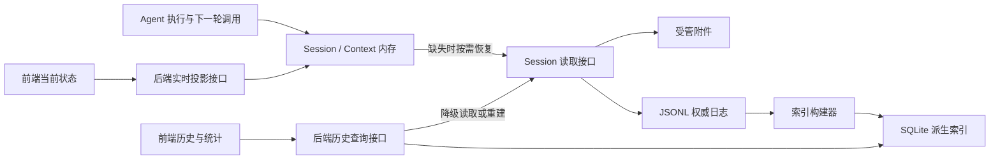
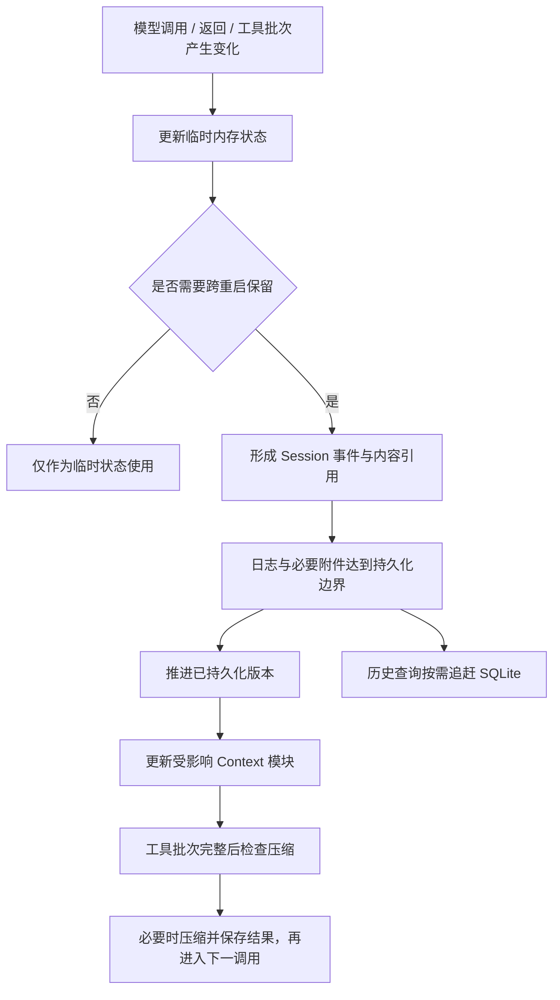

# ActSpace 存储职责、决策记录与实现边界

状态：2026-10-18 职责方向及 Q1–Q14 已确认；Q7 的增量写入与近期正文治理已实施。本文保存决策依据与模块实现细节；整体结构和读写图见[数据存储结构与职责](core-data-storage-design.md)。具体实现与验证边界见第 7 节及[执行计划](../exec-plans/completed/20261018-session-storage-refactor.md)。

## 1. 本轮明确的方向

1. Session 数据包完整保留需要恢复的会话事实。内存、SQLite 和投影检查点均不得独有持久会话事实。
2. Agent 内部正常执行、上下轮衔接、模型上下文组装与恢复使用 Session 接口、日志、受管附件和内存，不依赖 SQLite。
3. SQLite 主要服务前端的历史展示、搜索、分页、统计等派生查询；前端通过后端接口访问，不直接打开数据库。
4. 每轮调用与返回涉及的临时状态优先在内存处理；需要恢复的状态变化必须有 Session 事实依据。
5. 会话范围的业务设置和状态优先使用 Session 持久记录，不因计算量小而再建一份独立权威数据库。
6. 附件与大正文保留独立内容存储，通过 Session 引用形成完整数据包。此处不批准物理目录迁移。

用户已接受 Q1：内存不足不改变 Agent 执行链路边界；内部读取回到 Session 文件，不回退到 SQLite。

## 2. 分开执行读取和展示查询

总方案第 6 节按用途分开路由。Agent 内存缺失后经 Session 读文件，不自动查 SQLite；前端当前状态、聊天窗口与历史聚合也有不同路径。

| 用途 | 正常路径 | 内存不足或缺失时 | SQLite 的角色 |
| --- | --- | --- | --- |
| 下一次模型输入、Step/Turn 状态、会话设置、压缩与披露决策 | Session/Context 内存状态 | 经 Session 接口读取必要日志和附件；冷恢复仍可全量读取，当前未新增文件检查点 | 不参与正确性条件，不作为恢复必需品 |
| 前端当前运行状态 | 内存只读投影 | 返回尚未恢复/不可用状态，或按明确契约展示最近请求 | 不能用旧历史冒充实时状态 |
| 前端聊天消息窗口 | 打开会话通过 Journal 按范围读取 | 冷会话仍经 inspect 全量快照再截取窗口 | 不保证经过 SQLite |
| 前端历史列表、搜索、用量统计 | 后端历史查询服务 | SQLite 追赶、重建或有界日志回退，并报告进度/覆盖范围 | 派生查询加速 |
| 附件、历史原文 | Session 授权与内容读取接口 | 读取受管内容；缺失明确报错 | 可保存定位索引，不能成为唯一正文 |

SQLite 的可选搜索工具是否允许被 Agent 显式调用另见 Q11。这不等于让模型循环内部恢复依赖索引。

## 3. 每轮变化：计算位置与持久化位置分别决定

“内存能不能处理”是资源问题，“重启后需不需要恢复”是持久化问题。内存计算便宜，并不意味着可恢复状态可以只保存在内存。

| 状态 | 计算/使用位置 | 持久依据 |
| --- | --- | --- |
| 流式回复草稿、临时 UI 进度 | 内存 | Q3 不承诺逐字符恢复；未提交部分不能宣称已保存 |
| 最终模型回复、工具结果 | 内存参与后续模型输入 | Session 事件及必要附件 |
| 请求身份、模型参数、用量、结束原因 | 内存推进执行和实时展示 | Session 事件；历史费用应有稳定依据 |
| 待办、目标、模式、会话级设置 | 内存中的业务投影 | Session 状态变更事件 |
| 活跃/睡眠路径、压缩替换与补充内容 | Context 内存状态 | 足以重建的事件、决策与内容引用 |
| 累计 Token、轮数、耗时 | 统一规则计算；实时可在内存累计 | 原始事件可重算；SQLite 保存查询结果 |
| 历史搜索、跨会话分页、大规模聚合 | 历史查询服务 | SQLite 派生结果及来源水位；原始事实仍在日志 |

图不要求每个字符单独落盘；具体确认时机见 Q4。工具外部副作用还需要 Q10 的恢复规则。

## 4. 模块职责契约

| 所有者 | 负责 | 不负责 |
| --- | --- | --- |
| 业务插件 | 定义业务状态、变更事件与状态转换；经 Session 提交事实 | 直接改 SQLite 来保存业务设置 |
| Session Journal | 事件语义、接纳、序号、校验 | UI 聚合和 SQL 表设计 |
| Session Persistence | 持久确认、恢复、分叉协调 | 以索引成功代替日志成功 |
| Session Storage / JSONL | 物理读写、分批读取、租约、损坏检测与物理修复 | 决定业务含义 |
| Context Engine | 组装下一请求、增量状态、披露和压缩策略 | 查询历史 SQL 来恢复内部状态 |
| 投影规则 | 从事实推导状态；实时与历史共享业务口径 | 各缓存单独定义统计含义 |
| 投影检查点对象（非新增文件） | 保存兼容状态、来源身份、版本和事件位置 | 独立接受业务修改；取代日志 |
| Artifact Store | 内容持久化、校验、会话归属、引用生命周期 | 将正式正文当临时缓存清理 |
| 历史查询服务 / SQLite 索引器 | 历史查询、索引追赶、失效、重建、完整性状态 | 阻塞正常 Agent 执行或持有独有事实 |
| 前端接口 | 区分实时/历史、版本、未完成/空结果/错误 | 读取模型内部可变对象或直接读数据库 |

职责名称不强制对应独立 package。需要先明确边界，再决定现有 UsageReadModelService 等是否拆分或改名。

## 5. 已确认决策及保留的建议原文

2026-10-18 续议：用户先确认 Q1–Q6、Q8–Q14，再确认 Q7 并要求整理计划、实现。本表保留原建议措辞作为决策依据，其中“需确认/另定”的扩展能力不等于本轮已实现；具体代码落点、资源边界和验证结果见第 7 节。

| 编号 | 决策问题 | 已接受方向及原讨论依据 |
| --- | --- | --- |
| Q1 | “内存处理不了就用 SQLite”是否允许 Agent 内部执行读 SQL？ | 保持执行链路不依赖 SQLite。大历史通过分批日志读取、内存淘汰与文件检查点解决；SQLite 承担产品历史查询的大计算。若要例外，必须明确调用范围及无 SQLite 时的行为。 |
| Q2 | “业务设置用 Session”是否包含用户全局设置？ | 会话设置如模式、目标、模型覆盖进入 Session；应用默认模型、工作区登记、跨会话任务等保存为独立领域 JSON/JSONL。会话记录实际使用的有效配置，凭据仍走专用存储。不要把全局设置绑在某个偶然会话上。 |
| Q3 | 完整恢复需要保留最终结果，还是每个流式片段和历史请求精确正文？ | 建议保留已接受消息、最终结果、工具完整输出、失败/重试的必要事实和实际请求内容依据；逐字符流式片段默认不保证。历史还原目标是还原已保存输入输出与状态，不保证外部模型再次调用得到相同结果。精确请求范围需确认。 |
| Q4 | 用户消息何时算发送成功？落盘失败后还能否进入下一步？ | 区分已接纳和已保存。可可靠恢复的发送确认应在持久化后；持久化失败不进入依赖该事实的下一步，可展示未保存草稿并重试。流式输出可批量提交，频率通过测量确定。 |
| Q5 | 修改会话设置或全局默认值，在当前 Step、下一 Step 还是下一 Turn 生效？ | 当前在途请求固定配置，后续请求按明确规则生效并记录实际选择；安全相关撤销单独定义及时生效规则。会话覆盖优先于全局默认，历史记录不随今日默认改变。 |
| Q6 | JSON 投影检查点现在启用，还是仅预留？保存什么？ | 先统一检查点契约与兼容校验，是否启用及阈值由冷恢复测量决定。需要备用加速就必须实际写入；只预留接口不提供恢复收益。执行恢复所需检查点不能只能从 SQLite 取得。 |
| Q7 | Context 已压缩、前端历史已走 SQLite 后，运行时是否仍随完整历史增长？ | 已确认：先消除全量重复校验和计算，再释放已持久化旧事件正文；保留当前状态、未完成事务和近期窗口，完整历史通过文件范围读取。模型 Context 压缩独立；不改变日志格式、分段或删除历史。 |
| Q8 | 前端能否先显示落后的历史统计？ | 可以，但标明统计截至位置、同步中、部分结果或失败；新产生的内容由实时投影显示。SQLite 不可用时有界降级或重建，不能返回伪完整的零值。 |
| Q9 | 附件共享、分叉、导出、删除如何保持完整？ | 保证逻辑数据包闭合，可使用独立存储加引用收集；分叉不能因父会话删除丢内容。暂存转正式后才写可靠引用；垃圾回收需识别所有有效引用和在途写入。具体去重/复制与物理目录另定。 |
| Q10 | 工具已执行但结果未落盘，重启后如何处理？ | 记录调用身份及可恢复状态；恢复历史不自动重放外部副作用。不确定的调用明确标记，由工具按幂等查询、补结果或人工处理恢复，不能默认再执行一次。 |
| Q11 | Agent 能否显式调用“搜索历史会话”工具，间接使用 SQLite？ | 作为可选工具可以单独讨论；必须区分工具能力失败与核心执行失败。保守基线暂不新增此例外，也不让工具索引结果自动成为下一轮的完整会话来源。 |
| Q12 | 跨会话操作、父子会话、全局任务由谁拥有事实？ | 每项事实确定一个所有者，其他地方保存稳定引用。跨领域操作记录操作 ID 和恢复依据，不以两处独立写成功作为隐含原子性保证；避免为了全局查询把可变事实复制到每个 Session。 |
| Q13 | 旧版本日志、缺失附件、索引独有旧数据如何迁移？ | 先审计和备份，显式版本化；无法恢复的信息标为缺失，不编造历史。只有确认无独有事实后才允许丢弃旧索引。损坏日志与损坏缓存分别处理。 |
| Q14 | 哪些文件进入完整备份？哪些可以清理？ | 全应用备份包括 Session 数据包、全局领域记录、专用凭据和必要装配记录；SQLite 与检查点可排除。删除、保留期限和脱敏分别定义，不能把带正文的派生缓存当作不存在隐私内容。 |

### 5.1 Q7 澄清：压缩、历史查询与运行时成本是不同问题

用户提出：模型 Context 由压缩控制，前端历史由 SQLite 查询，统计应增量，因此需要说明剩余问题。这个目标分工成立，但不能据此判定当前实现的全部运行成本已与历史长度无关。

| 对象 | 随历史增长意味着什么 | 本项是否要求新设计 |
| --- | --- | --- |
| 模型实际 Context | 压缩后只使用保留内容与摘要，不等于完整日志 | 不另设计一套；沿用已确认的 Step 安全点压缩方向 |
| 前端历史 | SQLite 可加速分页/筛选；接口分页与前端渲染范围仍需正确实现 | 沿用历史查询方向，不把 SQLite 当无限量前端渲染的替代品 |
| 磁盘 Journal | 完整历史随事件追加增长，即使旧内容不再进入模型 Context | 正常保留事实；本项不提出删日志或强制分段 |
| 运行时全量事件与计算辅助状态 | 即便模型只用小 Context，程序可能仍保留并扫描完整历史 | 这是本项真正需要审计和测量的范围 |

实施前的静态证据（以下描述保留作为问题来源，不再代表重构后实现）：

- `packages/session/journal/src/journal.ts` 的 `#events` 保留事件数组，与 `#surface` 分开。`append()` 构造 `nextEvents = [...this.#events, event]`，调用全量 `validateSessionEvents` 并计算有效事件；`events` getter 还复制一次数组。数组复制不表示每次深拷贝全部历史正文，但仍随事件数量增加引用复制与遍历工作。
- `packages/session/journal/src/invariant-validator.ts` 的 `validateSessionEvents()` 遍历所给事件序列。把前端查询迁至 SQLite 不会自动消除这一执行写入路径成本。
- `packages/session/projection/src/facts.ts` 的用量总数使用增量替换公式，但 `selected` 保存按请求记录、`requests` 保存关联；更新中存在对象展开和 `Object.values(selected).some(...)`。因此“总数增量”不等于“所有中间状态和每次更新都固定成本”。
- `packages/runtime/src/session/session-controller.ts` 已对 live model 应用水位后的事件，但读取 `journal.events` 的数组复制和 Journal 自身成本仍独立存在。

这些是代码形态证据，不是性能测量；尚未证明在用户当前数据规模下构成可感知瓶颈。

建议把 Q7 收窄为：保持 Context 压缩、SQLite 历史查询和完整 JSONL 事实源；另行测量长会话的运行时内存、每次追加/校验、统计辅助状态与冷恢复成本。根据证据决定是否做增量校验、受控历史保留或按需恢复，不提前批准新文件格式、分段和迁移。用户已确认并授权实施，结果见第 7 节。

## 6. 产品级完整性核对与验收边界

本轮已完成增量运行态重构，自动化证据见[执行摘要](../exec-runs/20261018-session-storage-refactor/execution-summary.md)。更广的产品级核对仍按事实清单推进：业务字段 → 唯一写入者 → JSON/JSONL 事件或领域记录 → 所需正文 → 内存计算 → 可选 SQLite 投影 → 恢复方式。

下列是完整性验收目标，不能全部标记为本轮已验证，也不授权操作真实用户数据：

- 禁用 SQLite 后，Agent 可以创建、恢复并继续执行会话；正常上下轮读取不会访问 SQL。
- 仅保留权威文件和受管内容，重新建立内存、索引、检查点后，状态和历史查询含义一致。
- SQL 延迟/失败只影响历史查询，不吞掉已保存消息，不阻塞无关执行。
- 检查点失效、日志损坏、附件缺失分别有明确行为。
- 中途崩溃不导致重复工具副作用、错误发送确认或分叉附件丢失。
- 使用当前配置重建旧数据时，不改变历史模型、费用及请求证据。

本轮实现未新增数据库或文件检查点写入器，也未移动附件目录。真实 Provider、Electron 和断电验证未执行；已验证项及剩余限制以执行摘要为准。

## 7. 2026-10-18 实现落点与边界

| 模块 | 当前职责与实现 |
| --- | --- |
| Journal | `SessionEventValidator` 增量校验；失败只撤回触及的关系、事务与 seq；Surface 在事务完整后更新。普通追加不重放旧事件。去重 ID 保留，已结束 request/tool/inbox 的过程记录释放。 |
| JSONL provider | 文件仍为原 `journal.jsonl`；物理句柄不常驻全量正文，也不在每批追加重编码全历史。`JsonlEventHistory` 保留字节位置，用固定 fd 回读范围；索引不另存权威数据文件。 |
| Session Persistence | accepted 与 durable 分离。默认 200 ms 延迟定时器、128 事件 / 256 KiB 写入预算，生产者等待慢磁盘；失败保留 blocked 状态。达到 durable 边界后允许 Journal 释放旧正文。 |
| Journal 近期窗口 | 默认最多 512 条、序列化正文预算 4 MiB；仅淘汰 durable 前缀。未保存事件及校验器里的未完成事务仍保留；临时 Session 或没有历史读取能力的 provider 不丢弃唯一事实。 |
| 当前业务状态 | `journal.project()` 首次分批重放，此后只处理水位后事件。Inbox、Todo、Workspace、权限和消息去重采用当前投影；Task 更新从已有快照归并新增事件。 |
| Context | Reducer / Disclosure 按序号范围迭代；Supplements 缓存当前状态并保留重锚需要的最后持久版本。压缩摘要从当前 Surface 定位，无需每 Step 扫全部历史。 |
| Runtime Projection | 完成定义注册后 `seal()`，不留第二份完整重放正文；仅保留 512 条事件指纹用于重复投递核对，超出证明范围明确要求 resync。未完成投影事务仍留存。 |
| 实时统计 | `providerUsage` stateVersion=2；Step 结束后释放请求关联与用量纠正缓存，总量留存；已知费用计数增量维护，零费用与未知费用不混淆。旧 checkpoint 不匹配时重建。 |
| 前端查询 | 保留现有 SQLite 查询协议。`flush` 不再主动全量重建冷历史缓存；实时数据来自 live model；打开会话的窗口从 Journal 按范围读取，冷缓存仍全量 inspect 后分页。SQLite 查询时按来源水位追赶，实时事件不强制触发索引。 |
| 附件 | 保留 `artifacts-v2` 布局、归属和摘要校验；Desktop 与 Node 都在返回可靠引用前 fsync 正文、元数据和目录。已有 fork 复制/重写协议继续使用。 |

### 历史读取契约

- `readEvents(start, end)` 是显式、可能触发文件 I/O 的完整范围读取，end 不包含在范围内；缺失或不匹配报错，不把近期窗口伪装成完整历史。
- `iterateEvents()` 每批最多 128 条，供冷初始化或增量调用方使用；Host 文件读取每页约 256 KiB，单个大事件可以超过页预算。
- `eventsAfter()` 返回指定水位后的事件；`latestEvent()` 使用事件类型的轻量 seq 索引。旧 `events` getter 仅作兼容完整读取，生产热路径已迁移。
- JSONL 回读目前是 Host 注入的同步范围读取，避免改写现有同步业务接口；频繁当前状态使用内存投影，冷恢复/显式历史读取可能占用 Host 线程。不能宣称这是异步流式冷启动。

### 不应夸大的结论

4 MiB 约束的是近期事件的序列化正文，不是 JS heap 或进程总内存。当前 Surface、业务记录、去重 ID、字节索引和前端工具视图仍可能随有效业务规模增长。未启用压缩时，Surface 自然也会增长。显式全量导出/检查、现有冷打开 `inspect()` 仍可临时加载完整日志。本轮没有增加文件投影检查点，也没有改变物理日志格式或保证所有历史操作 O(1)。

十万条普通事件验证覆盖增量校验次数、文件完整回读、近期正文上限、关闭重开和 seq 连续性；它不是十万次真实模型/工具调用的内存基准。具体命令与结果见执行摘要。
