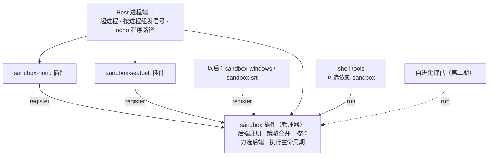

# 沙箱设计

> 状态：2026-10-25 用户确认的设计，尚未实施。第一期执行计划见 [20261025-sandbox-v1-tool-sandbox](../../exec-plans/active/20261025-sandbox-v1-tool-sandbox.md)。调研原稿与 Mac 性能实验见 [沙箱实现的思路](../../references/sandbox-research-20261022/README.md)。

## 1. 结论

沙箱是 Harness 里的一个概念，由一组**可替换的 Harness 插件**实现：一个管理器插件，加上若干后端插件。换后端、换成自己写的沙箱、甚至完全不要沙箱，都只是改 Harness 组合。

- macOS / Linux：nono 后端。nono 命令行程序随应用打包，只用我们自己打包的那份，系统里装了也不用。
- Windows：第三期做原生后端，参考 DSH 与 Anthropic sandbox-runtime（srt）；也可以直接加一个 `sandbox-srt` 后端，到时再定。
- **不能悄悄改为不加沙箱执行**：组合里没有沙箱，或者沙箱不可用时，bash 调用一律按“沙箱外执行”走审批。

**第一期打地基，后两期只做扩展。** 契约、策略合并、能力模型、执行生命周期、结果状态在第一期一次做完整；功能可以少，例如网络只实现“不限制 / 断网”，但第二、三期不应该需要改契约。

沙箱服务两种场景，对应两种沙箱：

| 名称 | 服务对象 | 何时启动 | 执行单位 |
|---|---|---|---|
| **工具沙箱** | bash 工具，以后的代码执行工具 | 每次工具调用 | 一条命令及其后代进程 |
| **评估沙箱** | Harness 自进化的候选版本评估 | 只在自进化评估时启动，平时不启动 | 一个完整的候选 Harness 进程 |

## 2. 分期

| 期 | 范围 | 平台 | 后端 |
|---|---|---|---|
| 第一期 | 全部地基 + 工具沙箱 | macOS、Linux | nono（`wrap`）、Seatbelt |
| 第二期 | 评估沙箱 | macOS、Linux | nono（`run`，域名代理） |
| 第三期 | Windows 的工具沙箱与评估沙箱 | Windows | 原生后端或 `sandbox-srt` |

第三期之前，Windows 上没有可用后端，bash 调用按“沙箱外执行”走审批。

## 3. 插件结构

| 插件 | 提供 | 依赖 |
|---|---|---|
| `sandbox`（管理器） | `sandbox` 服务：注册后端、查询状态、执行 | Host 进程端口 |
| `sandbox-nono` | 向管理器注册 nono 后端 | `sandbox`、Host 进程端口（含 nono 路径） |
| `sandbox-seatbelt` | 向管理器注册 Seatbelt 后端 | `sandbox`、Host 进程端口 |
| 以后的 `sandbox-windows` / `sandbox-srt` | 同上 | 同上 |

- **Host 只提供资源，不决定用不用沙箱。** Host 进程端口提供最基础的能力：起进程、按进程组发信号、告诉插件 nono 程序在哪里。仓库约定只有 Host 侧代码直接起子进程，Harness 插件通过端口获得能力，沙箱插件也遵守这一点。
- **后端可以热插拔。** 后端插件启动时调用 `sandbox.register(backend)`，插件释放时自动注销。
- **shell-tools 把 `sandbox` 作为可选依赖。** 拿到了就交给沙箱执行；拿不到（组合里去掉了沙箱）就按“沙箱外执行”走审批。
- **为什么不怕自进化换掉沙箱：** 去掉沙箱会变成审批，不会悄悄执行；换成别的沙箱属于自进化本身的审批范围（`evolution-approval.ts`）；评估沙箱由正在运行的 v1 从外面套住候选 v2，v2 换掉自己的沙箱插件也绕不开外层的内核限制。

## 4. 管理器契约

### 4.1 执行请求描述需求

| 字段 | 含义 | 第一期 |
|---|---|---|
| `purpose` | `tool` / `evaluation` | 两个取值都在契约里，模板只实现 `tool` |
| `argv`、`cwd`、`env` | 程序与参数（数组）、工作目录、环境变量 | 实现 |
| `filesystem` | 读写、只读、禁止读取、禁止写入的路径 | 实现 |
| `network` | `unrestricted` / `blocked` / `allowlist`（域名列表） | 实现前两种；`allowlist` 在契约中，后端都报告 `unsupported` |
| `timeoutMs` | 整次执行的最长时间 | 实现 |
| `requiredCapabilities` | 缺了就不能执行的能力 | 实现 |

### 4.2 策略合并

启动前按“默认策略 → 用途模板 → 本次调用”合成一份**固定策略**，之后不再变化。本次调用只能收窄，不能放宽模板没有给的权限。

### 4.3 能力分三档

每个后端对每项能力报告 `full` / `partial` / `unsupported`：

| 能力 | 含义 |
|---|---|
| `filesystem.write` | 限制写入范围 |
| `filesystem.read-deny` | 禁止读取指定路径 |
| `filesystem.write-deny` | 在可写目录中禁止写入指定路径（如工作区的 `.git/hooks`、`.git/config`） |
| `network.blocked` | 完全断网 |
| `network.allowlist` | 只放行指定域名 |
| `process.inherit` | 后代进程继承限制 |

只有覆盖全部必需能力（`full`）的后端才会被选中，选择顺序按注册优先级（nono 先于 Seatbelt）。没有合格的后端就返回“不可用”和每个后端不合格的原因。

### 4.4 执行句柄

`run(request)` 返回执行句柄，管理器负责完整生命周期：

- 准备：合并策略 → 选后端 → 后端生成启动方式。准备失败时，目标命令**一次也不执行**。
- 运行：输出流、等待结果、`terminate()`。
- 终止：先向整个进程组发送 SIGTERM，到期仍未退出就发送 SIGKILL，等待有限时间后报告是否有残留。超时与取消走同一条路径。
- 清理：调用后端的清理逻辑，例如删除临时策略文件。

### 4.5 结果状态

执行结果有四种：`prepare_failed`（附原因，命令未执行）/ `exited`（退出码或信号）/ `timed_out` / `cancelled`（后两种附带是否有进程残留）。另外附一份沙箱事实：隔离方式（`sandboxed` / `inherited` / `none`）、选中的后端与版本、各能力档位、策略指纹、清理是否成功。“程序怎么结束”与“沙箱是否正常准备和清理”是两件事，分开记录：清理失败不改变执行结果，只记在事实里。

### 4.6 继承外层沙箱

管理器支持“继承”模式：已经运行在外层沙箱里（第二期的评估沙箱）时，不再启动新沙箱，命令直接执行，结果标明 `inherited`。这个模式**只能由显式配置打开**（管理器插件配置，第二期由 CLI 启动参数传入），不读取环境变量。如果读取环境变量，用户环境里设了同名变量就能关掉沙箱。

## 5. 后端

### 5.1 nono（macOS、Linux）

- 工具沙箱用 `nono wrap`：nono 施加限制后直接变成目标命令，不留常驻进程。用户在 Mac 上实测，比直接用 Seatbelt 每次多 4–5ms。我们拿到的进程号就是目标命令本身，终止进程组即可覆盖后代进程。
- `nono run` 留给评估沙箱：supervisor 在 Mac 上让短命令多出约 200ms、多占约 17MB，但能提供域名代理、凭证注入、审计和回滚。后端契约里同时有两种模式，第一期只实现 `wrap`。
- 策略用配置文件一次性给出，不拼命令行参数：Linux 用权限清单（`-c`），macOS 用 profile（`-p`）。原因是 nono 权限清单的 `deny` 不生效，只有 macOS profile 的 Seatbelt 规则能在可写的工作区里禁止写入 `.git/hooks`、`.git/config`。
- “全部可读，减去凭据目录”用拆分覆盖表达：从 `/` 开始，不含排除路径的目录整体授权，含排除路径的展开子项。nono 不允许授权它自己状态目录的上级（`/`、`$HOME`），拆分覆盖同时绕开这个限制。单独授权的符号链接若指向排除路径之内或之上就跳过，因为 nono 按链接目标授权。
- macOS 上拆分只绕开 nono 状态目录，禁止读取写成 `(deny file-read* …)` 规则：把禁止读取的路径也拆开会让授权条目从约 110 条涨到约 1100 条，nono 每次启动从约 40ms 涨到约 900ms。Linux 只能靠不授权来禁止读取。
- Linux（Landlock）无法在可写目录里挖出只读子目录，`filesystem.write-deny` 报告 `unsupported`，第一期 Linux 上 nono 不合格，bash 走审批。
- 启动 nono 时去掉所有 `NONO_*` 环境变量，它们会改变 nono 的授权。
- 分发：打包 `aarch64/x86_64-apple-darwin` 与 `aarch64/x86_64-unknown-linux-gnu` 四个版本，锁定版本号、校验 SHA256，macOS 上随应用签名。nono 采用 Apache-2.0 许可证。
- 只按明确的路径查找 nono：打包路径 → `ACTSPACE_NONO_PATH` → 仓库 `dist/sandbox-components/`。不在 PATH 里查找，系统里装的也不用：版本无法保证一致，也无法确认是否被替换过。
- 不使用 Node SDK `nono-ts`：它只能对当前进程施加限制，而且撤不回来；它也将于 2026-11-01 归档。

### 5.2 Seatbelt（macOS）

现有 `packages/tools/shell-tools/src/node-ports.ts` 中 `sandboxSpawn` 的 SBPL 规则搬入 `sandbox-seatbelt`，行为不变，注册优先级低于 nono。`sandbox-exec` 已被 Apple 标为弃用，以后可以去掉这个插件。

### 5.3 Windows（第三期）

| | DSH `sandbox-windows-acl` | srt Windows（alpha） |
|---|---|---|
| 机制 | 受限令牌 + 低完整性 + 工作区 ACL + Job Object | 专用 `srt-sandbox` 本地账号 + 受限令牌 + ACL + WFP 网络防火墙 |
| 用户要做什么 | 什么都不用装，也不需要管理员权限 | 装一次，需要管理员权限（UAC），对整台机器生效 |
| 能限制什么 | 只能限制写入 | 读取、写入、网络（只能走代理） |
| 代价 | 工作区 ACL 长期保留；硬链接可以绕过 | 用系统 TLS（Schannel）的工具连不上 HTTPS；alpha |
| 参考代码 | `tmp/deepseek-harness/packages/sandbox/sandbox-windows-acl/` | `tmp/sandbox-runtime/`（`vendor/srt-win-src/`） |

Windows 后端在能力表里如实报告 `partial` / `unsupported`。初步方向：工具沙箱参考 DSH，评估沙箱参考 srt，或者直接加 `sandbox-srt`。第三期再讨论确定。

## 6. 评估沙箱（第二期）

- **为什么要整体放进沙箱**：自进化会整体替换 Harness，候选版本可能带新的插件代码和依赖，所以整个候选 Harness 进程都要受限。
- **层级**：正在运行的 Harness（v1）通过自己的 `sandbox` 服务，以 `purpose: evaluation` 启动候选版本 v2 的子进程。v2 与主应用平级，不包在主应用外面。
- **启动方式**：通过 CLI（`packages/headless`）启动候选 Harness，并传入“继承外层沙箱”参数（4.6）。
- **嵌套**：v2 内的管理器处于继承模式，bash 不再另起沙箱。
- **网络**：用 `network.allowlist` 只放行模型服务，由 nono `run` 的代理实现。
- **密钥**：通过环境变量注入。候选进程能读到它，所以建议使用单独的、设了额度上限的 key。
- **评分器**：先放在评估沙箱里面。风险已知：候选版本可能修改评分器或分数。以后可以改为由 v1 在沙箱退出后读取结果文件打分。
- **接入点**：自进化 V1 已经实现（`packages/plugin-manager`、`packages/harness-hmr`，见[自进化的方案设计](../自进化的方案设计/README.md)），流程是 build → prepare → apply。评估沙箱插在 prepare 与 apply 之间：评估通过才允许 apply。

## 7. 排除的方案

- **沙箱放在 Host 里、不可替换**：用户决定沙箱是 Harness 概念，可以替换、可以不要；安全性由“去掉沙箱就转审批”和自进化审批来保证。
- **第一期只做“准备启动”**：执行生命周期第一期就由管理器负责，第二期评估直接复用。
- **Windows 上用 nono**：nono 没有原生 Windows 后端，上游方案 NEP-0005 还是草案。通过 WSL2 使用要求用户安装 WSL2，而且 bash 会在 Linux 环境里执行，用不上用户的 Windows 工具链。
- **`nono-ts`**、**在 PATH 中查找 nono**：原因见 5.1。
- **沙箱不可用时悄悄执行**：调用方会误以为命令是受限的。
- **用环境变量判断嵌套**：原因见 4.6。

## 8. 实测结论（2026-10-25，nono 0.80.0）

详见[执行过程](../../exec-runs/20261025-sandbox-v1-tool-sandbox/execution-process.md)步骤 1。

- nono 权限清单的 `deny` 不生效；禁止读取改用拆分覆盖，禁止写入只有 macOS profile 能表达（见 5.1）。
- macOS 上 nono 会拦截钥匙串，沙箱内 `git push`、`gh` 需要申请沙箱外执行；用户接受这个更严格的行为。
- 每次 `wrap` 的额外耗时：权限清单模式约 31ms，profile 模式约 55ms（授权条目约 110 条）。
- Linux 需要 Landlock（内核 5.13+）；不支持时 nono 后端报告不可用。
- Cordis 准入原本不支持可选依赖，第一期补上。
