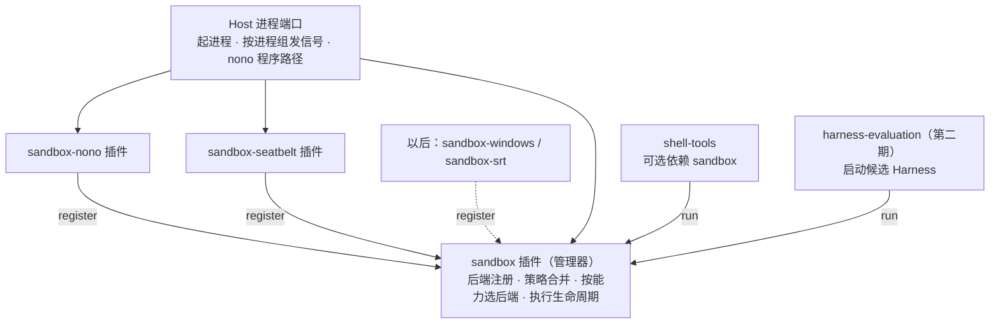
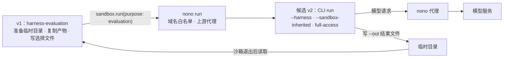
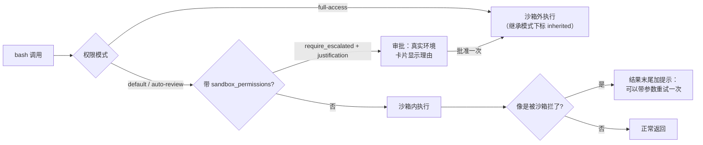

# 沙箱设计

> 状态：2026-10-25 用户确认的设计；第一期（地基 + 工具沙箱）已实施，见 [20261025-sandbox-v1-tool-sandbox](../../exec-plans/completed/20261025-sandbox-v1-tool-sandbox.md) 与[执行摘要](../../exec-runs/20261025-sandbox-v1-tool-sandbox/execution-summary.md)。第二期（评估沙箱）已实施，见 [20261025-sandbox-v2-evaluation-sandbox](../../exec-plans/completed/20261025-sandbox-v2-evaluation-sandbox.md) 与[执行摘要](../../exec-runs/20261025-sandbox-v2-evaluation-sandbox/execution-summary.md)。工具沙箱的出沙箱与回退（第 9 节）已实施，见 [20261025-sandbox-escape-fallback](../../exec-plans/completed/20261025-sandbox-escape-fallback.md) 与[执行摘要](../../exec-runs/20261025-sandbox-escape-fallback/execution-summary.md)。第三期未开始。调研原稿与 Mac 性能实验见 [沙箱实现的思路](../../references/sandbox-research-20261022/README.md)。

## 1. 结论

沙箱是 Harness 里的一个概念，由一组**可替换的 Harness 插件**实现：一个管理器插件，加上若干后端插件。换后端、换成自己写的沙箱、甚至完全不要沙箱，都只是改 Harness 组合。

- macOS / Linux：nono 后端。nono 命令行程序随应用打包，只用我们自己打包的那份，系统里装了也不用。
- Windows：第三期做原生后端，参考 DSH 与 Anthropic sandbox-runtime（srt）；也可以直接加一个 `sandbox-srt` 后端，到时再定。
- **不能悄悄改为不加沙箱执行**：组合里没有沙箱，或者沙箱不可用时，bash 调用一律按“沙箱外执行”走审批。`full-access` 模式下 bash 按设计不进沙箱；其他模式下 Agent 只能带理由申请出沙箱，每次都要批准（第 9 节）。

**第一期打地基，后两期只做扩展。** 契约、策略合并、能力模型、执行生命周期、结果状态在第一期一次做完整；功能可以少，例如网络只实现“不限制 / 断网”，但第二、三期不应该需要改契约。

沙箱服务两种场景，对应两种沙箱：

| 名称 | 服务对象 | 何时启动 | 执行单位 |
|---|---|---|---|
| **工具沙箱** | bash 工具，以后的代码执行工具 | 每次工具调用 | 一条命令及其后代进程 |
| **评估沙箱** | Harness 自进化的候选版本评估 | 只在自进化评估时启动，平时不启动 | 一个完整的候选 Harness 进程 |

## 2. 分期

| 期 | 范围 | 平台 | 后端 |
|---|---|---|---|
| 第一期 | 全部地基 + 工具沙箱 | macOS、Linux | nono（`wrap`）、Seatbelt |
| 第二期 | 评估沙箱（沙箱能力 + 最小使用方；评估用例、打分与 apply 门槛属于自进化 V2） | macOS、Linux | nono（`run`，域名代理） |
| 第三期 | Windows 的工具沙箱与评估沙箱 | Windows | 原生后端或 `sandbox-srt` |

第三期之前，Windows 上没有可用后端，bash 调用按“沙箱外执行”走审批。

## 3. 插件结构

| 插件 | 提供 | 依赖 |
|---|---|---|
| `sandbox`（管理器） | `sandbox` 服务：注册后端、查询状态、执行 | Host 进程端口 |
| `sandbox-nono` | 向管理器注册 nono 后端 | `sandbox`、Host 进程端口（含 nono 路径） |
| `sandbox-seatbelt` | 向管理器注册 Seatbelt 后端 | `sandbox`、Host 进程端口 |
| 以后的 `sandbox-windows` / `sandbox-srt` | 同上 | 同上 |
| `harness-evaluation`（第二期，使用方） | `harness.evaluation` 服务：在评估沙箱里启动候选 Harness，取回结果 | `sandbox`（必需，拿不到就拒绝）、Host 评估端口（启动入口、模型连接） |

- **Host 只提供资源，不决定用不用沙箱。** Host 进程端口提供最基础的能力：起进程、按进程组发信号、告诉插件 nono 程序在哪里。仓库约定只有 Host 侧代码直接起子进程，Harness 插件通过端口获得能力，沙箱插件也遵守这一点。
- **后端可以热插拔。** 后端插件启动时调用 `sandbox.register(backend)`，插件释放时自动注销。
- **shell-tools 把 `sandbox` 作为可选依赖。** 拿到了就交给沙箱执行；拿不到（组合里去掉了沙箱）就按“沙箱外执行”走审批。
- **为什么不怕自进化换掉沙箱：** 去掉沙箱会变成审批，不会悄悄执行；换成别的沙箱属于自进化本身的审批范围（`evolution-approval.ts`）；评估沙箱由正在运行的 v1 从外面套住候选 v2，v2 换掉自己的沙箱插件也绕不开外层的内核限制。

## 4. 管理器契约

### 4.1 执行请求描述需求

| 字段 | 含义 | 第一期 | 第二期 |
|---|---|---|---|
| `purpose` | `tool` / `evaluation` | 模板只实现 `tool` | 实现 `evaluation` 模板 |
| `argv`、`cwd`、`env` | 程序与参数（数组）、工作目录、环境变量 | 实现 | — |
| `filesystem` | 读写、只读、禁止读取、禁止写入的路径 | 实现 | — |
| `network` | `unrestricted` / `blocked` / `allowlist`（域名列表，可带本机端口 `localPorts` 与上游代理 `upstreamProxy`） | 实现前两种 | 实现 `allowlist`、本机端口与上游代理（nono `run`） |
| `network.credentials` | 由沙箱外代理注入的凭据（候选只拿到替身 token） | — | 契约预留，后端报告 `unsupported` |
| `limits` | 内存、CPU 时间上限 | — | 契约预留，后端报告 `unsupported` |
| `timeoutMs` | 整次执行的最长时间 | 实现 | — |
| `requiredCapabilities` | 缺了就不能执行的能力 | 实现 | — |

第二期只做加法：新字段都是可选的，没有用到它们的第一期调用不受影响。

### 4.2 策略合并

启动前按“默认策略 → 用途模板 → 本次调用”合成一份**固定策略**，之后不再变化。本次调用只能收窄，不能放宽模板没有给的权限。

### 4.3 能力分三档

每个后端对每项能力报告 `full` / `partial` / `unsupported`：

| 能力 | 含义 |
|---|---|
| `filesystem.write` | 限制写入范围 |
| `filesystem.read-deny` | 禁止读取指定路径 |
| `filesystem.write-deny` | 在可写目录中禁止写入指定路径（如工作区的 `.git/hooks`、`.git/config`） |
| `network.blocked` | 完全断网 |
| `network.allowlist` | 只放行指定域名 |
| `process.inherit` | 后代进程继承限制 |
| `network.local-ports` | 白名单之外放行本机（`127.0.0.1`）的指定端口（第二期） |
| `network.upstream-proxy` | 放行的流量再转给上游代理（第二期） |
| `network.credential-injection` | 沙箱外注入凭据（契约预留） |
| `process.resource-limits` | 内存、CPU 时间上限（契约预留） |

只有覆盖全部必需能力（`full`）的后端才会被选中，选择顺序按注册优先级（nono 先于 Seatbelt）。没有合格的后端就返回“不可用”和每个后端不合格的原因。

### 4.4 执行句柄

`run(request)` 返回执行句柄，管理器负责完整生命周期：

- 准备：合并策略 → 选后端 → 后端生成启动方式。准备失败时，目标命令**一次也不执行**。
- 运行：输出流、等待结果、`terminate()`。
- 终止：先向整个进程组发送 SIGTERM，到期仍未退出就发送 SIGKILL，等待有限时间后报告是否有残留。超时与取消走同一条路径。
- 清理：调用后端的清理逻辑，例如删除临时策略文件。

### 4.5 结果状态

执行结果有四种：`prepare_failed`（附原因，命令未执行）/ `exited`（退出码或信号）/ `timed_out` / `cancelled`（后两种附带是否有进程残留）。另外附一份沙箱事实：隔离方式（`sandboxed` / `inherited` / `none`）、选中的后端与版本、各能力档位、策略指纹、清理是否成功。“程序怎么结束”与“沙箱是否正常准备和清理”是两件事，分开记录：清理失败不改变执行结果，只记在事实里。

### 4.6 继承外层沙箱

管理器支持“继承”模式：已经运行在外层沙箱里（第二期的评估沙箱）时，不再启动新沙箱，命令直接执行，结果标明 `inherited`。这个模式**只能由 Host 的显式启动参数打开**：CLI 的 `--sandbox-inherited` 写进 Host 沙箱端口（`inherited: true`），管理器从端口读取。

- 不读取环境变量：否则用户环境里设了同名变量就能关掉沙箱。
- 不放在管理器插件配置里（第一期的做法，第二期移除）：插件配置属于 Harness 组合，自进化产生的候选组合可以带上它，在普通 App 里悄悄关掉工具沙箱；而且启动候选时改写它的配置，评估的版本就和最终 apply 的版本不一致了。“是否已在外层沙箱里”是 Host 知道的事实，由 Host 告知。

## 5. 后端

### 5.1 nono（macOS、Linux）

- 工具沙箱用 `nono wrap`：nono 施加限制后直接变成目标命令，不留常驻进程。用户在 Mac 上实测，比直接用 Seatbelt 每次多 4–5ms。我们拿到的进程号就是目标命令本身，终止进程组即可覆盖后代进程。
- 评估沙箱用 `nono run`：supervisor 在 Mac 上让短命令多出约 200ms、多占约 17MB，但能提供域名代理、凭证注入、审计和回滚。请求的网络为 `allowlist` 时后端改用 `run -s --no-diagnostics --no-audit --no-rollback -p <profile>`（不加后两个参数，nono 会往 `~/.nono` 写审计与回滚数据），两个平台都用 profile 模式：Linux 权限清单会静默忽略上游代理，`-c` 又不能和命令行参数一起用。域名写进 `allow_domain`，本机端口写进 `open_port`，上游代理写进 `upstream_proxy`。nono 会给子进程设置 `HTTPS_PROXY` 与 `NODE_USE_ENV_PROXY`；Node 22.22（系统 Node 与 Electron 39 自带的 Node）的 `fetch` 实测会走这个代理。调用方环境里的代理变量在白名单下会被去掉，否则会绕过 nono 的代理。
- 本机服务要单独放行端口：nono 设置的 `NO_PROXY` 让本机地址直连、不经过代理，把 `127.0.0.1` 写进域名白名单不起作用。
- `allow_domain` 为空时 nono 不启动代理、网络完全放开。所以只有本机端口、没有域名的白名单写成 `block: true` 加 `open_port`。
- nono profile 默认带系统写入组：macOS 的 `system_write_macos` 放行 `/tmp`、`/private/tmp`、整个 `/private/var/folders`（所有临时目录）与 `$TMPDIR`，Linux 的 `system_write_linux` 放行 `/tmp`。评估沙箱用 `groups.exclude` 排除它们，候选只能写本次评估的临时根目录；工具沙箱仍保留这两个组。
- 策略用配置文件一次性给出，不拼命令行参数：Linux 用权限清单（`-c`），macOS 用 profile（`-p`）。原因是 nono 权限清单的 `deny` 不生效，只有 macOS profile 的 Seatbelt 规则能在可写的工作区里禁止写入 `.git/hooks`、`.git/config`。
- “全部可读，减去凭据目录”用拆分覆盖表达：从 `/` 开始，不含排除路径的目录整体授权，含排除路径的展开子项。nono 不允许授权它自己状态目录的上级（`/`、`$HOME`），拆分覆盖同时绕开这个限制。单独授权的符号链接若指向排除路径之内或之上就跳过，因为 nono 按链接目标授权。
- macOS 上拆分只绕开 nono 状态目录，禁止读取写成 `(deny file-read* …)` 规则：把禁止读取的路径也拆开会让授权条目从约 110 条涨到约 1100 条，nono 每次启动从约 40ms 涨到约 900ms。Linux 只能靠不授权来禁止读取。
- Linux（Landlock）无法在可写目录里挖出只读子目录，`filesystem.write-deny` 报告 `unsupported`，第一期 Linux 上 nono 不合格，bash 走审批。评估沙箱只写副本与临时目录，不需要这项能力，Linux 上可以使用。
- 启动 nono 时去掉所有 `NONO_*` 环境变量，它们会改变 nono 的授权。
- 分发：打包 `aarch64/x86_64-apple-darwin` 与 `aarch64/x86_64-unknown-linux-gnu` 四个版本，锁定版本号、校验 SHA256，macOS 上随应用签名。nono 采用 Apache-2.0 许可证。
- 只按明确的路径查找 nono：打包版只认随包的 `resources/app/sandbox-components/bin/nono`；开发版依次是 `ACTSPACE_NONO_PATH`、仓库 `dist/sandbox-components/<platform>-<arch>/nono`（`pnpm sandbox:fetch-nono` 获取）。不在 PATH 里查找，系统里装的也不用：版本无法保证一致，也无法确认是否被替换过。
- 不使用 Node SDK `nono-ts`：它只能对当前进程施加限制，而且撤不回来；它也将于 2026-11-01 归档。

### 5.2 Seatbelt（macOS）

原 shell-tools 里 `sandboxSpawn` 的 SBPL 规则已搬入 `sandbox-seatbelt`（shell-tools 不再自己起 `sandbox-exec`），注册优先级低于 nono。`sandbox-exec` 已被 Apple 标为弃用，以后可以去掉这个插件。

### 5.3 Windows（第三期）

| | DSH `sandbox-windows-acl` | srt Windows（alpha） |
|---|---|---|
| 机制 | 受限令牌 + 低完整性 + 工作区 ACL + Job Object | 专用 `srt-sandbox` 本地账号 + 受限令牌 + ACL + WFP 网络防火墙 |
| 用户要做什么 | 什么都不用装，也不需要管理员权限 | 装一次，需要管理员权限（UAC），对整台机器生效 |
| 能限制什么 | 只能限制写入 | 读取、写入、网络（只能走代理） |
| 代价 | 工作区 ACL 长期保留；硬链接可以绕过 | 用系统 TLS（Schannel）的工具连不上 HTTPS；alpha |
| 参考代码 | `tmp/deepseek-harness/packages/sandbox/sandbox-windows-acl/` | `tmp/sandbox-runtime/`（`vendor/srt-win-src/`） |

Windows 后端在能力表里如实报告 `partial` / `unsupported`。初步方向：工具沙箱参考 DSH，评估沙箱参考 srt，或者直接加 `sandbox-srt`。第三期再讨论确定。

## 6. 评估沙箱（第二期）

第二期只做评估沙箱这套能力，加一个最小的使用方 `harness-evaluation` 把它跑通。评估哪些用例、怎么打分、怎么拦住 apply，属于自进化 V2，另行立项。

- **为什么要整体放进沙箱**：自进化会整体替换 Harness，候选版本可能带新的插件代码和依赖，所以整个候选 Harness 进程都要受限。
- **层级**：v1 的 `harness-evaluation` 通过 `sandbox` 服务，以 `purpose: evaluation` 启动候选 v2 的子进程。v2 与主应用平级，不包在主应用外面。
- **启动方式**：CLI `run` 加两个参数：`--harness <选择文件>` 用指定的候选组合与产物启动（不写入持久选择）；`--sandbox-inherited` 打开继承模式（4.6）。启动入口与 Node 程序由 Host 评估端口（`actspace.host.harness-evaluation`）提供；打包版 Desktop 暂不带 CLI，第二期只在开发环境与 CLI 中可用，打包版入口随自进化 V2 一起做。
- **选择文件**：Harness `SelectionDescription`，可带期望的 `executionDigest`。带了就要求候选启动后实际挂载的摘要与它相同，不同就以退出码 3（`HARNESS_SELECTION_INVALID`）结束。它是可选的，因为摘要包含 Host 契约摘要：Desktop 下选出的组合在 CLI Host 里摘要不同，兼容性由 `validateCandidate` 判断，结果里报告实际运行的摘要。
- **服务**：`harness-evaluation` 插件提供 `harness.evaluation` 服务（`status()`、`run(request, signal)`），不在默认组合里。结果状态是 `completed` / `failed` / `timed_out` / `cancelled` / `unavailable`，附候选写的结果、沙箱事实、输出末尾 8000 字符与临时目录的清理情况。
- **文件系统**：候选只能写本次评估的临时目录：独立的 dataRoot（候选需要的产物复制进去）、工作区副本、结果目录、临时目录。原工作区与主应用数据只读，凭据目录不能读。不禁止写入 `.git`，所以不需要 `filesystem.write-deny`，Linux 上也能用。第二期的使用方只用临时测试工作区；真实工作区怎么复制留给自进化 V2（git worktree 会写原仓库的 `.git`，多半要用文件复制）。
- **网络**：`network.allowlist` 只放行模型服务域名，由 Host 根据模型连接的 `baseUrl` 推出；`baseUrl` 指向本机时推出本机端口。模型连接配置了代理（`LLM_PROXY_URL`，只支持 `http://`）时，代理地址交给 nono 的上游代理，候选环境里去掉代理配置。
- **环境变量**：评估不继承 v1 的进程环境，只给 `PATH`、`HOME`、`LANG`、`LC_ALL`，加 Host 给出的模型连接变量，`TMPDIR` 指向临时根目录下的 `tmp/`。`HOME` 是真实的 HOME，候选只能读（凭据目录除外）不能写：nono 的状态目录在 `~/.nono`，可写目录不能覆盖它。
- **密钥**：第二期通过环境变量传给候选，候选能读到它。契约里预留 `network.credentials`，以后改由 nono 反向代理注入，候选只拿到替身 token。
- **权限**：候选以 `full-access` 运行，无人值守不能弹审批；外层是评估沙箱，里面的 bash 处于继承模式直接执行，结果标为 `inherited`。
- **评分**：候选只写结果文件（CLI `--out`），v1 在沙箱退出后读取并校验。第二期不打分，只返回结果；打分属于自进化 V2，且放在沙箱外。
- **超时与资源**：默认 10 分钟；超时与取消复用第一期的进程组终止与残留检查。内存、CPU 上限 nono 做不了，报告 `unsupported`，第二期不实现。
- **不可用时**：Seatbelt 做不了域名白名单，没有可用的 nono 时评估沙箱不可用，直接拒绝评估，不转审批：评估跑的是整个 Harness，风险比单条 bash 大得多。
- **接入点**：自进化 V1 已经实现（`packages/plugin-manager`、`packages/harness-hmr`，见[自进化的方案设计](../自进化的方案设计/README.md)），流程是 build → prepare → apply。自进化 V2 把评估插在 prepare 与 apply 之间：评估通过才允许 apply。

## 7. 排除的方案

- **沙箱放在 Host 里、不可替换**：用户决定沙箱是 Harness 概念，可以替换、可以不要；安全性由“去掉沙箱就转审批”和自进化审批来保证。
- **第一期只做“准备启动”**：执行生命周期第一期就由管理器负责，第二期评估直接复用。
- **Windows 上用 nono**：nono 没有原生 Windows 后端，上游方案 NEP-0005 还是草案。通过 WSL2 使用要求用户安装 WSL2，而且 bash 会在 Linux 环境里执行，用不上用户的 Windows 工具链。
- **`nono-ts`**、**在 PATH 中查找 nono**：原因见 5.1。
- **沙箱不可用时悄悄执行**：调用方会误以为命令是受限的。
- **用环境变量判断嵌套**、**用管理器插件配置打开继承模式**：原因见 4.6。
- **评分器放在评估沙箱里**：候选可能改分数；改为候选只写结果文件，v1 在沙箱外读取。
- **没有 nono 时转审批、在真实环境里评估**：评估跑的是整个 Harness，直接拒绝。
- **让 Agent 每次自己选进不进沙箱**、**沙箱内失败后自动弹窗重试**、**出沙箱的批准记住（会话内同一条命令、前缀规则）**：原因见第 9 节。

## 8. 实测结论（2026-10-25，nono 0.80.0）

详见[执行过程](../../exec-runs/20261025-sandbox-v1-tool-sandbox/execution-process.md)步骤 1。

- nono 权限清单的 `deny` 不生效；禁止读取改用拆分覆盖，禁止写入只有 macOS profile 能表达（见 5.1）。
- macOS 上 nono 会拦截钥匙串，沙箱内 `git push`、`gh` 需要申请沙箱外执行；用户接受这个更严格的行为。
- 每次 `wrap` 的额外耗时：权限清单模式约 31ms，profile 模式约 55ms（授权条目约 110 条）。
- Linux 需要 Landlock（内核 5.13+）；不支持时 nono 后端报告不可用。
- Cordis 准入原本不支持可选依赖，第一期补上：组合条目的 `optionalInjects` 必须与 `optional: true` 的契约一致。

第一期实施后补充：

- shell-tools 的权限判断按 `sandbox.status("tool")` 决定进程资源的 `noSandbox`；执行端只认批准时的 `noSandbox`，不在执行时重新判断。批准时有沙箱、执行时沙箱不可用，结果是 `SANDBOX_PREPARE_FAILED`，命令不执行。
- 经真实 Host 端到端（`touch`）：nono 约 60ms，Seatbelt 约 14ms；工作区内写入、`git status`、`pnpm --version` 成功，`~` 下写入、读取 `~/.ssh` 失败，后台任务停止后无残留进程。
- Linux 在 Docker Desktop（arm64，内核 6.12，Landlock V6）中实测：nono 拦截工作区外写入、凭据读取与网络；`tool` 沙箱因 `filesystem.write-deny` 不支持而不可用，bash 转审批。

第二期实施后补充（详见[执行过程](../../exec-runs/20261025-sandbox-v2-evaluation-sandbox/execution-process.md)步骤 1、7）：

- `run` 的额外耗时（`/usr/bin/true`，5 次中位数）：macOS 上 `run` 158ms、`wrap` 45ms；Linux 上 `run` 41ms、`wrap` 7ms。多出来的是代理启动，一次评估只启动一次。
- supervisor 是进程组长，对进程组终止后没有残留；只终止组长会留下子进程。退出码原样透传。
- 白名单、本机端口、上游代理在 macOS 与 Linux（Docker，Landlock V6）上都生效：不放行的域名 CONNECT 403，去掉代理变量直连也被拦。
- 集成测试（真实 nono + 真实 CLI + 本机假模型服务）发现了 5.1 里的两处 nono 默认行为：系统写入组让候选能写原工作区所在的临时目录；空的 `allow_domain` 让网络完全放开。两处都已修正，并有用例覆盖。
- Linux 上候选能正常跑通，但 Docker Desktop 的 virtiofs 挂载目录与 Landlock 不兼容：`nono why` 说允许、读取却报 EACCES。在 Docker 里测要把仓库复制进容器自己的文件系统，并用 `docker run --init` 回收僵尸进程。

出沙箱与回退实施时补充（macOS，nono 与 Seatbelt，详见[执行过程](../../exec-runs/20261025-sandbox-escape-fallback/execution-process.md)步骤 1）：

- 沙箱拦截写入一律报 `Operation not permitted`（EPERM），命令自己的权限错误是 `Permission denied`（EACCES），可以区分；被拦命令的退出码有 1、4、255，所以识别时只排除 2、126、127。
- npm 被拦时 `EPERM` 出现在较前面，最后几行是误导性的 “sudo chown” 建议，所以要看输出末尾 8KB，不能只看最后几行。
- 钥匙串没有稳定特征：`gh` 在两个后端都只报 “token 无效”；nono 下 `security`、`git credential-osxkeychain` 报 `-50` 参数错误，Seatbelt 下与沙箱外相同。所以钥匙串不做匹配，只在工具描述与参数描述里点名 `git push`（HTTPS）和 `gh`。

## 9. 工具沙箱的出沙箱与回退（2026-10-25 确认）

调研了 Codex（CLI 与 App 共用 `codex-rs`）、Cursor、DSH、OpenCode 的做法后确认（调研结论见[计划](../../exec-plans/completed/20261025-sandbox-escape-fallback.md)背景一节）。

**结论：每条 bash 默认进沙箱；Agent 只能申请出去，出去要过审批；命令被沙箱拦了，结果里告诉 Agent 可以申请。**

- **何时进沙箱**：`default` 与 `auto-review` 模式下每条 bash 都进沙箱。`full-access` 不进：这个模式本来就自动批准出沙箱的申请，进沙箱只会多失败一次，Codex、DSH、Cursor 在完全放开时也都不用沙箱。沙箱不可用时（组合里没有沙箱、Linux、Windows）照旧按“沙箱外执行”走审批。决定在批准时作出、记在进程资源的 `noSandbox` 上，执行端只认它：切换模式从下一条命令起生效，已在后台跑的任务保持启动时的状态。
- **出沙箱的参数**：`sandbox_permissions: "require_escalated"`，必须同时给 `justification`（一句话，显示在审批卡上）；只给其中一个就拒绝，不弹审批。取值只有一个，因为工具沙箱只有“进”和“不进”两档；DSH 有多档模式，所以它的取值是模式名。`full-access` 下或沙箱不可用时带了也照常执行。原来的 `requiredPermissions: ["no_sandbox"]` 删除，不保留兼容。
- **告诉模型的话**：bash 工具描述写明沙箱的范围（工作区、输出与临时目录可写；工作区外、`.git/hooks`、`.git/config`、钥匙串被拦；凭据目录不可读；网络不限）。参数描述写明：被拦了才申请，或者明确知道要写工作区外、要用钥匙串（如 `git push`）时申请；不要一开始就申请；申请会请求用户批准。Cursor 的教训是提示写得太宽，模型会一上来就申请出沙箱；没有提示，模型又会反复重试同一条命令。
- **识别“被沙箱拦了”**：命令在沙箱里运行（结果为 `sandboxed`）、退出码不为 0 也不是 2、126、127（命令自己的用法错误与“找不到命令”），并且输出里有该后端的拦截特征串。特征串按 nono、Seatbelt 实测确定（写工作区外、写 `.git/hooks`、钥匙串、写工作区外的包缓存）。这是猜测，普通命令自己报 `permission denied` 也会带上提示；Codex 与 DSH 都接受这个代价。只在命中时提示，不是每次失败都提示，避免模型一上来就申请。
- **提示怎么给**：命中时在工具结果末尾加一行，说明可能被沙箱拦了、可以带 `sandbox_permissions` 与 `justification` 重试一次并会请求批准、不该需要这些权限就换做法。后台任务结束的通知同样处理。沙箱没准备好、命令根本没跑（`SANDBOX_PREPARE_FAILED`）的提示不变。
- **回退由模型驱动**：不自动弹“失败了，要不要沙箱外重跑”。Codex 只在最严的审批模式下这么做，默认也交给模型；模型知道这条命令是否真的需要那些权限，自动弹窗会把每次误判都变成一次打扰。
- **批准只对这一次有效**：出沙箱的批准不记住，也没有前缀授权（前缀授权仍只用于沙箱内的命令）。用一段时间、看实际申请频率再决定要不要做会话内记住或前缀规则（Codex、Cursor 的做法）。
- **auto-review 模式**：出沙箱的申请照常交给自动审查，审查看到的调用参数里包含 `justification`。
- **继承模式的标记**：评估沙箱里候选以 `full-access` 运行，bash 不再自己进沙箱，但外层沙箱仍在，结果标 `inherited` 而不是 `none`：管理器在继承模式下优先报告 `inherited`。
- **系统写入组不变**：工具沙箱保留 nono 默认的系统写入组（`/tmp`、macOS 的 `/private/var/folders`），与 Cursor、Codex 默认放行临时目录一致；用户的 `$TMPDIR` 本来就由 shell-tools 显式放行。以后要收紧再加设置项。
