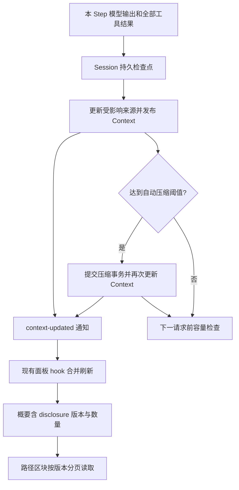

# Context 面板 Step 刷新与路径展示交接

状态：2026-10-18，后端契约、Desktop IPC 与现有面板刷新 hook 已实现并通过自动化测试。同日路径区块（「路径」卡片）与 `nextCompaction` 预判字段已实现并通过自动化测试与浏览器 mock 检查，视觉与交互见[右侧面板规范 · 路径](front-右侧面板与文件渲染规范.md#六个区块)；§5 的 P1–P8 尚未做 Electron / Computer Use 验收。

依据：[07 决策记录](../上下文管理引擎设计/上下文管理引擎V2/07-Step增量更新与披露面板决策记录.md)、[执行摘要](../../exec-runs/20261018-context-step-update/execution-summary.md)。原有内容明细、趋势、统计契约见[后端数据需求](front-Context面板后端数据需求.md)。存储重构由另一任务负责，本接口不改变 Session / SQLite 数据格式。

## 1. 前端要补什么

在右侧 Context 面板增加活跃路径和睡眠路径展示，具体布局由 CloudOps 决定。展示当前周期、活跃数量与上限（当前 100）、睡眠数量，以及两类路径的列表。已有趋势保留。

活跃路径导航会进入模型上下文，但不表示文件全文仍在上下文中。睡眠表示披露状态，不表示文件被删除或无法读取。路径列表是管理信息，不能把全部列表正文再算入 Token 占用。界面无需解释 SQLite、游标编码或引擎类名。

本轮已接通每 Step 的刷新通知，前端无需再建立一套轮询。新路径分页应跟随现有面板状态，保留版本一致性保护。

## 2. 已交付的读取接口

类型真源：`packages/shared/src/context-panel.ts`；Desktop bridge：`packages/shared/src/desktop-bridge/contract.ts`。Renderer 通过现有 `sessionsApi` 调用，不直接访问文件或数据库。这里只交付 Desktop IPC，没有新增 Web/远端接口。

### 概要

`sessionsApi.describeContextPanel({ sessionId, consumerId, versionToken? })` 原有完整响应新增可选 `disclosure`，保持 schemaVersion 2：

```ts
type ContextDisclosureSummary =
  | { status: "unavailable" }
  | {
      status: "ready";
      revision: string;
      cycle: number;
      activeLimit: number;
      activeCount: number;
      sleepingCount: number;
    };
```

- `ready` 且数量为 0：确实没有该类路径，可以展示空态。
- `unavailable`：没有可读的实时披露能力；历史请求仍可展示，但不能据此伪造当前路径。
- 字段缺失：兼容旧后端/旧 mock，按能力不可用处理，不当成 0。
- `notModified: true`：沿用上次完整响应及路径版本，仅按既有逻辑更新历史同步状态。
- `disclosure.revision` 等于 `currentVersion`；它与历史同步进度分离。**路径接口不要传 `entriesPage.revision`、`versionToken`、数字 `contextRevision` 或 Journal seq。**

### 路径分页

```ts
const page = await sessionsApi.listContextPaths({
  sessionId,
  revision: view.disclosure.revision, // 先确认 status === "ready"
  visibility: "active",             // 或 "sleeping"
  limit: 50,
  // cursor: previousPage.nextCursor,
});
```

响应：

```ts
type ContextPathsPage = {
  revision: string;
  visibility: "active" | "sleeping";
  total: number;
  paths: Array<{
    id: string;
    path: string;
    description?: string;
    owners: string[];
    visibility: "active" | "sleeping";
    readsInCycle: number;
    addedCycle: number;
    lastReadAt?: string;
    nextCompaction?: "wake" | "sleep";
  }>;
  nextCursor?: string;
};
```

| 字段 | 展示含义 |
| --- | --- |
| `id` | 路径状态的稳定身份，可作为列表 key |
| `path` | 完整路径；视觉可省略，保留查看/复制完整文本的方式 |
| `description` | 可选说明，缺失时不占空行 |
| `owners` | 路径状态的来源标识，可做次要信息，不是文件所有者或权限 |
| `readsInCycle` | 当前周期的读取次数，不是历史累计次数 |
| `addedCycle` | 加入路径状态时的周期 |
| `lastReadAt` | 可选最近读取时间，缺失时显示未知或省略 |
| `nextCompaction` | 2026-10-18 补：按当前状态预判下次压缩的变化。`wake` 是睡眠路径本周期被读过、下次会回到活跃；`sleep` 是活跃路径下次会转为睡眠；不变时缺省。由 `@actspace/shared` 的 `selectNextActivePathIds` 算出，引擎压缩时的重排用的是同一个函数，前端不复刻规则 |

后端按 path、id 排序。默认每页 50，最大 100；正整数超过 100 会收窄，非法 limit 拒绝。路径行合计限制 192 KiB，超大单条报错，不静默截断路径。`total` 是当前筛选下的总数，是否还有数据以 `nextCursor` 为准。游标是 opaque 字符串，绑定 sessionId、revision、visibility，前端不要解码、拼接或跨筛选复用。

返回值不包括文件全文、路径状态 history 或睡眠索引文件内容。读列表只使用内存投影，不执行 read_file、不激活路径、不触发压缩、不改变文件权限。

## 3. 刷新与版本规则

已修改 `use-context-panel.ts`：订阅 live `run-state` 消息 `context-updated`，只刷新匹配 Session；复用单在途请求、合并刷新、隐藏释放、条件读取及轮询兜底。事件在完整 Step 结果持久化并 reconcile 后发送，压缩成功/产生事实后会再次发布。多个紧邻更新可能合并，保证获取最新视图，不承诺逐帧显示每个中间版本。

该事件只表示“请重新读取”；不要拿 live envelope 的 `throughJournalSeq` 当作 Context 新版本。正式版本由面板响应提供。SQLite 历史仍可处于 syncing，不阻止当前路径显示，也不阻止模型执行。

路径组件需实现：

1. 以 `(sessionId, disclosure.revision, visibility)` 管理分页状态；第一次展开时读取首屏。
2. Session 或 revision 改变时清空旧游标和分页；只接受仍匹配当前请求身份的响应。若展示旧数据过渡，必须明确正在更新，不能拼接到新版本中。
3. 追加页时核对响应 revision、visibility，按 id 避免重复。不要仅按大小比较版本字符串；版本是不透明身份。
4. 历史索引变化但 disclosure.revision 未变时，保留已有路径页。
5. stale/cursor 错误时重新获取面板，再从首屏开始；其他错误在路径区块显示重试，不清空其他可用区块，不无界自动重试。
6. 组件卸载或隐藏后停止新请求，丢弃迟到结果。不要破坏现有面板 consumer 的释放行为。

现有错误通过 IPC 拒绝返回，包括 `Context revision stale; reload the panel.`、`Context path cursor invalid; reload the panel.`、`Context disclosure unavailable.`；本轮未新增结构化错误码。不要把错误消息当路径内容渲染。

## 4. 流程与源码入口



- `packages/core/agent-loop/src/loop.ts`：Step 发布与压缩安全点。
- `apps/desktop/src/main/runtime-v2/context-paths.ts`：摘要、分页、游标与响应预算。
- `apps/desktop/src/main/runtime-v2/context-panel-service.ts`：实时投影、版本核对。
- `apps/desktop/src/main/runtime-v2/fixed-renderer-ipc.ts`：Desktop 接线。
- `apps/desktop/src/renderer/components/right-panel/context/use-context-panel.ts`：刷新入口。
- `apps/desktop/src/renderer/components/right-panel/context/ContextPanel.tsx`：现有面板入口。
- `apps/desktop/src/renderer/components/right-panel/context/ContextPaths.tsx`、`ContextPathList.tsx`、`use-context-paths.ts`、`context-paths-model.ts`：路径卡片、列表、分页 hook 与纯函数。
- `apps/desktop/src/renderer/mock/context-paths-fixture.ts`：确定性路径数据；默认 mock 为 87 活跃 / 342 睡眠，`?mock=context-pagination` 为活跃满 100、睡眠 1284 条多页、400ms 延迟、首次读睡眠失败一次。

## 5. 前端验收清单

这些是 UI 的 Electron 验收要求。2026-10-18 路径区块已实现，自动化测试覆盖了分页、版本切换、去重、stale 恢复、隐藏不请求和复制不发请求，但下列各项尚未在 Electron 里逐项验收：

- P1：活跃/睡眠数量、周期、上限与真实后端一致；空态和 unavailable 不混淆。
- P2：长路径、缺失说明/时间、多来源、100 条活跃路径及多页睡眠路径均能查看，保留完整路径。
- P3：Step 完成或压缩后，数量、周期、列表随新版本更新；未变化的历史同步不重置分页。
- P4：快速切会话、切分类、翻页期间压缩、响应乱序均不混入旧页面；版本过期可以恢复。
- P5：隐藏/卸载停止请求；恢复显示拉取新版本；事件密集时不并发堆积查询。
- P6：读取失败可重试，错误只影响相应区块；没有披露能力时其他 Context 内容仍可看。
- P7：仅查看/复制路径不会触发文件读取、路径激活或压缩；不误导为全文已在模型上下文。
- P8：浅/深主题、窄面板、键盘焦点、滚动和弹层符合现有前端规范；趋势与明细原有交互不回归。

Computer Use 前先列上述验收点，再按“正常列表与分页”“运行中刷新与竞争”“异常及布局”安排路线；可以复用场景，不能省略验收点。按仓库约定由 gpt-6.1-sol 执行，并提交逐项证据。
