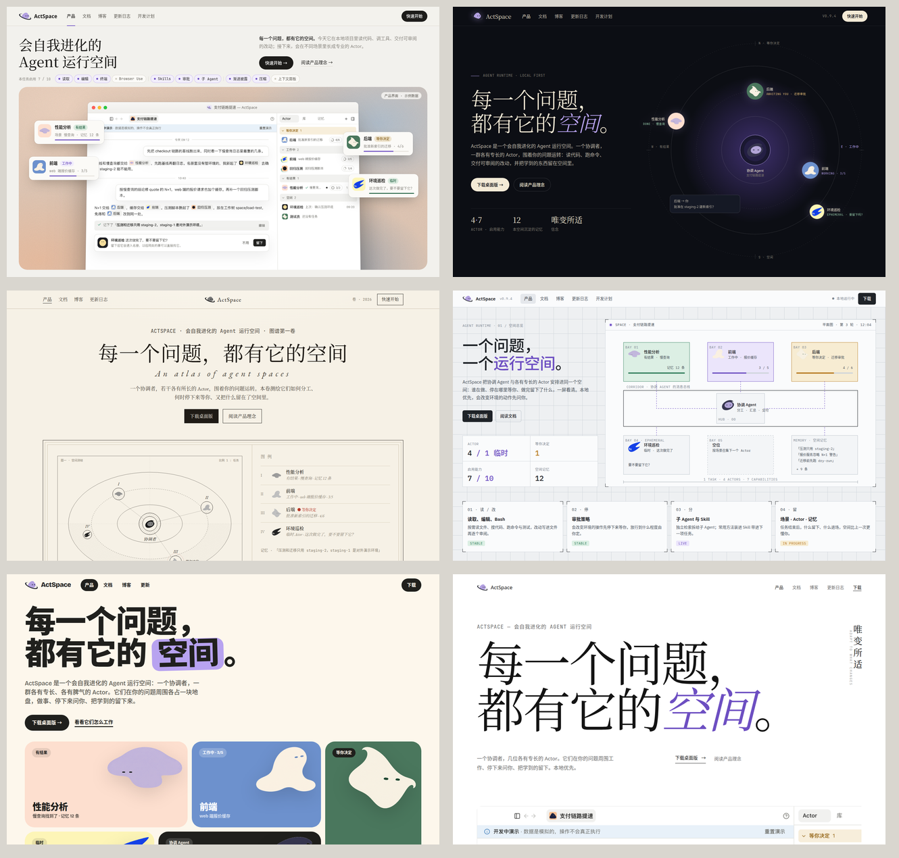
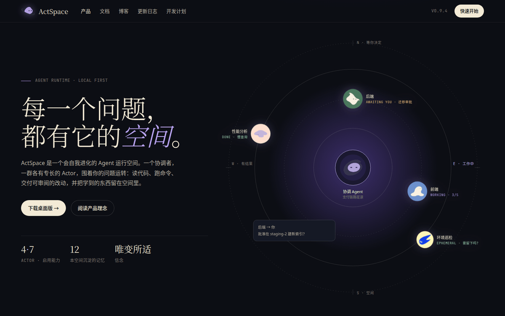
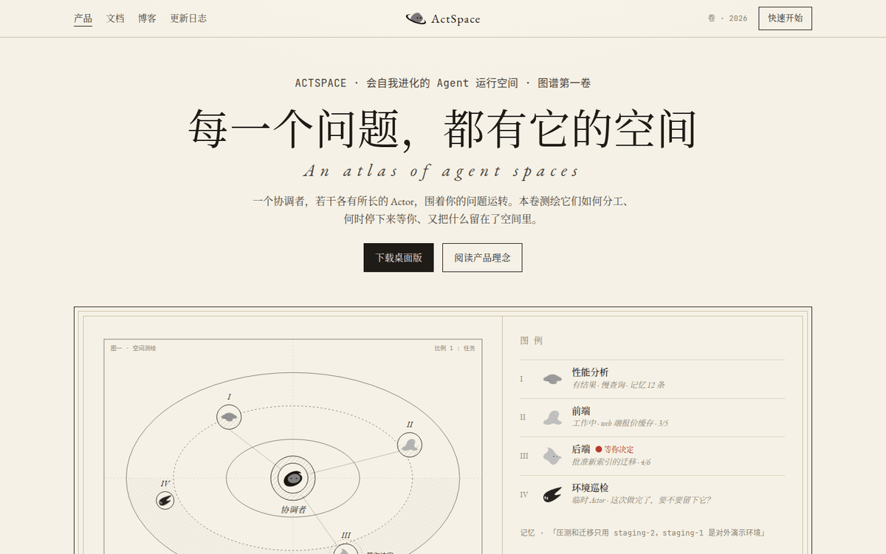
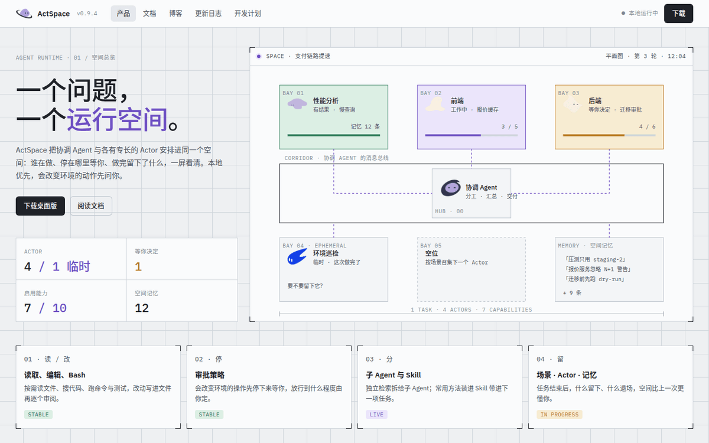
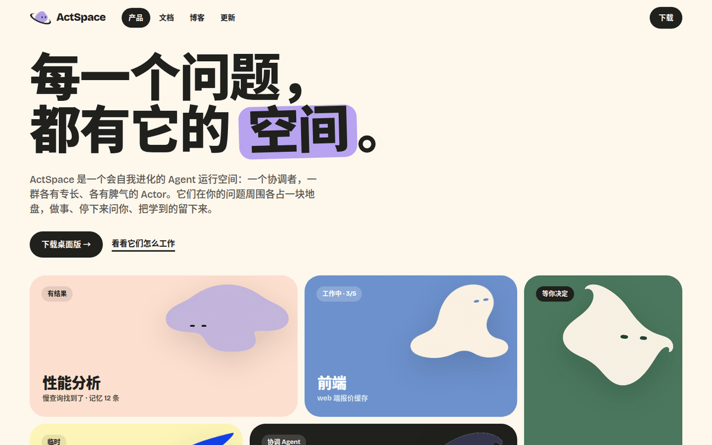
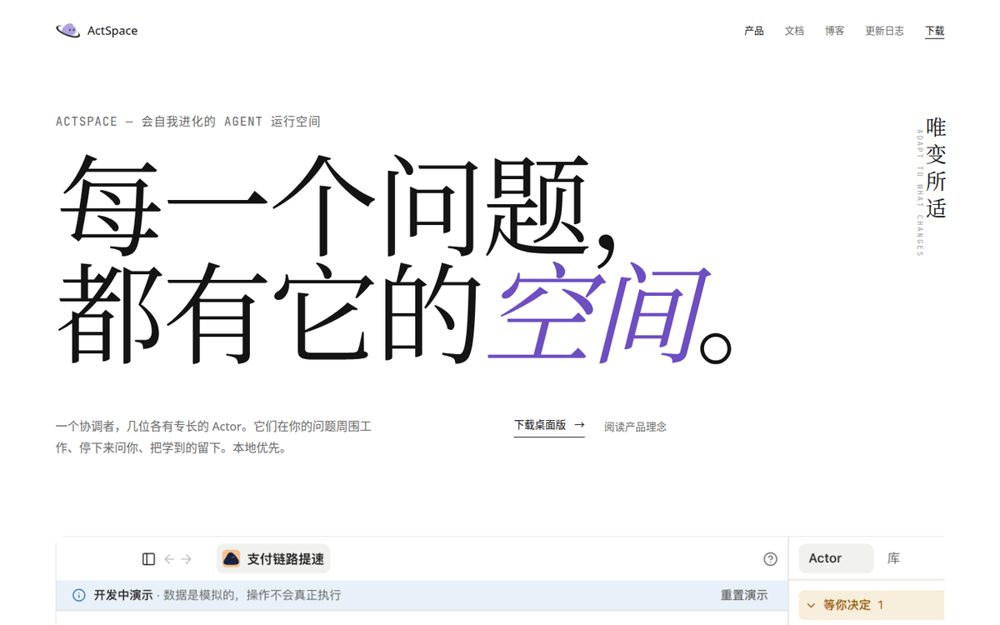

# 官网 V6 视觉方向候选

> 状态：**已评审，全部未采纳**（2026-11-10）。用户看过六个原型后的结论是「都不咋地」，决定不换方向，改为把现有 V4 首页精细化、做得更真实；精修的具体改动见 `docs/histories/2026-11/20261110-0055-site-home-polish.md`，现行规范仍是 `apps/site/DESIGN.md`（V4 首页 + V5 内页）。本目录保留下来只作为「试过什么、为什么不选」的记录，不是现行规范，后面再做视觉方向探索时先读这里避免重复。

## 这一轮回答什么

官网的核心是把「Space」这个东西表达出来。V4 的首页用一个手绘窗口加十个插件开关来讲「能力」，讲清楚了，但没有把「空间」讲出来：看完不知道 Actor 是谁、谁在干活、谁在等我。

这一轮给出两类东西：

1. **方向 0 · V4 精修**：不换气质，只把首屏做「真」。
2. **方向 1–5 · 五个新方向**：每个都用不同的视觉语言回答「空间长什么样」。

六个原型都是独立 HTML，直接用浏览器打开 `demos/*.html` 即可（相对路径引用仓库内的 logo、截图和角色图）。截图在 `shots/`，`overview.png` 是六个首屏的拼图。

## 总览

| # | 方向 | 一句话 | 空间怎么被表达 | 字体 | 底色 |
|---|------|--------|----------------|------|------|
| 0 | V4 精修 | 把现在的首页做真 | 真实 macOS 窗口 + 真实 Space 截图，Actor 名册卡浮在窗口外 | 现有 Charter / 宋体 | 纸本 `#f2f1ed` |
| 1 | 星图 | 深色天文台 | 协调 Agent 在中心，Actor 在轨道上缓慢运行，方位刻度即状态 | Fraunces + IBM Plex Mono | 夜空 `#0c0e14` |
| 2 | 博物志 | 一卷天文图谱 | 编号图版「图一 · 空间测绘」+ 图例 + 朱印 | EB Garamond + JetBrains Mono | 米纸 `#f6f1e6` |
| 3 | 控制台 | 空间站平面图 | 每个 Actor 一个工位（Bay），走廊是消息总线，读数实时 | IBM Plex Sans / Mono | 冷灰 `#eef0f2` |
| 4 | 栖息地 | 精灵各占一块地盘 | 八种角色底色做平涂色块，Actor 精灵住在自己的色块里 | Bricolage Grotesque | 奶油 `#fdf7ec` |
| 5 | 留白 | 字与一张图 | 「空间」就是空：巨大的标题、竖排信念、一张切出页边的截图 | Instrument Serif | 纯白 |

## 逐个说明

### 方向 0 · V4 精修（`demos/0-v4-refined.html`）

- 保留全部 V4 token、舞台色场、颗粒、圆角、按钮，气质不变。
- 首屏窗口换成**真实 macOS 窗口框 + 真实 `space.png` 截图**，轻微 3° 透视，像产品发布图；不再手绘会话气泡。
- 十个插件开关和折线退成标题下一条安静的「能力条」（`本任务启用 7 / 10`），不再和窗口抢位置。
- 四张 **Actor 名册卡**从窗口里「拿出来」，压在窗口边缘：性能分析（有结果）、前端（工作中）、后端（等你决定）、环境巡检（临时）。这是 V4 缺的那一口气：第一眼就看到空间里有谁、在干什么。
- 功能块同样换成真实窗口框。
- 落地成本最低：改 `Hero.astro`、`home.css`、`home-stage.ts` 里的舞台部分，其它页面不动。
- 风险：依赖真实截图的更新节奏；界面一变首页就旧。

### 方向 1 · 星图（`demos/1-starchart.html`）

- 把产品概念里的「宇宙 + 计算」意象当真：深色夜空、同心轨道、东西南北四个方位各对应一种 Actor 状态（N 等你决定 / E 工作中 / W 有结果 / S 空闲）。
- 协调 Agent 在中心，Actor 以 140–200 秒一圈的速度缓慢运行，单色读数（`AWAITING YOU · 迁移审批`）。
- 品牌紫只做星光、斜体强调和指针，不做大面积底色；暖白文字避免冷硬。
- 下方「观测记录」用一条渐变描边的面板放真实截图，像从天文台窗口看出去。
- 优点：最有「空间感」，最容易被记住，和 logo（紫色星球 + 环）最契合。
- 风险：全站深色与现有 docs / blog 的浅色体系冲突，要么双主题，要么只首页深色；截图是浅色界面，嵌在深色里对比强，需要加深色边框过渡。

### 方向 2 · 博物志（`demos/2-atlas.html`）

- 一本旧天文学图谱：米色纸、墨线铜版画、双线框、「图一 · 空间测绘」编号图版、罗马数字图例、页边批注、朱印「唯变所适」。
- 空间 = 一张被仔细测绘过的天体图；Actor = 图版中的天体（角色精灵去色后当作铜版画里的星体）；记忆 = 页边批注。
- 真实截图做「图二 · 实测」，用轻微 sepia 当作图谱里贴的照片。
- 优点：最有文化气质，和「有分寸」的性格最接近；中英文衬线混排天然好看。
- 风险：最「慢」，不像软件官网；需要克制，一不小心就变成仿古装饰；图版 SVG 是手工画的，维护成本高。

### 方向 3 · 控制台（`demos/3-console.html`）

- 空间站平面图：冷灰网格底、带角标的面板、单色大写标签、尺寸标注线。
- 首屏是一张舱室平面图：Bay 01–05 各是一个 Actor 工位，中间 Hub 是协调 Agent，走廊是消息总线，虚线流动表示消息；Memory 舱放空间记忆；空位 Bay 05 表示「按场景召集下一个 Actor」。
- 颜色按状态：绿 = 有结果、紫 = 工作中（live）、琥珀 = 等你决定。
- 优点：最「工程」，最直接地把「运行空间」画成一个可读的系统图；和 docs 的信息密度一致。
- 风险：容易像后台 dashboard 而不是官网；亲近感弱，精灵在这里只是图标。

### 方向 4 · 栖息地（`demos/4-habitat.html`）

- Actor 是「专业又亲近的精灵」，那就让它们住进来：八张角色封面的底色直接做平涂色块（桃、蓝、松绿、黄、石板、紫），32px 大圆角，粗壮无衬线。
- 首屏是一个 bento 式栖息地：每个 Actor 占一块有自己颜色的地盘，状态是色块上的小标签；协调 Agent 是黑色地块；真实截图放在最大的石板色块里。
- 通栏紫色带「它们会长大。空间也会。」
- 优点：最有性格、最年轻、最能把精灵用起来；移动端天然好排。
- 风险：和「有分寸」的气质有距离，偏消费品；如果精灵不再是品牌资产，这个方向立刻失去支点。

### 方向 5 · 留白（`demos/5-whitespace.html`）

- 「空间」最直接的表达就是空。纯白、一个占半屏的标题、一行竖排「唯变所适」、一张从右页边切出去的真实截图、三段话、一行用精灵当字的 Actor 名册句子。
- 几乎没有动效、没有卡片、没有色场；紫色只出现在「空间」两个斜体字上。
- 优点：最克制、最像一个有自信的产品；落地最简单；和 V5 内页的「稿纸」气质最连续。
- 风险：信息量最少，首屏不解释功能，靠文档和截图承担；如果截图不够好看，整页就塌。

## 共同约定

- 所有原型都用真实的 `space.png` 截图，不再手绘窗口内容。截图更新节奏要进发布流程（`docs/releases/README.md`），否则首页会过期。
- 原型里的 Actor 精灵来自 `apps/site/src/assets/blog/covers/character-0N.png` 的纯色底抠图（`demos/assets/sprite-0N.png`，640px）。如果选用的方向需要精灵，正式实现时应从源文件导出透明 PNG / SVG，而不是用这里抠的版本。
- 原型通过 Google Fonts 引入外部字体，只为看效果；正式实现按 `docs/SECURITY.md` 和现有 `tokens.css` 的做法自托管子集字体，并补齐中文回退（现状 Windows 回退到 SimSun 的问题要一并解决）。
- 原型只做桌面 1440 和 390 两档断点，内页（docs / blog / updates）都没画。选定方向后内页按 V5 结构套该方向的 token。

## 建议

如果只能选一个：

- 想**稳**：方向 0。两三个文件的改动，首页立刻从「示意」变「真实」，并补上 Actor 名册这个缺口。
- 想**换一口气**又不想丢掉现在的纸本内页：方向 5（留白）或方向 2（博物志），两者和 V5 内页都能自然接上。
- 想让人**一眼记住「空间」**：方向 1（星图）。代价是深色和内页体系要重新对齐。

也可以组合：方向 0 的真实窗口 + 方向 1 的星图当背景色场，或者方向 5 的排版 + 方向 4 的精灵名册句子。
