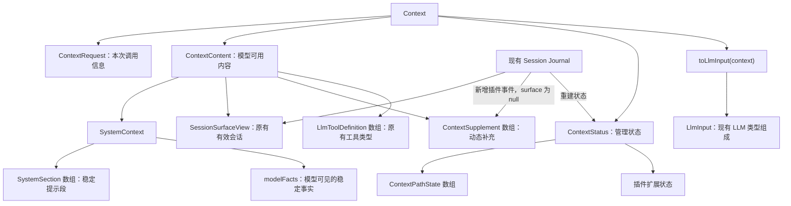
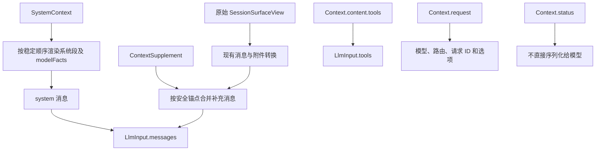

# Context数据结构和模型输入数据结构的设计规范

状态：2026-10-06 第一版实现已接入；自动化与真实界面的验证范围见[执行摘要](../../exec-runs/20261006-context-management-engine/execution-summary.md)。本文维护设计契约，不承诺未执行的 Provider 验收。

## 1. 设计定位

对外只需要理解两个主要对象：`Context` 和 `LlmInput`。具名子类型用于让字段清楚，不代表新增插件、服务、存储文件或处理阶段。

**Session 保存事实，Context 组合事实与补充信息，LlmInput 表达本次模型输入。**

- Context 是现有 Session 之上的兼容与补充层，不是新版 Session 存储格式。
- 直接复用 `SessionSurfaceView`、现有消息内容块及 LLM 类型，不建立第二套会话模型。
- 新状态可持久化到 Session，但只能通过已有扩展与写入机制追加，不重写历史。
- 不再将早期讨论中的 `ContextEntry`、`ContextAssembly`、`SessionContextState` 作为额外公共入口；本文取代这些候选方案。
- 插件通过统一 Context 契约协作，不依赖其他插件内部实现。

## 2. 数据结构关系



## 3. 类型定义

以下为目标 TypeScript 契约。`SessionSurfaceView` 来自现有 Session；`LlmMessage`、`LlmToolDefinition`、`LlmRequestOptions` 来自现有 LLM 服务；`RuntimeV2JsonValue` 为现有 JSON 值类型。本文不复制、改写这些已有类型。

### 3.1 Context 与内容

```ts
interface Context {
  readonly request: ContextRequest;
  readonly content: ContextContent;
  readonly status: ContextStatus;
}

interface ContextRequest {
  readonly sessionId: string;
  readonly turnId?: string;
  readonly stepId?: string;
  readonly requestId: string;
  readonly routeId: string;
  readonly model: string;
  readonly options: LlmRequestOptions;
}

interface ContextContent {
  readonly system: SystemContext;
  readonly conversation: SessionSurfaceView;
  readonly supplements: readonly ContextSupplement[];
  readonly tools: readonly LlmToolDefinition[];
}
```

`turnId`、`stepId` 在正常模型请求中必须提供；手动压缩等发生在 Turn 之间的上下文操作允许缺省，不伪造会话身份。

`request` 的模型选择同时用于系统 Prompt 选择与最终调用。组装后切换模型时，必须重新处理受模型影响的内容。取消信号属于调用控制，凭据属于现有 Host/LLM 服务，不进入可持久化 Context。

`readonly` 表示插件不能通过修改数组绕过引擎或 Session 写入；运行时需要冻结或等效隔离，不能只依赖 TypeScript。

### 3.2 SystemContext

```ts
interface SystemContext {
  readonly sections: readonly SystemSection[];
  readonly modelFacts: readonly RuntimeV2JsonValue[];
}

interface SystemSection {
  readonly id: string;
  readonly owner: string;
  readonly order: number;
  readonly content: RuntimeV2JsonValue;
}
```

- `owner` 由注册归属确认，支持取消来源注册，不允许插件冒充其他 owner。
- `content` 兼容当前 contributor 的文本和结构化输出，不强制本轮将它们全部迁成字符串。
- 使用稳定排序；同顺序时采用稳定身份作为次序依据，不依赖插件加载时机。
- `modelFacts` 只包含明确需要向模型公开的事实，审计事实留在 `status.facts`。
- 不在此保存一份可独立修改的 `renderedSystemPrompt`。渲染结果在转换时产生，需要审计时写入现有请求快照。

### 3.3 动态补充

```ts
interface ContextSupplement {
  readonly id: string;
  readonly owner: string;
  readonly sourceEventSeq: number;
  readonly afterEventSeq: number;
  readonly text: string;
}
```

- `sourceEventSeq` 是补充记录的 Journal 位置；`afterEventSeq` 是请求中的插入锚点，`-1` 表示会话之前。
- 通过插件事件持久化，`surface: null`；不新增 Surface 节点种类，也不冒充真实用户输入。
- 转换为模型消息时明确标注 Runtime 来源，可使用现有 `user` 角色承载补充文本。
- 只有展示内容变化才追加新补充，已经保存的记录不逐轮改写；读取计数变化不等于展示内容变化。
- 插入位置必须在完整消息边界，不能拆开工具调用与结果。
- 旧导航保持到压缩，以最新导航为准；压缩输入排除旧的可识别导航补充，压缩成功后在安全尾部重新补入当前导航。具体锚点解析和去重接线必须在实现计划中验证。

这修正早期“把动态补充直接追加成普通 user/message”的讨论。当前 Surface 对事件与节点有严格对应限制，新增插件事件不能任意发布 Surface 消息。

### 3.4 管理状态与路径

```ts
interface ContextStatus {
  readonly throughJournalSeq: number;
  readonly cycle: number;
  readonly paths: readonly ContextPathState[];
  readonly sleepingDirectory?: {
    readonly artifactId: string;
    readonly mediaType: string;
    readonly path: string;
  };
  readonly facts: readonly RuntimeV2JsonValue[];
  readonly plugins: Readonly<Record<string, RuntimeV2JsonValue>>;
}

interface ContextPathState {
  readonly id: string;
  readonly path: string;
  readonly description?: string;
  readonly owners: readonly string[];
  readonly visibility: "active" | "sleeping";
  readonly readsInCycle: number;
  readonly addedCycle: number;
  readonly lastReadAt?: string;
  readonly history?: {
    readonly sessionId: string;
    readonly sourceEventSeqs: readonly number[];
  };
}
```

- 状态按 Session 隔离。`plugins` 按插件 ID 隔离扩展数据，不能成为所有插件任意改写的全局字典。
- 来源提交需要保留的路径，披露策略统一维护计数与可见性；各来源不另存路径计数。
- 文件按来源工作区解析后的规范化路径识别；同一 Journal 文件合并为一条路径，`history.sourceEventSeqs` 合并精确集合，不能因路径去重丢掉来源。
- 历史保留精确 `sourceEventSeqs`，展示时可整理为范围，不能用最小/最大序号取代精确来源。
- 读取只计数；成功压缩后统一调整活跃与睡眠并清零，详见[渐进式披露设计](agent-progressive-disclosure.md)。
- `addedCycle === 当前 cycle` 表示本周期新路径，包括工具和本次压缩的新增引用；重复登记不能刷新。保护不突破 100 条上限。
- 活跃项只允许具体文件，最多 100 条，按本周期读取次数降序选择；同分与容量裁剪规则见渐进式披露规范。睡眠目录入口单独存于 `sleepingDirectory`。
- 历史文件直接提供原始 Journal 路径和精确来源序号，不生成摘录。物理路径及其可读性由 Host 接线提供，Session 存储契约保持中性。
- 最近读取时间不保证文件仍未变化。第一版不新增文件版本库或文件监听。

### 3.5 LlmInput

```ts
interface LlmInput {
  readonly requestId: string;
  readonly sessionId: string;
  readonly routeId: string;
  readonly model: string;
  readonly messages: readonly LlmMessage[];
  readonly tools: readonly LlmToolDefinition[];
  readonly options: LlmRequestOptions;
}
```

名称为 `LlmInput`，不是 Token 统计结构。它直接兼容当前 `PrepareLlmRequest` 的调用内容；取消信号另行传入，凭据继续由现有 LLM 服务处理。

## 4. 转换与调用

公共使用方式：

```ts
const context = await engine.getContext(request);
const input = await engine.toLlmInput(context);
const prepared = await llm.prepareAsync({ ...input, signal });
```

转换方法目标为 `toLlmInput(context: Context): Promise<LlmInput>`。异步用于复用现有附件/文件引用解析，不意味着增加公共中间对象。



转换器不压缩、不改变活跃状态、不调用来源插件、不改写 Session 或 Context。它保留消息角色、工具调用对应关系、图片及推理回放信息，复用现有归一化行为。路径由披露插件生成可见文本；不能再把整个 `status.paths` 注入一次。

供应商协议、图片字节处理和供应商缓存配置仍归现有 LLM Adapter。

## 5. Session 兼容与持久化

| 已有部分 | 设计约束 |
| --- | --- |
| 事件外壳、Header、JSONL 及 Provider | 不替换，不让 Context 直接读写物理日志 |
| Surface、消息节点、内容块 | 原样复用；插件不能直接改 entries |
| 来源序号和 replaceGeneration | 保留 |
| 压缩事务 | 通过现有 Session 接口提交 |
| append、flush、恢复 | 继续使用现有业务与持久屏障 |
| request/context.snapshot | 保留现有契约，不用整个 Context 替换 |
| 新属性和补充记录 | 注册插件 Codec，追加 versioned 事件到同一 Journal |

新增事件使用已有 envelope，类型位于 `plugin/<ownerPluginId>/...` 命名空间，状态数据放入 `data`，不改变对话时使用 `surface: null`。必须注册 Codec 并遵守 owner、版本、JSON-safe 和现有记录大小限制。

旧会话没有新事件时初始化默认状态，不伪造历史读取次数。新版本读旧会话与旧版本读新会话是不同的兼容要求：未知 required 事件会导致 browse-only，未知 ignorable 事件会降级；不能为了旧版本可读将所有新事件任意标成 ignorable。

行为插件停止注册不应顺带失去历史解码能力；Codec 发现与行为启用按现有架构分离。新增状态保存必要变化，大目录复用 artifact 能力，不每次序列化整个 Context。睡眠目录应是可从状态重建的导航产物，不能成为另一份不可恢复的事实源。

现有请求快照继续记录实际输入与必要来源；通过内部映射保留 `messages`、`systemSections`、`modelFacts`、`facts`、`renderedSystemPrompt` 等现有消费者需要的字段。快照不是第三个新公共模型。

## 6. 数据例子

以下路径和身份均为示意：

```text
Context
├─ request：session-1 / request-1 / main / selected-model
├─ content
│  ├─ system
│  │  ├─ 系统 Prompt：你是 ActSpace 开发助手……
│  │  └─ AGENTS 规则：修改代码前说明方案……
│  ├─ conversation：原有 Surface，包含“检查登录问题”
│  ├─ supplements：活跃资料和睡眠目录入口，锚定在用户消息之后
│  └─ tools：当前 read_file、grep 等工具定义
└─ status
   ├─ cycle：3
   ├─ login.ts：active，readsInCycle = 2
   ├─ old-auth.md：sleeping，readsInCycle = 1
   └─ sleepingDirectory：/session/context/sleeping.md
```

`old-auth.md` 本周期读过一次但仍为睡眠，下次成功压缩再统一参与前 100 条的活跃选择。转换得到：

```text
LlmInput
├─ requestId、sessionId、routeId、model、options
├─ messages
│  ├─ system：系统 Prompt + AGENTS 规则
│  ├─ user：检查登录问题
│  └─ user：带 Runtime 来源说明的资料入口
│       活跃：/workspace/src/login.ts
│       其他资料：/session/context/sleeping.md
└─ tools：当前可用工具定义
```

计数、插件状态和审计 facts 不进入模型消息。下一步读取文件后，原始 Session 正常追加助手与工具结果；相同补充不重复写入，计数更新不导致 system 改变。

## 7. 缓存与取消注册

动态内容通过消息追加减少对稳定前缀的干扰，但 user 角色本身不保证缓存命中。修改早期消息、系统 Prompt、工具、模型或进行压缩，仍可能影响缓存。

取消来源注册后，下次组装排除它的直接贡献和可识别的动态补充；不删除 Journal，不扫描删除用户或工具历史中引用过的文本。共享路径仍有其他有效来源时可以保留。移除旧补充可能改变请求前缀，这是关闭功能的明确代价。

## 8. 实现前后的验证边界

源码检查支持上述扩展方式，但“保持格式兼容”不等于实现已经无影响。后续计划必须明确：

- 补充锚点在多工具结果、压缩、fork 和恢复后的解析方式。
- 路径计数、压缩成功与周期推进的持久化顺序和幂等性。
- 文件 artifact 解析、读取缓存与压缩的衔接。
- 新 Codec 的 criticality、版本、关闭行为插件后的解码可用性。
- 请求快照与实际 LLM 输入一致，既有展示、统计和恢复消费者不退化。

验收至少覆盖旧会话、文本/图片/附件/工具消息、精确来源追溯、追加状态后重启、压缩中断、fork 引用、插件关闭、模型切换和补充去重。Session 原始记录不应因读取或转换被修改。

## 9. 关联与源码依据

- [插件拆分](上下文管理引擎的插件拆分和上下文的插件拆分.md)
- [渐进式披露](agent-progressive-disclosure.md)
- [设计原则](agent-plugin-design-principles.md)
- [Session 业务与存储边界](../agent-plugin-runtime/agent-spec-session-core-persistence-separation.md)
- [Surface](../../../packages/session/journal/src/surface.ts)、[Codec registry](../../../packages/session/journal/src/codec-registry.ts)、[SessionHandle](../../../packages/session/persistence/src/session.ts)
- [LLM 消息](../../../packages/llm/service/src/message.ts)、[LLM 请求](../../../packages/llm/service/src/service.ts)

## 实施接线

已整理[执行计划](../../exec-plans/completed/20261006-context-management-engine/README.md)和[共享实施契约](../../exec-plans/completed/20261006-context-management-engine/shared-contracts.md)，明确补充生命周期、压缩持久化与 fork；实现入口是 `packages/context/src/engine.ts`，验证范围见执行摘要。
