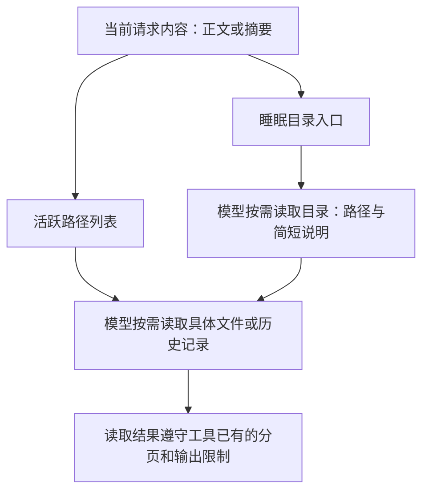
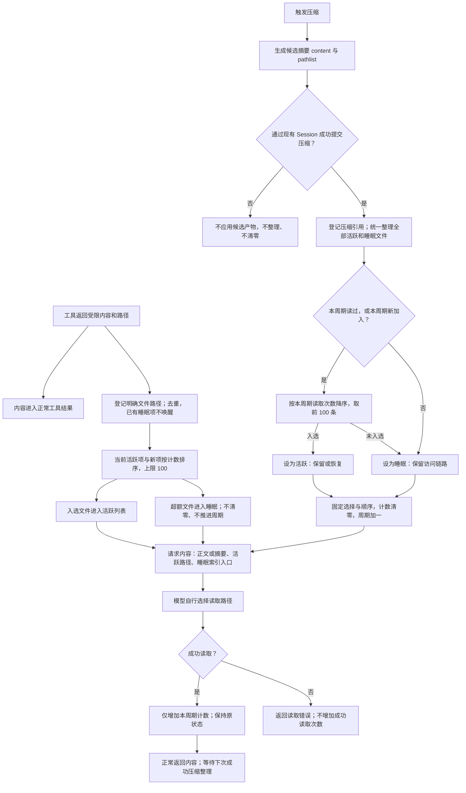

# 上下文渐进式披露设计

状态：2026-10-06 第一版实现已接入；自动化与真实界面的验证范围见[执行摘要](../../exec-runs/20261006-context-management-engine/execution-summary.md)。本文维护设计契约，不承诺未执行的 Provider 验收。

完整的数据对象与插件职责分别见[数据结构规范](Context数据结构和模型输入数据结构的设计规范.md)和[插件拆分规范](上下文管理引擎的插件拆分和上下文的插件拆分.md)。本文件保留渐进式披露行为；`content`/`pathlist` 描述压缩产物语义，不要求增加新的公共条目对象。

## 目标与原则

长程任务会不断积累正文和文件路径。压缩可以减少正文，但不能让原始材料的访问入口随之丢失；路径本身也需要整理，避免直接引用清单无限增长。

第一版追求简单有效、模块职责清楚、策略可扩展：

- 模块提供内容和路径，模型自行判断是否沿路径读取。
- 工具已有的分页、截断、输出文件等策略继续负责控制工具结果大小，不另建复杂的资源准入流程。
- 引擎独立维护引用状态；请求内容被压缩，不等于路径状态被删除。
- 通过活跃列表和睡眠目录逐层披露，不自动展开所有引用正文。
- 在压缩完成时，由代码根据本周期读取情况整理引用，不依赖压缩模型逐条判断重要性。

## 内容与状态

上下文引擎管理所有可访问的上下文信息。下一次请求根据管理状态选择、组织内容，不把全部内部状态直接发给模型。

| 部分 | 含义 |
| --- | --- |
| 内容 | 对话、工具结果、摘要，以及向模型展示的路径和说明 |
| 状态 | 独立维护的路径列表、活跃或睡眠标记、本周期读取计数等管理信息 |

“状态不变”指状态不会随着消息淡出或被压缩而丢失，不是指状态不能更新。读取、登记路径和压缩整理都可以改变状态。

内容与状态分开管理是逻辑职责的区分，不代表新增两个可独立覆盖的持久事实文件。持久化、恢复和 Journal 接线需要在实现计划中明确，沿用仓库现有 Session 事实边界。

## 三层披露

1. **当前窗口**：本次请求的正文、摘要、活跃路径及睡眠目录入口。
2. **活跃上下文**：当前窗口直接展示入口的材料；正文由模型按需读取。
3. **睡眠上下文**：路径被收拢到目录文件中；当前窗口保留目录入口，模型先读目录，再选择具体材料。

活跃与睡眠描述引用的曝光状态，不代表原文件被移动或删除。活跃也不意味着原文件全文始终放进窗口。

**活跃列表只展示具体文件，最多 100 条，不接受目录路径。** 睡眠目录是一个可读取的索引文件，通过独立入口展示，不计入这 100 条，也不参与文件读取热度排名。发现目录不自动展开、登记其全部子文件。100 条限制针对当前权威活跃列表，不扫描删除历史消息里曾出现的路径。

活跃列表通过带来源的动态补充进入请求消息序列，不逐轮修改系统提示词。补充使用插件事件持久化且 surface 为 null，转换时按安全锚点插入；不改写原始 Session Surface。正文无变化不重复追加，具体锚点、压缩后重新补入和去重接线见数据结构规范。

## 路径的两种产生方式

### 工具输出

工具按自身策略控制输出。内容过大、需要保留后续访问入口时，返回受限正文和文件路径，并把需要持续保留的路径交给引用管理。

路径可以同时出现在工具结果末尾和活跃列表中。这种重复可以接受：工具结果解释本次操作，活跃列表提供持续可见的入口。路径列表内部按路径去重，不对全部正文做全局去重。

### 上下文压缩

压缩插件提供两个概念字段：

| 字段 | 职责 |
| --- | --- |
| `content` | 摘要正文，保留 `Relevant Files` 章节，列出相关文件或目录及用途 |
| `pathlist` | 要保留的文件和历史引用；交给引擎统一登记 |

摘要与 `pathlist` 可以包含相同文件，列表内部去重，不跨正文删除引用。摘要中的目录说明不进入活跃文件列表。

模型只负责生成摘要 `content`；压缩插件用代码收集 `pathlist`，不要求模型生成 JSON 路径清单。公共交互仍使用 Context；不新增公共摘要对象体系。提示词及其来源见[压缩提示词设计](agent-compaction-prompt.md)。

路径来源包括工具已明确返回的路径，以及从被压缩原始内容中用正则提取的文件路径。不能只扫描生成后的摘要，否则摘要遗漏的路径也会一起丢失。正则是简单抽取手段，不保证识别全部有效路径，不能把任意匹配字符串直接视为已验证文件。

历史引用直接指向原始 `journal.jsonl`，附带精确来源序号；不生成可读摘录文件，也不转换为另一份历史格式。模型自行按工具限制读取或搜索。来源序号不是文件行号，不向模型作此承诺。多次压缩合并同一历史文件的精确来源序号集合；展示时可以合并连续区间，不能扩大成含无关记录的最小/最大范围。

当前 JSONL 的物理路径由 Host/存储实现解析，Context 不拼接存储目录。读取能力要通过现有权限接线允许访问对应历史文件；仅输出路径并不能使工作区外的 Journal 自动可读。不为内存等没有文件的后端伪造路径或生成摘录；此类后端保留 Session/序号追溯信息，并明确不提供文件导航能力。

## 模块分工

| 负责方 | 职责 |
| --- | --- |
| 工具插件 | 控制结果大小，产生正文和需要保留的路径 |
| 压缩插件 | 生成摘要，提供路径列表与历史访问入口 |
| 读取工具接线 | 成功读取后报告路径，只增加计数，不调整活跃或睡眠状态 |
| 渐进式披露策略 | 用代码决定哪些路径保持活跃、哪些转入睡眠 |
| 上下文引擎 | 维护状态，提供登记和调整操作，组装给模型的内容 |

工具不需要了解睡眠目录的组织细节。引擎也不内置每种工具自己的分页、截断规则。

## 路径登记与计数范围

- 登记成功读取的具体文件、工具明确返回的完整输出文件、工具明确报告的修改目标，以及压缩引用。
- 不批量登记 glob/grep 的搜索命中，不猜测 Bash 命令访问过哪些文件。正则只补充原始待压缩内容中的文件引用，并在来源工作区基准下归一化、过滤目录、合并重复项；不能把匹配结果当作已验证可读。
- 同一文件只有一份计数。相对路径按产生引用的工作区解析；来源不明时不猜路径。读取已登记文件的分页每次成功都加一，`read_file` 的未变化缓存命中也算成功读取。
- 失败、目录列举、grep 命中、Bash 输出不增加读取次数；工具成功事实按调用身份去重，恢复重放不重复加一。
- 重复登记不增加读取次数、不重置 `addedCycle`，也不唤醒睡眠引用。

## 已确认的周期规则

读取次数按两次成功压缩之间的周期统计，不使用整个任务的累计次数。

| 事件 | 状态处理 |
| --- | --- |
| 新文件引用登记 | 设置 `addedCycle = 当前 cycle`；在容量规则下加入活跃候选 |
| 成功读取文件 | 本周期计数加一；不改变活跃/睡眠状态，不重新排序已展示列表 |
| 压缩成功完成 | 从全部引用选出本周期读过或本周期新加入的候选，按读取次数降序取最多 100 条活跃，其余睡眠 |
| 整理完成 | 固定本次选择和展示顺序，计数清零，`cycle` 加一 |
| 压缩失败 | 不应用本次摘要产物和整理结果，不清零、不推进周期；此前工具已记录的计数仍保留 |

新路径保护条件为 `addedCycle === 当前 cycle`，包括本周期工具登记及本次压缩产出的新路径。保护表示有资格参与本次选取，不突破 100 条上限；进入下一周期后，若未读取，就不再受保护。

确定排序采用：`readsInCycle` 降序、`lastReadAt` 降序（未读排后）、`addedCycle` 降序、稳定路径 ID 升序。同分规则只用于稳定决策；不加入额外重要性权重。完成选择后才清零，不能清零后重新排序。

**100 条是硬上限。** 周期中新增引用导致超限时，只对“当前活跃项 + 此次新项”按同一规则保留前 100 条，其余进入睡眠；不会顺便提取已有睡眠项。已有睡眠引用只有在下一次成功压缩时才有机会恢复；本周期读过但排到第 101 名的引用仍然睡眠。没有压缩插件时也遵守容量限制，但不自动推进周期或唤醒睡眠引用。

这里区分两个动作：读取只计数；压缩统一决定恢复与周期淘汰。登记时的容量裁剪仅保证列表上限，不建立另一套睡眠唤醒策略。

状态调整与压缩提交必须可恢复且幂等，沿用现有 Session 事务和持久屏障，具体接线及崩溃点验证由实现计划固定。

## 完整流程

图中的工具返回与压缩是两条独立入口，不要求工具返回后马上压缩。压缩路径登记、摘要生效、引用整理之间的提交顺序需要在实现时保证一致，图不规定底层事务 API。

## 一个跨周期例子

上次压缩后，A、B、C 三条路径处于活跃状态，读取计数都为零。

1. 本周期读取 A 两次、B 一次，没有读取 C。
2. 本轮压缩产生摘要和一条新的历史引用 H。
3. 压缩成功后，代码保留 A、B 和刚加入的 H，将 C 收进睡眠目录。
4. 计数清零。新请求展示摘要、A/B/H 的入口及睡眠目录入口。
5. 模型后来从睡眠目录找到并成功读取 C，C 的本周期计数变为一，仍处于睡眠状态；本次读取照常返回内容。
6. 下一次压缩成功后，统一整理全部路径，C 因本周期计数大于零且排名未超出 100 条恢复活跃，然后计数清零。若排名超过 100，仍保留在睡眠目录。

模型读取的是材料，代码维护的是引用状态；整理本身不需要再次调用模型来评估每条路径的重要性。

## 文件变化与读取缓存

文件引用采用简单方向：路径、简短说明和最近读取时间；未读过的路径不伪造读取时间。时间说明最近何时读取，不保证文件内容没有变化。

第一版不增加文件版本保存、文件监听或“文件一变化就删除引用”。再次读取时获得文件当前内容；已有历史记录的访问入口继续用于回看历史。

必须处理现有读取缓存与压缩的衔接：压缩后原正文可能已经退出窗口，不能仅因文件未变化就提示模型复用旧内容。缓存键现包含 Session 与有效 Surface.replaceGeneration，压缩后第一次读取重新返回正文。

## 实现与验证边界

2026-10-06 实现确认：

- `packages/tools/filesystem-read/src/node-ports.ts`：`read_file` 支持 `offset`、`limit`，默认 200 行；同一路径和范围可命中未变化缓存，支持 `force`。
- `packages/tools/shell-tools/src/node-ports.ts`：Bash 内联正文上限 8,000 字符，超限时保存输出 artifact；磁盘输出另有安全上限。
- `packages/context/src/conversion.ts`：将文本 artifact 解析为可读路径，并提示用分页读取或搜索访问。
- 本轮检查的工具运行层和 Agent Loop 中未发现“全部工具统一限制为 2,000 字符”的规则。

统一路径登记、周期计数和活跃/睡眠整理现位于 `packages/context/src/disclosure/`；工具通过命名 detail 提交文件事实。普通文件只登记当前路径，不创建版本快照。

相关当前规范：[工具输出与引用](../tool-system/agent-tool-output-references.md)、[Context 与 Usage](../model-context/agent-token-usage-and-context-state.md)、[Session 持久化](../agent-plugin-runtime/agent-spec-session-core-persistence-separation.md)。

## 后续实现计划与验证

路径规范化由 Runtime Host 完成；成功结果按 seq 去重；睡眠索引使用类型化 artifact 引用。候选批次先 flush，四条 core 事件提交并 flush 后，才提交 applied。中断恢复只完成缺失派生步骤。原始 Journal 路径由 JSONL Host 提供，读取仍走既有权限流程，内存会话不伪造路径。

验证至少覆盖：两种入口、正文允许重复但列表去重、原始内容路径抽取、相对路径基准、目录过滤、100/101 条边界、同分稳定排序、新路径保护与上限的优先级、睡眠读取只计数、下次成功压缩排名恢复、清零后的顺序稳定、重复登记不提前唤醒、压缩失败与崩溃恢复、原始历史可读、连续压缩不丢精确来源，以及压缩后重新读取正文。

未来的检索 Agent、质量修复 Agent、业务工具许可判断和工作流沉淀不属于第一版。临时插槽、来源刷新和第一版范围见[插件规范](上下文管理引擎的插件拆分和上下文的插件拆分.md)。

## 2026-10-06 验收修正

- 文件提示抽取识别 read_file 的行号前缀，规范化后仍只接受真实文件。
- 睡眠索引身份和规范路径由状态记录；工具结果、历史与摘要候选共用排除规则，索引不占普通文件名额。新增可选 indexPaths 字段用于重启和 fork 后保留历史索引路径身份；旧事件仍可解码，后续索引事件可纠正错误的派生条目。
- 已成功处理但不含普通文件的工具结果也记空 fact，避免 fork 后重新解释。每次成功 applied 将恢复边界推进至对应 compaction/end，恢复补写较晚时不跳过之后的新工具结果；读取来源是否启用仍按 request/context provenance 判断。
- 原始 Journal 引用通过 SessionStorage 的可选 journalPath 能力取得，JSONL Cordis 包装服务透传，披露插件无需识别具体存储类；内存会话不提供该能力。
