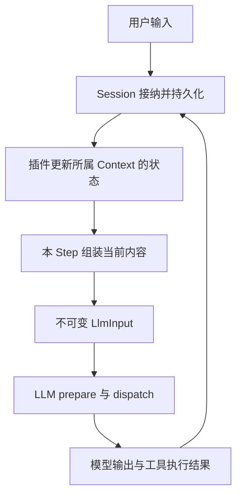
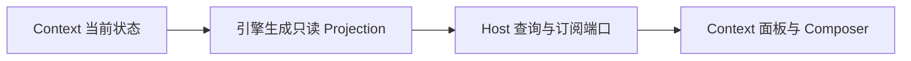
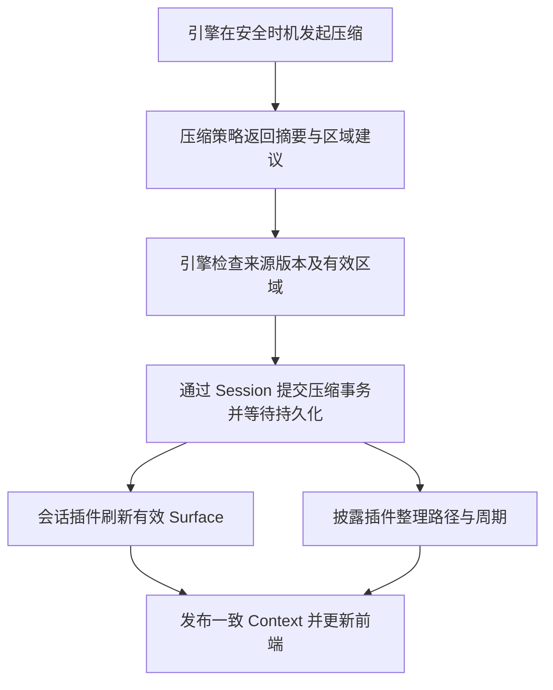

# 总体设计与调用流程

状态：V2 目标设计，已审阅；长期实例、reconcile 和只读 Projection 已有第一阶段实现。总入口见 [README](README.md)。

## 1. 从一次组装理解 Context

Session 保存发生过的事实，Context 管理引擎维护各插件的当前状态，组装时把需要给模型的部分转换成 LlmInput。一次请求结束后，Context 继续存在，等待新的事实更新。

图里的回路可以发生在同一次 Run 的多个 Step 之间，也可以跨下一次用户输入。持久屏障、工具批次和中断处理见 [状态更新](02-生命周期与状态更新.md)，不把整个回路当作一个磁盘原子事务。

### 首次组装

1. Host 接纳用户任务；执行前取得 Harness 租约和运行配置。
2. 引擎取得 Session 与 Agent 逻辑作用域对应的 Context，没有驻留实例时恢复它。
3. 会话插件追上 Session 的有效 Surface；其他插件按自身依赖加载或刷新内容。
4. 引擎完成必要的状态提交与检查，捕获一致版本的组装视图。
5. 转换器从该视图生成 LlmInput；现有 LLM 服务负责 prepare、协议适配和 dispatch。
6. dispatch 前保留既有 request/header、request/context 快照及持久检查点。

### 使用与下一次组装

模型产生的最终消息和工具结果先通过 Session 写入。引擎在安全边界等待所需事实持久化，再让相关插件推进状态。下一 Step 重新捕获视图并生成新的 LlmInput。

例如 Conversation 从 revision 12 更新到 13，系统提示词仍为 revision 3、规则仍为 revision 5。下一次组装会使用这三个当前版本；没有变化的模块可以复用派生结果。每 Step 都具备刷新能力，不等于每 Step 全量读文件或重放整个 Journal。

当前默认执行结构是一个 Run 调用一次 `runTurn`，内部有多个 Step。Session 跨多个 Run；Task 队列也可能在当前 Run 的安全点交付补充输入。这里不重新定义 Runtime 的 Task/Run/Turn 术语。

## 2. 三个面向使用者的概念

| 概念 | 定位 | 是否持续变化 |
| --- | --- | --- |
| Context | 同一会话与逻辑作用域内的状态聚合对象 | 通过引擎受控更新 |
| ContextProjection | 给前端、调试和观察使用的只读数据 | 每个投影版本固定，可发布后续版本 |
| LlmInput | 一次模型调用的逻辑输入 | 生成后固定 |

引擎内部还需要捕获只读组装视图，避免异步转换读到新旧混合状态。可以内部称为 assembly view，不要求它成为第四个业务入口或独立插件。`ContextView` 与 `ContextAssembly` 不同时引入为两套公共模型。

Context 的稳定身份不包含 requestId、stepId 或短期请求 options。这些信息属于调用参数及对应请求快照。Context 可以记录“最近一次请求”的关联身份，但不会因此变成最近一次请求本身。

内容和管理状态保持区分：系统段、会话、工具定义、明确补充可以参与模型输入；读取计数、插件版本、持久水位、审计事实不会自动送给模型。

## 3. 管理引擎的职责

| 职责 | 引擎承担的事情 | 由其他模块承担的事情 |
| --- | --- | --- |
| 生命周期 | 实例获取、恢复、运行绑定、释放、版本隔离 | Host 管理 Harness 租约与 Session writer |
| 状态协调 | 事件路由、插件切片提交、水位与 revision、一致读取 | 各插件定义自己状态的业务含义 |
| 组装与转换 | 来源排序、失败语义、内容合并、LlmInput 冻结 | LLM 服务及 Adapter 处理供应商协议 |
| 压缩与披露 | 安全调度入口、过期检查、Session 事务协调、后续恢复 | 压缩插件生成候选；披露插件管理路径和周期 |
| 前端数据 | Context 内容、状态、来源与估算投影 | Host 提供只读端口，客户端传输，前端渲染 |
| 可解释性 | 模块 revision、来源、请求身份与跳过原因 | Provider usage 和费用仍由既有事实链提供 |

引擎可以承载未来的质量策略注册接口；不在基础引擎中实现模型驱动的质量判断、自动记忆提炼或工作流生成。这些属于后续领域插件。工具执行、权限、审批和 Session 存储也不迁入引擎。

## 4. 前端显示当前 Context

前端需要拿到 Context 内容及状态，由引擎负责语义，不向 renderer 暴露可变对象、函数或运行时句柄。

UI 必须区分两个阅读对象：

| 阅读对象 | 内容来源 | 示例 |
| --- | --- | --- |
| 当前 Context | 已提交模块状态及当前配置下的只读预览 | 工具结果已经写入，但下一次模型尚未调用 |
| 某次实际请求 | 当次持久 request/context 及 prepared metadata | 精确核对某次模型调用看到的内容 |

当前 Context 的展示不应一直停留在上次请求。没有任何模型请求的新会话，也能展示已经加载的状态；未加载来源明确标记，不伪造一个完整模型输入。

Projection 至少表达 sessionId、逻辑作用域、Context revision、Journal 水位、展示依据、模块加载/失败状态、内容条目与分项估算；展示某次请求时携带 requestId。若有 Harness 版本，需能辨认投影来自哪个版本。插件 revision 与 Context revision 不能替代 Journal seq。

对于“下次输入预览”，内容和容量必须来自同一模型配置版本。配置未解析或模块未刷新时标记未知、待刷新或过期；不能用新模型容量配旧系统提示词，或声称已经发送。历史请求容量仍取其 prepared metadata / 关联 header，缺失为未知，不回退到固定常数。

前端查询本身不能追加 Journal、消费临时插槽、生成摘要或执行工具。实时通知只表示“有新版本可读”，不承担写入提交；前端按 revision 丢弃乱序旧结果，切换 Session 时取消旧订阅。Host 无活跃执行租约时，仍可通过纯投影/Codec 读取持久内容；需要新 Harness 配置的预览则使用受控短期读取能力，结束后释放，不为浏览启动 Run 或保活旧租约。

组件和布局沿用现有 ContextPopup、右侧 Context 面板（`right-panel/context/ContextPanel.tsx`，2026-10-11 取代 ContextRenderView，数据形状见 [Context 面板后端数据需求](../../frontend/front-Context面板后端数据需求.md)）与 Composer。引擎定义语义，Host 负责授权与传输；远端也通过同一边界读取。未加载新行为插件的旧会话仍能从请求快照展示历史，不因 V2 引擎未驻留而不可浏览。

Token estimate 是模型可见内容的估算，管理状态和睡眠目录全部条目不能被当作已注入 Token。Provider usage 是已发生请求的用量，压缩不会清零累计用量，也不能用它替代当前 Context 占用。

## 5. 压缩在流程中的位置

压缩策略只向引擎提供决策和候选，不直接修改 Context、调用披露插件或操作 UI。摘要内部使用 LLM 服务是合法依赖，“只服务引擎”不表示它不能使用 LLM。

保留现有候选/core/applied 恢复规则。core 压缩已持久而披露未完成时，标记派生恢复中，补齐后再提供完整请求输入；不能再次生成摘要或重复推进周期。前端可读已提交事实并展示恢复状态，不把部分恢复伪装为完整可用 Context。

2026-10-18 经用户确认，自动压缩已改为完整 Step 的工具批次持久化后的安全入口；最终 Step 也检查。成功后重新发布 Context，再进入下一请求的硬容量检查。手动压缩继续占用 Session 调度槽。取消、失败与估算边界见 [07 决策记录 §5](07-Step增量更新与披露面板决策记录.md#5-step-压缩的已实现行为)。

## 6. 本版继续保留的规则

- 消息与附件继续使用既有 Session Surface 和 LLM 类型；不建立第二套 conversation schema。
- system 与 modelFacts 只包含需要向模型公开的信息，动态审计身份不污染稳定提示前缀。
- 动态补充通过现有插件事件保存，`surface: null`，按完整工具消息边界插入；展示无变化不重复追加。
- 来源 required/optional、稳定排序、owner 校验与卸载行为继续有效。
- 临时插槽按请求或 Turn 过期；未 dispatch 的预览不消费插槽，传输重试不重复消费。
- 渐进式披露的 100 文件上限、成功读取只计数、下次成功压缩再整理、精确历史来源和索引恢复继续有效。
- 不增加设置页、任意 entry 编辑、自动记忆或新的工具权限体系。

旧约束的出处与需要更新的位置见 [漂移核对](04-旧文档与源码漂移核对.md)。
