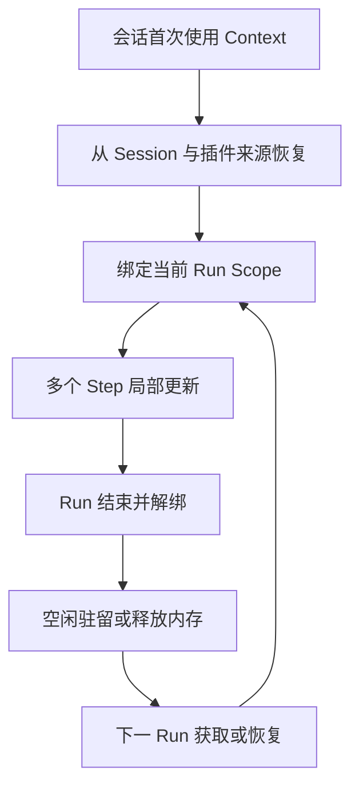
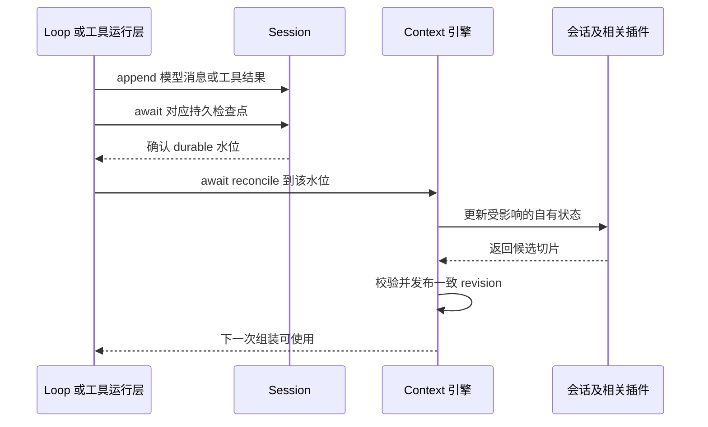

# 生命周期与状态更新

状态：V2 目标设计，已审阅并实现；实例注册、逻辑身份、reducer 水位检查、持久化后更新和恢复路径已接入。本文细化 [总体设计](01-总体设计与调用流程.md)。

## 1. 长期存在的是什么

Context 是会话内持续演进的逻辑对象，但不要求某个 JavaScript 对象从应用打开一直驻留到应用退出。

| 层次 | 归属与寿命 | 释放后的行为 |
| --- | --- | --- |
| Context 管理引擎服务 | 某个已装载 Harness 版本，随该插件实例创建和释放 | 不保留其执行句柄 |
| Context 逻辑身份与持久状态 | Session + Agent 逻辑作用域 | 根据 Session 事实恢复 |
| Context 内存实例 | 引擎管理的驻留实例，同一运行内跨 Step 复用 | 无消费者时可以释放，再次使用时重建 |
| Run / Agent 运行绑定 | 当前 Run、实际 Agent Scope、工具和配置 | Run 结束解绑并按既有规则归还租约 |
| LlmInput | 单次逻辑请求；已冻结输入可供该请求传输重试使用 | 历史输入通过持久请求快照审计 |

当前 Runtime 为每次 Run 创建 Scope，并在结束后释放它；不能直接把随机运行 scopeId 当作跨 Run 永久身份，也不能为了保持 Context 对象地址而阻止旧 Harness 卸载。

设计上区分两种作用域：逻辑作用域表示“这个 Session 中哪一个 Agent 的上下文”，运行作用域表示“这次执行的能力与生命周期”。主会话可映射到 Session 内稳定的 main 身份；子 Agent 使用自己的会话/稳定身份，不使用一个全局 subagent 键。逻辑身份与当前 scopeId 的映射由 Runtime 显式交给引擎，不由插件猜测。

已有内置子 Agent 使用独立 Session 和 Harness 租约，因此不假设主子 Agent 共用同一个 Journal。未来如允许同 Session 多 Agent，事件必须有清晰作用域与可见性，不能广播全部私有状态给所有 Context。

## 2. 创建、续用和关闭



- Session 创建时可以仅建立逻辑身份；第一次执行或读取 Context 时按需加载，不要求空会话启动全部插件。
- 同一次 Run 的多次组装使用同一受管理实例；跨 Run 如果实例仍有效可以复用，若租约或版本已释放则重新 hydrate。
- 切换聊天页面、断开远端观察或关闭一个面板不代表 Session 结束，不中断后台运行。
- 真正关闭 Session handle、释放 Harness 或关闭应用时，先结束使用者和必要持久化，再清理监听、缓存与运行绑定。不能清理仍有请求使用的实例。
- 再打开历史会话时，逻辑状态可延续，内存实例可以是新的；这不等于新建一个 Session。
- Fork 是新的 Session 和 Context 身份，从合法 fork 边界恢复允许继承的状态，之后独立更新，不复制父实例或共享可写 Map。

Harness 切换时，正在运行的请求保留原租约；后续 Run 使用新版本。在新引擎中按声明兼容的 Codec 恢复持久状态，重新加载模型/工具/Prompt 等版本相关数据。缓存键必须包含 Harness/配置代际；不把旧插件 class 实例直接交给新版本。

## 3. 状态切片由谁拥有

```text
Context：Session A / main
├─ system        revision 3
├─ runtime       revision 9
├─ rules         revision 5
├─ skills        revision 2
├─ conversation  revision 13
├─ tools         revision 7
└─ disclosure    revision 6
```

revision 数值只作示例。压缩运行状态由引擎协调器维护，压缩策略只持有自身配置与必要内部状态；不另设一份可写 conversation 或重复披露计数。

| 状态类别 | 事实来源 | 是否需要单独持久化 |
| --- | --- | --- |
| 会话有效内容 | Session Journal / Surface | 不再复制保存第二份聊天记录 |
| 路径计数、补充寿命、压缩应用标记 | 既有或显式版本化插件事件 | 需要恢复的业务变化写入 Session |
| 系统提示词、规则、技能、工具定义 | Harness 资源与受控 Host 事实 | 当前值可重新加载；实际请求内容保留在 request snapshot |
| 缓存、脏标记、监听、运行句柄 | 进程运行时 | 不持久化，按需重建 |

所谓“状态一直保存”，指需要跨运行延续的业务含义可恢复；不要求把整个 Context class、缓存和工具对象序列化到磁盘。外部文件在重启后改变时，当前 Context 可刷新为新值，历史请求仍读当时快照。

## 4. 更新的是片段，发布的是一致版本

Context 可以实现为带方法的类，但类不是核心约束。核心是：有明确身份、受控更新入口、模块所有权、可恢复状态和一致读视图。

日常流程是：引擎向相关插件交付输入，插件从自己的旧状态计算候选新切片，引擎校验并提交。可以在内部替换某个切片对象，不需要原地修改每个字段，也不需要每 Step 重建整个 Context。

示意方法职责：

| 操作 | 调用者与效果 |
| --- | --- |
| acquire / bind / release | Runtime 获取实例、绑定当前执行、解除绑定 |
| reconcile / refresh | 引擎同步新事实，按模块依赖刷新 |
| 插件 reduce / project | 插件更新自有状态，输出只读贡献 |
| capture / toLlmInput | 引擎捕获一致视图并转换 |
| getProjection / subscribe | 读取展示数据与订阅版本变化 |
| compact | 调用策略并协调 Session 提交 |

不向任意业务代码开放 `setConversation` 或“修改任意 pluginId”的公共 patch。插件提交入口绑定注册身份，不能冒充 owner。一个事件可以影响多个模块，例如工具结果同时影响会话与披露；这是各自解释同一事实，不是互相写私有状态。

若插件异步刷新到一半失败，不发布其半成品。required 来源失败阻止请求；optional 来源失败记录跳过原因，不能把旧值静默当新值使用。没有语义变化时不递增内容 revision，不重写持久补充。

## 5. 模型与工具输出的具体流转

现有 Session 区分 acceptedSeq 和 durableSeq。`append` 及 `session/event` 表示已接纳，不保证已经 fsync。生产检查点通过明确 awaited service 等待持久化，通知监听器不是持久屏障。

V2 的可用 Context 发布遵循以下顺序：



这是目标提交语义，不声明当前源码已逐事件执行该顺序。实现可以批处理持久化，不能为每个流式 token 新增一次 flush。若相关插件还需追加可恢复状态事件，需经过 Session 及相应持久屏障后再发布完整状态；派生事件按来源 seq / callId 去重，避免自我订阅形成循环。

模型流式 delta 可以继续通过现有通道展示，但不把每段未提交文字写进正式 Conversation 状态。取消或失败时使用既有终态记录语义，不把未完成输出伪装成完整模型回复。

并行工具结果按 Session 接纳顺序和工具调用身份归并。前端可以看到已经提交的局部进展；开始下一次 LLM 请求前，必须等待所需工具批次完整，不能在 tool-call 与 tool-result 中间插入补充或发出不完整历史。

若持久化失败，保持旧的可用 Context revision，并将新状态标记未完成/阻断；不能先向 UI 宣称成功，再让下一个请求继续。若事实已持久而更新中断，恢复时重放缺失后缀，不重新执行模型或工具。

临时 Session 沿用显式内存模式，durableSeq 为 null；可以从已接纳事实更新，但必须标明临时语义，不能伪称磁盘持久化。

## 6. 每 Step 的一致性边界

每 Step 组装前检查插件失效条件。当前和未来模块都可以声明按 Journal、配置 revision、Turn、Step 或外部来源版本刷新；引擎提供统一边界，插件选择合适频率。

| 变化 | 典型受影响模块 | 边界 |
| --- | --- | --- |
| 新用户消息、助手输出、工具结果 | conversation；有文件事实时 disclosure | Session 事实确认后 |
| 模型配置变更 | system、runtime；相关估算与预算 | 下一次请求组装前 |
| 模式变化 | runtime、rules、skills、tools、system | 保留当前模式在 Run 内固定的规则 |
| 规则文件变化 | rules | 沿用新用户 Turn 检查；能力允许未来扩展 |
| 工具可见性或注册变化 | tools | 下次请求与执行能力一起解析 |
| 未来记忆来源更新 | 对应记忆插件 | 下个安全 Step；本版不实现 |

当前系统不仅会话会变化：运行补充、披露计数、技能选择、模型配置也有变化路径。V2 不把“目前常见只有会话变化”固化为限制。用户界面切换模型通常用于后续输入；现有 Run 安全点接纳补充输入时也可能更新后续请求配置，已经发出的请求不受影响。

捕获时固定 Context revision、各模块 revision、Journal 水位、Surface generation、配置及插件集合版本。异步转换只读取捕获结果。期间到达的新事实供下次捕获使用；不让旧 LlmInput 引用可变数组而被后续更新污染。

同一逻辑请求的传输重试沿用冻结输入和已绑定插槽；现有每次真实尝试的独立 requestId 与用量记录继续保留。重新选择模型、工具或组装内容属于新请求边界，必须重新快照，不能包装成旧请求重试。

## 7. 恢复、释放与故障

- 每个 Context 的提交串行化；不同 Session 可以并行。过期异步结果需核对上下文身份、绑定代际和依赖版本，不能覆盖新版本。
- 增量同步使用 Journal 水位；冷启动重放，日常只消费新增后缀。持久化前缀与内存已接纳前缀不得混用。
- 旧会话缺少插件事件时采用明确默认值，不伪造历史读取次数。插件私有 scope 状态不能因旧事件缺少 scopeId 而广播给所有新 Scope。
- 卸载插件先撤销新贡献和订阅，等待在途使用者结束；已发出的 LlmInput 不变，历史事件和可解码能力保留。
- 逻辑会话未结束也允许回收闲置内存，具体缓存容量是实施参数；不能承诺无限期驻留所有 Context。
- Context 当前投影、请求快照和恢复后的状态之间应能通过身份、水位与 revision 解释差异，不要求它们永远内容相同。
