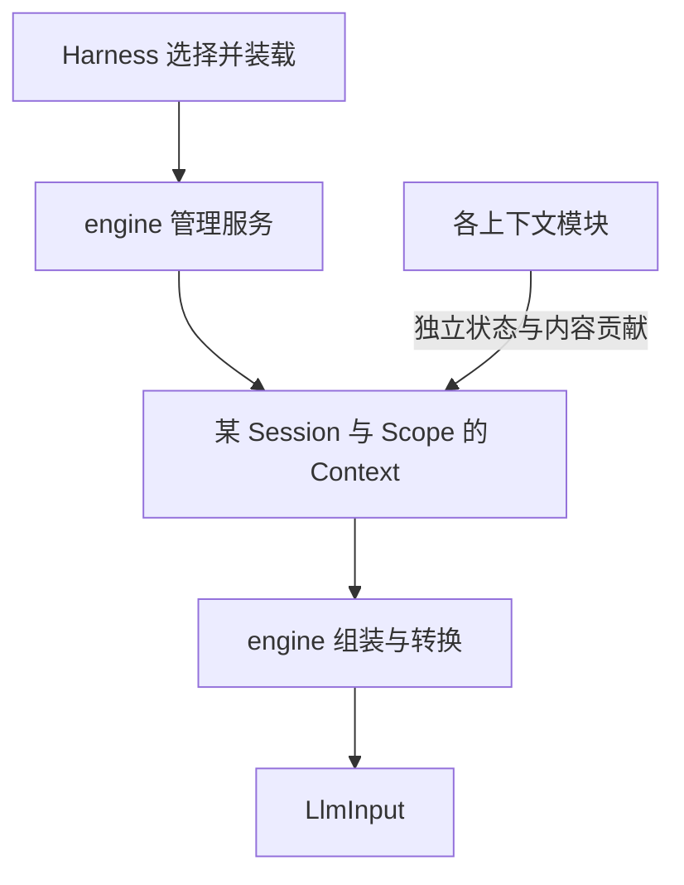
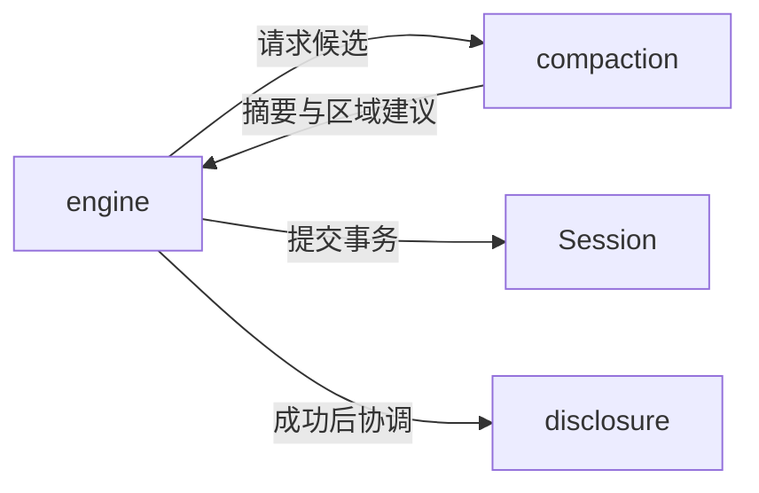

# 插件包与职责边界

状态：V2 目标包划分，已落地；当前 Harness 已按独立入口装配模块，`packages/context/engine/src/modules.ts` 固定目标包与行为入口的映射。总入口见 [README](README.md)。

## 1. 目录先按职责读

```text
packages/context/            领域目录，下面每个子目录都是独立的 workspace 插件包
├── contracts/               纯契约包
├── engine/                  管理引擎插件
├── system/                  系统提示词插件
├── runtime/                 动态运行信息插件
├── rules/                   AGENTS 规则插件
├── skills/                  Skill 上下文插件
├── conversation/            会话上下文插件
├── tools/                   工具上下文插件
├── disclosure/              渐进式披露插件
└── compaction/              压缩策略插件
```

这是 10 个 workspace 包：1 个纯契约包、1 个引擎插件、6 个基础来源插件、1 个兼具来源能力的披露插件、1 个压缩策略插件。`contracts` 不为了数量而注册一个空行为插件。

目录名称已确定职责；精确 npm 包名、manifest ID 与 export 路径已落到各子包。磁盘包名、插件 ID、事件 owner、服务名仍是不同身份，历史 `actspace.context` owner 与 Codec 保持兼容。

英语学习等领域扩展保持独立业务归属，通过公共来源契约注册。未来记忆或工作流如被实现，可以在 context 领域下新增相应模块包；本版不建立占位实现。

## 2. 在运行流程中的定位



图表示运行时职责，不表示 engine 在源码中依赖所有具体插件包。Harness 按现有 Cordis 机制装载插件，各插件向引擎注册能力；引擎只调用公共契约。

压缩单独看，避免把所有线画在一张图上：



compaction 不直接调用 disclosure。disclosure 的路径事实由引擎路由；tools 不导入 disclosure 私有实现。

## 3. 每个包拥有的内容

| 包 | 状态或能力归属 | 不承担 |
| --- | --- | --- |
| contracts | Context 身份、模块注册、只读贡献、投影与策略契约 | 运行态状态、具体插件逻辑、存储 |
| engine | 实例注册表、作用域绑定、提交顺序、快照、投影语义、压缩协调、插槽协调 | 某个领域的 Prompt/计数算法、供应商协议 |
| system | 基础身份与行为说明、按模型选择模板 | 规则文件加载、工具权限 |
| runtime | 模式、日期/时区、公开环境事实与运行提醒 | 执行预算控制、凭据、Host 审计对象直传 |
| rules | AGENTS 内容、来源摘要、刷新版本 | Skill 加载、扩大文件范围 |
| skills | 目录、显式选中内容与来源版本 | 自动创建和迭代 Skill |
| conversation | 从有效 Session Surface 派生的会话视图、水位 | 直接写聊天记录或另存 conversation 文件 |
| tools | 当前可见工具定义、命名工具事实的解释接口 | 执行工具、审批、独占工具结果消息 |
| disclosure | 路径去重、读取计数、冷热状态、导航与索引 | 生成摘要、改变工具权限、替模型检索材料 |
| compaction | 判断、区域选择、摘要候选与保留路径建议 | 提交 Surface、维护另一套会话、直接更新 UI |

同一信息可以被多个模块引用，但只有一个模块拥有某项管理状态。例如工具结果正文属于会话视图；成功读取事实可被披露解释；读取计数只有 disclosure 一份。状态切片不同不代表信息完全隔离。

## 4. 包依赖与插件注册

契约包不得依赖 engine 或任何具体来源。engine 不 import system/rules 等实现；来源和策略可以依赖契约及必要基础服务，不互相引用私有文件。contracts 如需已有 Session/LLM 值类型，使用现有公共类型，不复制协议；跨进程 DTO 不能导致 shared 反向依赖运行时实现或循环引用。

默认 Harness 负责显式选装这些包。每个可加载插件包具有自己的 manifest、behavior entry、必要的纯 Codec entry 和撤销生命周期；不新增平行插件加载器。关闭可选插件后新组装去掉对应贡献，历史仍可读取；必要来源缺失时阻止请求。

压缩摘要使用 LLM 公共服务，规则/技能通过受控 Host 端口读来源，conversation 通过 Session 公共接口取 Surface。独立插件不代表没有依赖，而是依赖清楚且不绕过所有者。

## 5. 独立状态与刷新协议

插件注册包含稳定 id、owner、所写内容、required/optional、稳定排序、作用域和刷新依赖。状态持有在所绑定的 Context 内，不能放在模块级全局 Map 而忽略 Session。

模块可以具有 initialize/hydrate、事件 reduce、按需 refresh、内容 project、dispose 等职责，不要求无状态插件实现空方法，也不要求继承大父类。事件 reducer 不执行工具、网络或任意 Session 写入；需要产生持久变更时返回受约束提议，由明确协调路径提交。

默认贡献顺序延续现有 system → runtime → rules → skills → conversation → tools → disclosure。排序是呈现契约，依赖检查另外声明；不能靠加载先后隐式获得其他模块私有字段。有受控依赖时读取公开只读结果并跟踪版本，避免引用循环。

同一插件重载不重复注册、不重复注入；延迟回调不能在 dispose 后写入新 Context。来源关闭后不追溯删除原始会话文本或历史请求快照。

## 6. 包移动必须保留的兼容边界

当前 supplement/state 事件使用 `plugin/actspace.context/...` owner。拆成多个包后仍要能解码这些历史事件，包重命名不是 Journal 格式迁移理由。旧 Codec 的代码位置可以调整，但 owner 和 schema 兼容需保留唯一注册；不能让新包重复声明旧 owner，或删除 required Codec。

未来确有新的 scoped 状态事件时，由明确 owner 注册带版本的 Codec，并定义旧事件向主 Context 的映射；不改写历史 seq、Surface 或插件事件。fork、未知 required 事件 browse-only 与行为关闭后继续发现 Codec 的约束均延续。

Prompt 包现在只提供 contributor、装配支持和 Host source loading；来源实现位于 `packages/context/system|runtime|rules|skills`。既有压缩策略位于 `packages/context/compaction`，engine 保留唯一协调器。

默认 Harness 构建闭包、Host Codec 发现、workspace exports 和包清单也要随实现迁移。此处仅列设计兼容要求，本轮不调整这些配置或生成文件。
