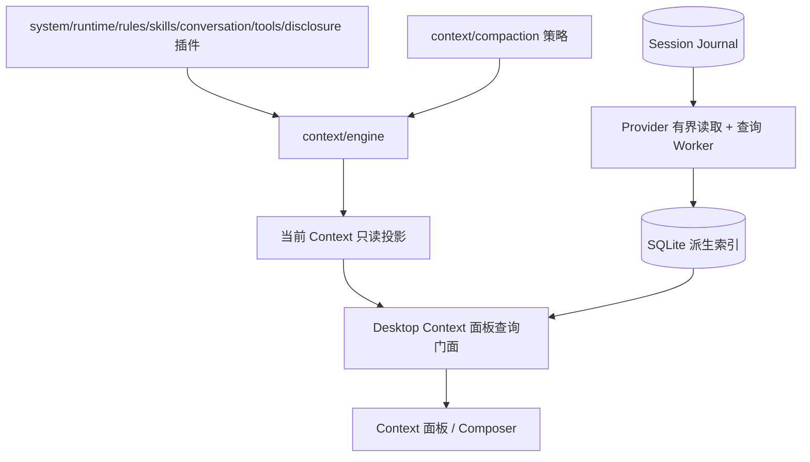
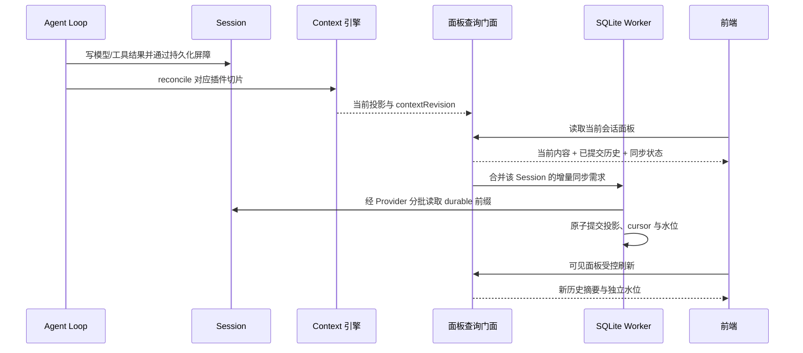

# Context 面板与 SQLite 联合设计

状态：2026-10-18，联合实现与本轮验收已收束；schema 9 与 Context 面板契约 2 已接入。性能及 Computer Use 仍按原记录保留限制，未全量通过。

已对照用户提供的 SQLite 分支完整会话复核，见[06：原会话决策与联合方案校验](06-原会话决策与联合方案校验.md)。schema 9、Context manifest、分批发布和刷新协议已在后续联合实施落地；它们不属于早期 SQLite 分支基线。

执行入口：[联合执行计划](../../../exec-plans/completed/20261011-context-sqlite-integration/README.md)。测试入口：[联合测试验收计划](../../../exec-plans/completed/20261011-context-sqlite-integration/acceptance.md)。本文是 Context V2 在面板查询与 SQLite 集成方面的增补；01–03 的 Session 权威、实例生命周期和插件边界继续有效。

## 1. 原实施基线与范围（2026-10-11 历史记录）

在 `fix/context_manager_v1` 上完成两件关联工作：补齐右侧 Context 五区块的真实数据，修复 SQLite 查询已知问题并统一验收。基线包含 `2cbb634f` 和当前未提交的 Context、前端及其他改动；HEAD 不能独自代表待验版本，执行时记录受影响工作树内容指纹。不得为整合任务覆盖其他未提交工作。

以下为实施前核对事实，不是当前行为。当前 `describeContextPanel` 已委托 ContextPanelService，历史索引已升级 schema 9：

- `packages/context/engine/src/instances.ts` 以 Session + logicalAgentScopeId 保存长期实例；一次提交替换不可变 view，不要求外部一直持有同一可变对象。
- `packages/agent-service/src/application.ts` 已同时提供 `readContextProjection` 和有界 `readSessionEventBatch`；`sessionQuerySources` 当前枚举全库。
- `apps/desktop/src/main/runtime-v2/fixed-renderer-ipc.ts` 的 `describeContextPanel` 仍返回 null；旧 `describeContext` 即使已有 managed 投影仍读取 Session 历史。
- 实施前的 SQLite schema 8 已有 catalog、Usage、搜索及各自水位，没有 Context 历史索引。`usage-read-model.ts` 串行处理查询；单 Session 同步跨多个读取批次、最后才提交事务。
- `use-context-panel.ts` 依赖 Session revision 拉取，不能保证索引稍后完成或无新 Journal 事件的 Context 变化会刷新。
- `request-snapshot.ts` 将系统 section 映射为 content，部分来源身份在快照中丢失；必须从转换前的来源保留身份，不能事后用数组下标推测。

范围包括主 Agent、本地 Context 面板和 Composer 轻量数据、SQLite U-01–U-10 的修复/复验与文档状态核对。不新增上下文编辑、历史请求原文浏览、子 Agent 面板、跨会话洞察、记忆插件；远端 Host 不增加新产品能力，既有 gateway 的路由和不支持行为须回归。

## 2. 职责与包定位

引擎管理来源刷新、受控切片更新、生命周期、转换和只读投影；前端布局不进入引擎。模型/工具输出先持久化至 Session，插件随后 reconcile。SQLite 不参与 Agent Loop、恢复、权限判定或 Context 组装。

保持 `packages/context/{engine,system,runtime,rules,skills,conversation,tools,disclosure,compaction}` 物理插件包；不新增 UI 专用领域插件。`packages/shared` 放跨进程类型，不放 SQLite 或业务持久化。纯 Context 分类/清单生成逻辑归 engine，公开导出供 Runtime 转发和 Worker 复用；Desktop 通过公开包入口/既有 Runtime loader 消费，不相对导入 sibling src。

Desktop 复用现有查询服务、Worker 和数据库文件，在内部拆出 Context 投影/查询模块；不复制一套 Worker 生命周期。新增一个轻量面板门面组合当前投影与历史结果，IPC 只校验并转发。改动涉及超过 8 个源码文件和跨层契约，按联合计划执行，不当作单 handler 修补。

## 3. 从更新到显示

仅面板有查询需求时索引该会话。一次查询捕获目标 durable 水位 N，不能无限追逐正在追加的尾部；N 之后的增量由下一次请求处理。Context 当前路径不能等待全局 Usage 重建。

沿用已确认的查询时懒同步：没有 Usage、历史或 Context 查询需求，就不启动 SQLite 扫描、同步或迁移。常驻 Worker 不等于常驻后台索引任务。Session 输出使 Context 插件更新，与为查询维护 SQLite 是两件事。Workspace admission 属于原有启动/权限流程，不能借其后台化启动全库 SQLite 索引。

Runtime 增加 `sessionQuerySource(sessionId)`，只读取指定会话并执行与批量接口相同的 durable 截断、codec 与错误校验。不得为查询一个 Context 先枚举所有 Session，也不得在 descriptor 缺失时静默调用全量 inspectEvents。

## 4. 面板契约与刷新

以 `packages/shared/src/context-panel.ts` 为最终契约。现有 schemaVersion 1 升为 2，main、renderer、mock 同步迁移，保留 `describeContext` 给 Composer 的轻量契约。

| 字段/对象 | 约定 |
| --- | --- |
| identity | Session + logicalAgentScopeId；主 Agent 与 Runtime 实际身份同源，不硬编码另一套 main 值 |
| current | 引擎清单、分类估算、modelFacts；包括 status 和 basis（current-context / last-request / unavailable） |
| currentVersion | instanceGeneration + contextRevision + throughJournalSeq，另含 modelFacts/estimator 的版本或内容指纹；不能只依赖 Journal 水位或条目 revision |
| history | status（ready / syncing / rebuilding / fallback / unavailable）、indexedThroughSeq、targetThroughSeq、indexGeneration、脱敏 error；初次未索引水位为 -1 |
| previous | 最近已持久化请求输入的清单；无记录为 null；保留 requestId 和可比较性标志 |
| stats | 允许 null 表示尚不可用；只有完整覆盖目标水位时才能显示为完整会话累计统计 |
| trend/events | 分别最多 500/200 条；返回各自 truncated、returnedCount 和保留范围 |
| entriesPage | 当前明细/比较清单按 revision 绑定 cursor 分页；不为满足体积限制悄悄丢条目 |

主响应目标 ≤200 KiB；硬上限沿用 IPC 1 MiB、单页明细 ≤500。先裁剪 preview，再分页条目；分类总量必须在分页/截断前计算。title ≤80 字符，非会话 preview ≤600 字符；conversation 不返回正文预览。趋势和事件裁剪优先保留最近数据，并明确可见区间。

增加 `sessions.listContextEntries`（revision、cursor、分类过滤、与基准对比）以及 `sessions.readContextEntry`（revision、key、有界文本页）。全文只开放非会话分类，不返回二进制附件；文本每页 ≤64 KiB，不能绕过权限或读取任意磁盘路径。revision 已失效返回明确 stale 错误，前端刷新后再打开。过期 cursor 返回重新加载提示，不混合两个 Context 的条目页。

第一版采用已有事件触发加可见面板的条件探测，不新增全局订阅协议。`describeContextPanel` 接受上次响应的版本令牌；相同版本返回 `notModified` 与有界同步状态，不重新传输整份清单。令牌覆盖 current、历史已提交版本、请求基准和查询条件；缓存必须随对应变化失效，不能只看 durableSeq。首次读取及数据变化才返回完整有界 DTO。探测仅核查当前实例、当前 Session descriptor 与已有任务状态，不重复 SQL 聚合、全文读取或全库枚举。

当前实现同步中 1 秒、空闲 5 秒、错误按 2/4/8/10 秒退避；这些是待资源验收校准的参数，不是原 SQLite 会话已经确认的要求。任何触发合并为最多一个在途请求。隐藏停止；最后一个消费者消失时按批次暂停同步，重新显示立即核对。相同版本必须读取 0 个 Journal 事件、重新估算 0 个条目、执行 0 次数据聚合；索引完成但无新消息、模型 facts 单独改变都能被下一次探测捕获。

前端以本地选择代次 + 请求序号防止会话切换后的迟到响应覆盖；current/history 分别判新旧，不能用一个总水位拒绝历史追赶结果。同 Session 的实例/索引代际变更显式使 cursor 和缓存失效。

历史会话没有内存 Context 时，展示标注“最近请求”的历史视图；不可伪装为当前上下文。打开面板不启动 Run、模型调用或带写入副作用的组装。索引失败时仍保留有效 current；历史错误不能显示成“没有事件”。

## 5. 请求清单与统计口径

在 Context → LlmInput 转换时保留来源映射，并在 prepare 完成后生成精简 manifest，随既有 `request/context` 持久化。manifest 包括 schema/estimator 版本、稳定 key、bucket、estimatedTokens、来源身份和必要 trajectoryRef，不含全文。分类计算以实际转换/prepare 后输入为依据；适配器改变内容却无法映射时标记不可精确比较，不伪造来源。估算值不等同供应商计费 token。

系统条目用 owner + section id；规则用规范化来源路径/id；skill catalog 与 invoke 分开；工具用 owner + name；消息用 messageId；工具调用/结果用 callId 加类型；摘要用 compactionId。模型 facts 使用语义 key。不得包含数组下标、revision 或 request seq。

所有 requestId 独立记录，重试不能被 stepId 去重；usage 复用现有请求归属规则，处理 `assistant/message` 与 `llm/retry`，不再累计 `step/end` 中的重复汇总。未知 usage/费用保留 null。turn/step/压缩计数来自对应事实而非 UI 行数。

现有 request/context 在 dispatch 前落盘：它证明请求输入已经准备并持久化，不能证明供应商收到。统一把比较文案改为“最近请求输入”，以最新 durable request/context 为基准；不新增网络送达保证。失败和重试可保留请求记录，实际 usage 缺失时留空。

当前与基准采用同一 estimatorVersion；算法升级后重建派生索引，旧快照有内容时重算。不能还原稳定身份的旧记录保留总量与趋势，比较标记 unavailable；不把变化显示成全量新增。新旧混合和缺少 contextWindow 都必须有测试，上限未知返回 null。

全局 Usage 重置只改变全局统计的可见范围，不删除 Context 会话累计事实。Context 投影从完整 Session 独立累计，复用 Usage 解释规则但不读被 resetAt 过滤的 activity 作为完整事实。清空全局统计后，Context 的累计 usage 与最近请求比较保持不变。

上下文事件优先使用真实事件；从相邻请求推导的工具/模型变化标记 inferred，时间表示观察到变化的请求边界。不能把请求之间未观察到的每次变化都补造出来。压缩 reclaimedTokens 只比较压缩前后相同 estimator 的上下文，不能用夹带新消息的两个请求差值当回收量；无可靠证据返回 null，并同步放宽现有类型。

## 6. SQLite 投影与迁移

数据库仍为 `runtime-v2/usage-read-model.sqlite`。增加 Context 命名空间：

- `context_request`：按 session、logical scope、requestId 唯一的数值摘要、模型与 seq；请求分页/趋势按 seq 保持因果顺序，展示时间规范化 UTC。
- `context_manifest_entry`：仅保留最新比较基准的清单与当前重建需要的前一清单；不为每个历史请求复制全部条目。
- `context_event`：真实/推导事件、来源 seq、nullable tokenDelta、确定性 id。
- `context_session_stats`：完整会话统计及跨批次必要关联状态，未知费用保持 null。
- 同步状态：各投影独立 source identity、codecDigest、projectorVersion、estimatorVersion、cursor、committedThroughSeq、targetThroughSeq、generation。

表不存完整 transcript、工具结果或请求正文。新增磁盘成本随请求摘要和事件线性增长；最新清单随当前请求条目数增长。每批只保留有界数据，不在 Main 累积全历史数组。

schema 8 → 9 使用受控派生库重建，修复旧时间字段与过滤结果；不修改 Journal。这是联合方案的迁移选择，不代表 U-05 已解决。仅增加 Context 空表不足以修复 U-08：旧 resetAt 过滤可能已经漏存合法行，必须回读相应事实。旧 M/L 冷投影约 35/91 分钟，重建成本必须计入升级验收，不能宣传为即时升级。

迁移只在查询需要时启动，确认旧 owner 停止后初始化；空表先建索引，再按查询作用域分批导入并保存进度。单 Context 查询不为升级强制重放其他 Session。未知旧 schema 的行不能按新 schema 查询；迁移期历史明确 unavailable/rebuilding，保留可用 current，不承诺跨 schema 继续读旧 published 数据。同 schema 的投影重建才适用下一节保留旧 published generation 的规则。已发布 schema 不再用隐式首次查询补建大辅助索引；超时、取消、重开页面不能反复清库。U-05 还须单独验证原生长 SQL、退出等待及新索引准备，不能仅靠升版绕过复现。

Provider 当前单行上限 1 MiB，新增 manifest 必须纳入记录体积预算。旧 Journal 超过合法查询预算时返回具体不可索引状态，不删事实、不无限放开解析；大请求 fixture 必须验证临界值及超限呈现。若真实合法模型请求普遍超过该预算，属于发布阻断项，需要调整有界读取契约后复验，不能用小 fixture 签收。

## 7. 同步、取消与公平调度

每个 Session/投影/目标版本只存在一个可合并同步任务，查询等待者与任务分离。保留请求队列上限 8；当前会话按需同步优先，每处理一个有界批次归还调度机会。初始调度参数为连续 4 个前台批次后给后台至少 1 个批次，待并发基准校准；不饥饿和无需求不工作才是契约。这里的后台任务必须仍有查询消费者，不指无条件全库同步。原生单条长 SQL 不可被 JS 调度抢占，故迁移与复杂查询必须另行控制。

增量采用批次事务：数据、关联状态和 cursor/水位同提交，崩溃只重做未提交批次。同 schema 重建以 Session/投影为单位使用构建 generation，读端保留旧 published generation（标 stale），完整追至捕获目标 N 后原子切换。新旧 generation 各自的 activity、FTS、rollup、run 去重与关联状态必须一致：全局查询只计算 published 行，不能把两代相加。首次无 published 版本时不显示部分累计值为完整结果。旧 generation 分批清理，禁止同时复制全库所有 Session，记录实际临时磁盘峰值。

| 动作 | 行为 |
| --- | --- |
| 页面离开/隐藏 | 取消等待者与回传；无其他需求的同步在下一批结束后暂停，进度保留 |
| 筛选变化 | 替换结果请求，复用相同 source 的同步任务 |
| 用户显式取消 | 取消本请求；无其他消费者才暂停对应同步，不能误杀 Context 或历史列表共同依赖的任务 |
| 应用关闭 | 停止新任务，结束/回滚当前批次，关闭连接并等 Worker 退出 |
| Worker 超时/崩溃 | 标记等待者失败，等退出后恢复 committed cursor，不并发启动第二个 owner |

U-04：descriptor 区分文件身份、物理变化与 durable 前缀。水位不变且已验证前缀未变时不重建；尾部追加不能视为已提交事实。文件替换、截断、相同大小覆盖与 codec 变化仍必须失效。现有 cursor 边界 hash 不是完整文件校验，未知来源的 stamp 变化按保守策略验证/重建；只对 Runtime 持有写入权且能证明 append-only 的未 flush 尾部走快速路径。

U-03：首窗口不再等待全部历史 workspace admission 扫描；先加载已显式注册 workspace，历史发现用后台有界队列。SQLite catalog 只能提供显示线索；选中会话时仍从 Session 验证 workspace 归属后才授权，期间保持 pending/不可写。旧数据只出现于历史事实的 workspace 逐步发现，不消失且不因索引错误获得权限。

这是启动流程的新增修改，不能仅凭读取耗时推定可安全延后。T4 要核对恢复中会话、未完成任务及新旧 workspace 的接纳顺序：凡依赖归属事实的恢复/写入也须先验证，不能只拦 UI 点击。保留已实现的 pending-task 轻量提示和 delegation lineage 预筛选，禁止为了列表徽标或历史发现重新完整恢复全部 Session。

U-01/U-06：按 Provider 读、传输、投影、触发器/rollup、提交和 SQL 聚合分别计时。使用有界批绑定、复用 prepared statements、限制重投影为受影响 group；标题筛选以 session_id 索引限定集合并复用维度聚合，不把百万行搬回 JS。首次复杂筛选与热查询分别报告；优化不能改变精确计数、时间窗口或 null 费用语义。

## 8. 失败、回退与权衡

最脆弱前提是“相同水位代表相同事实前缀”。本设计保留 source identity/版本与保守失效路径，而不是为了性能忽略文件变化。

Context 历史失败沿用有界 fallback：最多 1,000 Sessions、合计 5,000 events / 8 MiB；Context 请求进一步只允许当前 Session。不进入无限 JSON 扫描。超限保留 current 与错误/重试提示。权限事实始终读 Session。

失败分流保持 SQLite 分支末期修正后的行为：

- `WorkerTimeoutError`、用户取消、队列/结果/搜索预算或失效 cursor 不证明数据库损坏；返回相应状态，不删库。超时后必须等待旧 Worker 真正退出，再从 committed cursor 恢复。
- 单 Session 读取失败或 codec 缺失只隔离该来源；全局结果显式报告 failedSources，指定会话查询明确失败，健康会话继续可用。同 descriptor 恢复后须重新入索引，不能被失败缓存永久隐藏。
- 损坏/不兼容 schema 才走受控重建；每次显式查询恢复最多自动重建一次，再失败才有界 fallback。条件探测不能不断重启这条恢复链，终态错误等待用户重试或可验证的源/配置恢复。
- fallback 复用投影和 Worker 内请求级临时 SQLite 的 FTS/分页/聚合语义，结束即释放。它仍需要可用的 Worker 与 `node:sqlite` 驱动；驱动缺失显式 unavailable，不在 Main 运行 SQL，也不返回假空数据。

保留现有 SQL 过滤/聚合与限定 FTS 搜索的区别。标题和最多 512 字符的受控消息片段搜索不承诺全文；Usage 的 model/provider/tool 等维度也不扩展为完整正文。历史总量不受 500 条截断，但单页仍有 500 条/1 MiB 上限，多 workspace 首页共享预算，后续通过 cursor 可达。打开正文和轨迹详情继续读 Session。原 JSON usage cache 不作为查询真源，也不随本任务清理。schema/application id、WAL、单 owner、结构化 IPC 与参数化 SQL、未知费用/混合币种和 run 去重口径均须回归。

最小方案是仅接当前 Context、继续隐藏趋势/事件，但它不满足本次完整面板目标；不采用。另一种给 Context 独立数据库/Worker 能隔离队列，却重复 owner、迁移与恢复成本；选择同库同写入 owner、独立投影和批次公平调度。

回退业务代码时不回滚或删除用户 Journal。停掉本任务 Worker 后可以移开派生库，旧版本自行重建其支持的 schema；包含新 manifest 的 Session 必须通过旧读取兼容测试。若旧 decoder 拒绝新增字段，不发布不兼容快照，先用向后兼容的可选 metadata 契约修正。

不新增外部服务、账户或 API key。真实 provider 测试沿用用户已有配置，缺少凭据则明确未覆盖，不以 mock 代签。U-07 历史媒体失链单独保留；源码、自动化与 Computer Use 证据分别报告。

## 10. 实施落点与验证边界

schema 9 的内部模块为 `read-model-sync`（批次发布）、`read-model-scheduler`（公平调度）、`context-history-projection/query`（历史）、`context-panel-service`（当前/历史门面）。历史消费者租约 20 秒，最多缓存 16 个 Session；隐藏显式释放，租约兜底应用异常退出。Context 回退进一步限制当前一个 Session、5,000 events/8MiB；超时不触发全扫描。

请求 manifest 使用 `context-content-1` 字符估算器。prepare 改写输入且无法保留来源时明确不可比较；manifest 超过 5,000 条/256KiB 或请求接近记录预算时省略身份清单，保留总量与不可比较原因。skill catalog 与调用分别按插件、来源 id、skill id 标识；无可靠来源的模型事实保留为系统信息。历史清单保留安全 title/kind/trajectoryRef，移除正文预览及全文读取标记。

主面板与后续分页都检查响应字节数，目标 200KiB、硬限 1MiB；必要时减少页条数并返回后续 cursor，趋势/事件体积收缩有明确截断元数据。Composer 读取当前轻量投影，已有面板历史缓存时可复用历史基准，不启动新的全局索引。

SQLite 写入支持按新增 rowid 分组汇总，显式避免 GROUP BY 选择覆盖索引扫描全历史；少量行使用原逐行触发器。页缓存固定 32MiB，WAL 每约 16MiB 自动 checkpoint；这只是有界资源配置，不代表 250ms 增量同步目标已通过。证据及剩余性能问题见联合执行记录。

### 当前能力不可用时的历史读取

Host 获取 live Context capability 失败（例如旧 Harness binding 无法恢复）时，仅 current 标为不可用或使用明确标注的最近请求回退，独立历史查询仍可继续。禁止把历史回退标为 live。读取 Context 不启动 Run、不组装新的模型输入；现有 capability inspection 会经过 Harness 租约接入，不能将其描述成绕过所有 Harness 恢复机制的纯内存 peek。

## 2026-10-12 性能取舍确认

用户确认不为低频标题统计增加每次写入的预先汇总代价，不继续追求一次追加1k/5k的250ms压力目标，不扩展发布结构重构。原测量保留为已接受限制，不冒称达标；schema 9与现有读写契约保持。以正常单次回复、少量工具调用、切会话、打开统计和大量历史同步时的可用性继续验收，重复超时/无法恢复/正常操作阻塞仍需修复。详细覆盖与证据遵循联合验收计划。
