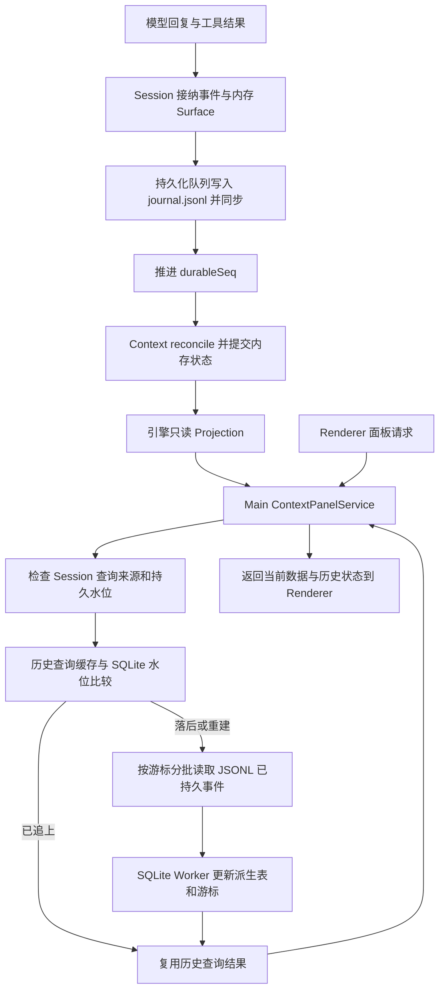

# Step 增量更新与披露面板决策记录

状态：2026-10-18，用户已批准 T1–T5，后端、Desktop 刷新及前端交接已完成；路径 UI 留给 CloudOps。实施结果见[执行摘要](../../../exec-runs/20261018-context-step-update/execution-summary.md)，接口见[前端交接](../../frontend/front-Context面板Step刷新与路径展示交接.md)。§2、§4 保留讨论时的源码基线，存储重构另行负责。

基线：ActSpace `e3468f2b`；本地 DeepSeek Harness 参考副本 `d743267388`。本轮为源码核对，没有运行时性能测量或 Computer Use 验收。工作转至主仓库普通分支 `codex/context-incremental-design`；旧 worktree 无未提交内容、忽略产物或独有提交，已移除。没有提交或推送。

## 1. 已确认决定

| 编号 | 决定 | 约束与原因 |
| --- | --- | --- |
| D1 | 保留每个 Step 结束后的 Context 更新 | 面板需要看到最新状态；优化重复计算，不取消更新能力。不是要求记录或逐帧展示所有中间投影。 |
| D2 | 保留 Session 先持久化、Context 再推进的安全边界 | 当前持久化总体流程没有被要求重做；SQLite 不成为 Agent 状态真源。 |
| D3 | 向按模块增量更新演进 | 普通工具结果主要更新会话；文件读取还影响披露。只更新受影响模块，未变来源复用。本轮已采用来源显式依赖缓存，见 §3。 |
| D4 | 每个 Step 工具批次全部完成并持久化后检查压缩 | 达到阈值时先压缩，再继续下一模型调用；本轮已替代原来仅 Turn 结束自动压缩的入口。不能拆散工具调用与结果配对。 |
| D5 | Context 面板显示活跃路径与睡眠路径 | 活跃上限 100 保留。活跃路径本身应进入模型上下文，文件全文不保证仍在其中。 |
| D6 | 主智能体负责后端数据和前端交接文档 | CloudOps / 前端模型负责具体 UI 设计。后端接口与交接文档已完成，路径 UI 待前端实现。 |
| D7 | 趋势暂保留 | 用户曾讨论删除但未确定删除；本轮不把删除列入范围。 |
| D8 | 保留版本一致性保护和 Token 估算 | 不追求与 Provider 计费完全相同的 Token 数。 |
| D9 | 使用主仓库普通分支进行修改、启动与调试 | 本次不再新建 worktree。 |
| D10 | 清晰划分实时状态与历史查询（2026-10-18 续议） | 内存 Session/Context 承担实时状态及模型输入；SQLite 承担派生历史查询。模型执行不等待 SQLite。日志仍负责事实持久化、恢复与必要的原始记录读取。 |
| D11 | 一个事件可以影响多个模块（2026-10-18 续议） | 确认 D3 的依赖传播原则：仅更新受影响模块，不限制一个事件只能更新一个插件。 |
| D12 | 将讨论扩展到以 Context 为核心的 ActSpace 数据存储设计 | 先厘清数据所有权、恢复依据和读取职责，再决定介质；其他业务数据划清边界。详细讨论见[整体存储讨论稿](../../core-data-storage-design.md)，其建议不自动视为已确认。 |
| D13 | Session 数据包完整保存会话事实；内存、SQLite、检查点均可重建 | 2026-10-18 用户明确以贴出的子会话方案替代上一版开放式分类。需要跨重启保留的会话信息不能只存在于派生层。跨会话业务记录归对应 JSON/JSONL 权威来源，凭据走专用存储；具体实现待审计。 |
| D14 | 存储数据结构重构移出本会话职责 | 用户另行安排，完成后提供设计文档。本会话暂停存储审计、重构和迁移；保留 Context 更新、Step 压缩、披露展示数据及前端交接事项，随后用户批准本会话执行 T1–T5。 |

D13 收紧 D10/D12 的目标：ActSpace 的 SQLite 统一作为可重建派生层，不保留独有业务事实。这是目标约束，尚未验证当前所有数据都已符合，不能据此直接删除现有数据库。Session 数据包包括日志与必要的受管附件；全应用恢复还需跨会话权威记录及专用凭据存储。最新基线见[整体存储讨论稿](../../core-data-storage-design.md)。

## 2. 当前面板到底读什么

这里的 Session 持久文件是 `journal.jsonl`：逐行保存事件的 JSON Lines，而非每次覆盖的一整个 JSON 状态对象。用户提到的“Circulate”在本讨论中按 SQLite 理解；未识别到独立同名模块。

Renderer 不直接读取 JSONL 或 SQLite。它经 IPC 请求 Main 的 ContextPanelService，Main 合并当前投影与历史查询结果。

| 展示内容 | 主来源 | 缓存/缺失行为 |
| --- | --- | --- |
| 当前 Context 内容、分类估算、当前模型与容量 | 当前 Harness 的 context.engine 内存实例生成只读 Projection | 同一 Context 对象投影可复用；不存在实时能力时返回 null，不为面板启动组装 |
| 最近实际请求、统计、趋势、事件 | SQLite Context 历史表，由持久 Journal 派生 | Main 保存历史查询结果；同步时可以先返回旧结果并标记 syncing |
| 没有实时实例时的上下文展示 | 历史索引中的最近请求 manifest | 标记 last-request / stale，不冒充当前 Context |
| 当前条目全文 | 内存 Context 内容解析 | 校验 revision 与 instanceGeneration，分页返回；查询本身不触发文件读取工具 |
| 会话恢复、索引追赶与重建 | Session storage 提供的持久事件读取 | JSONL 后端在 Worker 中按游标读取文件，不是 renderer 扫文件 |

### SQLite 在什么时候更新

Context 历史具体入口是 `UsageReadModelService.contextHistory()`：

1. 面板查询提供 sessionId、consumerId，并取得 `throughSeq / stamp / codecSetDigest`。
2. Main 为该 Session 维护查询结果、单在途任务和消费者有效期。
3. 来源版本不变且没有待重试错误时复用结果；不会因每个 live event 直接启动索引，`invalidate()` 的实现明确保持空操作。
4. 版本变化时异步查询 SQLite 已发布结果和索引水位；如果已同步则停止。
5. 落后时通过 `readSessionEventBatch()` 从保存的游标读取有界事件批次，发给 SQLite Worker 的 `context-journal`，提交派生内容及进度。
6. 完成后查询最新历史结果；前端后续刷新取得它。中途关闭/隐藏后消费者释放或过期，批次间可停止。
7. 游标、codec 或来源身份失效时重建该 Session；building/published 隔离重建，保留恢复边界。小数据失败回退有 5000 事件 / 8 MiB 限制，不无限扫描。

SQLite 服务还负责会话目录、搜索、Usage 筛选与统计等查询；这些消费者有自己的查询和同步入口，不能把 Context 面板的同步时机推广为所有查询功能只有一个触发点。

**“当前状态来自内存”不等于“整个面板请求零文件 I/O”。** `sessionQuerySource()` 会取得文件来源描述；JSONL 后端查询来源也经 Worker。活跃 Session 的查询上限在 SessionController 中受 durableSeq 限制。SQLite 缺少事件时，当前实现确实会从 JSONL 文件读取新增持久事件，而不是直接拿 Context 对象写库。读取是按游标和预算分批进行，不是每次完整读整个文件。

重启、首次打开、历史重建需要磁盘读取是正常的；需要避免的是稳定状态下反复完整扫描。SQLite 可以重建，不能用它的进度决定模型是否可以安全继续。

### 目标职责分层（2026-10-18 续议）

用户确认简化心智模型：实时读内存，历史查询读 SQLite。这里的“历史查询”指索引、筛选、统计等产品查询；精确日志、恢复和产物读取仍由各自持久存储承担，不要求所有历史字节都复制进 SQLite。

- Session/Context 内存：运行中的会话、模块状态、实时投影与模型输入。
- JSONL Journal：完整事实的持久来源；恢复、审计及重建索引的依据。
- SQLite：可丢弃重建的历史查询视图，不成为模型执行或权限状态的依赖。
- 可选投影检查点：仅用于减少冷投影重算，不作为第二套事实来源。是否新增独立 JSON 文件尚未决定；先评估已有 SQLite 派生数据是否足以满足冷展示，避免复制三套相同投影。

当前面板聚合两类来源本身是合理的；简化方向是明确读取契约、失效和同步职责，不把“界面有多个区块”直接等同于必须新增服务。暂不新增缓存服务、配置项或文件格式。

## 3. 长期实例与增量更新的实现边界

初始核对时，`ContextInstanceRegistry` 按 Session + logicalAgentScopeId 保持身份和版本；每次 commit 的 view 仍然是新的不可变值。`reconcile()` 先执行 `#assemble()`，然后恢复 reducer-owned 切片并处理水位之后的事件。

源码检索未找到生产来源向 ContextReducerRegistry 注册 reducer 的调用；注册框架及测试存在，不代表六类默认来源都已经由增量事件驱动。会话来源当前透传组装时取得的 Surface。

同时，不能把“重新组装”说成“每 Step 重读全部规则文件”：PromptRuntimeService.resolveForTurn 已按 workspaceRoot、turnId、chat 缓存规则/技能来源。渐进披露也有处理水位和状态缓存。仍可能重复的是来源贡献转换、聚合对象构造、扫描、序列化比较和新对象的投影估算；热点尚未测量。

### 模块依赖原则

| 变化 | 应更新的内容 | 应尽量复用的内容 |
| --- | --- | --- |
| 普通模型回复或工具结果 | Conversation 的新增消息和关联统计 | 系统、规则、技能和工具定义 |
| 成功 read_file 结果 | Conversation；Disclosure 的路径/计数，以及确实发生变化的导航 | 无关来源 |
| 同一 Step 新增流程事件 | 模块处理水位；确实关心该事件的状态 | 无内容变化时不重算内容 manifest |
| 用户选技能、变更模式或工具注册 | 对应技能、运行信息、工具可见集合；依赖这些集合的来源 | 不受影响的会话正文与其他来源 |
| 模型/路由变化 | 模型事实、容量及模型相关系统内容 | 语义不受影响的模块 |
| 压缩替换 Surface | Conversation 区域替换；Disclosure 周期、路径与补充 | 无关静态来源 |
| 恢复/Fork/插件变更 | 校验身份、codec、配置与恢复水位后重建受影响状态 | 仅复用已经证明兼容的部分 |

工具定义与工具结果不同：工具定义属于 Tools，工具结果属于 Conversation；read_file 的成功事实也会被 Disclosure 消费。因此不是机械地“一个事件只能改一个插件”，而是“只改变有依赖的插件”。

### 2026-10-18 已实现

`ContextSource.cacheKey(context)` 显式描述依赖；同一 Session、逻辑作用域、来源对象及依赖键不变时复用不可变贡献，改变时重新调用来源。依然按正常次序校验 owner / fields 并组装一致视图。无 cacheKey 的扩展继续每次调用，required 失败阻止请求，optional 失败不发布半成品；注销清缓存，容量上限 256 条。

- 系统/规则/技能/运行信息：Turn、模型、路由、模式、技能选择与 Host facts；系统来源额外包含当前选中提示词。
- Conversation：Surface 内容；Tools：工具定义内容；Disclosure：周期、路径状态和睡眠目录。
- 保留规则/技能原有按 Turn 加载语义；没有新增外部文件监听，不能承诺同 Turn 规则文件即时重载。
- `context-snapshot.ts` 对新切片进行校验、脱离和冻结；已验证切片复用引用，避免每次来源贡献后完整深拷贝 Context。

这是已接入生产来源的模块级复用，并未把六类来源改成逐事件 reducer。依赖键的序列化、整体摘要比较、Token 估算和请求快照仍有扫描成本；尚无耗时/内存基准，不宣称完全增量或某个性能提升倍数。

## 4. DeepSeek Harness 本地源码参考

参考范围是本地副本 `tmp/deepseek-harness` 的 `d743267388`，不是线上最新版本声明；未运行该副本。临时目录不作为生产依赖。

### 4.1 实时投影：按事件推进，未变化保留引用

`packages/session/session-projection/src/index.ts` 中：

- 每个 domain 注册自己的 unit：初始状态、apply、可选的 wire view。
- live drive 将一个事件交给各 unit；unit 不关心时返回原状态引用。
- 第一层 Object.is 判断状态没变，跳过后续 view 工作；第二层比较 view 引用，避免无意义通知。
- 每个 unit 保留 observedSeq；只补齐未处理的事件。首次接触仍需构建状态。
- 客户端通过完整 snapshot 与变化通知读投影；并非所有地方都使用字段级 patch。

可借鉴的是“独立模块状态 + 水位 + 不变引用 + 分层失效”。它仍会把事件交给各注册 unit，不能描述成完全没有分发开销，也不能把 UI 投影 registry 当作它完整的模型输入引擎。其 session/event 的 committed 语义也不能直接等同于本项目的 fsync durableSeq；ActSpace 仍需保持自己的持久屏障。

### 4.2 JSON 投影检查点：用于冷启动，不是每次 UI 读盘

`packages/session/session-projection-cache/src/index.ts` 的 cachedSnapshot 从 storage domain 内存表 get；JSON 后端可把每个 Session 的检查点保存为独立 JSON 文件。write 先捕获投影检查点、等待 live Session flush，再写缓存，防止缓存领先于事实。

创建、turn/end、dispose 有强制写入点；其余由显式配置的事件数/时间节流。续查已在 `packages/bundle/base/cordis.patch.yml` 核实基础组合配置为 200 事件 / 5000ms；实际部署仍可覆盖，并未验证运行进程配置。投影恢复接口支持用兼容检查点作为种子并应用后续事件；无效检查点需要重建。注意：这不保证实际调用者只读取日志尾部，具体冷读取路线见 §4.5。

这解释了“数据存在 JSON 文件”和“日常读取来自内存”可以同时成立。文件是持久备份，服务中的内存表承担热读。

### 4.3 SQLite：独立的派生检索能力

`packages/session-query/session-query-sqlite/src/index.ts` 提供 SQLite FTS5 会话/事件搜索；其 OpenAt 支持 startup、first-search、never。关闭搜索数据库时继承的精确读取/筛选/trace 仍可用。不要照搬为 ActSpace 的每一项统计语义完全一致。

### 4.4 压缩：已有 Step 边界入口

`packages/compaction/compaction-basic/src/index.ts` 在 agent/pre-step 检查压力，另有请求溢出的恢复路径。这支持“Step 之间检查”的方向；本项目已确认的是 Step 工具结果完整持久化后的检查，不直接复制它的失败后继续策略。

### 4.5 JSON 检查点在哪些真实场景有用（2026-10-18 续查）

| 场景 | 核对到的调用与用途 | 不应误解为 |
| --- | --- | --- |
| 重启后列出未加载的历史会话 | session-controller/src/list.ts 的 projectionsFor：live 会话用 registry；cold 会话用 projection cache，以 cached 标记展示标题/统计等已缓存信息 | 每个列表行都恢复完整 Agent；或者把缓存当作最新精确状态 |
| 冷会话精确状态查询 | sessionQuery.observeSession 读取日志，准备未发布的 Session；hydratePrepared 用匹配检查点初始化投影，再追上观察水位 | 仅靠 JSON 检查点即可恢复全部会话事实 |
| Session 引用显示标签 | context/session-reference/src/index.ts 的 referencedSessionIdentity：读取 title/subagent 投影，冷会话可使用缓存 | 模型每 Step 从 JSON 检查点取全部输入 |
| Agent 继续历史任务 | core/agent-loop/src/index.ts 的 resumeWith：取得写入句柄、handle.read(0, undefined)、补中断关闭事件，再从事件 seed 恢复 Session | 读取投影缓存即可安全恢复执行 |
| 已恢复 Agent 的下一次模型请求 | core/agent-loop/src/agent.ts 的 buildRequest 调用 session.deriveMessages()，捕获并冻结输入 | 每个 Step 重读整个会话文件 |

**对上一轮概括的收窄：** registry 的 restore 接口有检查点加尾部事件能力，但这次追踪到的普通 cold observation 调用 readColdSessionLog，而该函数执行 handle.read(0, undefined)，读取完整已存日志。hydratePrepared 接收已加载的完整事件序列，用检查点减少投影重复计算，并不在此再次读盘。Agent resumeWith 的直接恢复路径也读取完整日志。不能因此声称“DeepSeek 所有冷启动都只读尾部”或“检查点消除了日志 I/O”。

应用关闭再重开后，内存状态不存在；列表可以先用持久缓存的展示提示，真正继续某个 Agent 时按需恢复对应会话，不意味着启动时恢复全部 Agent。JSON 检查点与 JSONL 日志是两种不同文件：前者可过期、失效后重建；后者保存恢复依据。

正常 Step 从内存 Session 派生模型消息。若 Agent 主动用工具读取文件、历史正文或附件，工具当然可能访问磁盘；那是显式内容读取，不是每 Step 自动重新加载持久投影。

本轮新增核对入口：

- `tmp/deepseek-harness/packages/api/session-controller/src/list.ts`：projectionsFor。
- `tmp/deepseek-harness/packages/api/session-controller/src/index.ts`：projections、liveProjections。
- `tmp/deepseek-harness/packages/session-query/session-query/src/observation.ts`：read、preparedProjections。
- `tmp/deepseek-harness/packages/session-query/session-query/src/cold-read.ts`：readColdSessionLog。
- `tmp/deepseek-harness/packages/session/session-projection-cache/src/index.ts`：cachedSnapshot、hydratePrepared。
- `tmp/deepseek-harness/packages/core/agent-loop/src/index.ts`：resumeWith。
- `tmp/deepseek-harness/packages/core/agent-loop/src/agent.ts`：buildRequest。

## 5. Step 压缩的已实现行为

完整工具批次 → Step 结束与持久检查点 → 更新 Context 并发刷新通知 → 检查阈值 → 必要时压缩并持久化 → 再次更新 Context/披露 → 下一请求前容量检查。

- 压力取当前 Context 估算与 Provider 使用量加本 Step 新工具结果的保守值；不能只拿旧请求用量判断新增大工具结果。
- 每个完整 Step 安全点最多一次自动尝试，包括最终回复 Step 和最后允许执行的 Step；未完成/失败的工具批次不进入此安全点。
- 沿用已有压缩事务的来源校验、工具调用/结果配对、candidate/core/applied 恢复边界。传入取消信号；取消后不发下一请求，持久化阻断不吞掉。
- 摘要失败报告 live 错误并保留原 Surface。无可压缩内容或压缩不够时不无限重试；软阈值以上但未超过硬容量仍可继续。
- 每次真实请求（含重试）发送前，基于实际 prepared 消息/工具估算和配置的 maxTokens 预留检查模型硬容量；超过则停止并报错。容量未知时不虚构常数。
- 新输入或模型切换导致下一请求超硬容量也会阻止发送；本轮没有增加“新输入一到就自动压缩”的另一入口。Token 是估算，不能保证 Provider 永不报超限。

前端通知只用于失效刷新，正式版本仍从读取接口获得；隐藏面板不拉取，密集通知合并，不要求逐帧回放所有中间投影。SQLite 历史同步不成为下一模型请求的等待条件。

## 6. 活跃/睡眠路径与前端交接

活跃路径本身进入模型上下文；活跃文件全文不必都在其中。Disclosure source 将活跃路径导航和睡眠索引地址放进 supplements。睡眠不代表删除，也不改变文件权限。

本轮已在 `ContextPanelView.disclosure` 提供能力状态、周期、数量、上限与当前版本；`sessions.listContextPaths` 按 active / sleeping 返回有界元数据分页。版本沿用 currentVersion，不随单独的历史索引更新而重置。后端检查实例代际、水位和版本，拒绝过期游标；无实时披露能力返回 unavailable，不冒充零路径。

路径读取不访问文件正文、不激活路径、不触发压缩。列表不包含 history 或正文，单页最多 100 条，路径行预算 192 KiB。详细字段、刷新和 UI 验收要求见[前端交接](../../frontend/front-Context面板Step刷新与路径展示交接.md)。CloudOps 负责具体布局与 UI 实现；趋势保留。

## 7. 任务交付与后续边界

用户已将存储数据结构重构交由其他工作负责。本会话等待其文档作为接入依据，不继续承担存储审计或方案主导。此前存储讨论保留供追溯。

| 编号 | 事项 | 本轮交付 |
| --- | --- | --- |
| T1 | 每 Step 更新 Context 并供面板读取 | 已完成持久边界后的更新通知及面板 hook 合并刷新；不保证逐帧展示中间状态 |
| T2 | 按模块更新 | 已接入生产来源依赖缓存和不变切片复用；保留未声明扩展重算，尚非完全事件增量引擎 |
| T3 | Step 安全点自动压缩 | 已完成阈值检查、取消、失败处理、压缩后刷新及请求硬容量保护 |
| T4 | 活跃/睡眠路径展示数据 | 已完成摘要、带版本分页、Desktop IPC 与 guard；不包括路径区块布局 |
| T5 | Context 面板前端交接 | 已交付字段、读取时机、版本规则、空态/异常和逐项验收要求；CloudOps 后续实施 UI |

自动化结果与未覆盖范围见[执行摘要](../../../exec-runs/20261018-context-step-update/execution-summary.md)。保留版本一致性保护、Token 估算、活跃上限 100 和趋势。存储文档交付后，只核对必要事件、水位和恢复接口，不自动扩大为存储重构任务。

后续维护规则：新增决定继续编号并注明日期；修改旧决定写明替代关系；区分当前实现、目标、建议与未覆盖验收。

## 8. 源码核对入口

- `packages/core/agent-loop/src/loop.ts`：Step 收尾、checkpoint、reconcile、Step 安全点压缩及请求容量检查。
- `packages/context/engine/src/engine.ts`、`instances.ts`、`reducers.ts`、`projection.ts`：组装、长期身份、更新框架和缓存。
- `packages/prompt/src/context-source-support.ts`、`plugin.ts`：来源转换与按 Turn 的加载缓存。
- `packages/context/disclosure/src/plugin.ts`：读取事实、hydrate、路径导航和睡眠索引。
- `packages/agent-service/src/application.ts`：内存 Context 查询端口。
- `packages/runtime/src/session/session-controller.ts`：查询来源 durable 水位限制。
- `apps/desktop/src/main/runtime-v2/context-panel-service.ts`：面板两路聚合、版本和分页。
- `apps/desktop/src/main/runtime-v2/usage-read-model.ts`：Context 按需同步、结果缓存和受限回退。
- `apps/desktop/src/main/runtime-v2/context-history-projection.ts`、`context-history-query.ts`：SQLite Context 表构建和查询。
- `packages/session/jsonl/src/query-reader-worker.ts`：文件游标、有界读取。
- `apps/desktop/src/renderer/components/right-panel/context/use-context-panel.ts`：前端合并刷新、单在途和隐藏释放。
