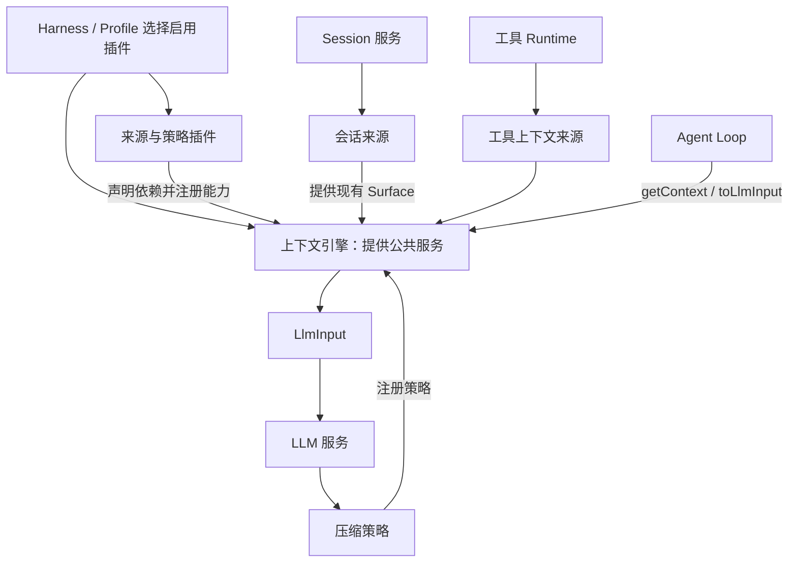
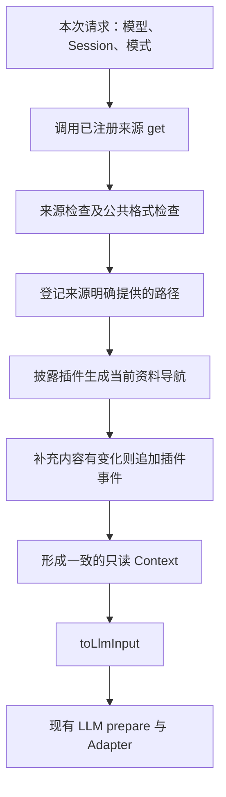

# 上下文管理引擎的插件拆分和上下文的插件拆分

状态：2026-10-06 第一版实现已接入；自动化与真实界面的验证范围见[执行摘要](../../exec-runs/20261006-context-management-engine/execution-summary.md)。本文维护设计契约，不承诺未执行的 Provider 验收。

## 1. 原则与范围

**模块化、低耦合，通过统一接口协作。并非完全没有依赖，而是不依赖对方的内部实现。**

按职责、生命周期和变化原因拆分，不按信息标签机械分类。同一信息可以被多个模块引用。统一使用 [Context 数据契约](Context数据结构和模型输入数据结构的设计规范.md)，来源与策略不必实现相同的大接口。

第一版：一个上下文引擎、六个基础来源插件、两个策略插件。渐进式披露同时提供来源能力，不为此再拆一个插件。

## 2. 职责划分

| 插件角色 | 负责 | 边界 |
| --- | --- | --- |
| 上下文管理引擎 | 注册与撤销来源/策略，组织 Context，接线状态保存和 Session 操作，转换 LlmInput | 不实现各来源领域逻辑，不另建会话存储，不适配供应商协议 |
| 系统提示词 | 按模型选择 Prompt，提供基础身份与行为说明 | 不读取项目规则，不负责执行层权限 |
| AGENTS 规则 | 用户与工作区 AGENTS.md 的加载及适用规则输出 | 第一版不加载 CLAUDE.md；不管理 Skill |
| Skill | 目录、描述、路径和显式选中 Skill 的内容 | 不自动生成或迭代 Skill |
| 动态运行信息 | 模式、必要环境事实、执行阶段提醒等 | 内部审计身份不全部发送模型；执行预算和权限仍由执行层控制 |
| 会话上下文 | 提供现有 Session Surface，保留消息结构及追溯信息 | 不保存第二份聊天记录，不擅自重写 Surface |
| 工具上下文 | 当前可用工具定义，工具结果路径接入，成功读取事实接入 | 不执行工具，不重做 Bash/读取工具自己的限制 |
| 压缩策略 | 压缩判断、摘要、保留路径、替换区域 | 不决定活跃与睡眠，不绕过 Session 提交 |
| 渐进式披露策略 | 引用登记、周期计数、压缩后整理、活跃导航与睡眠目录 | 不生成摘要，不替模型检索材料，不即时唤醒睡眠路径 |

记忆、场景沉淀、工作流可作为未来来源插件接入，第一版不为它们建立空实现。英语学习等现有扩展可接入统一来源接口，不塞进系统提示词插件的内部。

## 3. Cordis 装配与依赖

图中来源向引擎注册是依赖方向，LLM 输出箭头是数据流，不表示引擎硬依赖某个具体压缩实现。

- 引擎通过 Cordis Service 暴露契约，来源/策略声明所需服务依赖，不能在引擎中 import 具体实现。
- Context 类型契约不依赖具体插件实现，避免“来源依赖引擎实现、引擎又依赖来源”的包循环。
- 注册返回撤销函数，并纳入插件所属 Cordis effect/dispose 生命周期。卸载时清理注册、监听和临时缓存。
- 启用哪些插件由 Harness/Profile 装配决定；不另建平行插件加载器。
- 会话状态按 Session 隔离，不能用全局共享路径计数。子 Agent 与并行 Session 不互相污染。
- Codec 发现与行为启用分离：关闭功能不应自动失去读取其既有事件的能力。

## 4. 公共方法与 Context 的使用

方法名表达设计职责，最终类型签名在实施前结合现有 API 固定；不要求每个插件继承大父类。

| 角色 | 基本方法 | 说明 |
| --- | --- | --- |
| 引擎 | `getContext(request)` | 取得来源、应用检查、合并内容与管理状态，返回统一 Context |
| 引擎 | `toLlmInput(context)` | 转换为现有 LLM 参数，不执行压缩和状态策略 |
| 引擎 | 注册来源、注册策略 | 返回撤销函数；管理注册归属与生命周期 |
| 来源 | `get`，可选 `check` | 提供或检查属于自己的 Context 内容，允许内部缓存 |
| 压缩策略 | `shouldCompact`、`compact` | 消费 Context 会话与预算，提供摘要、路径和替换建议 |
| 披露策略 | 路径登记、读取计数、压缩后整理、`get` | 使用 Context.status；提供补充导航内容 |

具体来源输出和局部更新可以使用内部类型，但不再向业务使用者暴露 ContextEntry、ContextAssembly 等第二套概念。插件之间通过引擎与 Context 公共字段协作，不传递对方的私有状态对象。

引擎控制应用顺序。插件只能修改自己负责的内容或提出变化；会话变更通过 Session 服务提交。共享 Context 不意味着所有插件可以任意修改所有字段。

## 5. 一次请求的数据流

来源失败沿用 required/optional 的明确语义：必要内容缺失阻止请求，可选内容失败记录原因。顺序稳定，不依赖加载时机。动态内容的展示摘要用于去重，计数变化不能触发重复导航注入。

工具定义仍与本次实际执行能力一致；去掉展示不能被误认为已经撤销执行权限。真实权限、审批、工具调度继续由原执行层负责。

## 6. 压缩与披露协作

1. 引擎把 Context 中的有效会话与预算提供给压缩策略。
2. 压缩插件产生摘要和 `pathlist`；路径可以从原始待压缩内容抽取，也可直接采用已有明确引用。
3. 引擎通过现有 Session 压缩事务提交替换，保留精确来源序号。
4. 成功后调用披露策略，统一整理全部活跃/睡眠路径；读过或本周期新加入的文件按计数排序，最多保留 100 条，固定顺序后清零并推进周期。
5. 刷新 Context，按需要追加新的导航补充，再转换请求。

压缩插件不直接调用披露插件。关键顺序使用明确的 awaited 调用，不能依赖不等待结果的广播通知。压缩失败不整理、不清零；崩溃恢复与状态提交顺序需要在实现计划中验证。

成功读取只计数，睡眠路径下一次成功压缩后参与前 100 条选取；并非读取一次就保证恢复。规则详情以[渐进式披露设计](agent-progressive-disclosure.md)为准。

## 7. 当前来源清单与迁移依据

以下为 2026-10-06 源码检查事实，不代表新插件已经存在：

| 当前内容 | 当前来源 | 新职责归属 |
| --- | --- | --- |
| 身份、基础行为说明，Agent/Chat 区分 | prompt/core-contributors | 系统提示词 |
| 用户与工作区根目录 AGENTS.md | prompt/host-context | AGENTS 规则 |
| Skill 目录和选中正文 | prompt/skills/contributor | Skill |
| Agent 描述、工作区、Host 能力 | modelFacts contributor | 运行信息；稳定公开事实可保留于 SystemContext.modelFacts |
| agentMode 与 revision | 用户内容中的 runtime-context | 动态运行信息；旧记录照常读取 |
| 子 Agent 步数耗尽提示 | Agent Loop 请求尾部 | 动态运行信息；实际限制仍归 Loop |
| 用户、助手、工具结果与摘要 | Session Surface | 会话 |
| 图片、文件引用、回复摘录 | 现有消息块与 artifact 解析 | 会话接入，复用当前解析 |
| 可用工具定义、输出文件路径 | Agent Loop 与 Tool Runtime | 工具上下文 |
| 英语学习提示词 | system-prompt/assemble 扩展 | 独立来源插件接入 |
| agentRunId、invocationId 等 | request facts | 管理/审计状态，非默认模型输入 |

按模型选择 Prompt 属于后续实现能力。第一版先做好选择接口，保留已有 Agent/Chat 基础 Prompt；具体模型模板由用户后续单独接入。Agent/Plan 仅加载用户数据目录及工作区根目录的 AGENTS.md，Chat 保持只加载用户规则且不加载工作区 Skill 的现有边界。每个新用户 Turn 检查内容变化；用户规则优先，不增加文件监听、不加载嵌套目录规则。

## 8. 不额外拆分的部分

- 输入检查：先由来源/工具自己的策略承担，不另建复杂资源准入系统。
- 输出整理和 LLM 转换：引擎内部能力，不单独创建插件。
- 临时插槽：仅在下一次安全请求尾部插入；支持单次请求，或保留到显式移除/当前 Turn 结束。未实际提交的请求不消费单次插槽；同一请求的传输重试复用冻结输入。不能插入工具调用与结果中间，不增加 UI。
- 状态存取：复用 Session 接线，不另起状态事实库。
- 统计展示：读取状态与现有 Projection，不另造模型用量事实。

## 9. 取消注册与恢复

取消来源后，下次 Context 排除它的新贡献、组装缓存和可识别补充；已经开始发送的请求保持冻结。共享路径仍有其他有效来源时可继续展示。历史正文已经引用的材料不追溯删除。

卸载不删除 Session、artifact 或历史事件；恢复所需 Codec 与持久事实保留。取消策略后的降级行为由装配契约明确：不能静默运行一个缺失必要能力的 Harness，也不能因为移除可选来源就清空会话。

## 10. 第一版范围收口

以下为本轮用户对最终问题清单的确认：

- 范围固定为一个引擎、六个来源、两个策略；未来记忆、工作流、质量检查或修复 Agent 不提前实现。
- 模型 Prompt 预留选择及扩展能力，暂不编写或调优多套模型模板。保留现有 Agent/Chat 维度。
- AGENTS 加载两处，按新用户 Turn 检查变化，用户规则优先；规则是模型指令，不覆盖执行层权限。
- 动态运行信息复用现有内容，补充日期和时区；不逐步注入精确时钟，内部审计 ID 留在状态。
- 导航只在展示变化时追加，以最新列表为准；旧列表保留到压缩，以减少修改历史前缀。压缩排除可识别旧导航并补入当前导航。
- 路径登记与计数由代码处理；目录不进活跃列表，上限 100。确切范围和排序以渐进式披露规范为准。
- 压缩 Prompt 采用本轮拉取的 OpenCode 模板适配版，见[压缩提示词设计](agent-compaction-prompt.md)；其他压缩机制优先复用现有实现，不把提示词复用扩大成整套引擎移植。
- 原始历史直接提供 Journal 路径及精确序号，不生成摘录；Host 接好可读性，不让 Context 依赖 JSONL 内部目录布局。
- 临时插槽只支持安全请求尾部与明确寿命，不建设任意位置编辑能力。
- 启用策略由 Harness/Profile 配置；不新增设置页或开关矩阵。现有 Context 面板继续反映最终输入，状态不伪装为模型用量。
- 第一版不增加业务状态驱动的工具许可判断，已有权限与审批保留。停用压缩插件时停止周期整理，仍遵守路径容量上限；停用披露插件时去掉其导航贡献，保留正常工具结果和持久历史。

## 11. 验证与后续计划

至少验证独立注册/撤销、依赖缺失、重复注册、插件重载不重复注入、会话隔离、来源失败、模型一致性、工具定义一致性、动态补充去重、压缩失败与恢复、旧 Session 和 fork。

本设计不要求本轮新建九个 package。实现计划应逐项说明复用/调整现有 `packages/context`、`packages/prompt`、`packages/compaction` 和工具接线的位置，并保持现有 Session 数据契约。已使用 v1 required Context Codec、候选/core/applied 顺序、类型化 fork 索引、补充锚点、generation 读取缓存与 Host 历史路径实现接线。自动化证明与真实 Provider/界面验收分别记录在执行摘要。

关联：[数据结构与转换](Context数据结构和模型输入数据结构的设计规范.md)、[渐进式披露](agent-progressive-disclosure.md)、[设计原则](agent-plugin-design-principles.md)、[压缩提示词](agent-compaction-prompt.md)。

实施顺序与工程契约见[执行计划](../../exec-plans/completed/20261006-context-management-engine/README.md)。
