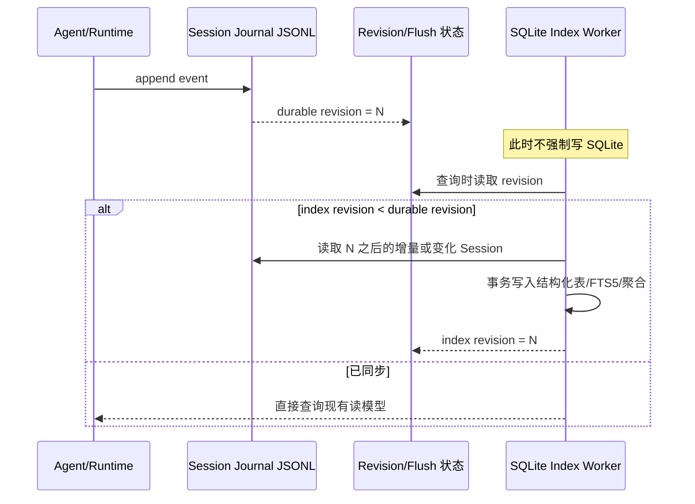
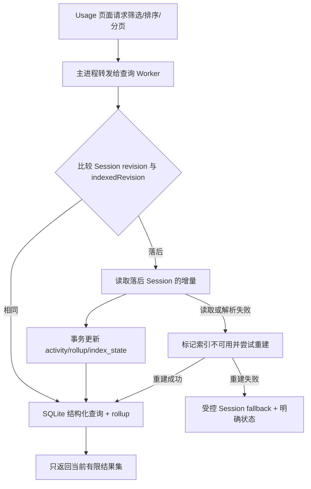
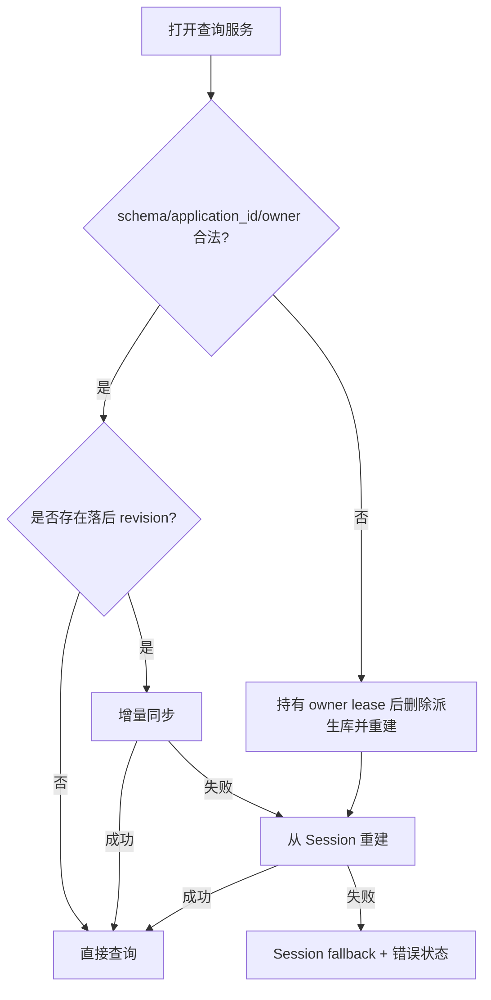
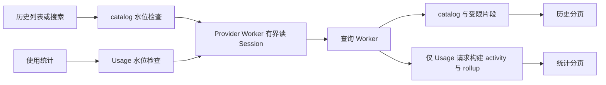

# 存储改版 V2：增加 SQLite 查询读模型

状态：当前实现收口，包含已知缺陷，尚未整体验收通过。用户要求等待其他任务完成后统一验收与修复，见[后续计划](../../exec-plans/active/20261011-usage-sqlite-acceptance.md)和[问题清单](../../exec-runs/20261011-usage-sqlite-read-model/acceptance-bugs.md)。

## 1. 要解决的问题

使用统计、历史搜索和过去会话查询最终可能面对百万行甚至千万行数据。改版前的实现以 JSON 数据为基础，在分页请求时会重新扫描、过滤、排序和聚合全部候选行，再截取当前页。分页只减少 IPC 返回量，没有减少计算量，因此数据增长后会出现 CPU、内存和响应时间一起上升的问题。

目标是同时保留两件事：

- Session 文件仍然是用户可以检查、备份、迁移和恢复的可读事实源。
- SQLite 只承担可重建的查询读模型，让筛选、排序、分页、全文搜索和聚合不再扫描完整 JSON。

这不是把 Session 迁移成 SQLite，也不是维护两份独立事实。SQLite 丢失时，系统可以从 Session 重建。

## 2. 已确认的核心决策

### 2.1 两层存储

```text
sessions-v2/<session-id>/journal.jsonl       <- 唯一事实源，可读、可导出、可重放
runtime-v2/usage-read-model.sqlite           <- 派生查询索引，可删除、可重建
```

Session Journal 继续负责 Agent Loop、恢复、上下文、轨迹详情和持久化语义。SQLite 保存用于查询的结构化字段、聚合结果、搜索文档和每个 Session 的同步水位。

SQLite 文件不可直接当作 JSON 打开，这是数据库文件的正常属性；用户仍可直接查看原始 JSONL。为了保持可理解性，系统还应提供导出 JSONL、索引状态和重建入口，不能让 SQLite 成为唯一可解释的副本。

### 2.2 写入不是应用层双写

每条事件只由 Session 持久化路径写入一次。写入成功后，Session 暴露持久化 revision 或单调递增的事件水位。SQLite 索引在查询触发时观察这个水位，发现落后才读取新增或变化的 Session 内容，并在一个 SQLite 事务中提交索引更新。

因此，写入路径是：



这样做的关键收益是：没有查询者时不做索引计算；Agent 写入也不需要等待第二份存储完成。代价是第一次打开使用统计或历史搜索时可能触发一次增量同步，这个成本由 Worker 承担并且只读取落后的部分。

### 2.3 Revision 与水位

每个 Session 至少需要两个可比较的值：

- `sessionRevision`：Session 已经 durable 的最新 revision。
- `indexedRevision`：SQLite 已经提交到的最新 revision。

查询开始时比较二者。相等表示索引可用；不相等表示需要同步。同步提交成功后，才推进 `indexedRevision`。如果进程在事务中断，水位不会提前推进，下次仍会从安全位置重试。

Revision 不是另一套事件事实，也不是“索引版本替代 Session 版本”。它只是判断派生读模型是否落后的水位。若某类旧 Session 没有可靠 revision，索引器必须退回到保守的文件元数据/内容校验，并在无法确认时重建该 Session 的索引。

## 3. 各个读取场景的归属

| 场景 | 首选来源 | 说明 |
| --- | --- | --- |
| Agent Loop、恢复、上下文组装 | Session | 保持后端语义不变，不能因为 UI 索引损坏影响 Agent 运行 |
| 使用统计页面 | SQLite | 结构化筛选、排序、分页、聚合；查询前按 revision 懒同步 |
| 历史搜索、查询过去会话 | SQLite + FTS5 | 先返回匹配的 Session 摘要和游标；选中某个会话后再从 Session 读取详情 |
| 轨迹详情 | Session | 轨迹需要更完整的事件信息；SQLite 可以保存检索所需的摘要或定位信息，但不取代详情事实源 |
| 轨迹列表/跨会话筛选 | SQLite 可选 | 如果当前页面和轨迹使用同一批 Journal 事件，可以复用索引；详情仍回到 Session |
| SQLite 不可用或同步失败 | 受控 Session fallback | 只允许有限、可取消的降级读取，并把“索引不可用/正在重建”报告给 UI |

历史页面可以把单页上限从当前很小的页面值调大，但“直接全部返回”只适用于会话摘要、日期、模型、计费和命中片段等轻量行。不能把千万条事件正文一次复制到 IPC 和渲染进程；选中会话后再读取详情，仍然是必要的边界。

## 4. SQLite 读模型的内容

当前 schema 8 限定用途，不复制完整 Journal：

- `session_catalog`：标题、workspace/worktree、pin/archive、时间、会话类型、完成 turn 数和源 revision。
- `usage_activity`：时间、model/provider/tool、token、费用、状态和有限 `row_json`。
- 小时、日、全量 rollup 与 run 去重表：累计指标查询不扫描明细；滑动时间窗口的边界小时回查明细以保持精确。
- `usage_search_dimensions` / `search_documents`：按 model/provider/connection/tool 组合去重的 FTS；避免每条 activity 重复保存相同搜索文本。
- `session_search` / `session_excerpt_search`：标题、每条 user/assistant 消息的前 512 字符，处理字符串和 text block，脱敏后索引。它是历史片段搜索，包含已被上下文压缩替换的历史消息；不是完整正文搜索。
- `usage_projection_*`：受控大小的 step/call 关联事实，用于跨批次重试、终态和 run 关联，复用原 Usage 投影口径。
- `index_state`：Usage 和 catalog 分别保存 committed revision、Provider cursor、物理 stamp 和独立 codec digest。catalog 水位不冒充 Usage 水位。

WAL、单 Worker 写连接、独立 SQLite owner lease、application id、schema 版本和文件权限 0600 均已接线。摘要行标记为 browse-only，不对整份 Session 的关系完整性作承诺；打开会话时仍由原 Session 恢复路径决定写入权限。

## 5. 三种查询流程

### 5.1 使用统计



### 5.2 历史搜索

FTS5 只匹配词项、短语和可索引字段；分页使用稳定排序键加 cursor，而不是 `OFFSET` 扫过前面所有行。查询返回 Session 摘要和命中位置，用户打开会话后再按 Session id 读取完整 Journal。

FTS5 的限制必须在产品行为中体现：默认 tokenizer 适合词项/短语搜索，不等同于任意子串搜索；统计条件仍用普通索引列，不能把所有条件编码成全文查询。

### 5.3 索引损坏或版本变化



Fallback 是正确性保险，不是常态路径。它必须限制最大读取量、支持取消，并告诉用户当前结果可能较慢；不能静默把全量 JSON 扫描放回每一次分页请求。

## 6. 实际查询链路与验收状态

Main 通过 App/Runtime/Provider 的有界读接口取得批次，JSONL 解析在 Provider Worker，SQLite 投影和查询在查询 Worker。每批最多 256 个物理事件、目标 256 KiB；单行最多 1 MiB。Main 不调用完整 Session inspection，不解析旧 JSON usage cache。插件服务层转发这些能力，真实 Cordis 路径已有回归测试。

历史摘要/搜索与 Usage 各有独立水位。只浏览历史时构建 catalog/片段，不构建 activity/rollup；Usage 打开后才计算其缺失增量。两者共享完整事实前缀，但不会重复累计已投影的 metadata。



数据库失败后重建一次；再次失败时最多从 1,000 Sessions 读取合计 5,000 events / 8 MiB 精简状态，在 Worker 中复用原投影并建立请求级内存 SQLite，继续使用相同的 FTS、游标和聚合 SQL。完成或失败均释放临时状态。超限明确报错，旧 JSON 文件保留但不是主查询或无限 fallback。请求队列最多 8 个，单次响应最多 1 MiB / 500 条明细；多 workspace 初页合计也不超过 500 条，未加载分组保留后续分页入口。

Workspace admission 继续从 Session 事实恢复；启动时只按批读取 workspace 相关字段，不完整重放 transcript/Usage，也不把 SQLite 当权限事实源。Provider 支持按事件类型过滤返回，但 cursor 仍跨所有物理事件推进。

当前测试和测量按用户要求暂停。已完成的百万行 Worker 热查询达到初始目标，但真实 Journal 的 1,000 行增量尚未达到 250 ms 目标；M/L/XL 和真实 Electron 验收不能用小数据结果替代。最新数值、失败项和环境限制见[执行摘要](../../exec-runs/20261011-usage-sqlite-read-model/execution-summary.md)。

## 7. 一次性实施的验收边界

得到批准后，这项改动按一个完整变更集实现，不拆成先写入、再读取、再 Worker 的长期迁移。必须同时满足：

1. Session 写入、flush、revision 语义保持兼容，Agent Loop 的读取路径不改为 SQLite。
2. Usage、历史搜索和过去会话查询通过同一查询服务完成按需同步、游标分页和结构化过滤。
3. SQLite 删除、损坏、schema 变化、Worker 重启后可以从 Session 重建。
4. 增量同步只处理落后的 Session；无变化查询不重新扫描全部数据。
5. 轨迹详情仍能从 Session 得到完整内容；索引中的摘要丢失不影响打开会话。
6. JSONL 仍可直接查看和导出；SQLite 只是本地派生文件。
7. 通过小数据、十万行、百万行规模的查询/重建基准，并验证 IPC 返回量有界。

不在这次范围内：把 Session 迁移为 SQLite、把完整 transcript 复制进 SQLite、修改 Work/WorkHub 的持久化协议、让 Agent Loop 依赖 FTS5、或为了“全部返回”取消 IPC 和 UI 的结果上限。


## 当前实现补充（统一验收待执行）

- SQLite schema 8：activity 行、去重维度 FTS、catalog 标题/受限消息片段 FTS、小时/日/全量 rollup、run 去重计数、增量关联状态与水位。维度 FTS 不为每条请求重复保存相同 model/provider/tool 文本。
- Provider 的轻量 Query Source 只返回必要 Header 字段、完整前缀 seq 和物理 stamp；128 个描述符一批。Provider Worker 缓存最多 10,000 项/16 MiB 编码量，单批结果最多 2 MiB。打开的 Session 由 Runtime durableSeq 限制，恢复与 Agent 仍读 Session。
- 标题和片段搜索只作用于本机索引。片段最长 512 字符；它不承诺覆盖消息全部正文，点击会话读取原始详情。搜索结果每页 50 条、上限 500，翻页替换结果列表。
- 首次同步、重建、查询与 fallback 状态可见；取消 SQL 查询通过终止查询 Worker 实现，Provider 批读和同步在批次边界检查取消。SQLite 所有者租约防止另一个 Worker 删除活动库。
- Flush 不再主动初始化没人读取的全局摘要缓存；已有缓存仍在 flush 后更新。Journal append/fsync、checkpoint 和 Agent 读取协议保持不变。
- 未打开的其他进程文件以完整前缀供查询，不把它当作跨进程 fsync 确认。文件被替换、截断、同水位 stamp 改变时重建对应 Session。
- 全量查询摘要的复杂度主要取决于不同维度组合数；极高基数与按会话标题筛选仍可能更慢，需要在验收记录中保留边界。

### 后台历史恢复边界

`session_catalog.has_pending_tasks` 来自 Worker 对任务 accept/claim/cancel/finish/recover 事件的增量投影；`catalog_pending_tasks` 只保存尚未完成任务的 id/run id/state，不保存任务正文，不参与调度。侧栏仅用这个提示决定是否补齐后台任务徽标，选中会话、实时事件和确有待处理任务时仍走原 Session 读取与恢复。继承的其他 Session 任务不计入提示。旧调用方没有该字段时保持原行为。

真实 Electron 压测还修复了子智能体恢复扫描：没有 delegation/requested 的父会话直接返回；其余会话通过 Provider Header lineage 排除无关文件，匹配的子会话依然完整校验后才允许恢复写入。该优化不引入 SQLite 恢复依赖。

### 查询补充（本轮验收修正）

Activity支持精确`model`/`providerId`与range/status/kind/FTS组合；旧statistics接口保持原有整段范围汇总语义。标题命中全部catalog可直接使用全局rollup，部分命中在SQLite TEMP表中一次聚合，再复用摘要、费用和维度计算。仅保留最近一个TEMP结果，`total_changes()`变化即失效；不会把匹配行数组送到Main。时间窗口变化也会产生不同缓存键。未筛选Tab计数继续走全局汇总。

旧statistics总览另有`usage_run_cardinality`，按天和全量维护精确运行身份数；同一运行的LLM/工具混合只计一次，删除最后一个kind才递减。已有派生库的辅助表创建、回填和触发器安装在单个事务完成，避免每次总览重新对全部运行去重；滑动时间窗口仍使用精确边界查询。
