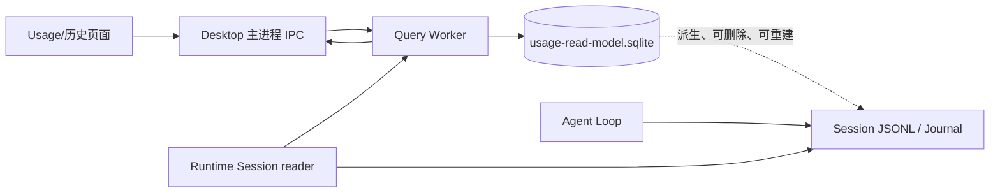
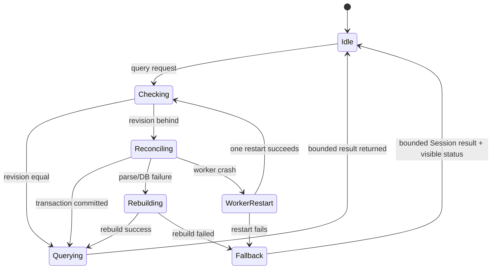

# SQLite 查询 Worker：兼容性、资源和使用边界

这里的“Work”按 Worker 理解，即 Electron/Node 的 `worker_threads`，不是 WorkHub 或多智能体 Work 功能。WorkHub 的兼容性另行讨论，不属于本次 SQLite 读模型方案。

## 1. 建议结论

首版就把索引同步和重查询放进一个长期存活的查询 Worker。Worker 不是等数据达到某个神奇数量才启用的开关，而是查询服务的执行边界：主进程负责 IPC、生命周期和权限；Worker 独占 SQLite 连接，读取 Session、做增量同步、执行 FTS5/聚合查询并返回有界结果。

这样做的理由是 SQLite 本身可以很快，但同步的 Journal 解析、FTS5 批量导入、重建和聚合会占用 CPU；同步的 SQLite 查询 API（例如 `DatabaseSync`）还可能直接阻塞 JavaScript 线程。若等到百万行再补 Worker，通常会把 UI 卡顿、取消、重启和打包路径问题一起推迟到风险最高的时候。

## 2. 执行边界

主进程不在每个分页请求中自己执行 SQL 聚合；它仍通过 Runtime Session reader 获取可验证的 Journal-derived activity 投影，再把落后 Session 的变更批次发送给 Worker。这样不会让 Worker 绕过 Provider/Session 边界。Agent Loop 也不经过 Worker 读取上下文。Worker 只服务前端查询和后台索引维护。

Worker 任务包括：

- 比较 revision 并做增量 reconciliation。
- SQLite schema 校验、WAL 初始化和索引重建。
- 使用统计的结构化查询、rollup 查询和 FTS5 搜索。
- 受控的批量导入、游标分页和结果裁剪。

Worker 不负责：

- 接管 Session 的写入或 flush。
- 修改 Agent Loop 的恢复、上下文和轨迹事实读取。
- 自动重放不确定的副作用。
- 把完整 Journal 或无限结果集复制给渲染进程。

## 3. 什么时候必须使用 Worker

实现上从第一版统一使用 Worker；下面的数值是容量和路由的经验阈值，用于压测、限流和是否允许主进程内联小查询，不是 SQLite 的硬上限：

| 信号 | 建议处理 |
| --- | --- |
| 任何全库重建、FTS5 批量导入、跨 Session reconciliation | 始终在 Worker |
| 索引行数超过约 50,000，或索引文件超过约 20–50 MB | 始终在 Worker，结果分页 |
| 单次查询 p95 超过 16 ms，或同步/聚合超过 100 ms | 保持 Worker，增加取消和进度状态 |
| 单次导入超过 1,000–5,000 行 | 分批事务提交，避免一次构造巨型数组 |
| 低于上述规模 | 仍可走同一 Worker；只对测试或极小查询允许内联适配器 |

16 ms 是保持交互流畅的帧预算参考，100 ms 是用户明显感到等待的参考；它们需要在目标设备上用真实数据校准，不能当作承诺的绝对性能。

## 4. 内存与 CPU 影响

Worker 有独立 V8 isolate 和 SQLite 连接，会增加固定进程开销。实际数值取决于 Electron 版本、SQLite 构建和查询结果，设计上按“几十 MB 级固定开销”预留，不能把完整百万行 Journal 一次读入内存来换取速度。正确的控制方式是：

- 按 Session、按批次读取；单批约 1,000–5,000 行，完成一批就释放对象。
- 查询只选择页面需要的列；详情正文按 Session id 回读。
- SQLite 使用事务和索引完成过滤/排序，返回结果硬上限和字段大小上限。
- FTS5 导入不建立无限大的临时 JS 数组，使用批量绑定。
- 同一时刻只允许一个 rebuild；普通查询可以排队但不能无限堆积。
- 提供取消信号；页面关闭时取消未开始的查询，重建则在安全批次边界停止。

因此，Worker 的内存成本是一个可预测的固定成本；不用 Worker 的代价则是把不确定的扫描和解析成本放在主进程，直接影响 UI 和 IPC。最终发布前必须记录 macOS/Windows 目标构建下的 Worker 常驻 RSS、重建峰值 RSS、CPU 时间和查询 p95。

## 5. 兼容性与打包约束

`worker_threads` 是 Node/Electron 内置能力，不需要部署外部服务，也不改变 Session 文件格式。主要兼容性风险在工程集成：

1. Worker 脚本必须有稳定的构建产物路径，开发环境和打包后的 `asar`/resources 路径都要能定位。
2. Worker 与主进程之间只传可结构化克隆的数据，不传数据库连接、文件句柄或巨型对象。
3. SQLite 文件只能由一个 Worker 拥有写连接；其他查询通过消息进入同一 Worker，避免多连接同时迁移 schema。
4. 数据库使用 WAL 和明确的 schema/application id；版本不匹配时关闭旧连接并重建，不在未知 schema 上继续写。
5. 应用退出时先拒绝新任务，再等待安全批次完成并关闭 SQLite；不能强杀后假设 revision 已推进。
6. Worker 崩溃最多自动重启一次并重新校验索引。重启失败时进入可见的 Session fallback；不自动重放 Agent 或 Work 的副作用。

已有的重型 diff/大 JSON 处理 Worker 经验可以复用这套边界：Worker 崩溃只影响派生查询，重建最多自动尝试一次，事实数据不被 Worker 修改。

## 6. 查询、失败和恢复状态

失败路径必须区分三件事：

- 查询没有命中：正常空结果。
- 索引暂时落后：等待同步或显示同步状态。
- 索引损坏/Worker 失败：重建，失败后才降级 Session。

这能避免把“当前没有数据”和“查询系统坏了”混成同一种空白页面。

## 7. 验收和基准

一次性实现时，Worker 相关验收至少覆盖：

- 无变化 revision 查询不会重新读取完整 Session。
- 增量事件、Session 修改和删除都能推进或重置正确水位。
- FTS5 词项/短语搜索、结构化时间/模型过滤、cursor 翻页结果稳定。
- SQLite 删除、损坏、schema 版本变化可以重建；重建失败会进入可见 fallback。
- Worker 崩溃、重启、取消和应用退出不会损坏 Session，也不会误报索引已同步。
- 10 万、100 万和更大合成数据下，测量重建时间、峰值 RSS、CPU 时间、查询 p95、IPC 返回字节数。
- Agent Loop 在 Worker 停止、SQLite 删除和索引重建期间仍能从 Session 正常恢复和继续运行。

最终是否进一步细调阈值，应以这些基准结果为准；阈值只影响性能策略，不改变 Session 是唯一事实源这一决策。

## 当前实现对照（执行中）

实际读取路径是 Main → Runtime/App → Storage.readEventBatch → JSONL Reader Worker，再由 Main 转发有界事件批次到 SQLite Worker。两个 Worker 都懒启动；前者由 Provider 生命周期管理，后者由 Usage Service 管理。Provider cursor 是不透明实现令牌，Main 不解释物理偏移。

JSONL 每批至多 256 events、目标 256 KiB，单记录最大 1 MiB；SQLite 按 step/call 关联重算精简 Usage 行，不把整库装进数组。一个 Session 可跨多个消息，但只有最后一批才提交事务和 indexed revision；上文“分批事务”不能理解为半个 Session 提前发布完成水位。单关联组 10,000 events / 8 MiB、fallback 1,000 Sessions / 5,000 events / 8 MiB 精简状态是当前有界失败阈值。

原 JSON cache 文件保留；主查询不再通过它加载全部历史。fallback 在 Worker 内复用原 Session projection，并用请求级内存 SQLite 复用正式 FTS、cursor 与汇总查询；超过预算时明确失败。取消、索引进度和 rollup 已实现，真实 Electron 资源验收仍在执行，详见[执行摘要](../../exec-runs/20261011-usage-sqlite-read-model/execution-summary.md)。

### 实际实现与测量边界

当前存在两个按需启动的线程：Storage Provider Worker 负责物理描述符与批量 JSONL 解析；Query Worker 负责 SQLite、精简关联投影、汇总和查询。Runtime 在两者之间解析已知 codec，Main 只中转有界批次。它们共用进程 RSS，不能把 `process.memoryUsage().rss` 当成独立 Worker 内存。

Provider 描述符每批 128 个，事件每批最多 256 个/目标 256 KiB，单记录上限 1 MiB；Query Service 排队上限 8，Worker 连续无进展等待上限 60 秒（大删除每500行报告存活并续期）。用户取消正在执行的 SQL 会终止 Query Worker，之后按已持久化水位恢复；不能依靠同步 SQLite 函数执行期间读取普通取消消息。

性能记录持续更新到 [执行摘要](../../exec-runs/20261011-usage-sqlite-read-model/execution-summary.md)。百万行合成 Worker 基准已通过热查询目标，真实 Journal、L/XL 和 Electron 尚待完整验收。

### SQLite 临时存储的读写策略

本机诊断发现，逐行触发器的临时数据落盘造成大量系统调用；只增大 SQLite 页缓存没有明显收益。Worker 在新的有界追加事务前使用 `temp_store=MEMORY`，保持 WAL 和原来的持久化事务不变。写入与水位仍一起提交。

查询前切回 `temp_store=FILE`，让大排序、DISTINCT 和标题 TEMP 聚合可以落盘；切换会删除 TEMP 表，必须同时失效标题聚合缓存。已有会话的替换、全局删除和 catalog 更新也使用 FILE。已经由历史查询同步过相同 revision/stamp 的 catalog，不阻止第一次 Usage 追加使用 MEMORY。

每批 dirty group 使用短期Set，最多10,000项、key累计8MiB，超过即回滚，不推进水位；每组关联事件仍限制10,000条/8MiB。该上限针对增量关联展开，不允许通过调大批次把全库放入内存。SQLite 页缓存和 WAL 仍由磁盘管理，不能把 JS heap 当作 SQLite 原生内存的全部，验收须同时记录进程RSS。

依据：[SQLite 临时文件](https://www.sqlite.org/tempfiles.html)、[temp_store PRAGMA](https://www.sqlite.org/pragma.html#pragma_temp_store)。这是临时表/索引策略，不是把事实数据库改成内存数据库，也没有关闭事务安全措施。

批内request/run/group关联缓存各最多256项，key/value超过1024字符不缓存；超出缓存的关联仍按原SQL读取。缓存只减少同一批里的重复查询，不替代SQLite持久关联，也不跨revision复用。

## 历史查询的 Session fallback

历史查询与 Usage 都遵守一次重建后有界回退。历史使用 Worker 内请求级临时 SQLite，直接从 Session 批读并复用同一 catalog projection、FTS 和分页语义；不创建磁盘索引、不获取 owner lease，结束和异常均关闭。预检最多 1,000 Sessions/5,000 events，Worker 再限制 8 MiB 序列化输入；超限报错而不全量恢复 Session。响应仍受 500 行/1 MiB 限制，`readModel.status=fallback` 让页面说明数据来源。临时查询也需要 Node SQLite 驱动可用；无法加载 Worker/驱动时显式失败，不在 Main 执行 SQL。

稀有模型与服务商过滤各有独立的时间分页索引，避免找一条很旧记录时沿全局时间索引扫描。schema 8 打开时以 `IF NOT EXISTS` 添加，无需重放 Journal。

同步采用单批预读：SQLite 处理当前批时，Provider 可解析下一批，Main 最多持有当前和下一批。预读错误立即转成受控结果，后续投影失败或取消时清理预读，再走既有事务回滚；不推进尚未提交的水位。该流水线不影响无查询时零索引工作和 Agent Loop 写入路径。

Usage fallback 的临时库没有文件和 owner lease。最多 1,000 Sessions、5,000 events、8 MiB 精简状态（metadata 同样计费），原 Session 投影生成的活动行经过与磁盘索引相同的绑定和 SQL 查询，避免标题搜索、cursor 和统计口径在降级时变化。请求结束/异常关闭连接；如果驱动本身不可用则显式失败。该临时库只服务当前请求，不是第二个事实源。

目录同步在 Main 保留逐会话 fingerprint。首次启动对所有描述符建立目录并检查已删除身份；后续只发送发生变化的会话，实际删除发生时才 prune。每次查询仍检查 Provider 物理 stamp，没有用 TTL 隐藏外部修改；查询 Worker 重启会清空 fingerprint 并重新核对。

### 查询目录与失败隔离

Runtime提供`SessionQueryCatalog { sources, failedSessionIds } | null`：逐会话描述符错误不阻断健康会话，null表示Provider未实现可选加速能力。启动workspace admission仍从Session事实恢复并逐会话隔离失败，不能从SQLite授予工作区权限。源读取/缺失codec错误按Session隔离，历史保留failed计数，Usage标识failedSources；SQLite执行错误仍走重建与回退。

codecSetDigest单独持久化，变化时不论revision增长与否都重建该Session。时间字段写入SQL前归一化UTC。页面在解码前按原始字节预算截断拒绝；水位列表仅是最多500项的诊断样本，`sourceWatermarksTruncated`指明不完整，全量来源数与SQL聚合不受影响。

### 原生 SQL 退出与大 Session 替换

Worker `terminate()` 发起停止后，同步原生 SQL 可能仍未返回；Query Service 等待退出 Promise 完成后才启动替代 Worker，避免争抢旧连接仍持有的 owner lease。超时本身不证明 SQLite 损坏，因此保留派生库并提示重试，不直接重建全库。大 Session 替换与删除按500条活动一批执行DELETE，在原同一事务内更新FTS/rollup并报告存活；中途取消/崩溃回滚全部批次，水位和旧数据保持一致。普通消息不能在单条原生 SQL 执行期间插入取消，长索引创建仍可能超时并需重试。

隔离源失败会同时失效该 Session 的 Usage、catalog缓存及目录fingerprint；源恢复且revision不变也会重新读取。Provider没有可选批读能力时，历史/正文继续原能力，Usage明确不支持有界查询，不返回假零统计或删除其健康派生行。
