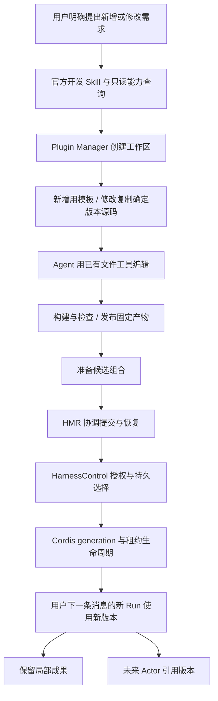

# 自进化总体架构与 DSH 借鉴边界

日期：2026-10-07。状态：总体方向已确认，V1 已获批准并实施；实际落点见 [10](10-V1实现与使用说明.md)。入口：[专题导航](README.md)。

## 1. 用户明确的方向

1. 提供指导 Agent 生成和修改插件的 Skill。
2. 提供 Plugin Manager 工具插件模块。
3. 提供 HMR 插件模块，负责运行中应用能力变更的协调。
4. 不覆盖运行版本：切换插件条目所引用的版本。修改先复制源码到开发工作区，新增也使用开发工作区。
5. 基座可以派生不同 Harness，未来支持长成不同 Actor；保留当前会话局部使用，不强制创建 Actor。
6. V1 仅由用户明确提出新增或修改需求；当前 Run 保持旧版本，提交成功后的下一条用户消息使用新版本，不实现自动续跑。
7. V2 再实现失败数据自动触发、独立评估沙箱和通过评估后的晋升流程。
8. 新增官方 Skill 内容集合，插件开发 Skill 默认随应用交付；复用现有发现与加载机制。

V1 先做工具自进化，支持在 Agent 模式直接表达需求；创造模式可作为后续聚焦入口，不是实现前提。V2 的失败触发与评估独立规划。Actor 由后续独立工作实现，此处只提供能力版本引用。

## 2. 一条统一链路

Skill、查询、编辑解释“怎样产生候选”；Manager 解释“怎样管理候选和产物”；HMR 解释“何时应用”；HarnessControl 与 Cordis 提供可信选择和实际生命周期。不能用某一个模型工具包办所有职责。

## 3. 明确各层所有权

| 层 | 拥有的职责 | 不拥有的职责 |
|---|---|---|
| 开发 Skill | 工作流、示例、契约阅读路线、验证要求 | 权限判定、持久状态、实际执行引擎 |
| 只读 inspect 工具 | 当前版本、工具定义、插件条目、服务和配置契约的查询 | 任意服务调用、编辑或启用 |
| Plugin Manager | 建工作区、取得源码、构建检查、发布产物、管理候选、提交应用请求、报告状态 | 改写运行实例、私自授权、独立持有当前生效选择 |
| HMR | 显式应用队列、选择与会话绑定的提交协调、状态和恢复 | 中断旧 Run、自动续跑、编辑源码、安装包、绕过 Control |
| HarnessControl | 候选准备、基线检查、独立授权、持久选择、租约准入 | 模型工作流、代码构建、业务任务调度 |
| HarnessGenerations / Cordis | 创建实例、Scope、租约计数、retired 清理、资源释放 | 判断能力是否更好、Actor 产品身份 |
| AgentService / Session 调度 | 在途任务、消息排序、停止、新 Run 按会话绑定获取租约 | 自动为版本切换生成任务、模块缓存清理、产物构建 |

推荐形成两个新增插件模块（Manager、HMR）和一个官方 Skill 资源模块。inspect 归属 Manager 的只读工具面；官方 Skill 模块集中维护开发指导及精选内容，不再创建 Skill 执行引擎。Manager 的模型工具代理可挂在 Harness 中，管理与切换协调实例由稳定 Host 生命周期拥有，避免切换时销毁自己的管理服务。新增可信服务面和跨模块接线需要独立实施计划。

### 现有模块与新增内容对照

以下明确的是推荐改动落点，不是已实现清单；新模块的准确包名、exports 和注册入口在实施计划中固定。

| 项目 | 新增还是扩展 | 具体落点和增量 |
|---|---|---|
| 官方 Skill 集合 | 新增内容资源模块，扩展已有发现入口 | 集中维护 SKILL.md、引用材料和版本清单；插件开发 Skill 为首个默认内容，Host 提供资源根目录，开发版和安装版均可读取 |
| harness_inspect | 新增模型工具，归属 Manager 模块 | 查询当前作用域、版本、条目和开发契约；不另起独立查询插件服务 |
| Plugin Manager | 新增插件模块 | 同一模块提供 Harness 侧工具代理和稳定 Host 侧管理服务；拥有工作区、构建、来源记录和候选流程 |
| HMR | 新增插件模块 | 稳定 Host 侧协调显式应用、选择与绑定提交、状态和恢复；不承担自动续跑 |
| 工作区、源码快照和构建入口 | Manager 内的新逻辑与存储 | 复用原有文件编辑工具和固定产物发布器；无需每项各建一个 Cordis 插件 |
| HarnessControl | 扩展已有 packages/harness-control | 增加从确定版本准备新分支的操作，并衔接授权、持久选择和恢复；不创建第二套 Control |
| 固定产物与 Patch | 复用并按契约需要扩展现有适配层 | packages/cordis-adapter 与 packages/composition 继续拥有发布、校验、导入和组合解析；新构建入口产出其接受的格式 |
| 会话绑定与执行接线 | 扩展已有 Runtime / AgentService 路径 | 将 ManagedRuns、压缩、能力查询和既有子 Agent 路径从固定 main 改为解析该会话的选择；绑定存储的具体位置仍需固定 |
| Cordis / HarnessGenerations / ToolRuntime | 主要复用现有生命周期 | 新模板正确注册和清理；按验收暴露的缺口补现有适配逻辑，不预设重写 Cordis 或另建工具表 |
| 应用与验证状态展示 | 扩展已有 Host 协议和 UI 投影 | 显示构建、候选、已选择、实际使用和验证结果；不以新增创造模式为前置 |
| Actor | 本轮不实现 | 只提供确定能力版本与持久引用边界，供未来 Actor 模块消费 |

这里的两个新插件模块是自进化基础设施。用户使用该基础设施生成的业务工具插件是另一层：用户可以新增业务插件，也可以由旧插件派生新版本；两者都走同一管理与应用流程。

## 4. 借鉴 DSH 的部分

| DSH 机制 | ActSpace 的采用方式 |
|---|---|
| 开发 Skill + 运行时 inspect | 采用；模板必须匹配 ActSpace manifest、权限与工具输出契约 |
| Manager 编排安装、选择、诊断 | 采用职责分离；首版主要接本地候选构建与固定产物，不要求建设任意 npm 包安装平台 |
| HMR 串行协调变更 | 采用；由显式候选应用触发，不靠文件修改触发启用 |
| Cordis 托管资源、卸载和挂载 | 采用并复用现有实现，不重建临时工具表 |
| 原路径源码修改与 ESM 缓存清除 | 不采用；每份改变后的产物有独立身份和加载地址 |
| Profile 变更影响共享会话 | 默认不采用；首次自进化创建会话局部分支 |
| 旧动态代码 Runner | 不采用；不创建另一套字符串代码执行生命周期 |

安装是将代码与依赖准备成可加载产物；挂载是创建运行实例。Manager 编排前者，Cordis 执行后者；HMR 不负责安装。完整 DSH 依据见 [调研](../../references/dsh-self-modification-20261007.md)。

## 5. 当前代码支持到哪里

| 当前事实 | 本方案的增量 |
|---|---|
| [固定产物](../../../packages/cordis-adapter/src/plugin-artifact.ts)按 artifactId 发布，校验内容后通过文件 URL 导入 | 可编辑源码快照、模板交付和通用工具产物构建 |
| [Patch](../../../packages/bundle/src/index.ts) 支持 insert / replace 等操作 | Manager 将新增/修改意图转为经过核验的 Patch |
| [HarnessControl](../../../packages/harness-control/src/service.ts)已有候选、授权、选择、回退 | 接模型工具；新增会话分支初始化与绑定，不能直接改全局 main |
| [Generations](../../../packages/boot/src/harness-generations.ts)已有新旧实例共存、引用计数和清理 | HMR 协调选择与绑定提交，旧 Run 继续持有旧租约，新 Run 使用新选择 |
| [ManagedRuns](../../../packages/runtime/src/harness/managed-runs.ts)仍固定获取 main | 所有会话执行与能力查询统一解析会话绑定 |

“替换条目版本”是逻辑变更。V1 准备新 Harness generation，选择新 generation，旧租约退出后清理旧树；不宣称已有逐插件就地切换。提交不必等待旧 Run 结束，也不改变它；同一 Session 的后续用户任务启动新 Run 时读取新选择。

## 6. 第一版边界

支持新增与修改受支持的工具插件，参数处理、组合调用、输出加工等应落在允许修改的 Harness 范围内。Host 端口、凭据、权限裁决、持久化 Codec、管理服务自身不作为自进化对象。

工具执行逻辑可能委托给 Host；例如 [filesystem-read](../../../packages/tools/filesystem-read/src/plugin.ts) 的文件读取由 Host port 提供。修改 Harness 包不能自动改变 Host 能力。inspect 应明确哪些源码可编辑、哪些需求超出范围。

不建立后台全量失败挖掘、完整自动评估平台、Actor 名册或多智能体协作。最脆弱的前提是可编辑源码与依赖可完整交付；若某插件只有不可重建产物，保留其可调用能力并拒绝“原插件修改”，允许用户另行提出基于公开接口的扩展。
