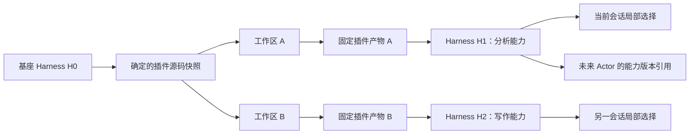

# 工作区、版本派生与 Actor 扩展

日期：2026-10-07。状态：不覆盖、派生与引用切换已确认；本页保留设计语义，V1 存储布局见 [10](10-V1实现与使用说明.md)。入口：[导航](README.md)。

## 1. 不可变产物与可编辑工作区分开

新增从模板创建工作区，修改从明确指定的确定版本复制源码快照，默认以来源 Run 实际使用的版本为基线；不把可能已经变化的当前选择当作同一版本。复制的是源码及构建描述，不是软链接到正在运行的目录，也不自动复制会话数据、凭据或缓存。



构建开始时固定工作区源码快照并计算摘要。随后继续编辑只产生下一次候选，不改变已提交构建的输入。发布后的 artifactId 对应固定内容；同内容可复用，内容变化必须产生新身份。

已有发布器会复制和校验固定文件，并限制符号链接、模块依赖等。运行版本不指向工作区。未变的产物可以共享；运行时可变状态仍按实例或会话 Scope 隔离。

## 2. 各类身份不要混用

| 身份或记录 | 含义 |
|---|---|
| workspaceId | 可编辑开发目录的受管身份；不是运行版本 |
| sourceSnapshot / sourceDigest | 可恢复的确定源码和构建输入，用于后续再次派生 |
| pluginId / artifactId | 插件身份与固定内容身份；显示版本号不能替代内容校验 |
| entryId / manifestEntryId | 组合中的槽位与产物声明中的 behavior 入口 |
| HarnessVersionRef | 可复用的完整组合、产物闭包、executionDigest、Host 兼容约束；推荐的逻辑引用 |
| parentVersionRef | 演化来源，支持从同一基座形成多个分支；不表示合并算法 |
| harnessId / selection revision | 一个选择分支及其有序启用历史；不等于 Actor 身份 |
| generationId | 当前进程挂载的一棵实例树；重启后可重建，不作为永久版本身份 |
| Session binding | 某会话选择哪个分支/版本，附独立绑定 revision |
| changeId | 一次构建、应用及绑定提交的关联身份，便于重试和恢复 |

新增的版本与来源记录不能替代 HarnessControl 既有选择日志；管理目录保存产物与来源，Control 保持“选用哪份组合”的真值，会话绑定只负责消费者映射。

## 3. “替换”是生成新组合

修改工具时保留原 composition，以确定基线和目标 entryId 构造 replace Patch。新组合引用新 artifactId；旧组合和旧产物保持完整。新增则构造 insert Patch。

```text
H0: slot csv → artifact A
H1: slot csv → artifact B，parent = H0
H2: slot csv → artifact C，parent = H0

会话甲选择 H1，会话乙选择 H2，默认基座仍为 H0。
```

当前 [Patch 解析](../../../packages/composition/src/harness-patch.ts) 不允许同一 composition 对同一 pluginId 混用多个 artifact。默认内置产物又可能包含多个 behavior，因此首版从内置多条目包派生单个工具时推荐赋予派生插件独立 pluginId，以原 entryId 作为替换槽位；用来源记录表达与原插件的关系。不能复制整个 manifest 却留下重复服务或无关行为。

同一插件条目可能提供多个工具。替换必须保留承诺保留的工具和依赖契约；不是只实现目标工具就视为兼容。必需服务缺失、冲突注册或不支持的 Host / Codec 变化在准备时拒绝。

## 4. 局部持久化与分支初始化

默认未修改会话可使用现有基座。首次修改时，从当前 Run 使用的确定版本派生局部分支，再提交会话绑定；构建期间基线发生变化则返回冲突，不能静默重定位到另一个版本。

现有 HarnessControl.prepare 要求有目标分支基线。实施需要增加受控的“从确定版本初始化分支”能力，复用兼容性校验、授权与持久化；不能仅生成 harnessId 就绕过初始化。

用户已确认首次派生采用“从确定基线准备局部候选，成功提交后才建立会话绑定”的顺序：

1. 固定来源 Run 实际使用的完整版本和预期会话绑定 revision，预留局部分支身份。此时会话仍使用原选择，main 不变。
2. 从该版本源码创建工作区，构建新固定产物；Control 以来源版本和目标局部分支身份准备完整候选。目标分支尚无已启用基线的情况由新增控制操作处理，不先改 main 或把半成品分支暴露给会话。
3. 构建、初始化和试跑遵循 Host 执行许可；正式选用候选时再按具体 digest、分支和基线核验启用授权。该顺序不表示准备阶段无需执行许可。
4. 在约定的应用边界记录可恢复意图，提交局部分支的确定选择，再提交会话绑定。两个持久化步骤之间保持目标会话准入受控，恢复完成后才允许它获取目标版本。
5. 准备失败、提交前取消或未获授权时，保留原绑定并释放候选。若选择已经提交而绑定尚未完成，按应用记录恢复绑定，恢复失败则阻塞后续准入；不能让会话误用中间状态，也不能声称已经提交的记录不存在。

上述分支创建顺序和 V1 生效策略均已确认：允许当前 Run 仍执行时提交新选择和绑定，当前 Run 保持旧租约；用户下一条消息启动的新 Run 使用新选择。不主动排空旧 Run，不自动续跑。

局部表示影响范围，不表示内存临时状态。恢复会话应恢复其已提交选择；其他会话与 main 不随之改变。局部分支默认不自动跟随基座升级。会话绑定和 Control 选择如果分开持久化，需要 [08](08-HMR与运行时版本切换.md) 的可恢复意图与准入闸门，不能假设跨文件原子提交。

若源码不可获得或不能重建，返回明确不可编辑原因。新建包装扩展是另一项可选择的需求，不伪装成对原插件的可靠修改。

## 5. Actor 消费版本，而不是变成一个版本号

依据 [产品概念稿](../ActSpace产品概念思路初稿.md)，Actor 包含场景、身份、能力与记忆。自进化产出的是可交付能力版本；Actor 模块将来建立产品身份并引用它。

本轮预留的契约语义：

- 按确定引用读取完整版本描述和父版本来源。
- 提供无需原工作区即可恢复的产物闭包与兼容要求。
- 支持独立消费者持有版本，生命周期不绑定某个 sessionId；具体 Actor 保留引用由后续模块拥有。
- 新会话可通过受控选择入口使用该版本，实例状态不会因为共享代码而自动共享。
- 能力交付描述预留配套 Skill 的来源、版本/摘要引用；未来 Actor 若自带 Skill，可通过 Skill 来源接入点提供，不让现有加载器依赖 Actor 身份模块。
- 不导出凭据、临时权限、完整聊天历史和绝对开发路径作为能力版本内容。

首版不做自动产物 GC，避免删除会话后破坏未来持久引用；实例清理与磁盘产物保留是两件事。Actor 形成后是否调整原会话归属、记忆归属和升级策略由 Actor 设计负责。

产品稿中的“Actor 不能复制”约束个体身份；从同一基座派生能力版本不等于复制 Actor。本方案不增加 Actor 复制、名册或协作操作，也不把“全局可复用”实现成覆盖所有人的默认 main。
