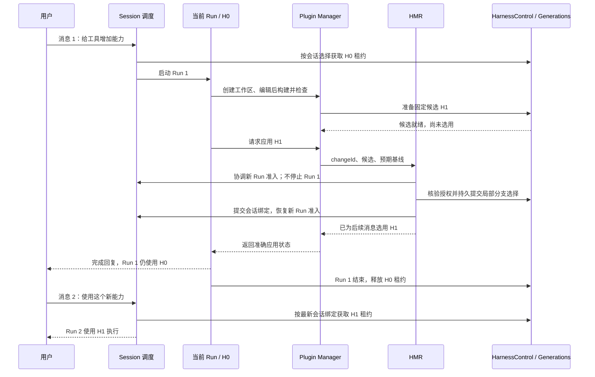

# HMR 与运行时版本切换

日期：2026-10-07。状态：V1 下一条用户消息生效策略已确认；本页保留接口与存储设计语义，已实施 API 见 [10](10-V1实现与使用说明.md)。入口：[导航](README.md)。

## 1. ActSpace 的 HMR 定位

HMR 是运行中的固定版本切换协调器。V1 接收显式应用请求，协调 Control 的选择提交、会话绑定、并发准入和恢复。当前 Run 不换租约；提交成功后，用户下一条消息启动的新 Run 使用新选择。

它不监听源码保存后自动启用，不安装包、不清 Node 私有 ESM 缓存、不维护第二套工具表，也不终止当前 Run 或创建自动续跑任务。改变的代码发布到独立 artifactId 路径，变化的依赖闭包同样固定。官方 Skill 是开发指导，Manager 负责产物，HMR 负责应用协调。

## 2. 当前 Run 与下一条消息

一次用户任务可能包含多次模型调用和多批工具调用，它们仍属于同一个 Run。固定租约覆盖整次 Run，而不是每个模型步骤重新选版本。

V1 不要求等 Run 1 结束后才能提交 H1。提交时旧租约受保护，剩余模型步骤仍看到 H0 的工具定义和实现。Manager 不在工具调用栈中等待 Run 1 退出，避免等待自身结束。首次局部分支不会退役仍被 main 使用的基座；已有局部分支升级时，旧 generation 是否回收由其实际引用决定。

“下一条消息使用新版本”以选择和绑定已经成功提交为前提。消息到达时仍在构建或准备，界面显示未就绪；实际版本在新 Run 准入时确定，届时尚未提交则仍用旧选择，排队期间提交完成则用新选择。若已进入提交事务，准入等待提交/恢复得到确定结果，不能读到半完成绑定。普通后续消息应排队成为新 Run，不能因为旧 Run 还活跃而自动补充到旧 Run 中。显式指定补充旧 Run 的操作保持旧租约，UI 必须明确这种差异；不把这种补充冒充新版本任务。

## 3. 应用队列与提交顺序

同一会话/分支上的应用请求串行处理。Control 继续拥有选择真值、基线检查、独立授权与 acquire 闸门；HMR 负责跨选择和会话绑定的协调，不直接操作底层 generation manager。调用方向为 Manager → HMR → Control，Control 不反向等待 HMR。

1. 对已准备候选核对来源版本、目标分支和预期会话绑定 revision。
2. 获得适用的 Host 启用授权，并在提交时重新核验基线与有效性。
3. 记录可恢复意图，控制该会话的新 Run 准入；当前 Run 可继续。
4. 通过 Control 提交选择，再提交会话绑定；首次派生顺序详见 [07](07-工作区与版本派生及Actor扩展.md)。
5. 标记绑定完成并恢复准入。没有用户任务时保持空闲，不生成验证 Run 或续跑消息。

两候选竞争同一基线时，后提交者需要重新准备，不盲目覆盖。构建和长期检查不占用提交队列，无关会话照常运行。重复 changeId 与相同内容复用已有结果；相同 ID 对应不同内容拒绝。

目前 [AgentService](../../../packages/agent-service/src/service.ts) 创建 SessionRunManager 时固定传入 harnessId，[ManagedRuns](../../../packages/runtime/src/harness/managed-runs.ts) 仍固定 main。V1 需要让新 Run 准入时解析当前会话绑定，配合 Control 闸门取得确定租约。普通执行、压缩、能力查询和已有子 Agent 入口都要遵守所属会话/Run 的版本边界；在途 Run 发起的子任务不能无意混入新版本。不能只改一个 UI 选择字段。

## 4. 挂载与释放复用 Cordis

首版物理替换单位是 Harness generation。逻辑修改可以只有一个工具条目，但候选仍通过现有流程挂载完整 Harness 子树。[HarnessGenerations](../../../packages/boot/src/harness-generations.ts) 在 prepare 时挂载候选，activate 发布新选择；被替代的 generation 等最后一个旧租约释放后再 dispose。

因此候选失败可以释放候选并保留原选择；提交后旧 Run 自然完成或由用户停止，生命周期按正常路径清理。不需要为版本切换新增强制排空协议。

工具注册、事件、定时器和后台资源必须通过 ctx.effect、注册 handle 等方式托管。复用 [工具租约](../../../packages/tools/runtime/src/activation-lease.ts) 的 beginDrain/dispose，释放时停止新调用并等待已有调用结束。Cordis 不会自动撤销已写文件、网络请求或未托管后台任务。

新旧实例可以共存，模板初始化不得争抢共享独占资源或用模块级可变全局量保存会话状态。版本目录与 Scope 不是安全沙箱；候选准备本身会执行初始化，必须先满足 Host 执行许可。释放实例也不等于清除 ESM 模块或删除产物。

## 5. 状态与崩溃恢复

持久应用记录以 changeId 关联来源 Run、目标 Session、来源/目标版本、绑定 revision、分支和选择提交记录。进程内 candidateId 只作诊断关联，恢复依赖固定版本描述，不能依赖旧句柄。

| 状态语义 | 准确含义 |
|---|---|
| candidate-ready | 构建检查和候选准备完成，未改变选择 |
| awaiting-authorization / queued | 等待可信决定或提交顺序 |
| selected | Control 已提交选择，绑定可能尚未完成；暂不宣称可供新任务使用 |
| bound | 会话绑定完成，后续用户消息可获得新版本；当前 Run 仍持有旧租约 |
| in-use | 新 Run 实际获得目标版本，记录其 runId 和 digest |
| checked / check-failed | V1 针对性检查的结果；不等于 V2 独立评估通过 |
| failed / cancelled / cleanup-failed | 指明失败阶段和是否已提交，清理结果独立记录 |

选择与绑定分开持久化，不天然具有跨文件原子性。恢复时根据意图和提交事实补齐绑定或明确取消未完成绑定，再开放准入。若必须重建候选，重新准备、检查并核验执行许可；不复用失效句柄或过期授权。损坏、冲突和不兼容应报告阻塞，不静默回到 main。

提交前取消保留旧选择，提交后取消保留已提交事实。停止当前任务不自动回退已选择版本，也不允许恢复流程擅自启动任务。真正的选择回退仍通过 Control。用户之后重新发送消息，使用届时已提交的选择。

## 6. V1 的复杂度与 V2 扩展

V1 主要成本是安装版候选构建、首次局部分支、会话绑定与全部 acquire 接线、持久恢复及生命周期验证。移除自动 Run 交接后，不需要正常让出协议、续跑幂等记录或跨自动 Run 预算继承。它仍是多模块功能，但比完整连续自修改明显收敛。

V2 在选择提交之前加入独立评估门禁，复用版本与绑定链路。自动发起一次演化工作流不等于必须实现旧 B 的原任务自动续跑；原任务是否重试是 V2 另行定义的产品策略，不是本次预留必须实现的任务状态。
