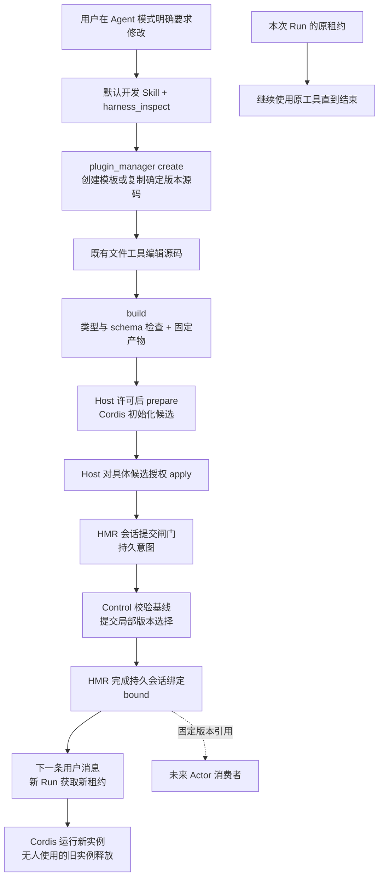

# V1 实现与使用说明

日期：2026-10-07。V1 功能已实现于 `codex/harness-evolution-v1`；验证证据与未覆盖项见[执行摘要](../../exec-runs/20261007-harness-evolution-v1/execution-summary.md)。本文固定本次实际 API，05–09 保留总体设计与后续扩展语义。

## 用户体验与范围

在 Agent 模式明确提出“帮我新增一个工具”或“修改之前创建的工具”。Agent 读取默认 `actspace-plugin-development` Skill，查询能力、创建源码副本、编辑、构建，再请求初始化和启用许可。回执到 `bound` 后，用户下一条消息可调用新工具；本条消息对应的整个 Run 保持原 Harness。无需新增创造模式。

本版首个源码契约是 **无外部依赖的单文件 TypeScript JSON 工具**，适合文本、格式和数据变换。系统生成 manifest、Cordis wrapper、权限声明、注册和释放逻辑。新增工具及修改本模块生成的工具可用；没有支持的源码快照的内置插件不可编辑。任意 npm 安装、Host/Codec/管理服务修改、自动失败触发、评估沙箱、Actor 创建不属于本版。

## 实际模块

| 位置 | 类型与职责 |
|---|---|
| `packages/official-skills` | 新资源包；Skill、模板、契约随应用和 CLI 发布，没有常驻服务 |
| `packages/plugin-manager` | 新插件模块；固定 Harness 中的两个工具代理调用 Host 持有的 Manager，管理工作区和候选 |
| `packages/harness-hmr` | 新协调模块；当前由 agent runtime 持有，生命周期随 Host；另提供 Cordis entry。按会话串行提交与恢复，不运行模型 |
| `packages/harness-control` | 扩展已有服务；新增从确定基线准备分支、历史来源回退、按父 Scope 获取租约 |
| `packages/boot` | 扩展 generations；新旧实例共存，父 Run 的子任务继承其仍有效的 generation |
| `packages/runtime` / `packages/agent-service` | 扩展现有调度；新 Run 解析会话绑定，当前 Run 固定租约；管理授权交给 Host |
| `packages/tools/runtime` | 复用工具校验、权限、调用、清理；增加 Run 内嵌审批接口，使管理审批也暂停执行预算 |
| `packages/prompt` / Desktop Skills | 扩展现有发现和列表；官方来源最后扫描，统一稳定 id、禁用、遮蔽，官方资源不可卸载 |

## 工具和状态

`harness_inspect` 返回当前 Run 的版本、会话已选择版本、注册工具定义、条目与可编辑原因、开发资源路径、历史版本和不含聊天历史的 `versionRef`。只读查询不执行候选代码。

`plugin_manager` 从真实工具调用上下文确定 session / Run / workspace；不接收模型自报的会话身份或审批结果。

| action | 主要参数 | 结果 |
|---|---|---|
| create | purpose，以及 toolName 或 entryId | editable；模板或固定源码副本，来源 revision/digest |
| build | workspaceId | built；源码与输出固定到内容摘要目录。失败先撤销旧候选和旧构建引用 |
| prepare | workspaceId | Host 初始化许可后，Control 返回 ready 候选；会话尚未改变 |
| apply | workspaceId | Host 授权后提交并返回 bound、selected、currentRunUnchanged |
| status | workspaceId | 工作区与当前绑定；恢复已提交结果，失效内存候选降回 built |
| discard | workspaceId | 释放未提交候选，标记 discarded；不删版本历史 |
| rollback | workspaceId、executionDigest | 重新初始化并授权，产生新的局部选择。支持本地历史和该工作区的原始基座 |

apply 的 changeId/candidateId 由 Manager 固定并持久化，重复调用返回同一提交；相同 changeId 指向不同候选被拒绝。create 每次创建独立工作区；build 对当前两份源码取快照，不能把它当通用请求去重 API。已提交工作区要修改，先 create 源码副本。准备候选只在进程内存存在；应用重启后允许从 built 重新 prepare。

V1 使用既有工具结果卡展示结构化状态；没有独立的版本管理页面。build / ready 不等于已生效。只有 bound 表示下一次准入可选用；实际 Run 版本记录在 Task Ledger，harness_inspect 可对照查看。

## 存储与首次分支

- 开发源码：所选项目下 `.actspace/evolution/<workspaceId>/tool.json` 和 `implementation.ts`。目录必须保持在真实项目路径内。
- 管理元数据：Host dataRoot 下 `evolution/workspaces/<workspaceId>.json`，保存来源和绑定基线；只允许所属会话访问。
- 固定产物：`harness-artifacts/sha256-…/`，包含原始两份源码、源码摘要、编译输出和固定 wrapper。编译器随生产依赖分发，不执行外部安装脚本。
- 正式选择：复用 Control 的 `harness-state`。会话分支 ID 由 sessionId 摘要生成。
- 绑定与提交意图：`harness-sessions/<session 摘要>.binding.json` / `.intent.json`。临时写入、sync、rename 后提交。

首次派生先核验来源 revision/digest，目标分支要求 revision=0；prepare 不发布选择、不绑定会话、不修改 main。Control 在 activate 时再次检查来源和目标基线。成功后 HMR 补齐绑定。

提交前失败或取消保持原绑定。选择已持久提交而绑定写入失败，保留意图；下一次查询或准入先恢复绑定，失败则拒绝准入。提交已经成功时取消不能抹掉事实。恢复不会生成新业务任务。工作区删除后，已发布版本仍可加载。

## 权限和生命周期

构建使用随包 TypeScript API，仅输出代码；prepare 会导入并初始化插件，所以必须先取得 Host 许可。apply 的一次性授权绑定具体 changeId、candidateId、基线与 executionDigest，不能复用模型提供的 `approved` 字段。没有审批通道时明确失败。新工具调用继续走现有 process 能力和权限链。

生成工具在同进程执行，是用户授权的可信插件，**不是隔离沙箱**。单文件和 import 限制是 V1 契约约束，不是恶意代码隔离措施。V2 再增加独立评估环境。

每个 generation 的工具注册归属 Cordis 生命周期。旧 Run 持有旧租约，子任务也沿父 Scope 找到相同 generation；最后一个租约结束后清理旧实例。已写文件、网络副作用不能被回退撤销。

## Actor 扩展与版本边界

`versionRef = { executionDigest, artifactIds }` 指向固定能力内容；完整组合描述由 Control 持久选择保留。未来 Actor 可以复用描述与产物，并建立自己的身份和选择，不依赖临时源码路径。V1 不创建 Actor，也不把局部分支改为全局 main。

V2 在候选提交前增加失败触发、沙箱评估和晋升门禁。V1 没有失败事件监听器或自动续跑路径。

## 从旧内置版本升级

应用更新时，既有固定选择不会因构建目录变化自动替换。V1 增加了受限的 Host 升级条件：选择历史仅有一条可信 bootstrap、全部为内置默认插件、没有 Manager 条目且没有会话分支，才提交包含管理入口的新内置版本。原始历史记录保留。这是应用升级路径，与用户自进化的审批通道分开。

已有自定义选择或分支不满足该条件，不自动替换；需要 Host 的可信维护/迁移路径接入新管理入口。V1 未提供批量迁移定制 Harness 的界面。后续版本若修改 Host 契约，仍遵守 Control 的兼容性和阻塞规则。

Skill 禁用设置写入稳定 id，同时兼容旧版按显示名称保存的禁用项；第一次切换时移除该旧名称键。能力查询在存在活跃 Run 时使用其 generation，空闲会话查询才使用下一次准入的选择，避免切换后漏掉旧 Run 仍在执行的工作。
