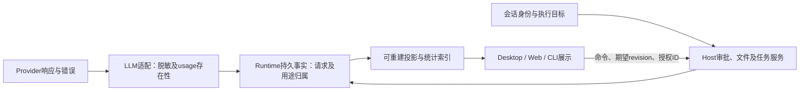

# ActSpace 验收问题集中修复方案

- 日期：2026-10-22。
- 状态：**修复与复验持续进行。2026-10-23 用户授权全部已登记及新发现 Bug 直接修复，包括跨模块问题，无需逐项询问；BUG-016 按 §4 的最小下载方案实施。**
- 来源：[两阶段验收](20261021-actspace-full-acceptance.md)、[Bug 总索引](../../exec-runs/20261021-actspace-full-acceptance/bugs/README.md)、[原建议汇总](../../exec-runs/20261021-actspace-full-acceptance/fix-plans/triage.md)。
- 当前版本：主仓库 `fix/settings-model-select`，HEAD `00d6b7630907deefcf07bdb60b88d58b0db00b2a` 加现有未提交改动；执行前再次核对并保存差异快照。旧验收证据只证明其记录的版本。
- 最新授权：用户于2026-10-23明确要求“后续这些 Bug 都可以直接修复，不用反问我了”，覆盖验收中新发现的问题；此前仅修小 Bug、跨模块待讨论及逐项审批限制失效。A–H 和 D3–D6 保留为实施依据，新增缺陷补充方案后直接执行；执行状态见[修复记录](../../exec-runs/20261022-acceptance-bugfix/execution-summary.md)。

## 1. 数量、范围与推荐决策

以下为2026-10-22初次评审快照，当前数量及关闭状态以[Bug索引](../../exec-runs/20261021-actspace-full-acceptance/bugs/README.md)为准：共 **30 条 Bug 记录：3 条已复验关闭、27 条尚未关闭**。27 条中 BUG-016 的产品范围仍待确定，其余26条建议列入修复。另有2条未确认观察，不计入30条。33个失败验收编号会重复关联同一 Bug，不能当作33个独立 Bug。

整体验收仍有103/165个编号取得通过或失败结论（62.4%），其中70个通过、33个失败、62个未覆盖或部分完成。本计划不会把这些项目提前勾成通过，也不替代剩余验收。

原集中评审决策如下；2026-10-23 全部 Bug 修复授权已扩展 D1 的范围：

| 决策 | 推荐方案 | 对用户的影响 |
| --- | --- | --- |
| D1 修复范围 | 纳入 A–H 及后续发现的全部 Bug；已关闭项做受影响回归 | 每批可以单独核对，不做全项目顺带重构 |
| D2 Web产物 BUG-016 | 按最新全部 Bug 修复授权实施 §4 的最小下载方案 | 复用现有 Host 快照协议，完成原 P2-W03 下载验收；不扩展在线文件浏览器 |
| D3 CLI退出 BUG-009 | SIGINT退出130；SIGTERM完成取消、清理后退出143；结构化结果仍为aborted | 脚本可以区分两种信号，取消与清理行为一致 |
| D4 队列 BUG-025 | 人工撤回及回合结束时尚未领取的引导，都回普通队首；多条按原队列相对顺序返回 | UI、实际调度、重启恢复一致，已领取项不能撤回 |
| D5 请求事实 BUG-026/030 | 保留真实用途请求及未知用量；允许最小事件/投影扩展和固定版本适配补丁 | 用途调用可对账，缺失用量显示未知；不伪造历史数据 |
| D6 授权入口 BUG-027 | 恢复现行规范的显式目录范围选择、当前会话授权查看/撤销 | 默认仍为精确目标，目录范围必须用户明确选择 |

本轮未发现可以仅凭源码就把其余未关闭项标为“已经正常”的充分证据。BUG-002/004/017为工程问题，BUG-028为外观问题；它们与产品流程缺陷分开描述，但仍保留修复与验证责任。

## 2. 实施顺序与依赖

这是跨轮总计划，预期涉及远多于8个文件，不能作为一个大补丁一次交付。每批完成定向验证和记录后再进入下一批；批内按Bug保留变更归属。顺序以安全、基础事实、交互修复为主。

| 批次 | Bug | 目标 | 依赖 / 风险 |
| --- | --- | --- | --- |
| A | 008、009 | 凭据脱敏、退出清理 | 高；先于新增模型调用与大规模运行复验 |
| B | 004、017、002 | 修好契约门禁和正式验收夹具 | 低至中；为后续批次提供可靠验证入口 |
| C | 020、021、022、023、024 | 会话身份、分组与执行目录一致 | 高；先建立共同语义，再改消费者及索引 |
| D | 005、027 | 可恢复、可理解、可撤销的审批授权 | 高；依赖A、C的身份与目标边界 |
| E | 030、026 | 用量真实性与用途请求完整性 | 高；先修未知语义，再补用途请求生命周期 |
| F | 025 | 队列撤回、回合结束退回与重放一致 | 高；独立持久化切片，不顺带重写调度器 |
| G | 010、011、012、013 | Browser定位和真实输入副作用 | 中至高；共用输入底层，但按四个问题分别复验 |
| H | 007、018、019、014、015、028、029 | 焦点、键盘、性能和布局 | 低至中；焦点三项共用路线，性能单独测量 |
| I | 016 | Web产物下载 | 已获全部 Bug 修复授权；依赖既有 Host 身份和文件快照边界 |

共享边界必须保持：

Renderer不成为权限或调度事实源；工具不直接拼写Journal；通用LLM适配不依赖Desktop。Browser Bridge仍保持独立Host能力边界。

## 3. 26条推荐修复的逐项方案

以下“源码依据”与“根因假设”分开表述。列出的路径是当前入口及预期改动边界，不承诺只需改一个文件。每条的历史复现、截图和日志可从[Bug索引](../../exec-runs/20261021-actspace-full-acceptance/bugs/README.md)按编号进入。

### A：安全和进程生命周期

**BUG-008｜Provider回显凭据进入输出与Journal｜P1，高风险。**

- 源码依据：`packages/llm/service/src/redaction.ts`主要按格式匹配；`packages/llm/pi-ai/src/pi-ai-stream.ts`有原始错误、cause和异步事件路径，当前规则漏掉已复现的非标准Key。
- 推荐：在掌握本次credential和敏感header的适配边界，建立请求级脱敏器；错误进入公共failure、事件、日志前移除已知秘密，再做格式兜底。覆盖同步throw、异步迭代throw、error/aborted事件、cause链和重试诊断；对外只输出白名单错误字段。秘密只在调用生命周期内使用，不建全局永久集合。
- 边界：LLM service/pi-ai及CLI/Host公共错误出口；不改用户历史Journal，不通过把UI错误全部隐藏解决。短值、编码值不能靠任意子串全局替换，应由敏感字段及受控编码规则处理。
- 关闭标准：合成非标准凭据和并发不同凭据的故障测试，扫描stdout、stderr、Journal、result、trace均不出现原值；状态码、重试类别及安全诊断仍可用。真实Key不进入测试材料。

**BUG-009｜SIGTERM后静默工具子进程残留｜P2，高风险。**

- 源码依据：`apps/cli/src/cli.ts`只注册SIGINT；`runtime-v2/run.ts`已有取消与profile.shutdown链，SIGTERM未进入同一链。
- 推荐：统一CLI终止协调器。首次信号取消当前run，等待工具进程组清理、结果落盘和Host关闭；建议5秒清理预算，第二次信号或超时只强制终止本CLI拥有的进程。SIGINT=130、SIGTERM=143，更新退出码类型及协议文档；aborted结果最多写一次。
- 边界：CLI入口、run生命周期、退出码类型；必要时补工具所有权清理，不能扫描并杀死同名用户进程。Host daemon自身的stop语义单独回归，不混改。
- 关闭标准：静默/持续输出/带孙进程工具、PTY与非PTY、等待审批、重复信号、退出中再收信号；父子均退出且无僵持，普通成功和错误退出码不变。

### B：工程门禁和验收夹具

**BUG-004｜契约矩阵漂移｜P3，低风险。**

- 入口：`scripts/contract-matrix/source-registry.mjs`、`generate.mjs`及生成文档。推荐补全当前workspace的显式来源登记，用生成器重建矩阵；新增/退役包的归属需明确，不用任意目录扫描代替受控清单。
- 关闭标准：`pnpm test:contract-matrix`通过，重复生成无差异，包名和入口能定位；不修改产品协议以迁就生成快照。

**BUG-017｜正式夹具仍用退役模型API｜P3，中风险。**

- 入口：现有Host/Desktop验收夹具中的`scripts/acceptance/agent-refactor/seed-settings.ts`及`apps/desktop/src/main/model-connections-service.ts`的公开服务。推荐按当前连接、模型、用途四层数据模型重写seed，删除旧custom-model-input/SettingsService写法；不恢复旧API兼容层。
- 关闭标准：全新隔离profile能构建、启动、配置两个可用模型、发出受控请求并正常停止；重复seed不重复建数据，失败也清理进程，不接触日常profile。

**BUG-002｜ModelPicker按钮门禁超基线｜P3，低风险。**

- 入口：`components/composer/ModelPicker.tsx`新增pinned row。推荐使用共享`Button`表达该按钮，保留布局、点击和键盘行为；不提高`native-button-baseline.json`掩盖违规。
- 关闭标准：原生按钮检查恢复通过，常用模型行鼠标/Enter选择正常，焦点可见、菜单关闭及浅深主题一致。此项是工程门禁，不把它描述为已经复现的模型选择失败。

### C：会话身份、工作区和工作树

共同约定：明确区分“来源关系”“是否委派子会话”“侧栏分组工作区”“实际执行目录”。本地目录与远端Host不能靠相同路径字符串混为一组。共享纯函数放在现有shared层；Host事实和renderer选择状态各自保留归属。

**BUG-022｜普通分叉被当成子会话隐藏｜P2，高风险。**

- 源码依据：`packages/shared/src/session-list-page.ts`、`fixed-renderer-ipc.ts`、`usage-read-model.ts`使用`lineage !== null`标记child，而真实快照已有`lineage.origin === "delegation"`判断。
- 推荐：统一依据明确的delegation来源判定子会话，fork保留来源关系但可见；不清空lineage。未知历史来源保留可访问性并显式处理，不能一律当委派。更新所有普通列表消费者及派生索引版本，重建涉及的行和游标，保持Journal原样。
- 关闭标准：自然fork、重启、分页/搜索/置顶/归档可见；委派仍隐藏且父会话子轨迹可访问；本地、远端、旧数据和索引重建结果一致。

**BUG-024｜归档列表混入委派子会话｜P2，中风险。**

- 推荐：复用022的身份判定，在普通会话归档查询及分页前过滤delegation；保留内部子会话查询能力，不能全局禁止读取子会话。归档总数、分页游标与列表采用同一过滤口径。
- 入口：`fixed-renderer-ipc.ts`、会话列表投影/索引与Desktop归档列表。
- 关闭标准：受控已归档委派不出现在普通归档页，普通fork仍在；恢复普通会话、分页计数及父子轨迹无回归。原缺陷证据仅为受控归档状态，不扩写成自然UI归档已复现。

**BUG-020｜工作区归档全部遗漏同组工作树｜P2，中风险。**

- 源码依据：`App.tsx`归档候选使用workspaceId/root，`components/sidebar/session-grouping.ts`分组还考虑worktree来源。
- 推荐：归档候选与侧栏使用同一“显示组归属”函数，纳入来源属于该组的工作树会话；保持忙碌/待审批保护、部分失败回报、活动会话切换行为。按完整候选集处理，不只归档当前分页已加载行。
- 关闭标准：原工作区+两个工作树+其他工作区、分页及远端同名路径；只归档目标组符合条件的会话，受保护项与部分失败明确保留，重启结果一致。

**BUG-021｜setWorkspace忽略workspaceId｜P3，中风险。**

- 源码依据：`fixed-renderer-ipc.ts`的setWorkspace处理器只读取`input.workspaceRoot`。
- 推荐：在Host通过registry解析workspaceId；root-only仍支持，id与root同时传入必须指向同一登记项。无效ID、冲突或缺参返回明确错误；继续通过现有workspace更新服务执行忙碌检查及授权失效逻辑。
- 关闭标准：ID-only/root-only/两者一致均成功，未知/冲突/空参不落入默认工作区；忙碌和权限边界、更新后持久化通过。

**BUG-023｜工作树右栏指向原仓库｜P2，高风险。**

- 源码依据：`components/WorkbenchLayout.tsx`右栏使用selectedWorkspaceRoot；`App.tsx`其他Review路径已经优先取worktree.workspaceRoot。
- 推荐：活动会话的Host+实际执行root成为右栏文件树、Review及新建相关终端的统一目标，集中从RunTargetContext解析；侧栏分组仍用sourceWorkspaceRoot。缓存键含Host/root，切会话撤销旧请求并丢弃迟到响应；已打开且绑定目标的面板/终端保持自身目标。
- 关闭标准：两个工作树制作互斥canary文件和diff，逐个切换只展示各自内容；Review操作不落到原仓库；远端同路径、快速切换、返回原仓库均正确。

### D：审批恢复与会话授权

**BUG-005｜Web刷新后审批命令消失但仍可允许｜P2，高风险。**

- 已知链路：`apps/web/src/pages/session/SessionDetail.tsx`通过callId寻找tool block，`ApprovalCard.tsx`依赖其命令；Runtime的`durable-session.ts`与`tool-dto.ts`提供工具投影。已确认刷新前后不一致；尚未证明丢失发生在哪个投影层。
- 推荐契约：授权范围内的pending审批必须能按session/run/call/request身份恢复同一份操作展示信息。优先补齐已有持久tool事实到snapshot/client/Web的投影；如当前事实不足，在Host审批准备阶段保存最小、脱敏、带版本的展示摘要，由pending snapshot返回。命令正文与截断摘要分开，截断必须可识别，不能把摘要当完整命令。
- UI：详情恢复中或不可恢复时禁用允许/会话允许，提供重试和拒绝；过期request被Host拒绝，页面及时撤卡。禁止用localStorage保存原始命令当恢复机制；不另开任意Journal读取接口。
- 关闭标准：待审批刷新/断线重连/新观察者、长命令/敏感参数、多工具同名、多请求、已处理请求竞争；看到的目标与实际批准目标一致，仅执行一次；Desktop共享投影回归。若最小摘要需要新增权限或原始敏感参数持久化，超出本方案，须补充设计后再改。

**BUG-027｜目录范围选择与Grant撤销入口缺失｜P2，高风险。**

- 源码依据：`components/messages/ApprovalParts.tsx`只取exact；Runtime已提供exact/subtree建议及typed bridge revokeGrant，现行权限设计§17承诺这些UI。
- 推荐：审批卡默认exact，展开后才显示Runtime返回的目录建议，展示路径、读/写及会话范围；提交suggestionId，不由renderer拼selector。当前会话的权限入口增加授权列表及按grantId撤销，读取Host实时事实，撤销中防重复，成功后刷新。
- 边界：复用现有typed API和Runtime权限生命周期；不把once自动升级为subtree，不创建renderer授权缓存，不承诺撤销能回滚已发生的副作用。选择入口和管理入口同时交付。
- 关闭标准：exact默认、显式subtree、树内复用/兄弟路径拒绝、读写分别验证、撤销后下一checkpoint重新审批；Session/Agent隔离、模式降级、重启、远端断线、键盘和窄窗均覆盖。

### E：模型请求与统计事实

**BUG-030｜没有usage被记成供应商报告的零｜P2，高风险。**

- 源码依据：本地固定依赖`@earendil-works/pi-ai@0.82.1`的`dist/api/openai-completions.js`先初始化全零usage，只在wire有usage时替换；本仓库`pi-ai-stream.ts`对存在的对象标provider-reported。这解释已复现协议的来源丢失，不能推广成所有Provider均有缺陷。
- 推荐：在wire解析边界保留usage是否出现、每个字段是否出现，再映射到`LlmUsage`。缺失字段为未知，明确报告0仍为0；缓存桶及总数只按协议事实换算。建议用可版本化的最小pnpm patch为当前依赖补元数据，并在本仓库adapter消费；不直接编辑node_modules、不宽泛升级依赖、不复制整套Provider实现。
- 展示/兼容：缺output token不计算tok/s；保留有事实依据的TTFT和耗时。统计展示已知合计及未知请求口径，不能用0掩盖未知。旧Journal的零缺乏wire证据，保留原记录并注明修复前来源局限；不批量猜测改成null。
- 关闭标准：受控wire完全缺失、部分字段、明确0、正常非零、缓存usage、失败/取消；从HTTP到Journal、轨迹、统计逐层对账。对当前支持协议分别验证，元数据不可获得的协议保留未知；依赖补丁能干净安装且锁文件可复现。补丁若需要改变公开协议或大面积fork，回到方案评审。

**BUG-026｜看图内部调用漏记请求及Token｜P2，高风险。**

- 源码依据：`packages/tools/image-inspection/src/node-ports.ts`直接prepare/dispatch并消费结果，缺独立持久请求；现有统计`usage-journal-projection.ts`的主请求按step归组，不能简单塞入主step冒充另一次主调用。
- 推荐：增加Host注入的辅助请求记录端口，image-inspection只传用途、上下文和规范化生命周期。Runtime持有记录器，写独立辅助请求开始/终结事件；建议契约包含sessionId、父run/turn/callId、逻辑requestId、attemptId、purpose、实际model/route、时间、terminal状态和nullable usage。首次仅接入inspect_image；不顺带迁移标题/压缩等所有调用。
- 持久化规则：启动事实先落盘再dispatch；每个attempt最多一个终结事实。重试分attempt记，逻辑请求汇总去重，失败/取消保留已报告用量；崩溃后未终结保持未知，不补0。新增事件用独立codec与投影，不伪造assistant/message或step/end，不污染对话或Context。
- 消费：Usage及轨迹能追溯用途请求到父工具；统计主/辅助各一次，未知价格仍未知。变更派生索引版本并可重建，旧数据没有辅助事实就明确未计入，不从工具次数倒推Token。
- 关闭标准：原fixture主7次+视觉2次准确对账9次/1080 Token，各模型归属正确；再测重试、取消、缺usage、缓存、重启重放不重复，Desktop及CLI/远端Host均走同一契约。新增事件需同步schema/codec/invariant/契约矩阵与设计文档，此项绝不能按UI小修实施。

### F：队列持久语义

**BUG-025｜撤回引导没有回队首｜P2，高风险。**

- 源码依据：`App.tsx`发送designate/runId:null；`packages/agent-service/src/task-ledger.ts`和`task-projection.ts`只更新targetRunId，未移动queue。
- 推荐：由TaskLedger原子完成“解除未领取引导+移到普通队首”；人工撤回和run结束退回采用同一队列规则，多条保持原相对顺序。通过带明确placement/version的持久事件表达，不仅改变现有旧事件解释；旧Journal按旧语义重放，新命令写新语义。
- 并发：沿用expectedRevision和串行化约束；已领取项拒绝撤回并刷新，停止后的暂停状态保持，必须显式继续才派发。renderer只展示投影，不能自行prepend掩盖实际调度。
- 关闭标准：SECOND撤回后真实顺序SECOND→FIRST→THIRD，恰好各执行一次；首尾项、多引导、自动结束退回、失败/停止、领取竞争、过期revision、重启及Desktop/Web一致。

### G：Browser输入与定位

**BUG-010｜Color精确label定位失败｜P2，中风险。**

- 源码依据：`browser-bridge/apps/cli/internal/locator/runtime-src/locator.ts`的label路径使用整个label文本，可能把select选项并入label。
- 推荐：修正label专用文本提取，剔除被标记控件的值/选项子树，保留label本身可见文字；沿用现有aria命名优先级和组合树规则。编辑runtime-src并重新生成runtime，不能手改generated文件。
- 关闭标准：显式for、嵌套label、select多选项、空白、重复label歧义、shadow DOM、aria-label/labelledby；精确Color命中正确控件，CSS路径仍通过。

**BUG-011｜双击只有一次click副作用｜P2，中风险。**

- 源码依据：`browser-bridge/apps/cli/internal/cua/engine.go`当前只派发一对press/release，clickCount设2。
- 推荐：公共输入层派发两对完整press/release，计数依次1、2，保持同一目标、坐标和modifier；异常时释放持有按键。locator/dom/cua三条入口复用该实现。
- 关闭标准：受控页面两次click与一次dblclick计数均正确、真实双击选择/处理器工作；单击、右键、modifier、页面移动/目标消失不误报完成。

**BUG-012｜跨源iframe点击成功返回但未命中｜P2，高风险。**

- 已知：同一页面两次reload均无点击副作用；`internal/locator/engine.go`有frame offset/localCoordinates分支，扩展`src/background.js`参与frame/CDP路由。当前尚未确认是坐标换算还是OOPIF会话路由错误。
- 推荐边界：让定位结果显式携带坐标所属frame/target/session，输入适配只在一个边界转换到实际派发session的viewport，逐层处理嵌套frame与滚动。命中检查与派发使用同一身份；frame导航、脱离或身份失效返回错误/要求重新定位，不能退回顶层随意点击。
- 根因判定门：用现有fixture记录frame链、派发session和最终点位，对照命中元素，决定在locator转换或CDP路由的责任点修复。该门是有界定位，不能依据候选原因直接改两个系统；若需权限扩展或重写attach生命周期，提交方案增补。
- 关闭标准：同源/跨源、嵌套、滚动、缩放、OOPIF及导航失效；真实frame计数增长且父页错误目标不被触发。API返回ok不等于点击副作用验收通过。

**BUG-013｜Backspace发事件但不删除｜P2，中风险。**

- 入口：同一`cua/engine.go`的Keypress/dispatchKey。推荐在公共键盘输入层统一标准键名、code、虚拟键码和modifier序列；文本输入与非文本按键分开，组合键逐步累积并可靠释放修饰键。禁止用JavaScript改value模拟删除。
- 关闭标准：input/textarea/contenteditable中的Backspace/Delete、选区删除、箭头/Home/End与已支持快捷键；keydown/keyup及浏览器默认编辑均正常，异常后无卡住modifier。真实系统剪贴板另有前提，不以本项代签。

### H：Desktop交互、性能和外观

**BUG-007｜模型获取弹窗关闭后焦点落body｜P3，低风险。**

- 入口：`FetchModelsDialog.tsx`及其打开按钮；共享`ui/Dialog.tsx`已有returnFocus。
- 推荐：显式传入触发器ref；自动打开无触发器或触发器卸载时，返回连接详情中稳定可聚焦位置，避免把body作为正常终点。除非实验证明共同缺陷，不修改所有Dialog默认行为。
- 关闭标准：按钮打开/新建连接自动打开，Esc/关闭按钮，保存/请求中，触发器卸载；返回焦点可见且后续Tab顺序正常。

**BUG-018｜第二次Esc不能退出设置｜P3，中风险。**

- 入口：`SettingsPage.tsx`、App导航/快捷键边界。推荐设置页处理未被顶部弹层或行内编辑消费的Escape，调用既有onBack，回到进入前会话与合理焦点；不额外叠加多个全局监听器。
- 关闭标准：一次Esc只关闭最上层，第二次退出设置；正在编辑字段先取消编辑；搜索/Select/Popover/快捷键录制不被抢键，快捷键打开设置也可返回。

**BUG-019｜Mermaid全屏Esc不关闭｜P3，中风险。**

- 根因：Dialog 初始焦点落在关闭按钮，焦点触发的 Radix Tooltip 作为更上层浮层先消费第一次 Escape。
- 已实施的局部修复：Mermaid 关闭按钮禁用 Tooltip 并保留无障碍名称；Dialog 原有 Escape 与焦点恢复机制不变。新增一次 Escape 关闭及回焦回归测试，修前失败、修后通过。
- 状态：renderer 定向测试、Desktop typecheck 和 renderer build 通过；真实 Electron 定向复验进行中。复验需覆盖单次 Esc、显式关闭按钮以及回到原图触发位置，完成前不关闭 Bug。

**BUG-014｜大文本预览打开与关闭卡顿｜P2，中风险。**

- 源码依据：`right-panel/CodeRenderView.tsx`即使分批高亮也一次挂载最多2万行；原5.25MB样本约8万DOM节点，重复打开1.4–1.9秒、关闭约2.75秒。此证据不证明内存泄漏。
- 推荐：大文件走有界行窗口渲染，复用仓库已采用的`@tanstack/react-virtual`，动态测量软换行行高；只高亮可见及邻近窗口，缓存有界且卸载取消。小文件保持现有展示。第一批保留现有2万行上限与明确截断提示，不扩大到完整大文件编辑器。
- 交互要求：行号、换行、选择及复制不因虚拟卸载悄悄丢内容；跨窗口选区用源文本偏移保存并据源文本复制，不能靠扩大overscan假装解决。完整文件动作仍走既有文件级入口；不增加每行工具栏。
- 关闭标准：同机同构建，原样本冷开与5轮热切换记录首屏、可操作、关闭和DOM/长任务；拟定热开及关闭P95≤500ms，冷开≤1秒，可见DOM不随2万行总量线性增长。长单行、中文、窄窗、快速切文件、浅深主题和跨窗口复制正确。未达阈值则保留未关闭，不能仅凭DOM下降签收。

**BUG-015｜Review统计覆盖范围按钮｜P2，低风险。**

- 推荐：在Review工具栏明确范围按钮的最小宽度/不可收缩区，统计区可收缩或滚动，使用正常布局分配而非叠放；不能只提高z-index使遮挡反向发生。
- 关闭标准：原现场数据量与宽度、窄面板/长统计文本/缩放；按钮真实鼠标命中并可键盘操作，所有统计仍可读，浅深主题正确。

**BUG-028｜运行中停止按钮缺细边框｜P3，低风险，外观项。**

- 推荐：按已确认交接给轨迹停止按钮增加局部语义token边框及hover/focus状态；不改通用`.tjb-action`导致其他动作全部加框。
- 关闭标准：运行中/悬停/聚焦、浅深主题及窄窗视觉核对，停止行为保持；复用现有行为测试，不为单条样式新增镜像测试。

**BUG-029｜工作树来源提示键盘不可达｜P3，低风险。**

- 推荐：只读来源说明接共享Tooltip，提供可聚焦的非按钮触发区域、可见焦点及可读名称，支持focus显示与Esc关闭；不把只读说明做成假按钮。
- 关闭标准：Tab可到达、完整来源可读、Esc后焦点稳定，鼠标hover与触屏现有行为正常；窄窗长路径及浅深主题；原生读屏缺设备时单列未覆盖，不能凭DOM代签。

## 4. BUG-016：Web 产物下载修复

**2026-10-23 按用户全部 Bug 直接修复授权执行。** 原 P2-W03 已包含产物下载要求，现有 Host 已提供授权快照和分块读取协议；沿用此协议补齐 Web 消费者，不再等待逐项批准。原先“暂缓/范围待确认”是历史建议，不再适用。

最小交付是“已成功生成或呈现产物的下载”，不同时开发完整在线文件浏览器或任意格式预览：

- Web 每轮交付区展示文件名和下载动作，成功下载后显示快照大小；仅消费成功 write/edit/present 的结构化 outputRelativePath，不把任意文本 diff 里的路径变成能力。过程折叠后仍可下载。
- 复用`packages/agent-host/src/artifacts.ts`已存在的session-owned snapshot和read contract，经授权的Host操作生成引用，按session/artifactId获取并校验大小/内容；不另建任意路径HTTP下载接口。
- 路径外逃、symlink替换、跨会话读取由Host拒绝；已有20MiB快照边界明确反馈，过期/删除/离线可重试，文件类型以安全下载处理，不能直接执行HTML/SVG。
- 快照在用户点击下载时创建，文件可能已被后续操作修改；界面明确此语义，不声称取得工具执行时的历史字节。切会话、断线或卸载取消待完成下载，不能将旧请求结果保存到新场景。
- 关闭标准：实际下载字节/hash一致，刷新后可重新下载且既有快照可按原引用读取，越界/跨会话/超限被拒绝，390px及移动浏览器下载路线真实验证。缺真机仍保留该子项未覆盖。
- 风险：Web 下载消费者与既有 Host 文件权限边界，中；独立红绿回归与真实 Host 下载复验。保留 165 个验收编号，不以修改范围代替修复。

## 5. 已关闭3条与未确认2条

| 编号 | 当前结论 | 本次安排 |
| --- | --- | --- |
| BUG-001 | Markdown分块NodeList展开导致类型检查失败，已改Array.from并复验 | 保留关闭；最终Desktop类型检查回归，不重复修 |
| BUG-003 | 旧计划链接退役Demo目录，已修文档链接并复验 | 保留关闭；文档检查回归 |
| BUG-006 | Browser helper引用退役Runtime路径，已修引用并复验 | 保留关闭；G批真实启动smoke复用，原关闭不代表全部Browser通过 |
| OBS-001 | 首次配置看图用途后需重启的观察，动态生效预期未定 | 不列为确认Bug。推荐将“下一次工具调用读取最新用途配置、在途调用保持快照”作为后续候选；本批026只修计量，不静默修改配置生命周期 |
| OBS-002 | 子对话曾等待，后续自然流式复验正常，原样本不足 | 不修。再次出现时保留同一时刻snapshot/RPC/订阅序列与UI证据，再判断；不绕过正式投影读取原始Journal强行刷新 |

## 6. 验证、关闭与回退

### 验证分层

- 每个有行为/协议变化的问题先保留原复现，补能识别原缺陷的测试；低影响样式不写仅复述实现的测试。
- 按批运行受影响包测试和typecheck。涉及Runtime依赖时先构建依赖闭包：`pnpm --filter @actspace/runtime... build`，避免旧dist制造假结论。
- 工程入口：`pnpm check:docs`、`pnpm test:contract-matrix`、`pnpm check:packages`；协议事件变更补`pnpm check:harness-events`、`pnpm test:harness-events`及相关恢复测试；typed bridge变化补renderer-bridge与IPC门禁。
- G批：`pnpm check:browser`及在`browser-bridge/apps/cli`运行`go test ./...`，再执行原真实浏览器路线，检查副作用而非仅RPC成功。
- UI批：Desktop/Web定向测试，涉及颜色时主题检查；浏览器mock之后必须按原证据路线在真实Electron/Host验证。Computer Use按仓库规则委派`gpt-6.1-sol`，主智能体开发与定位，子智能体提交逐点结果和证据。
- 所有纳入批次完成后再跑仓库总测试/typecheck与集中回归；首次结果已通过且无新改动时不机械重复。最终接续原计划剩余未覆盖项，修完26条不代表全项目验收完成。

### 状态和证据

实现开始时建立`docs/exec-runs/20261022-acceptance-bugfix/`的execution-process、execution-summary和acceptance-handoff。证据存`tmp/codex-acceptance/20261022-acceptance-bugfix/BUG-NNN/`，每条记录版本、复现前后、测试和实际交互结果。

Bug状态按“已登记→已定位待修→修复中→已修复待复验→已复验关闭”推进。列表打勾仅表示对应标准实际通过：

- [x] 用户批准全部 Bug 直接修复，包含 BUG-016 的最小下载方案；无需逐项询问。
- [ ] A批完成并复验：008、009。
- [ ] B批完成并复验：004、017、002。
- [ ] C批完成并复验：020、021、022、023、024。
- [ ] D批完成并复验：005、027。
- [x] E批完成并复验：030、026；026含Desktop、CLI与远端Host真实链路。
- [ ] F批完成并复验：025。
- [x] G批完成并复验：010、011、012、013；Browser读取等未覆盖子项另记总台账。
- [ ] H批完成并复验：007、018、019、014、015、028、029。
- [ ] 集中回归、原Bug索引/覆盖台账回填、剩余验收交接。

关闭Bug后只更新关联验收点已经完成的子项；复合验收点仍有未做步骤时保持未完成，不能整行代签。缺凭据、原生系统访问或设备的路线保留前提。

### 回退与停止边界

- 每批记录精确文件diff及制品版本；主仓库有大量在途改动，不整体reset、stash、clean或覆盖旧文件。回退仅撤销本计划对应hunk；源码回退不能代替派生索引兼容检查。
- Journal只追加新事实，禁止为通过测试清空用户数据。索引版本变化仅重建派生数据；新事件/队列语义必须给旧读者兼容说明与旧Journal测试。尚未确定降级可读性时，不在用户日常profile运行新写入版本，先在隔离副本验证。
- 不合并独立side-chat目录，不升级用户安装版，不提交/推送/发布。任何扩大权限、不可逆数据迁移、通用调度/LLM框架重写都超出本方案，需要方案增补。
- 执行按2026-10-23全部Bug授权在上述边界内逐批推进，不因跨模块或实现选择反复请求确认。实证推翻方案时更新根因、方案与回归范围后继续执行；不为常规 Bug 修复逐项请求调整批准。

## 7. 本轮准备记录

- 2026-10-22：核对30份Bug、2份观察、原独立建议、当前入口源码及固定pi-ai依赖；完成集中方案，更新验收/问题导航的评审时机。未修改产品源码、未启动修复、未改变验收结果。

## 2026-10-23：用户扩展修复授权

全部已登记和验收中新发现的 Bug 均可直接修复，包含多模块改动。每项先记录方案、补回归测试，再实施与定向复验，继续剩余验收；不再按 Bug 征求批准，不留到全部验收结束后才修。旧审批条目作为历史依据保留，当前授权以本节及两阶段验收计划 §3.4 为准。不提交、不推送、不合并、不发布，保护现有工作区和用户数据。
