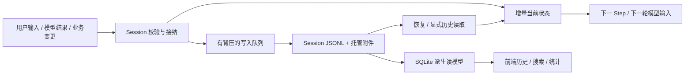

# Session 数据存储职责与增量运行态重构

状态：代码与本轮自动化完成；全库文档门禁有一条既有断链，详见执行摘要。用户已确认存储职责与长历史处理方向，并授权整理计划、完成实施。

## 目标与不变量

Session JSONL 与托管附件保存完整会话事实；SQLite 只提供可重建的前端查询、搜索、统计加速。Agent 执行、恢复与下一轮输入不依赖 SQLite。全局设置、凭据继续归各自已有 Host 模块。

不删除历史、不改变既有 seq，不以压缩模型 Context 代替运行时内存治理。未完成事务、未持久化事件必须保留；磁盘失败不得推进 durable 水位。缓存和检查点消失后可以从事实文件重建。

## 实施顺序

- [x] P1 增量 Journal 与物理追加：`packages/session/journal` 引入可回滚的增量校验器；追加只校验新增事件；事务提交后投影，批次失败原子回滚。`packages/session/jsonl` 移除每批全历史校验、编码、摘要和驻留快照；显式读取仍返回完整事实。
- [x] P2 有界运行态与历史接口：`packages/session/storage`、`persistence` 提供文件历史读取；Journal 区分当前状态、近期事件和完整历史。迁移 Runtime、Inbox、Todo、Task、Context、Subagent 的历史访问，禁止把近期窗口伪装成完整历史。持久事件才可卸载；临时 Session 保留其唯一事实。
- [x] P3 投影与统计：`packages/session/projection` 消除第二份无界事件正文；保留重复事件冲突检测、事务原子性和版本检查。当前统计只做增量更新，已结算请求的中间状态在安全边界释放；历史查询保持可重建。
- [x] P4 持久化与完整性：写入队列增加背压；验证恢复、fork、附件引用与派生数据可删除边界。检查点不是事实来源；本轮不为没有测量证据的冷启动另建第二套 JSON 权威数据。
- [x] P5 回归与文档：Session/Runtime/Context 相关定向测试、依赖构建、类型检查、文档门禁；十万事件规模检查追加工作量与驻留范围，冷重启恢复与旧数据兼容。

## 验收

1. 追加第 N 条普通事件不重新调用前 N-1 条的 codec 校验；非法事件、事务及 Surface 失败不改变已提交状态。
2. 文件完整历史、运行态当前视图、重放结果一致；SQLite 缺失不阻断内部执行。
3. 磁盘写入失败时 durable 不推进，运行态不可继续接受具有可靠性承诺的工作。
4. 有界窗口不造成历史丢失、seq 复用或恢复误判；pending 与未持久化数据不被淘汰。
5. 旧 Journal 可读取，fork 仍复制并改写托管附件引用；不把临时路径当持久附件。
6. 明确区分自动化验证、规模实验与真实 Provider / Electron 验证，不以静态检查声称界面通过。

## 执行边界与回退

本次跨多个领域包，涉及超过 8 个文件。工作区已有 Context Step 与面板改动；保留现有差异，仅按当前文件内容做必要的局部迁移，不覆盖、回滚其他任务。沿用现有分支，不切换共享目录。执行记录在 `docs/exec-runs/20261018-session-storage-refactor/`。

格式保持兼容；实现回退不要求转换用户数据。任何性能优化必须保留旧完整读取或明确报错，禁止静默返回残缺结果。检查点版本不匹配时弃用派生状态、重放事实。

## 结果

详细证据与实际资源边界见[执行摘要](../../exec-runs/20261018-session-storage-refactor/execution-summary.md)。本轮没有保证进程总内存恒定，也没有实现新的文件检查点；冷恢复和导出仍可全量读文件。真实 Provider / Electron / 断电验证未执行。全库文档检查的既有断链不标记为通过。
