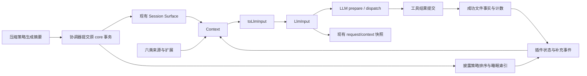

# 上下文管理引擎执行摘要

状态：2026-10-06 P1–P4 代码实现完成，计划已移入 completed。真实 Provider 分组验收完成取证，确认7项问题和2项候选；这不表示 U1–U8 全部通过。

## 交付结果

- 一个 `Context` 承接内容和管理状态，一个 `LlmInput` 承接最终模型输入。生产请求通过唯一转换器；现有 Session header、事件 envelope、core 事务和 Surface 均不迁移。
- 六个独立来源注册到 Cordis Harness：system、rules、skills、runtime、conversation、tools。AGENTS 按 Turn 刷新，英语学习使用作用域隔离的来源扩展；模型 Prompt 选择可扩展。
- 动态补充使用独立插件事件，转换为带 Runtime 标记的模型消息，插入完整工具批次后；不出现伪造用户气泡。临时插槽支持 Turn/逻辑请求寿命，重试不重复消费。
- 手动与自动压缩共用协调器。OpenCode 固定版本模板完整保留 Relevant Files，前次摘要与新内容分别输入一次；取消、失败或过期候选不覆盖当前历史。
- 文件引用按压缩周期统计成功读取，最多 100 个活跃文件。睡眠文件读取只增加计数，下次成功压缩排名恢复；目录不进入活跃列表。睡眠索引单独使用 artifact，原始历史直接引用 Journal 和精确 seq。
- 候选/core/applied 三阶段持久化支持幂等恢复。读取缓存包含 Session 和 Surface generation，压缩后重读可获得正文。fork 复制类型化索引并重建子会话导航，父记录不改写。

## 数据流

## 验证结果

| 检查 | 实际结果 |
| --- | --- |
| 全仓类型检查、CLI/Desktop 构建 | 通过；Desktop 构建仍有既有 chunk 大小提示 |
| docs/repo/packages/package-cutover/v2-legacy-removal | 通过 |
| Context、Prompt、英语学习、Compaction、Loop、Runtime 定向测试 | 通过；包括默认 Harness 实际装载、模型 Prompt 切换与快照一致 |
| Session、工具、Host、CLI、Shared 及其他包 | 完整测试流程中通过 |
| Desktop 全量 | 首次 1006 项断言通过，但 Composer HoverCard teardown 后产生未捕获 window is not defined，导致命令失败；随后定向 100 项和 Desktop 全量复跑 1006 项通过，2 项既有 skip。未修改无关组件，不声称该时序问题已修复 |
| CLI 真实进程 | 12/12 通过 |
| 旧 Session 兼容 | JSONL 原文件 bytes、seq、Surface 在只读转换前后相同 |
| 恢复与规模 | 0/1/100/101/10000 引用，候选分批与缺批，core 事务持久前缀，候选 flush/索引/applied 故障，重启/fork、去重与索引稳定均有 fixture |
| 真实 Electron | 原无 Provider 空态检查保留；本轮独立目录复用授权配置，真实Electron验证普通请求、模式、附件、模型切换、停止、手动/自动压缩、重读、权限、重启和fork |
| 真实 Provider、U1–U8 全链路 | 本轮完成35次真实请求和53份输入快照核对，确认路径采集、历史引用、索引、fork热度、英语开启、任务投影累计容量、自动压缩比例问题；逐项状态见 [真实桌面报告](real-desktop-acceptance-20261006.md) 和 [实际数据证据](real-desktop-data-evidence-20261006.md)。不能用转换一致代替功能全部通过 |

故障注入验证 Journal 编码/投影和模拟持久边界；不等同于在每个指令位置实际杀进程或掉电。消息前缀与补充去重有自动化证据，未测 provider cache 命中率或真实摘要质量。

## 维护入口

- [公共类型](../../../packages/context/src/types.ts)、[引擎](../../../packages/context/src/engine.ts)、[注册表](../../../packages/context/src/registry.ts)。
- [压缩协调器](../../../packages/context/src/compaction.ts)、[披露策略](../../../packages/context/src/disclosure/plugin.ts)、[状态 reducer](../../../packages/context/src/state.ts)。
- [Host 路径能力](../../../packages/runtime/src/harness/context-host.ts)、[默认 Harness](../../../packages/runtime/src/harness/default-harness-definition.ts)。
- [OpenCode 模板](../../../packages/compaction/src/prompts.ts)和包内 MIT 原文。
- [完整计划](../../exec-plans/completed/20261006-context-management-engine/README.md)、[执行过程](execution-process.md)、[数据设计](../../design-docs/上下文管理引擎设计/Context数据结构和模型输入数据结构的设计规范.md)。

## 后续修复与复验

首轮确认B2–B6、B8、B9共7项问题，见[真实桌面报告](real-desktop-acceptance-20261006.md)、[数据证据](real-desktop-data-evidence-20261006.md)及[值核对JSON](real-desktop-value-checks-20261006.json)。用户随后批准修复：上述7项及新发现的两层启动锁问题B10已完成修复与定向复验，最新状态以[修复摘要](../20261006-context-acceptance-bugfix/execution-summary.md)为准；B1/B7仍保留未确认。以下保留首轮验收边界。

尚未覆盖真正Provider自动重试、压缩失败/取消、英语启用后的作用域/关闭/语音；空压缩数据no-op正确，但未看到明确UI反馈。首轮暂停候选在后续正常重启未复现。输入转换一致和自动提交成功不能代替上述失败或缺口。没有测Provider缓存命中率。

本轮实例正常GUI退出，dev链路已结束；6个插桩文件按原字节恢复，helper源码/生成文件删除，runtime闭包与默认Harness重建、docs及diff检查通过。只验收和记录问题，未修复业务代码，未提交或推送。回退必须保留两个required Context Codec；不认识新事件的旧二进制只能browse-only，不能删事件后强行继续写入。
