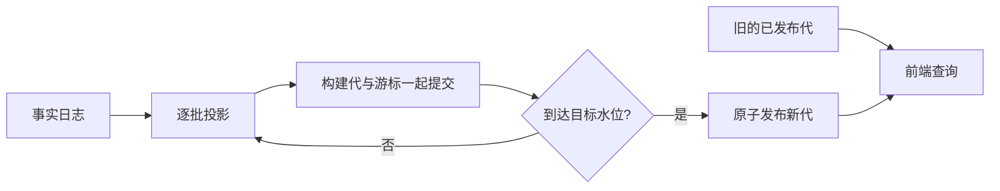

# 索引进度持久化，不等于把半成品展示给用户

从 [Context / SQLite 联合实现](../../exec-runs/20261011-context-sqlite-integration/execution-process.md) 中提炼。

重建一份大索引时，有两种看似合理却都不完整的选择：整个会话一个事务，或者每批直接覆盖用户正在查询的表。前者取消就丢掉整个会话的计算；后者会让用户看到新旧结果混合，甚至让统计重复计数。

解决办法是区分两种提交。**进度提交**保存“已处理到哪条事实、对应中间状态是什么”；**发布提交**才切换“查询应该读哪份完整结果”。进度可以频繁提交，结果只在校验完整后原子发布。

游标和中间投影必须在同一个事务中提交。只保存游标会漏数据；只保存数据会在重试时重复计算。如果中间状态还包括请求关联、去重集合或工具调用关联，它们也属于这个提交边界。

发布隔离必须覆盖全部派生结构。只把明细写进临时表，却让触发器更新正式汇总或全文索引，仍会泄漏半成品。因此构建代需要隔离明细、关联状态和搜索结构，发布时再统一更新正式汇总。

取消也要分层。关闭一个面板，通常只是撤销这个面板的等待；另一个面板还在读取时，共享任务应该继续。全部消费者离开后，任务可以在有界批次结束时暂停，下次从已提交游标继续。停止任务不意味着删除索引，更不意味着删除事实日志。

三个容易忽略的限制：

- 保存了进度，不代表进度可以跨任意来源变化复用。文件被替换、codec 改变或目标水位不再匹配时，需要重新验证。
- 分批构建，不代表最终发布没有大事务。复制、删除旧代和触发器汇总仍可能很慢；必须单独测发布阶段，不能只测批次。
- 正确可恢复，不代表性能达标。本次增量索引仍有超过250ms门槛的实测，不能拿事务正确性或Main未冻结替代延迟验收。

自检：在任意一个批次后强制终止进程，重开后应既不漏数据、不重复计数，也不把半成品标成完整结果。若无法清楚指出游标、关联状态和查询可见性分别在哪个事务中改变，恢复边界还没有设计完整。
