# Claude Projects 真实视频截图索引

来源：Riley Brown 的 `NDTbUObZTlM` 视频。采集日期：2026-10-02。

21 张图均通过 Computer Use 读取 Chrome 播放器保存，没有生成或重建界面。每张图保留完整视频展示区域、讲解者以及可能出现的字幕。部分截图顶部仍有短暂的全屏提示，不影响核心产品区域。图片是视频中的演示证据，不等同于亲自操作 Claude 产品后的验收。

时间取暂停后播放器实际值，章节索引见 [资料说明](README.md)，逐项覆盖及缺口见 [覆盖报告](screenshots.md)。截图文件名主题以本索引描述为准。

## 项目与 Thread

### 02:33 — 线程总览的特殊状态

右侧出现 Waiting on you、Working、Idle、Resolved。等待用户的条目带 Blocked 提示和原因。条目还展示产物数量及时间。覆盖 V01、V05、V06。

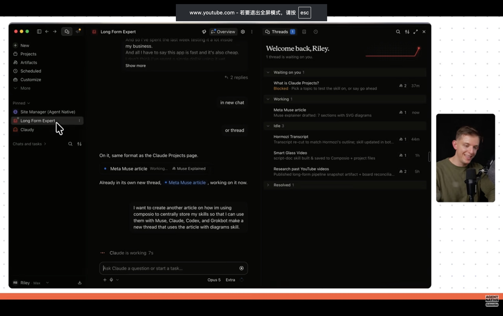

### 04:05 — 创建项目表单

居中的 New project 弹窗包含 Name、Goal (optional)、Context (optional)、Add、拖入文件或文件夹区域，以及 Cancel / Create project。覆盖 V02。

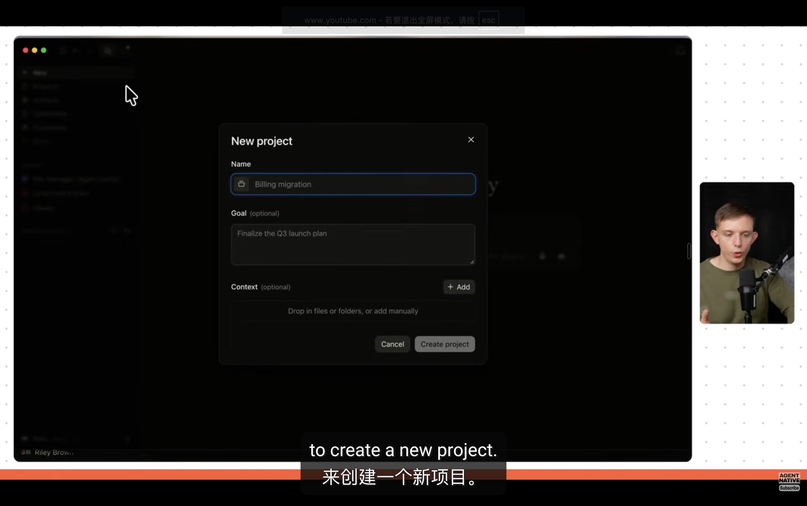

### 04:41 — 项目欢迎页与三栏布局

左侧固定项目，中间是主会话欢迎说明、建议任务与输入框，右侧 Threads 为空状态。右面板顶部还可见资源与计划相关图标。覆盖 V01、V06。

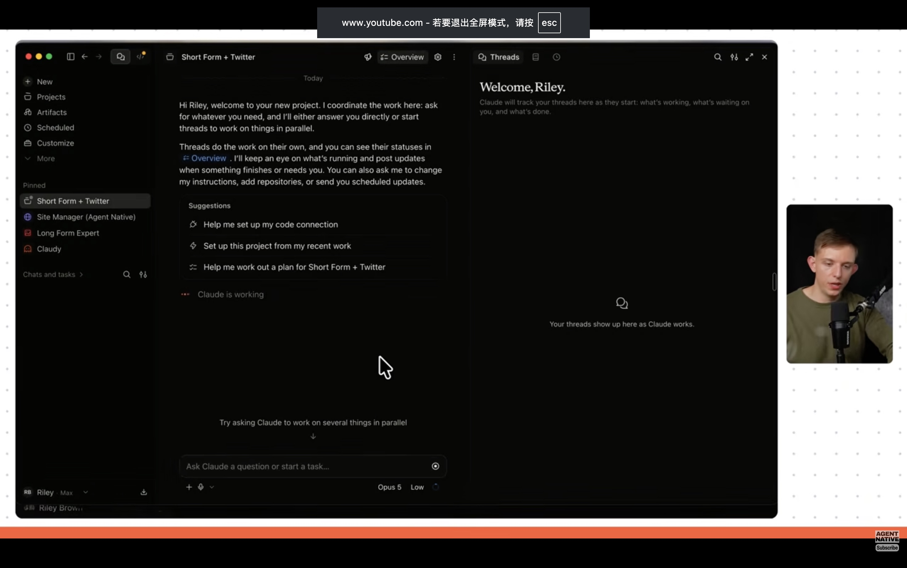

### 04:55 — 项目图标与颜色设置

项目标题图标下方展开浮层，包含图标搜索、图标矩阵、两行颜色选择与 Reset icon and color。只确认图标/颜色部分，未据此确认重命名操作。覆盖 V03 的图标部分。

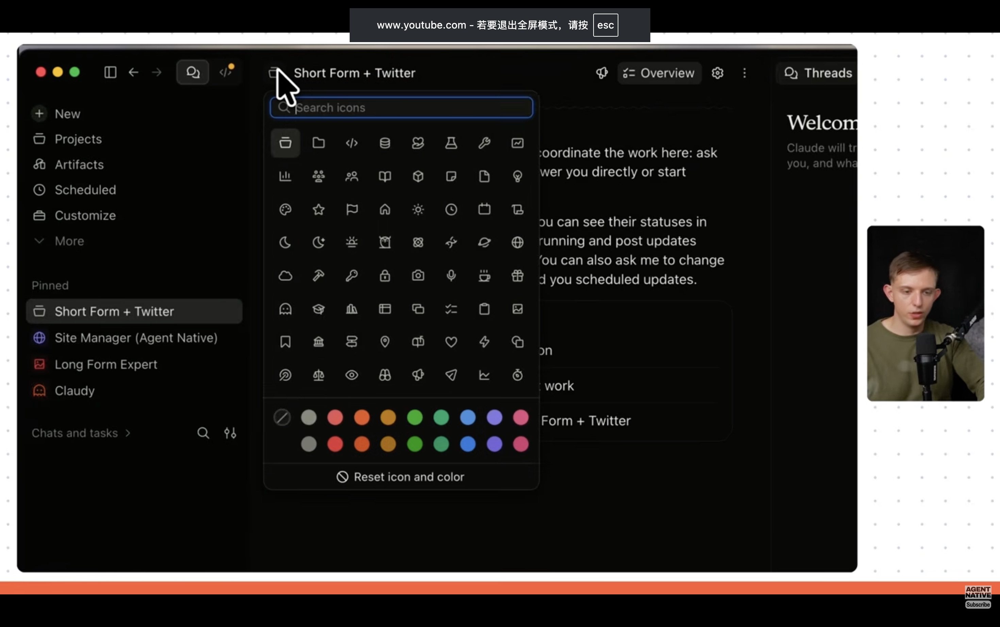

### 06:15 — 主会话委派两个并行 Thread

中间包含一次两任务请求和两条线程关联；右侧 Working 2，条目显示当前步骤、进度及时间。覆盖 V04、V05、V06。

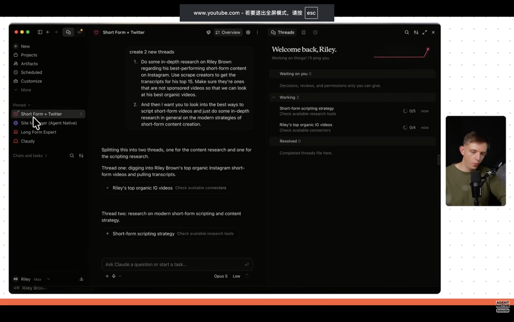

### 06:31 — Thread 详情与产物卡片

主会话保持在中间，右侧改为具体 Thread 会话，展示研究结果与 Artifact 卡片；线程有独立的 Steer this thread 输入框。覆盖 V04、V06。

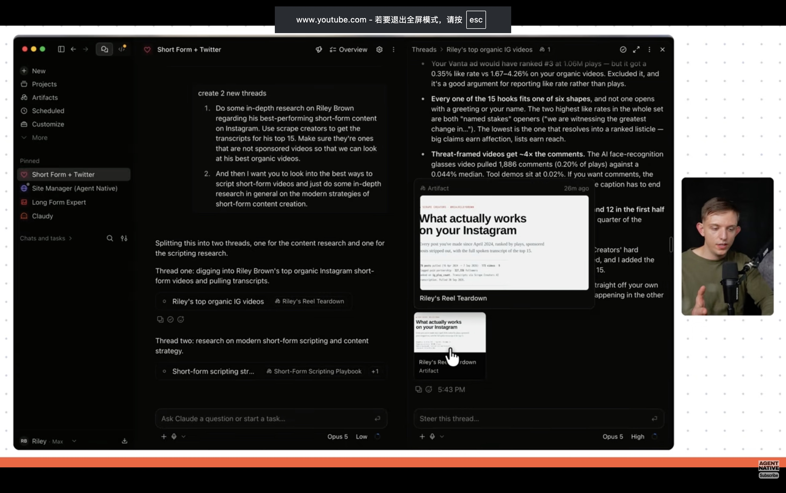

### 06:53 — 产物与所属 Thread 并排

更大的产物视图覆盖工作台，左侧展示产物，右侧保留 Thread 结果和输入框。产物标题栏可见固定、评论、分享与更多入口。覆盖 V06、V07 的浏览部分。

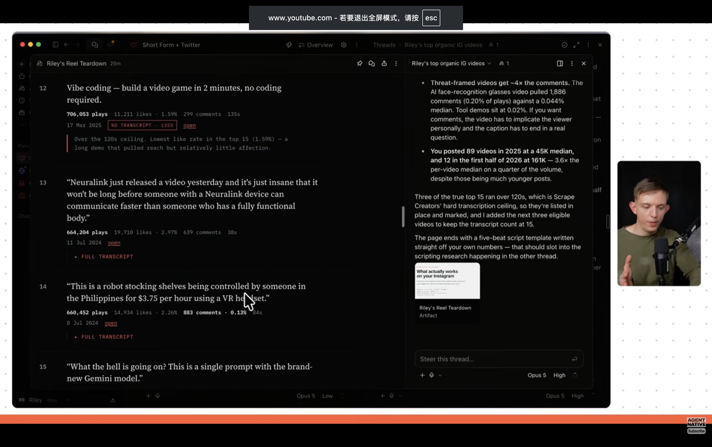

## Usage、Design 和 Library

### 10:18 — 用量浮层

包含订阅配额、项目总 Token、Coordinator 与线程用量分布、See full project usage。此处记录作者账号的示例数值，不作为默认限额。覆盖 V08。

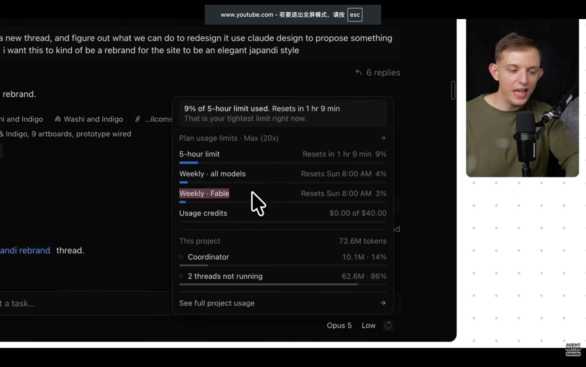

### 11:02 — 详细项目用量

Settings 左栏包含 General、Memory、Environment、Plugins、Usage。右侧统计线程数、Token、Cache hit、Coordinator 占比；分类表含 Input、Output、Cache write、Cache read；下方线程列表有模型、Token、缓存命中率与占比。覆盖 V08。

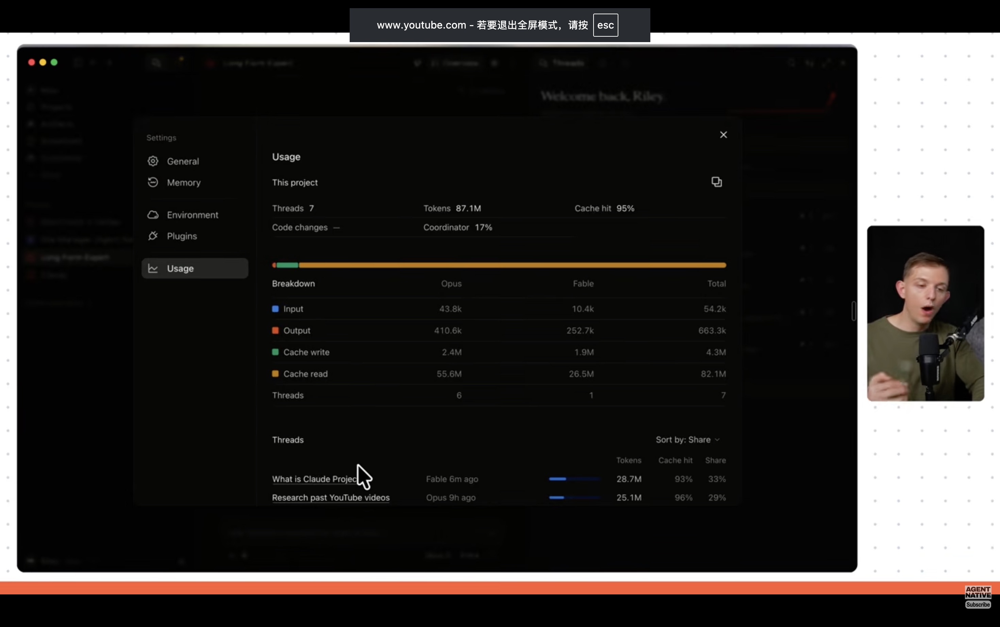

### 13:10 — Design 画板总览

左侧画板有页面选择、工具栏、缩放和多个 Artboard；右侧保留设计 Thread，会话底部可见 Create PR 入口。截图只记录入口，不代表执行了 PR 操作。覆盖 V09 的布局部分。

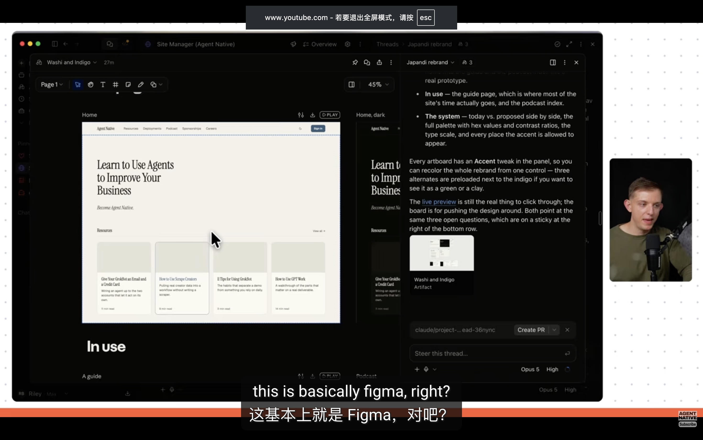

### 14:16 — 画板局部评论

选中区域出现边框、评论锚点和输入浮层，浮层包含 Send to Claude 选项。右侧仍保留对应 Thread。覆盖 V07 的局部评论部分、V09 的评论部分；没有完整记录属性修改前后。

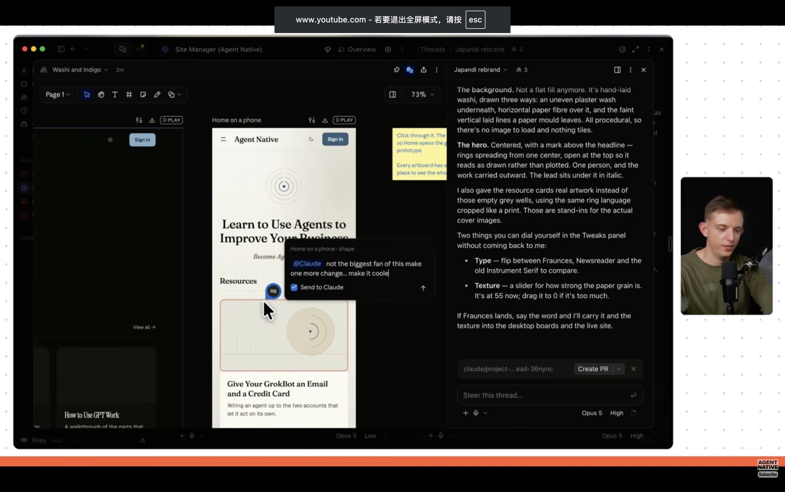

### 15:50 — Library 列表与文件夹

右侧展示 Artifacts 与 skills 文件夹、名称、修改时间；顶部有类型筛选、网格/列表切换和 Add。底部提示可让 Claude 在任意线程创建并组织文档、文件和产物。覆盖 V06。

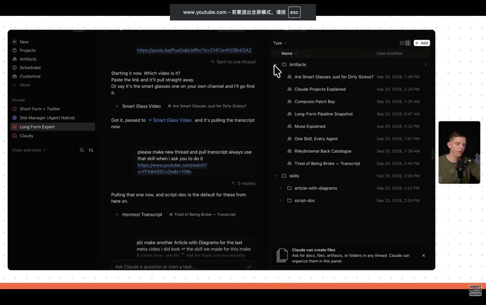

### 16:26 — 产物分享与已解决 Thread

分享弹窗包含邮箱邀请、访问范围、用户角色与链接复制结果。后方 Thread 显示 resolved 与 Reopen。实际没有邀请他人或更改权限；这里只截图视频演示。覆盖 V05 的完成状态、V10。

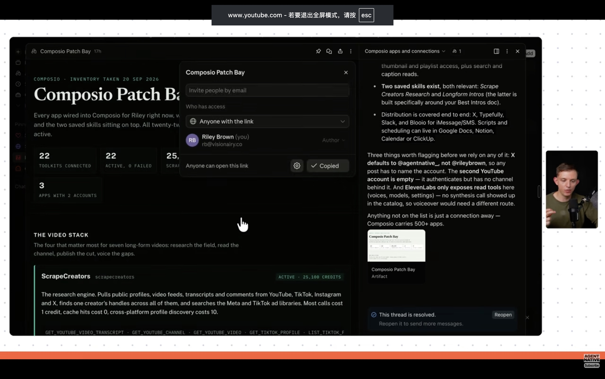

### 17:11 — 桌面幻灯片产物

左侧是幻灯片编辑/浏览区域，底部缩略图横排，顶部有下载、播放、显示与缩放入口；右侧保留生成它的 Thread。覆盖 V11。

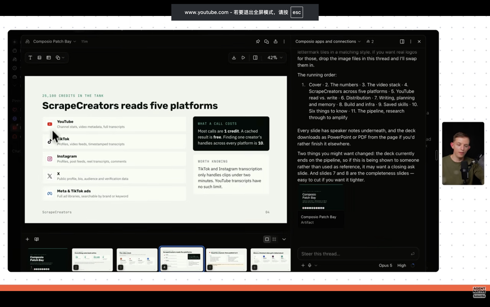

## 手机端与职责说明

### 17:50 — 手机端项目导航

侧边导航显示 Pinned 项目及 Recents 会话；与桌面项目名、图标对应。覆盖 V12。

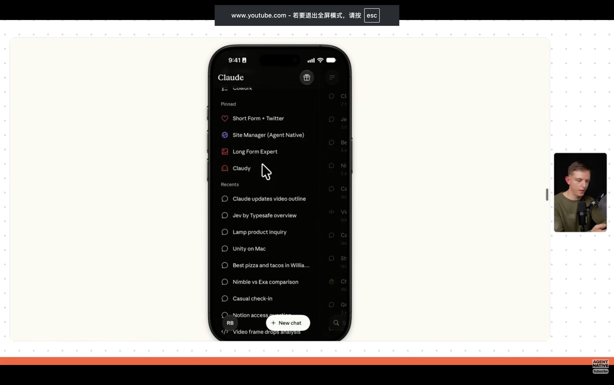

### 17:58 — 手机项目主会话

顶部是项目标题和 Overview 入口，正文有 Thread / Artifact 关联，底部有 Ask anything 输入框和麦克风。覆盖 V12。

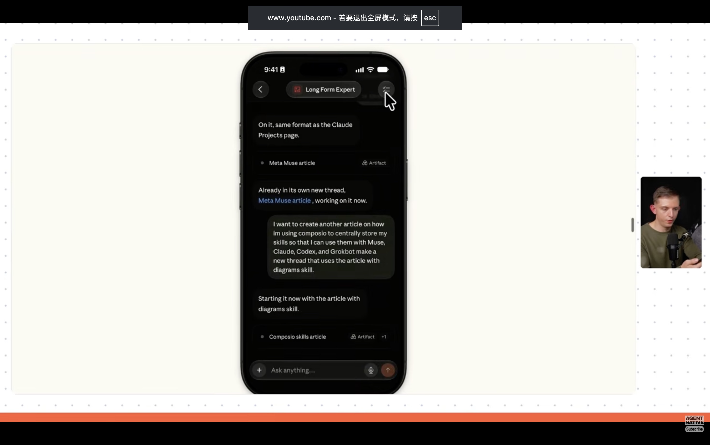

### 18:20 — 手机幻灯片浏览

产物页面有关闭、评论、分享、下载、播放、缩放及底部分页导航。截图示例是第 3 / 11 页。覆盖 V11、V12、V13 的产物浏览部分。

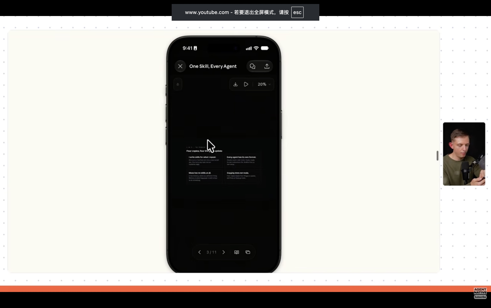

### 18:28 — 手机局部评论输入

评论浮层标识具体 Slide 与 Group；下方打开系统键盘。这里记录输入中的状态，不能仅据此判断评论已成功提交。覆盖 V13 的局部评论输入部分。

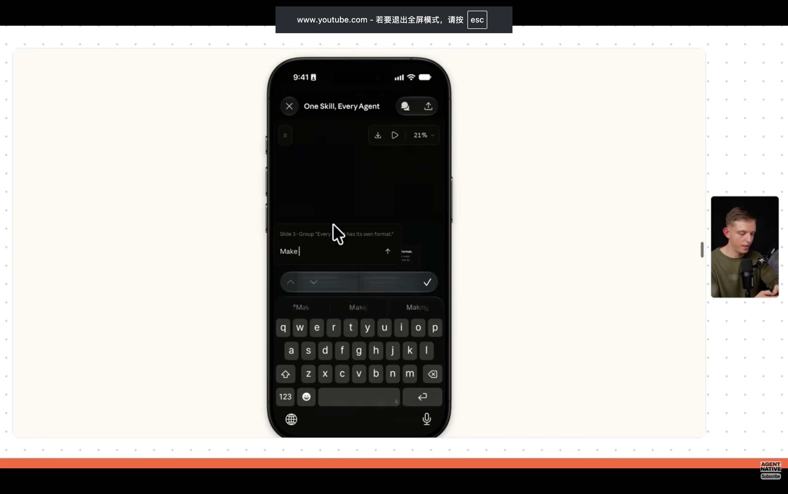

### 19:21 — 手机修改消息与运行状态

Thread 中出现针对多张幻灯片的修改要求，底部有麦克风、排队消息输入和停止入口。截图确认修改消息存在；语音录制开始/结束及识别过程没有独立保留完整证据。覆盖 V13 的修改消息部分。

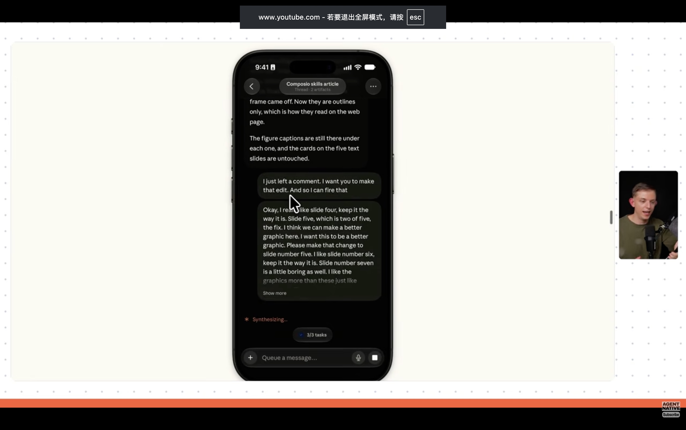

### 19:38 — 手机项目设置与 Usage

Settings 背景能看到 Name、Goal；Usage 底部 Sheet 显示 Threads、Total tokens、Cache hit 与输入/输出/缓存分类。Context 和 Library 的完整展开没有在本图保留。覆盖 V14 的设置与用量部分。

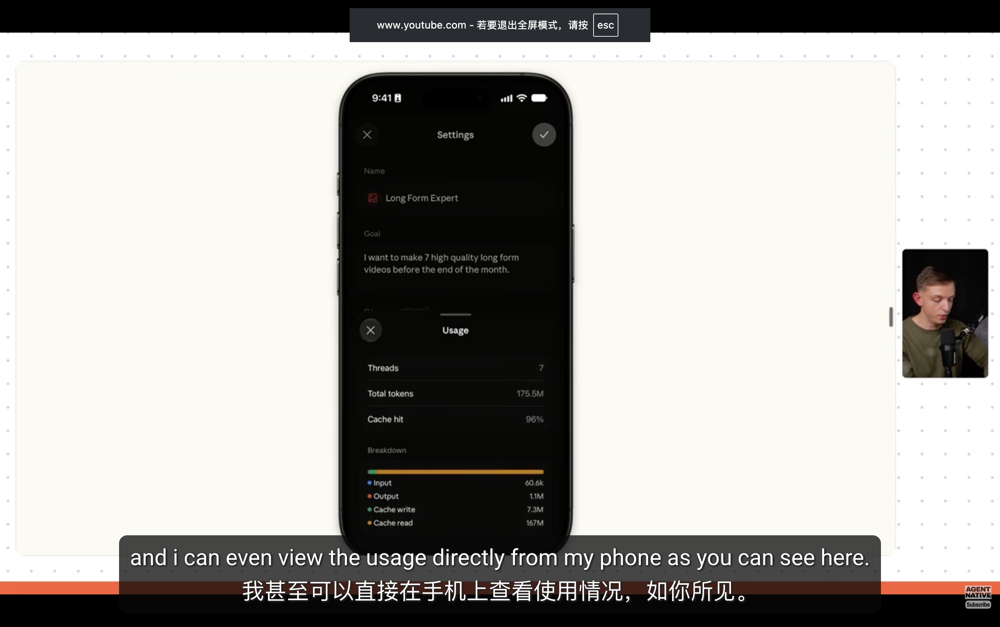

### 20:30 — 主会话与 Thread 的能力说明

作者展示的模型回复表格说明：主会话持有项目记忆、看到线程并委派工作；Thread 从记忆开始处理自己的任务，使用连接器、创建产物、运行代码和计划任务。该表是演示中的模型说明，不是官方 API 或已核实的能力契约。覆盖 V15 的说明画面。

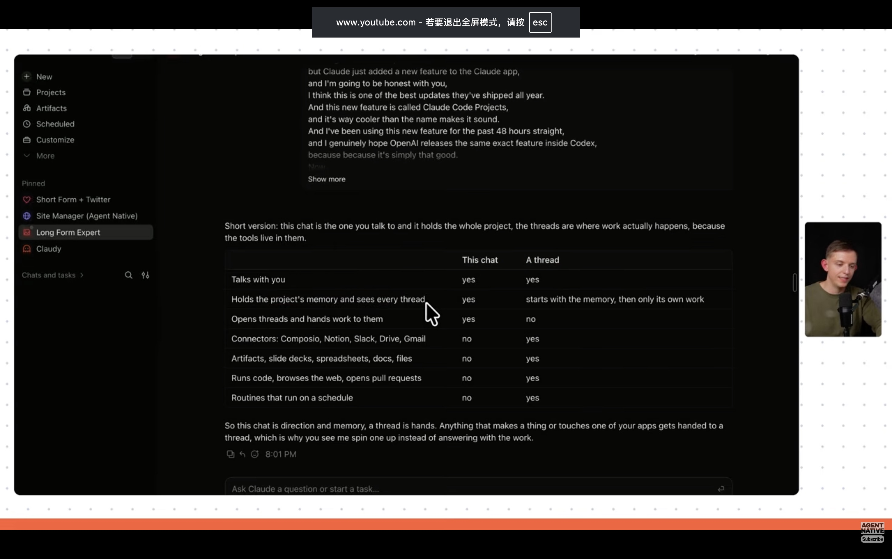
