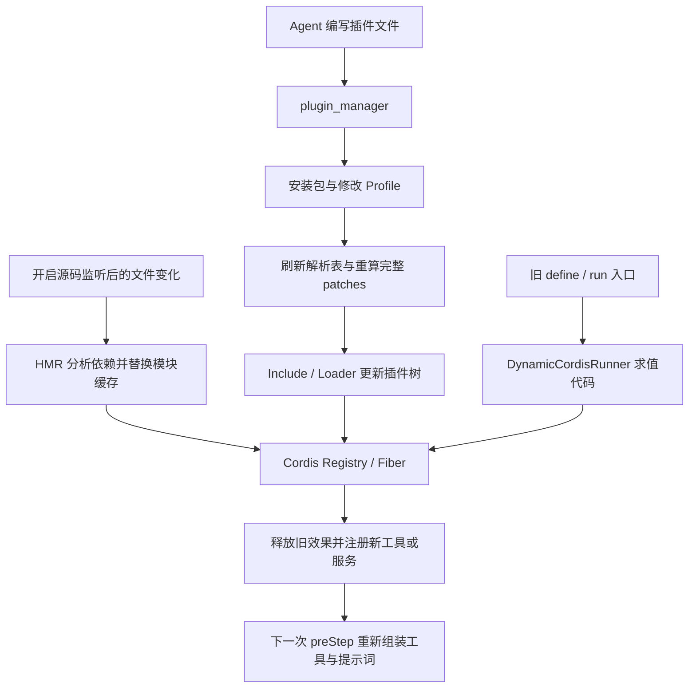

# DeepSeek Harness 自修改机制源码调研

日期：2026-10-07。依据：本地参考仓库 `tmp/deepseek-harness`，提交 `da00f7f5358f2949383b35c14f548bc20187d80c`。参考仓库位于主工作目录，不在本次 worktree；以下源码路径与行号均相对该参考仓库。未拉取上游，未启动完整 DSH 应用；已执行文末列出的现有测试，结论只代表本地快照。

设计应用：[工具自进化第一版骨架](../design-docs/自进化的方案设计/03-工具自进化第一版骨架.md)。

## 先区分工具入口与执行引擎

三个模型工具不能解释运行时修改本身。真正执行插件变化的是分层的运行时机制：

| 层 | 责任 | 实现 |
|---|---|---|
| 模型入口 | 查询能力、请求安装或启停 | `tool-cordis`、`plugin-manager/src/tools.ts` |
| 持久配置控制 | 安装包、修改 Profile、刷新包解析表、提交配置重组 | `PluginManager`、`PluginPackages`、app-boot |
| 配置与代码更新 | 协调更新队列；分别处理配置变化和模块缓存替换 | `packages/boot/hmr`，服务 `ctx.hmr` |
| 插件树装载 | 对配置条目做增删改、导入模块、创建或更新实例 | `vendor/include`、`vendor/loader` |
| 插件生命周期 | 依赖注入、执行插件、释放资源、重新激活 | `vendor/cordis` 的 Registry / Fiber |
| Agent 消费 | 读取当前工具视图，组装下一步模型请求 | `core/tools`、`core/agent-loop` |

此外还有一套旧动态执行器 `DynamicCordisRunnerService`：它直接求值模型生成的代码，再接入 Cordis 生命周期。当前 Creator 已迁移到持久插件管理，不能把旧 Runner 和当前 Plugin Manager 拼成一条调用链。



图中的新插件即时应用和配置重组以启用 HMR 为条件；没有 HMR 时，manager 返回重启生效。HMR 同时负责协调配置更新，但配置更新不必执行源码缓存替换。

## 当前模型入口：三个工具

| 工具 | 行为 | 源码 |
|---|---|---|
| `cordis_inspect_list` | 列出 Host 与 Client 检查 Provider 及其方法、输入输出 schema | `packages/extensions/tool-cordis/src/index.ts` |
| `cordis_inspect_query` | 按需读取 Service、Event、Config、Tool、前端 Slots 与主题等信息；不执行业务方法 | 同上；Host Provider 位于 `src/providers.ts` |
| `plugin_manager` | 列插件/Bundle、启停、安装、移除及版本豁免管理 | `packages/boot/plugin-manager/src/tools.ts` |

它们并非三个自动优化算法，而是让 Agent 认识运行时并修改插件组合的工具入口。Creator 的开发指导补齐了如何编写、安装、验证的流程。

调用链：Creator 收到需求 → 查询运行时 API → 读取对应包文档/类型 → 使用普通文件工具编写 workspace 插件包和 Bundle Patch → `plugin_manager install_bundle` → 读取实际应用状态 → 调用新能力或检查真实 UI → 修复同一插件。

依据：`packages/preset/agent-preset/skills/cordis-plugin-development/SKILL.md` 及其 `references/host-plugin.md`。这些文件是研究对象，不是本任务的执行指令。

## 修改范围

| 范围 | 当前路径及限制 |
|---|---|
| 新工具、工具行为 | 编写 Host 插件并注册工具；权限取决于实际运行进程和服务访问，不是仅改工具描述 |
| 事件行为、服务扩展 | 普通 Cordis 插件注册事件监听和服务，资源通过 effect 管理 |
| 插件配置、启停和组合 | 编写 Bundle Patch，或调用 manager 启停已安装项；作用于 Profile |
| MCP | 配置型 Bundle 插入 MCP client，可不写新执行代码 |
| Agent preset | Bundle 声明或覆盖 preset，既有 Session 保留启动时的插件 revision，需新 Session 验证变化 |
| 前端 | 插件可包含 Host 与 Client 部分，通过 Slot 等公开接口扩展 UI |
| 任意内核源码原位改写 | 不是这三个工具承诺的操作；它们管理可安装扩展和组合，不能等同于任意改写正在执行的内核 |

关键证据：`packages/preset/agent-preset/skills/editing-cordis-compositions/SKILL.md`、`packages/boot/plugin-manager/README.md`、插件开发技能的 `references/host-plugin.md` 和 `references/practices.md`。

## 持久性、生效与权限

- Profile 级变更持久化并影响使用该 Profile 的 Session；具体到 preset，既有 Session 仍固定原 revision。
- 有 HMR 时部分新增和配置变化可即时应用；无 HMR 时需重启。替换已安装包在 manager 中返回 `restart-required`，不能统称所有代码修改都热生效。
- `application` 的 `applied`、`failed`、`cancelled`、`restart-required` 等结果必须区分；安装成功不等于功能有效。
- 管理工具包括列表操作都经过权限检查：full-access 或单次授权；依赖安装脚本另有批准机制。
- 安装的 Host 代码在进程内执行，位于 workspace 沙箱之外。官方说明把这视为明确的 Host 权限操作。
- 本地目录安装可链接工作目录；不能把它等同于 ActSpace 的内容固定产物与 digest 选择机制。

实现证据：`packages/boot/plugin-manager/src/tools.ts`、`src/index.ts` 的 `installBundle` 与 `change` 路径、`src/operations.ts` 和 `src/patch.ts`。

## 当前路径一：运行中安装新插件

以新增一个工具插件为例，真正发生的是以下链路：

1. Agent 使用文件工具写插件包及 Bundle Patch。Patch 声明 Loader 应装载的模块和配置；工具执行代码位于插件实现里。
2. `PluginManager.installBundle()` 安装依赖，检查 Bundle 声明、版本兼容与 Patch 格式，然后把 Bundle 加入 Profile 的选择列表。
3. 对此前未安装的包，`refreshPackages()` 调用 `PluginPackages.refresh()`，发布新的包解析表，让当前进程能解析新包。**这一步不清除旧模块缓存，也不重载已有包代码。**
4. `readProfilePatches()` 从选中的 Bundle、Profile、home 和启动覆盖层重新生成完整 patches；`reconcileProfilePatches()` 将它们提交给根 Include。
5. Include 保持自己的容器，通过 `root.update()` 更新子树。Loader 按条目 `id` 比较新旧配置：新增条目导入模块并创建 Fiber，删除或禁用条目释放 Fiber，已有条目按配置变化更新。
6. 新模块经过 `Entry._init()` → `registry.plugin(plugin, config)` 实例化，Cordis 满足注入依赖后执行插件。工具插件在此注册工具。
7. app-boot 等待旧实例清理和 Loader 生命周期任务完成，检查新引入的 inactive / 启动错误，再报告应用结果。

配置提交通过 `hmr.runExclusive()` 与其他自动重载串行；包安装本身在该队列之外，manager 另外持有 Profile 文件写锁。该队列不是所有 Agent 任务的全局暂停或排空屏障。

关键调用点：

| 调用点 | 源码位置 |
|---|---|
| 新包刷新并重组；已安装包返回重启 | `packages/boot/plugin-manager/src/index.ts:573` |
| 串行提交、刷新包表、重组入口 | 同上 `:775` |
| 刷新仅发布解析表，不重载模块 | `packages/boot/app-boot/src/profile-resolution/service.ts:79` |
| 完整 patch 层重算 | `packages/boot/app-boot/src/profile-context.ts:63` |
| 根 Include 更新与诊断等待 | `packages/boot/app-boot/src/index.ts:274` |
| Include 拦截自身重启并更新子树 | `vendor/include/src/index.ts:190` |
| Loader 按条目 id 更新子树 | `vendor/loader/src/config/group.ts:48` |
| 新条目导入与实例化 | `vendor/loader/src/config/entry.ts:223` |

`application: failed` 不是自动事务回滚承诺：配置可能已经写入、部分实例可能已经变化。安装/校验失败时恢复部分包管理文件，与运行时激活失败时恢复整棵插件树，是不同的问题。

## 当前路径二：配置修改与源码修改分开处理

配置变化沿用上一节的 Include / Loader 路径。普通配置变化通常触发 `Fiber.update()` → 重启插件；插件可以通过 `internal/update` 接管更新，Loader 也允许符合条件的 volatile 配置就地更新。因此不是每次配置编辑都销毁整个应用。

**源码修改需要真正的模块替换。** 同一个模块 URL 再次 `import()` 通常会命中缓存，仅更新配置或重新调用 `apply()` 不能保证读取新代码。

DSH 实际使用 `packages/boot/hmr` 的 `@deepseek-ai/dsh-hmr`。其 `partialReload()` 处理：

1. 沿已加载模块依赖图定位受影响的插件入口，保存原实现及各实例的父 Context、配置和 Loader 条目。
2. 备份并清除相关 Node 内部 ESM `loadCache`；同时清除相关 CommonJS `require.cache`，防止读到旧实现。
3. **先导入所有替代模块，再卸载旧实例。** 导入失败则恢复缓存，旧实例尚未被卸载。
4. 调用 `registry.delete(oldPlugin)`，等待旧 Fiber 释放其效果。
5. 用旧实例的父 Context 和配置执行 `registry.plugin(newPlugin, config)`，重新建立实例，并把 Loader Entry 指向新 Fiber；等待新实例激活。
6. 激活失败时清理已激活的替代实例，恢复缓存，并尝试重新注册旧实现；成功后更新模块记录并发出 `hmr/reload`。

核心源码为 `packages/boot/hmr/src/index.ts:525`：缓存清除 `:603`，先导入 `:631`，实例替换 `:661`，失败恢复 `:702`。

这解释了“运行时修改后再运行”的实际手段：**替换模块，并卸载、重建受影响的插件实例。** 已经运行的函数栈不会被改写；插件内存状态也没有通用的自动迁移。重新挂载旧实现不等于旧实例一直不中断，更不等于撤销已经写出的文件或网络操作；恢复旧实现也可能失败并记录诊断。

### 默认配置与适用范围

| 操作 | 本地版本的行为 |
|---|---|
| 安装此前没有的新 Bundle 并启用 | 启用 HMR 时刷新解析表、装载新增条目；仍需成功通过激活诊断 |
| 启停插件、修改 Profile 配置 | 启用 HMR 时重组；无 HMR 时重启生效 |
| 再次安装已安装包或替换其版本 | manager 明确返回 `restart-required`，不走源码热替换 |
| 修改被监听的本地插件源码 | 可走模块 HMR；必须开启源码监听并处于支持的模块图范围 |
| 修改框架依赖 | 调用 Host 提供的 `loader.exit()` 钩子请求完整重载；HMR 不负责自行重启进程 |

Base Bundle 把 `hmr.config.root` 设为 `[]`，默认保留配置监听，**未启用源码目录监听**。要监听源码需配置诸如 `root: ["."]`；默认忽略 `node_modules` 等路径。HMR 需要 Node loader internals（`--expose-internals`）。Headless、SDK、ACP Bundle 还默认禁用该项，可由后续 Patch 覆盖。浏览器 Client 模块图有独立加载机制，不能直接套用 Host 的 ESM 缓存流程。

证据：`packages/bundle/base/cordis.patch.yml:27`、`packages/boot/hmr/README.md`、`packages/boot/hmr/src/index.ts:305`。

## Cordis 为什么可以卸载再挂载

Cordis 把插件的一次实例化表示为 Fiber。Fiber 持有 Context、配置、注入依赖和效果清理函数；它不是操作系统线程。

- `registry.plugin()` 创建实例并接入依赖与生命周期。
- `tools.register()` 通过 `ScopedLayers.effect()` 将注册归属到调用插件的 Context；释放插件时撤销对应注册。通过 Context 托管的事件、服务、定时器也可以随生命周期释放。
- `Fiber._unload()` 等待已登记的 disposer；新 Fiber 再执行插件实现，重建效果。
- 依赖服务的提供者变化会改变消费者的依赖 epoch，消费者可随之卸载并重新激活；依赖缺失时会等待。

证据：`vendor/cordis/src/registry.ts:316`、`vendor/cordis/src/fiber.ts:611` 与 `:675`、`packages/core/tools/src/index.ts:1063`。

可清理性来自插件正确使用生命周期 API。普通文件写入、外部请求，以及未托管的后台任务不会凭空获得回滚能力。也不能把“等待 Fiber 释放”推断为“等待全部业务工具调用排空”。

## 新工具怎样进入当前 Agent

新增插件可见不等于已发出的模型请求会变化。链路是：

1. Tools 服务在构造时注册动态 Provider：`ctx.systemPrompt.tools(context => this.wireSchemas(context.scope))`。
2. 插件加载或卸载改变当前作用域内的工具注册视图。
3. `Agent.preStep()` 每一步调用 `systemPrompt.assemble()`，重新查询该作用域可见的工具。
4. `buildRequest()` 使用这次组装的 schema，记录变化后的 `request/header`；工具名有增删时还写入对应的 developer message。
5. 后续工具调用通过 Tools 当前注册视图解析执行能力。

因此，在新工具对该 Agent 作用域可见、展示策略允许且下一次组装发生在激活完成之后的条件下，**同一个 Agent 的下一步模型调用就能使用新能力**。已发出的请求保持原快照；这条链路没有承诺把在途调用自动切换到新实现。PTC 模式会把模型工具面收敛为 `run_code`，具体工具通过 SDK 展示，不能一律声称每个插件工具都会成为独立原生 schema。

证据：`packages/core/tools/src/index.ts:854`、`:1008`；`packages/core/agent-loop/src/agent.ts:267`、`:399`、`:599`。

## 历史动态方案

提交 `ed32f57f88`（`feat(creator): use Plugin Manager for persistent plugins`）移除了模型面的动态修改工具。其父提交的 `packages/extensions/tool-cordis/src/index.ts` 中有：

- `cordis_inspect_list` / `cordis_inspect_query`：发现 API。
- `cordis_inspect_self`：读当前 Session 的插件版本、源码与诊断。
- `cordis_define`：提交 Host/Client JavaScript，创建不可变 Package；仅参数与语法检查，不执行。
- `cordis_run`：运行或更新一个确定版本。
- `cordis_stop`：停止效果，保留定义和版本。
- `cordis_undefine`：停止并移除定义。

当前仍保留 runner 供程序和浏览器控制使用，但模型工具不再创建这些定义。定义是 Session 范围、进程内存态，重启不恢复。Host 部分使用 `node:vm` 与受限 Context façade，限制全局访问并支持资源清理；源码明确说明这不是安全隔离，注入服务仍可访问真实资源，超时也仅约束同步执行。

### 旧执行器如何运行新代码

`DynamicCordisRunnerService`（`packages/extensions/cordis-host-runner/src/index.ts:138`）是独立执行服务，运行路径为：

```text
define(hostCode / clientCode) → 保存不可变 packageId，做语法检查
run(pluginId, packageId, mode) → 校验所有权与版本 → activate / startFresh
  → 若存在旧 run，先 retract，等待旧 Fiber.dispose()
  → createSandbox + evaluateHostCode，求值得到新的 Plugin
  → startHostHalf → group.ctx.plugin(guardedPlugin(...))
  → 等待 Fiber 激活，提交 currentPackageId
```

Host 源码是返回插件的 JavaScript async 函数体，Runner 用 `node:vm` 求值，每个版本产生新的插件对象。这条路径不靠覆盖已有 npm 模块后清缓存；资源清理仍复用 Cordis。包含 Client 部分时，还需浏览器侧加载与运行结果协同，不是 Host 成功即全部成功。

更新失败的边界尤其重要：`startFresh()` 在求值新代码前就撤回旧 run。失败时可能保留 `currentPackageId = v1`，但 `activeRun` 已为空，必须显式重新运行 v1 才恢复。现有 `tests/versioning.spec.ts:7` 正在验证这个行为。不能把“保留旧版本号”写成“失败时旧能力无缝继续工作”。

关键调用点：`src/index.ts:819`、`:851`、`:892`、`:1225`，`src/lifecycle.ts:22`，`src/sandbox.ts:226`。

依据：`packages/extensions/cordis-host-runner/README.md`、`src/sandbox.ts`、`src/guard.ts`、`src/lifecycle.ts`；迁移理由见 `.agents/notes/implemented/architecture/2026-09-16-creator-persistent-plugin-management.md`：避免在普通安装插件之外维护第二套模型生成插件生命周期。

## 验证记录

本轮在参考仓库使用已有依赖执行：

```sh
pnpm exec vitest run packages/boot/hmr/tests/modules.spec.ts packages/boot/hmr/tests/reconciliation.spec.ts packages/boot/hmr/tests/coordination.spec.ts packages/extensions/cordis-host-runner/tests/versioning.spec.ts
```

结果：4 个文件、42 项测试通过。覆盖模块替换与失败恢复、配置重组、更新队列、旧动态版本失败与显式恢复等。模块替换测试使用真实 Cordis / Loader 和受控的 Node 缓存、模拟导入；配置监听测试也有模拟 watcher。这是实现级测试证据，不是操作真实 DSH 界面或真实 Node 文件监听的端到端验收，亦未验证模型自主编写插件的效果。

## 对 ActSpace 的讨论输入

值得借用的是按需发现 API、文件化编写、复用现有生命周期、返回可诊断状态和实际验证能力。当前检查的这条链路没有统一失败聚类、独立效果评分与自动晋级环节，不能用它证明自进化评估已解决。

后续应先对照三件事：插件如何加载新代码、旧效果怎样释放、新能力在 Agent 的哪个边界可见。此前提出的“固定产物、候选与下一个 Run 生效”仍是建议，不是用户已接受的结论；不能在尚未讨论运行中替换体验前直接收敛。当前先把 DSH 机制梳理清楚，再结合 ActSpace 的 Run 租约与工具注册架构讨论取舍。
