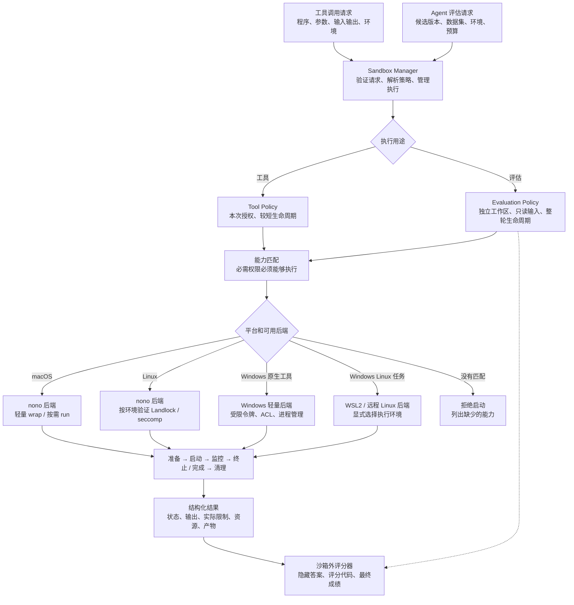
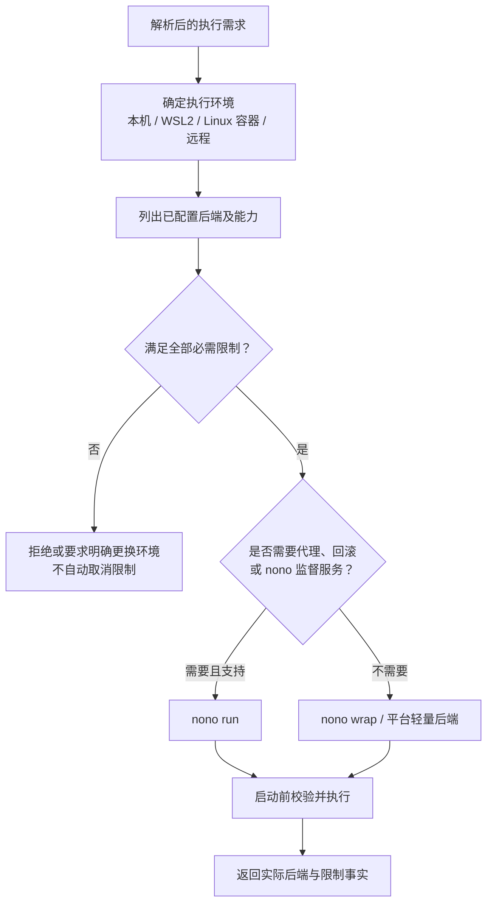
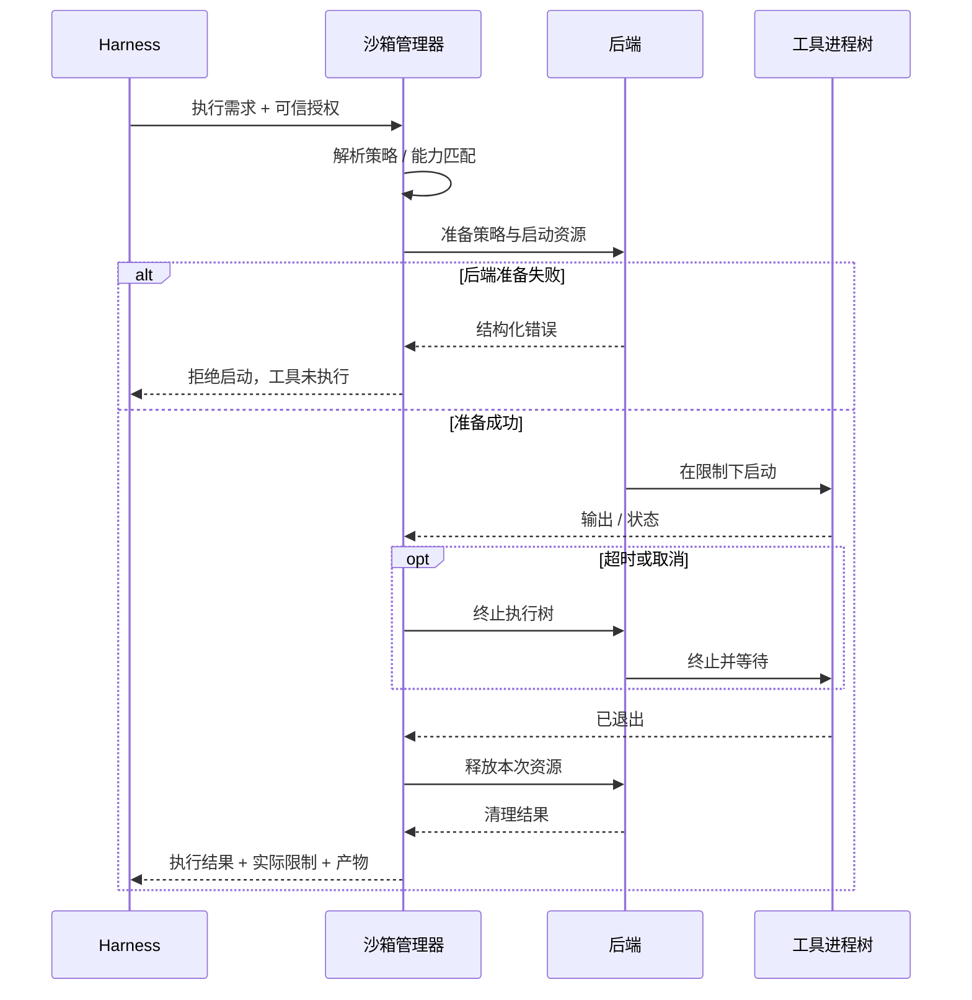
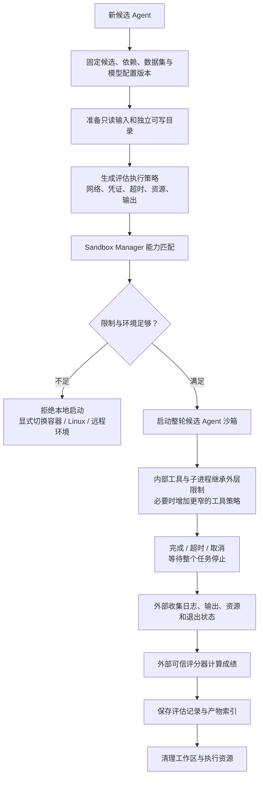
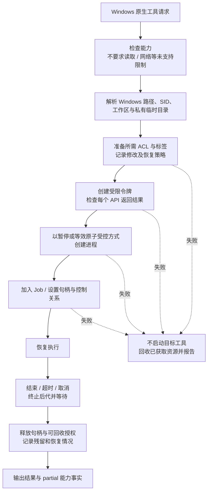

# 沙箱实现的思路

> 入库说明（2026-10-25）：本文是用户提供的沙箱调研原稿，按原文保存，仅把 DSH 本地路径改为仓库内参考副本 `tmp/deepseek-harness`。实验脚本与原始数据未入库。当前决策以 [沙箱设计](../../design-docs/execution-safety/agent-沙箱设计.md) 为准。

> 日期：2026-10-22。本文面向 Harness 开发者，整理当前架构方向、候选后端分析和本机实验结果。它是一份设计建议，不代表已经实现的产品能力。平台优先级为 **macOS > Linux > Windows**。

## 目录

1. [结论与设计范围](#1-结论与设计范围)
2. [两个执行场景](#2-两个执行场景)
3. [总体架构与分流流程图](#3-总体架构与分流流程图)
4. [沙箱管理器的输入输出](#4-沙箱管理器的输入输出)
5. [策略解析和后端选择](#5-策略解析和后端选择)
6. [工具执行的完整流程](#6-工具执行的完整流程)
7. [Agent 评估的完整流程](#7-agent-评估的完整流程)
8. [macOS 与 Linux 后端](#8-macos-与-linux-后端)
9. [Windows 原生轻量工具沙箱](#9-windows-原生轻量工具沙箱)
10. [Mac 性能实验及选型结论](#10-mac-性能实验及选型结论)
11. [权限、失败、资源和日志](#11-权限失败资源和日志)
12. [分阶段实施与验收](#12-分阶段实施与验收)
13. [待验证问题与成本取舍](#13-待验证问题与成本取舍)
14. [资料来源与证据](#14-资料来源与证据)
15. [实验附件和复现](#15-实验附件和复现)

## 1. 结论与设计范围

建议实现一层由自己掌握的 **Sandbox Manager（沙箱管理器）**，统一接收执行需求、解析策略、选择后端、管理生命周期和返回执行结果。底层隔离优先复用 nono 及操作系统已有机制。

当前建议的后端组合是：

| 平台 / 场景 | 首选方向 | 后续选项 |
|---|---|---|
| macOS 单工具执行 | `nono wrap` | 只有测量证明有必要时，再增加直接 Seatbelt 后端 |
| macOS 整轮 Agent 评估 | 按能力需求选择 `nono run` 或 `wrap`；需要代理、审计、回滚时选 `run` | 若需要独立依赖环境或强资源控制，再增加容器 / Linux 远程执行 |
| Linux 单工具执行 | nono，先验证 `wrap` | 可选 Bubblewrap；不提前维护所有后端 |
| Linux 整轮 Agent 评估 | nono；需要独立环境时组合容器 | 按威胁模型选择更强外层隔离 |
| Windows 原生工具执行 | 如果上游仍无合适后端，自行实现范围受控的轻量后端 | 参考 DSH 受限令牌方案，明确部分限制与兼容成本 |
| Windows 整轮 Agent 评估 | 优先考虑 WSL2 内的 Linux 后端或远程 Linux 环境 | 原生完整评估能力作为独立阶段，不由轻量工具后端自动推出 |

“全量使用 nono”在此表示 **尽量由同一个 nono 后端适配覆盖 Mac/Linux 的执行需求**，不表示为每个工具启用 nono 的全部功能，也不表示每次都运行监督模式。

本文区分三类内容：

- **已验证事实**：本机 Mac 性能数据、实际进程树、允许 / 拒绝文件写入的预检。
- **源码与文档事实**：DSH 的现有平台后端、nono 的模式和平台范围、上游 Windows 草案。
- **待实现设计**：本项目自己的管理器、策略、Windows 后端、评估调度和测试要求。

核心决策是：**先统一需求和执行生命周期，再决定使用哪个隔离实现。权限能力优先于性能，测量结果决定是否值得增加直接系统后端。**

## 2. 两个执行场景

### 2.1 场景一：工具执行

Harness 需要执行一个工具，希望它只拥有完成本次操作必需的权限。例如读取项目目录、写入结果目录、运行一个编译器，或禁止联网。

典型执行单元是一条明确的程序与参数，或一个独立工具工作进程。运行时间通常较短，调用频率可能很高，因此每次启动额外成本和取消行为十分重要。

这里有一个必须提前确定的接入点：如果工具只是 Harness 主进程内的函数，给 Bash 套一层 nono 并不能限制这个函数的文件操作。要么把工具移入独立工作进程，要么由可信工具实现自身的访问检查。后者不是对任意不可信代码的进程沙箱。

### 2.2 场景二：自进化 Agent 评估

Harness 产生一个新候选 Agent 后，用固定数据集评估其行为。被执行内容可能包括新提示词、工具组合、生成的代码、插件和依赖。

如果进化只改变提示词和参数，执行代码仍由可信实现控制，要求相对简单。如果允许候选 Agent 执行新代码、安装依赖或替换插件，就必须约束整个候选进程及其后代。

评估的执行单元通常是一整轮运行，而非每个内部工具重新启动一个监督进程。需要考虑：独立工作目录、只读输入、受控输出、超时、资源预算、网络和凭证、结果持久化以及清理。

### 2.3 共用与差异

| 维度 | 工具执行 | Agent 评估 |
|---|---|---|
| 启动单位 | 一次调用 / 一个工作进程 | 一个候选 Agent 的一次评估 |
| 生命周期 | 短，调用多 | 较长，通常有多个工具和子进程 |
| 文件布局 | 本次输入与输出 | 代码、数据集、工作区、结果、评分器分离 |
| 网络 | 按工具决定 | 通常只放行指定服务，或离线 |
| 资源 | 超时、输出上限，按需增加硬限制 | 更强调进程树、内存、并发和总预算 |
| 可复现性 | 固定输入即可起步 | 还需记录代码、依赖、模型和数据集版本 |
| 信任程度 | 工具可能已知，参数来自模型 | 候选代码可能未经充分验证 |

工具策略和评估策略可以不同，但不能有两套互相矛盾的权限含义。

## 3. 总体架构与分流流程图

上述 Windows 和管理器部分是目标设计，尚未编写实现。Mac/Linux 选择 nono 也不代表所有组合已验证可用。

一个便于理解的模块划分是：

| 模块 | 责任 | 不应承担的内容 |
|---|---|---|
| 请求入口 | 将工具 / 评估任务描述成执行请求 | 拼接平台策略、默默增加权限 |
| 策略解析器 | 将默认值、授权、输入布局解析成完整策略 | 在执行中读取不断变化的全局默认值 |
| 后端选择器 | 用真实能力匹配必需条件 | 把“不支持”伪装成“成功但没执行限制” |
| 后端适配 | 准备策略、启动限制、返回平台事实 | 决定数据集评分、模型任务等业务规则 |
| 执行控制器 | 取消、超时、等待、输出、退出、清理 | 承诺后端根本没有的资源隔离 |
| 评估编排器 | 任务分配、版本记录、调用外部评分器 | 让候选 Agent 决定自己的分数 |

初期这些职责可以由少量模块承担，无需把每一行都拆成一个包、服务或注册中心。

## 4. 沙箱管理器的输入输出

### 4.1 输入描述需求，而不是指定系统命令

调用方应描述“执行什么、允许什么、必须限制什么”。后端路径、SBPL 字符串、Windows 令牌标志不应成为普通工具调用方的配置。

建议的输入字段如下；这是设计字段，不是已经冻结的 SDK：

| 字段 | 作用 | 例子 |
|---|---|---|
| purpose | 区分工具与评估 | `tool` / `evaluation` |
| program / args | 程序与参数分离 | Python 路径、脚本路径、任务参数 |
| cwd | 执行环境中的工作目录 | 本次任务私有工作区 |
| filesystem | 可读与可写路径 | 代码只读、输出可写、临时目录可写 |
| network | 网络要求 | 无限制、断网、指定代理域名 |
| environment | 明确环境变量 | PATH、语言区域、指定配置，不默认继承全部宿主环境 |
| credentials | 凭证访问方式 | 优先受控代理，必要时明确环境注入 |
| timeout | 整次调用的最长时间 | 工具超时、评估总超时 |
| outputLimit | stdout/stderr 总量上限 | 截断并记录，或终止执行；行为要明确 |
| resourceLimits | 资源要求及是否必须为硬限制 | 内存、进程 / 线程数等 |
| executionWorld | 本机、WSL2、远程或容器 | 本机 Windows 与 WSL2 不可混为同一环境 |
| requiredCapabilities | 不能缺失的条件 | 必须限制读取、必须断网、必须硬内存上限 |

参数应通过数组传入进程创建 API。只有工具本身需要 Shell 语法时才启动 Shell，不在管理器中把任意参数直接拼接成脚本。

### 4.2 输出必须说明实际发生了什么

执行结果至少应包括：

- 执行 ID、用途、选用后端、后端版本、执行环境。
- 解析后的策略摘要或指纹；敏感字段必须脱敏。
- 状态：准备失败、运行完成、工具失败、超时、取消、后端不可用、清理失败等。
- 工具退出码与信号；不要把普通程序失败全部归为沙箱拒绝。
- stdout/stderr、是否截断、产物位置。
- 实际执行的限制，以及不支持 / 部分支持的项目。
- 耗时和资源数据，并标明数据含义，例如是否包含进程树。
- 清理结果；需要人工处理时提供明确路径与恢复信息。

“程序退出 0”与“所有后端准备和清理均成功”是不同事实，应分别保留。

## 5. 策略解析和后端选择

### 5.1 显式解析成每次调用的固定策略

建议顺序是：部署默认策略 → 工具 / 评估模板 → 本次任务约束 → 经授权的本次权限。候选 Agent 的请求不能直接扩展部署允许的最大权限。

策略在启动前解析和验证，后续运行使用这份固定结果。并发调用不共享一个可变的“当前权限模式”。

权限范围不要只保留 `read-only` / `workspace-write` 两个名字。它们可以作为用户友好的模板，但管理器内部还需要表达读取、网络、进程和资源要求，否则无法正确选择 nono 或 Windows 部分后端。

### 5.2 建议维护的后端能力事实

| 能力 | 为什么要单独表达 |
|---|---|
| 文件修改限制 | 工具场景的初期核心能力 |
| 文件读取限制 | 隐藏凭证、其他项目资料、数据集答案 |
| 完全断网 | 离线评估、避免直接外传 |
| 域名 / API 代理 | 访问模型服务而不开放任意网络 |
| 沙箱外凭证持有 | 进程只使用服务，不直接接触真实密钥 |
| 后代进程继承限制 | 防止工具启动另一个程序绕过 |
| 进程树取消 | 超时后不留下后台任务 |
| 硬内存与进程数限制 | 阻止资源耗尽，而非仅监控 |
| 审计与回滚 | 运行服务能力，与内核限制分开 |

能力事实必须结合后端版本、系统、内核、文件系统与实际环境判断。初期做简单能力表和必要的功能探测即可，不需要复杂的动态插件市场。

每项能力还应报告 `full` / `partial` / `unsupported` 及具体限制，不能只有一个布尔值。例如严格的“禁止工作区外所有文件修改”要求，不能由已知存在硬链接别名缺口的 Windows 后端满足。只有可信部署明确接受该项部分限制时，才能选择它；接受规则要指明能力、缺口与适用任务，不接受一个模糊的全局“允许降级”。

### 5.3 选择流程

性能排序只能在满足全部必需能力的候选中进行。不能因为 Windows 部分后端比较轻，就用它执行必须隐藏答案、断网或限制读取的评估。

若明确允许部分限制，应把接受范围记录在可信部署策略中，并在调用结果中报告。不要靠模型请求一个“忽略风险”字段决定安全级别。

## 6. 工具执行的完整流程

### 6.1 执行步骤

1. 可信工具入口确定程序、参数与输入，形成执行请求。
2. 管理器解析文件、环境、网络与预算，选择满足条件的后端。
3. 创建本次私有工作目录和临时目录；配置、策略文件由可信侧生成，候选工具不可修改。
4. 后端准备成功后再启动目标程序。准备失败应执行零次目标命令。
5. 采集输出、等待退出，响应取消和超时。
6. 需要终止时控制整个执行树；不要只杀最外层启动器。
7. 等待后代停止，再收集结果和清理临时资源。
8. 返回结构化结果，区分工具错误、策略拒绝、后端故障与清理问题。

### 6.2 工具执行时序图

### 6.3 提权重试

可参考 DSH：一次受限调用被拒绝后，通过可信审批路径允许某次更宽权限的执行。重试必须作为新的、可记录的执行，不在原调用内部偷偷运行两次。

用户批准并不意味着后端能力突然增加。例如用户批准联网后，仍要验证当前执行模式能提供要求的网络约束；后端不可用不能自动变成无沙箱执行。

### 6.4 取消与后代进程：首版必须单独验证

wrap 没有 nono supervisor，不等于没有 Harness 管理进程。Harness 仍负责超时和进程句柄。但“持有目标 PID”也不等于能够保证终止全部后代：子进程可能创建新 session、脱离进程组、重新挂到其他父进程，甚至在最初目标正常退出后继续运行。

首版按平台分别实现并报告终止能力：

- macOS：对受控工具建立独立进程组并管理信号，可以作为基础机制，但仅凭进程组不能承诺覆盖主动脱离的任意后代。先明确只支持不自行守护化的工具，测试常见后台子进程；对于必须保证“任意后代都被清理”的请求，未验证该能力前拒绝本地后端或显式换用具有可靠任务容纳机制的环境。
- Linux：进程组有同样限制；需要严格执行树控制时优先验证 cgroup 等任务容纳机制，不把递归扫描 PID 当作无竞争保证。
- Windows：优先使用暂停创建、加入正确配置的 Job 后再恢复，验证子进程归属、breakaway 与句柄生命周期；不能仅根据 Job API 调用成功就宣称所有逃离路径均被覆盖。

终止流程需要固定的等待与升级步骤，例如请求退出、到期强制终止、有限等待后报告残留。准确时长由配置决定。最初进程正常退出时，也要执行约定的后代检查与回收。若不能确认任务已经停止，结果应标记状态未确认或清理失败，保留工作区并隔离该执行的后续使用，不能无限等待或提前把目录交给下一任务。

这些是目标要求与待验证方案。本次性能实验仅测量正常退出，没有证明进程树取消已经可靠。

## 7. Agent 评估的完整流程

### 7.1 目录和信任划分

建议每轮评估有明确目录布局：

| 内容 | 对候选 Agent 的权限 | 管理方式 |
|---|---|---|
| 候选代码 / 启动配置 | 通常只读 | 绑定候选版本与内容摘要 |
| 题目与必要数据 | 只读 | 只提供该轮实际需要的输入 |
| 工作目录 | 读写 | 每轮新建，可丢弃 |
| 输出产物 | 读写 | 完成后由外部收集 |
| 临时目录 | 读写 | 每轮独立 |
| 隐藏答案与评分代码 | 不可读取、不可修改 | 保存在候选进程不可获得权限的位置 |
| API 真实密钥 | 尽量不可读取 | 由可信代理持有，或明确授权注入 |

在宿主用户身份相同的进程之间，单纯换一个目录并不能隐藏答案。读取隔离必须由后端真正执行。尤其不能用只有写限制的 Windows 后端声称答案已隐藏。

### 7.2 评估流程图

### 7.3 不要把 nono 当作依赖环境管理器

nono 管理进程能力，不会自动建立干净的 Python / Node 依赖环境。若候选 Agent 会安装依赖、修改运行时或使用不同系统包，评估还需要固定虚拟环境、只读运行时目录、预构建镜像或容器。

需要强制限制整棵进程树内存 / 进程数时，必须核对平台支持。所检查 nono 的 `--memory`、`--max-processes` 帮助说明指向 Linux cgroup v2；不能推导出 Mac 具有相同硬限制。Mac 初期可以实现超时和输出控制，但不能把轮询内存后杀进程等同于内核硬内存上限。

外层限制也不会因为内部工具请求而自动变宽。候选 Agent 的后代不能自己撤销已有内核策略；需要可信外部授权和新执行路径时，应明确设计其范围和审计。

### 7.4 首版嵌套规则

第一版默认只启动一个外层评估沙箱，内部工具直接继承限制，不自动再次启动 nono。流程图中的“增加更窄工具策略”属于后续可选能力，并不表示所有后端已经支持嵌套。

若未来需要每工具进一步缩小权限，必须逐个验证组合：外层 wrap 内应用新限制、外层 run 内再启动 supervisor、内层代理的端口与通信，以及取消和日志归属。Seatbelt 或 Landlock 的存在不能直接证明对应 nono 命令组合可运行。

另一条路径是内层通过明确 IPC 请求外部可信管理器启动工具。该工具不再天然继承候选 Agent 的内核限制，管理器必须重新验证调用身份，并强制其权限不超过本轮评估授权；候选不能任意调用宿主命令。未定义、未验证的嵌套或外部代理组合应拒绝启动，而不是自动重试到更宽执行路径。

## 8. macOS 与 Linux 后端

### 8.1 macOS：优先 nono，而不是立即重写直接适配

Seatbelt 是底层机制。DSH 通过 `sandbox-exec` 应用 SBPL 策略；nono 直接调用 `sandbox_init()` 并管理更丰富的策略。两者都依赖系统机制，不是两种完全独立的安全引擎。

本机实验表明，nono `wrap` 相比 DSH 风格简单 Seatbelt 多出的时间为几毫秒量级，并且运行期间没有额外管理进程。因此先统一 nono 有现实依据。

后续如果实际产品出现大量微小调用，再测量完整工具链；只有收益足以覆盖额外后端的开发、测试和维护成本时，再增加直接 Seatbelt 适配。`sandbox-exec` 已被 Apple 标记为弃用，直接依赖它也有长期维护风险。

### 8.2 nono 的两种模式

| 模式 | 进程行为 | 适用条件 | 不提供的服务 |
|---|---|---|---|
| `wrap` | 应用限制后直接替换成目标程序 | 基础权限限制、无监督服务需求 | 无常驻 supervisor、无 nono 审计 / 回滚 / 网络代理 |
| `run` | 保留可信 supervisor，受限子进程执行任务 | 需要监督服务、代理、审计、回滚等 | 并非自动拥有每个平台全部功能 |

“评估用 run”是常见选择，不是用途字段决定的死规则。一个离线、无需监督服务的评估可以使用 wrap；一个需要域名代理的工具可能必须使用 run。

### 8.3 Linux：nono 与 Bubblewrap 的区别

Bubblewrap 的可执行命令是 `bwrap`。它通过 Linux namespace、只读挂载和可写绑定等方式构建进程的文件系统视图，是 Flatpak 使用的现成工具之一。策略由调用方通过参数定义，并非一个自动开启所有保护的固定安全配置。

DSH 当前在 Linux 优先使用 Bubblewrap，不可用时尝试随包分发的 Landlock 启动器。nono 的核心 Linux 文件限制直接使用 Landlock，配合 seccomp 等机制；某些版本还支持可选 namespace 隔离。

Linux 初期仍可只接 nono，减少维护数量。但必须实际验证目标系统是否启用 Landlock，以及需要的网络和进程能力是否可用。不能用 Mac 的启动数据推导 Linux 性能，也不能因为 bwrap 支持网络 namespace 就认为 DSH 当前参数已经断网。

## 9. Windows 原生轻量工具沙箱

### 9.1 当前方向

如果 nono 上游仍未提供可用的原生 Windows 后端，可以自行实现一个小范围的 **Windows Tool Backend**。初期目标是让已知原生工具在约定文件修改限制下运行，完整实现准备失败、退出、超时、取消和清理。

这个后端可以填补架构中的平台空位，但不会自动获得 nono 的全部能力。重点是让能力报告准确，而不是让所有平台都返回相同的“成功”标记。

### 9.2 参考 DSH 的机制

DSH 的 Windows 后端通过 TypeScript 与 Koffi 调用 Win32 API，不是只拼接几条 PowerShell 命令。可以参考的组成包括：

| Windows 能力 | 用途 |
|---|---|
| `CreateRestrictedToken` | 派生权限受限的用户令牌 |
| `SetTokenInformation` | 调整令牌属性，包括完整性级别 |
| SID 与 NTFS ACL | 给工作区 / 私有临时目录授权 |
| Low Integrity / mandatory labels | 补充写入与删除限制 |
| Windows Job Object | 管理目标及其后代生命周期，按需实现资源能力 |
| 受控进程创建 | 配置句柄、stdio、环境与启动顺序 |

实际 API 组合需要在非管理员用户和目标工具上验证，不能仅凭编译成功判断限制成立。

### 9.3 第一版能力范围

建议第一版从 **只读 / 工作区可写的文件修改策略** 起步，限制对象覆盖目标工具及后代。读取和网络默认不受这套轻量方案限制，并在结果中明确报告。

若采用 DSH 类似机制，要承认它只能对部分文件效果提供限制。工作区中的 NTFS 硬链接可能指向同一个外部文件对象，路径白名单不能自动消除这种别名。不能把“对普通文件的测试通过”提升为完整路径隔离承诺。

第一版不承诺：任意路径读取隔离、域名代理网络强制、真实凭证隔离、隐藏答案、完整原生 Agent 评估隔离。应用可以使用该后端执行满足其范围的工具，不能用它处理这些额外必需条件。

### 9.4 Windows 原生启动流程

该图是建议流程，不是对 DSH 源码逐行复述。关键是不要先让目标自由运行，再给它补限制；准备阶段必须防止泄漏一个未受控子进程。

### 9.5 不应照搬而忽视的成本

DSH 当前文档记录的 Windows 代价包括：工作区 ACL 和 Low 标签常驻、首次权限传播可能遍历大目录树、硬链接限制、其他 AppContainer 标记对象的兼容问题，以及某些子进程管道和 PowerShell 行为差异。

其中常驻 Low 标签会影响其他同用户 Low 完整性进程对工作区的访问，这不只是性能缓存。自己的方案必须明确是采用、改变还是避免这类宿主状态修改，并提供清理和恢复机制；不能把它隐藏在一个普通 `run()` 调用后面。

建议优先在专门创建的测试工作区做原型，禁止把用户整个主目录当作授权根。若采用持久化授权，必须由明确的配置与工作区注册动作管理，普通工具调用返回实际状态。

权限状态由管理器中的工作区授权所有者统一维护，单次执行不独立撤销共享工作区权限。同一路径的授予、复用与撤销需要串行协调，并记录权限由谁建立、哪些执行仍在使用、哪些修改按设计持久保留。私有临时目录独享授权，不与工作区 SID 混用。

初期可以只允许单个管理进程管理某个工作区，通过明确互斥避免跨进程竞争；需要多管理器并发时再设计可靠协调，不能只用一个进程内引用计数解决。自动恢复只处理自己拥有且确认不再使用的修改，检测到外部权限变化时报告冲突，不盲目恢复旧 ACL 覆盖用户后续修改。这个所有权方案应在 Windows 原型阶段确定并验证后，再开放真实工作区。

### 9.6 WSL2 与原生后端的关系

WSL2 中 nono 执行的是 Linux 进程与依赖，使用 Linux 内核机制。它适合 Linux 评估环境，不等同于限制 Windows PowerShell / 原生 `.exe`。

将 Windows 工具替换成 WSL2 工具，会改变路径、文件系统、依赖和进程语义，因此要作为显式执行环境选项，不能在原生后端失败后偷偷切换。

WSL2 的内核版本和文件系统影响能力。不能统一假设它都是 Linux 6.6 / Landlock V3；较新安装已有更新内核的报告。9P Windows 挂载、seccomp 通知和代理强制仍需实际验证。为评估准备 WSL2 内的 Linux 原生目录通常比直接假设 `/mnt/c` 完全等价更稳妥。

### 9.7 为什么 nono 还没有原生 Windows

作者的 NEP-0005 已提出原生 Windows 后端，状态仍是草案。它讨论 AppContainer、受限身份 / 令牌、NTFS ACL、WFP 和一次管理员安装等机制，与 Linux/macOS 无需管理员、逐次应用进程策略的运行方式不同。

早期原生支持 PR 未合并；维护者指出改动巨大、难以有把握审查，另一个相关 PR 的关闭说明提到超过四万行且进展停滞。因此应理解为上游仍在设计与验证，不是 Windows 技术上不可能，也不是已有草案就可依赖其交付日期。

## 10. Mac 性能实验及选型结论

### 10.1 实验环境与版本

| 项目 | 实际环境 |
|---|---|
| 日期 | 2026-10-22 |
| CPU | Apple M4 Max，14 个逻辑 CPU |
| 内存 | 36 GiB |
| 系统 | macOS 26.4，Build 25E246 |
| 实测 nono | 0.71.0，本机已经安装，未升级 |
| 查询时最新发布版 | 0.80.0，未实测 |
| Python | Homebrew Python 3.14.6 |
| 测试位置 | 独立临时目录，固定合成数据 |

这是后端本地性能实验，不是完整 DSH 集成、完整 Agent 评估或安全审计。未修改 DSH 项目代码，未安装依赖，未使用真实模型请求。

### 10.2 对比方案与可比范围

五组：无沙箱、DSH 风格直接 Seatbelt、nono wrap、nono run 关闭审计、nono run 开启常规审计。所有组未启用网络限制、凭证代理或回滚。

Seatbelt 使用允许默认操作、禁止文件写入、放行工作区 / 私有临时目录和 `/dev/null` 的简单策略；nono 使用已解析的 JSON 权限清单，放行所需运行时目录读取、工作区和临时目录读写，自身其他保护仍然存在。

两套策略允许同样的测量任务，但 **不是完全相同的安全策略**。简单 Seatbelt 不提供 nono 那样的读取和进程规则。因此实验回答的是“采用这两种实际接法的成本”，不能据此推断所有策略完全一致时的纯机制开销。

所有沙箱均先验证：工作区内写入成功，外部写入失败；无沙箱负对照可以外部写入。任务成功输出与基线摘要一致，成功运行 stderr 为空。

### 10.3 方法与样本

短任务每组 40 次、SHA-256 每组 12 次。每种配置先记录一次初次观察并预热两次，然后以固定随机顺序交错测量。每次启动新进程，但文件缓存已预热，不是系统重启后的冷启动。

墙钟时间从创建进程前到收集输出并退出后，包含启动器、目标任务和监督清理。CPU 使用 Python `getrusage(RUSAGE_CHILDREN)` 差值。p50 取排序后的经验上中位值，p95 使用最近秩；12 个样本的 p95 实际等于样本最大值，不能作为稳定尾延迟估计。

### 10.4 耗时结果：中位数 / P95，单位毫秒

| 任务 | 无沙箱 | Seatbelt | nono wrap | run 无审计 | run 有审计 |
|---|---:|---:|---:|---:|---:|
| 空命令 | 1.89 / 2.21 | 7.00 / 8.44 | 11.80 / 13.89 | 32.24 / 43.42 | 41.08 / 57.04 |
| Bash 输出短文本 | 3.86 / 6.54 | 10.23 / 12.98 | 15.38 / 21.71 | 238.71 / 244.64 | 248.46 / 256.57 |
| 搜索约 8 MiB / 128 个文本文件 | 7.01 / 7.85 | 12.31 / 14.12 | 17.85 / 19.29 | 43.87 / 54.84 | 53.01 / 62.30 |
| Python 转换 9.2 MB 文件 | 30.62 / 33.32 | 35.57 / 44.65 | 39.53 / 49.00 | 63.69 / 264.98 | 73.48 / 278.11 |
| SHA-256 累计处理 1 GiB | 344.79 / 354.34 | 345.37 / 360.83 | 349.40 / 363.52 | 380.39 / 577.65 | 387.06 / 599.11 |

搜索使用单线程 rg，输入总量 8,386,432 字节；转换输入为 9,200,000 字节。计算任务重复哈希内存中的 1 MiB 数据块 1,024 次，在本机约 0.35 秒，不是预设的一秒任务。

第一轮 wrap 比 Seatbelt 的中位数分别多约 4.79、5.16、5.55、3.96、4.03 ms。对应总耗时增幅约 68%、50%、45%、11%、1.2%；微小任务必须同时看绝对毫秒数，不能只看倍数。

### 10.5 CPU 时间中位数，单位毫秒

| 任务 | 无沙箱 | Seatbelt | wrap | run 无审计 | run 有审计 |
|---|---:|---:|---:|---:|---:|
| 空命令 | 1.06 | 5.71 | 9.43 | 19.16 | 19.71 |
| Bash | 1.99 | 7.72 | 12.03 | 25.57 | 26.87 |
| 搜索 | 5.96 | 10.82 | 15.21 | 30.91 | 31.84 |
| 文件转换 | 28.10 | 32.57 | 35.86 | 49.49 | 50.25 |
| SHA-256 | 341.45 | 342.22 | 345.69 | 359.95 | 359.77 |

run 的约 200 ms 墙钟台阶并不是同等量的 CPU 消耗。

### 10.6 复测与约 200 ms 等待

第二轮对空命令和 Bash 各测 20 次。Seatbelt / wrap 空命令中位数为 6.49 / 11.30 ms；Bash 为 10.76 / 18.99 ms。run 无审计 / 有审计的 Bash 分别为 242.24 / 256.65 ms。

进一步使用 `--no-audit --no-rollback --no-diagnostics`，Bash 20 次的中位数仍为 245.47 ms。关闭诊断显示没有消除等待。

0.71.0 源码中非 Linux supervisor 明确使用 `poll(..., 200)` 定期检查子进程状态。这与观测相符，但尚未做修改该分支后的因果对照，不能断言每一段延迟都来自这一行。

不同复测之间有桌面背景负载波动，不应只挑差距最小的一轮。总体证据支持 wrap 的固定成本为几毫秒量级、run 对短工具有明显额外成本，而不是一个保证跨版本固定不变的数值。

### 10.7 运行期间内存

相同 Python 程序输出 ready 后等待 1.5 秒。每组启动 3 次，每次采样 8 次，统计目标 PID 与全部后代的 RSS 合计，得到 24 个观察值。

| 方案 | 进程树 RSS 中位数 | 观察到的进程 |
|---|---:|---|
| 无沙箱 | 14.34 MiB | Python |
| Seatbelt | 14.33 MiB | Python |
| wrap | 14.28 MiB | Python |
| run 无审计 | 31.27 MiB | nono + Python + `/usr/bin/log` |
| run 有审计 | 31.33 MiB | nono + Python + `/usr/bin/log` |

前三组差别视为噪声，不是 wrap 更省内存。run 本次多约 17 MiB。RSS 合计可能重复统计共享页面；这是运行期间采样，不是启动峰值、物理增量或完整 Agent 的峰值。

额外尝试了 `/usr/bin/time -l`，但 exec 前后得到的数值不能可靠覆盖启动器峰值，因此不拿它证明 wrap 启动峰值很低。启动峰值仍是未测项。

### 10.8 实验结论

**先用 nono wrap 实现 Mac 工具执行具有合理性。** 相比维护第二套直接 Seatbelt 后端，几毫秒的启动差值目前不足以证明后者更划算。若每轮有上千次极短工具，或要求极低延迟，再用真实调用分布判断。

**不要用 run 为每次微小工具启动监督服务。** 对整轮较长评估，一次启动可以摊薄成本，但这次没有测量完整评估、代理与回滚，不能把启动数据当成完整资源预算。

## 11. 权限、失败、资源和日志

### 11.1 最小可信部分

可信侧包含：请求解析与策略、后端适配、监督服务、凭证代理、评分器和结果记录。候选 Agent、工具参数和生成代码不能修改策略、后端二进制、审批记录或评分结果。

若可信侧会按 PATH 查找程序，目录不能由候选 Agent 写入；否则它可能替换一个稍后在沙箱外运行的同名工具。应在准备阶段解析可信程序路径，并按后端支持考虑启动期间的替换问题。

### 11.2 环境和凭证

默认构造明确环境，不直接复制整个宿主环境。HOME、TMPDIR、缓存和配置目录的映射要与工具兼容。真实 API Key 若通过环境注入，就进入目标进程可读范围，不能再声称密钥对该进程不可见。

代理凭证方案要同时限制直接网络，否则工具仍可绕过代理联网。仅设置 `HTTP_PROXY` / `HTTPS_PROXY` 环境变量不是强制网络限制。

### 11.3 资源限制分清执行者

| 项目 | 初期可由谁执行 | 必须说明的限制 |
|---|---|---|
| 总超时 | 管理器 + 进程树控制 | 包含准备还是仅运行，需明确 |
| 输出上限 | 管理器的受限缓冲 / 流式采集 | 按字节计算，不能无限保留再截断 |
| 内存上限 | 支持的平台内核机制，例如 Linux cgroup | 采样与事后终止不是同等硬保证 |
| 进程数 / 线程数 | cgroup / Windows Job 等实际支持机制 | 统计范围与失败行为要验证 |
| 文件产物空间 | 文件系统 / 容器限额，或受限监控 | 未实现硬上限就如实报告 |
| 模型调用预算 | Harness / 评估编排层 | OS 沙箱本身不知道 token 和费用 |

### 11.4 失败分类与清理

后端未安装、策略不支持、权限准备失败时，不启动目标。目标已经启动后发生故障，要报告已执行或状态未知，不能让调用方误以为可以安全重复执行有副作用的操作。

正常退出与清理失败要分别保留。临时文件可以按保留策略清理，评估记录与用户需要的恢复文件不能随工作区一起丢弃。Windows 残留 ACL / 标签应有独立恢复说明。

日志至少记录后端版本、策略摘要、执行结果与实际限制，敏感参数和环境值需要脱敏。应用会话日志不是密码学防篡改审计；nono 审计也应按其文档范围理解，不自动等于外部可信时间戳或完整宿主状态记录。

## 12. 分阶段实施与验收

| 阶段 | 交付内容 | 验收重点 |
|---|---|---|
| P0：确定请求与能力模型 | 工具 / 评估请求、结果、必需能力、后端选择规则 | 不支持时拒绝；无隐式无沙箱回退 |
| P1：Mac nono 工具 | manifest 生成、wrap 启动、输出、超时、取消、清理 | 内部成功、越界拒绝、后代限制、错误分类 |
| P2：Mac 评估路径 | 整轮候选执行、run 按需服务、只读输入、外部评分 | 隐藏答案不可读、评分不可改、退出后无遗留任务 |
| P3：Linux 验证 | 同一管理接口接 Linux nono | 内核 / 文件系统能力检测，真实模型代理与资源限制测试 |
| P4：Windows 原生工具 | 受限令牌与所需授权、Job 生命周期、部分能力报告 | 非管理员环境、PowerShell / Node / Python、失败前不执行、ACL 恢复 |
| P5：按证据优化 | 更新 nono 版本实测；必要时直接 Seatbelt / Bubblewrap | 真实调用收益覆盖维护成本，安全语义不降低 |

Windows 部分可以在 Mac/Linux 稳定后推进，也可在目标工具清晰时单独提前做原型；它不阻塞总体架构。

### 12.1 最小行为验证集合

- 文件：允许路径成功、禁止路径失败、只读输入无法修改；符号链接、路径替换和多目录隔离要有实际验证。
- 进程：子进程继承；后台任务、取消和超时后任务确实停止；启动失败没有执行目标。
- 网络：请求断网时验证真实连接失败；代理模式验证忽略代理变量后的直接连接仍受限。
- 隔离：两个并发调用不能写对方临时目录；评估任务不能读答案或修改成绩。
- Windows：junction、大小写、UNC / 设备路径、硬链接、句柄继承、大工作区传播、真实 stdio 与非管理员用户。
- 资源：只对已实现的硬限制声明通过；监控指标的单位和进程树范围可核对。

### 12.2 性能验证集合

保存版本、策略、数据规模、原始样本和完成条件；比较无沙箱、选定后端和必要的直接后端。测整体调用而非只测策略字符串生成，不将模型和网络波动混进本地启动开销。

不要因为提交、打包或文档改动反复跑没有变化的整套性能实验。后端版本、策略或执行路径变化时再补相关测量。

## 13. 待验证问题与成本取舍

### 13.1 已有依据的决定

- 自己做管理与编排层，底层复用为主。
- Mac 优先以 wrap 支撑工具，按能力需要使用 run。
- Windows 原生工具后端可以作为独立实现，明确范围小于完整 nono。
- 评估器和隐藏答案独立于候选 Agent；不能只靠提示词禁止访问。
- 运行环境隔离与权限隔离分别设计，必要时组合容器。

### 13.2 尚未验证的内容

- nono 0.80.0 与后续版本的 Mac 性能，以及观察到的 run 延迟是否变化。
- 开启域名代理、凭证、回滚和真实审计规模后的耗时与内存。
- 并发工具 / 多轮 Agent 评估、长时间运行、启动峰值和磁盘增长。
- Linux 与 WSL2 实机能力；本次没有运行这些平台实验。
- Windows 原生实现的安全、兼容性和授权清理；本次没有写后端代码。
- 工具实际时间分布和调用次数，是否值得为几毫秒另维护平台适配。

### 13.3 成本如何理解

| 维护内容 | 必须投入的原因 |
|---|---|
| 请求、策略、生命周期、评估记录 | 属于产品业务，换任何沙箱都需要 |
| nono 适配与版本验证 | 减少底层实现，但仍要跟踪行为、兼容和漏洞 |
| 直接 Seatbelt / Bubblewrap | 新增策略生成、错误分类和平台测试；只有收益明确时承担 |
| Windows 受限令牌 / ACL | 需要真实平台验证和恢复设计，范围小也不等于安全工作少 |
| 容器 / 远程执行 | 增加镜像和环境管理，换来依赖可复现及其他资源能力 |

现阶段不适合给出精确人日估算：还未选定目标工具、API 接口和 Windows 授权机制。可以先完成一个真实工具的端到端原型，再按兼容问题和验收范围估算。

## 14. 资料来源与证据

### 14.1 nono 上游

下列资料用于确认机制和能力，不把营销描述当作实际安全保证。性能测量版本固定为 0.71.0，部分设计状态核对到 0.80.0 / 当前上游。

| 编号 | 来源 | 本文使用的事实 |
|---|---|---|
| N1 | [nono README](https://github.com/nolabs-ai/nono/blob/v0.80.0/README.md) | 产品范围、Linux/macOS、Windows 经 WSL2 的现状 |
| N2 | [0.71.0 Execution Modes](https://github.com/nolabs-ai/nono/blob/v0.71.0/docs/cli/features/execution-modes.mdx) | wrap exec 替换、run supervisor、服务差异 |
| N3 | [0.71.0 Capability Manifest](https://github.com/nolabs-ai/nono/blob/v0.71.0/docs/cli/internals/capability-manifest.mdx) | 管理器可生成的完整 JSON 权限描述 |
| N4 | [0.80.0 Security Model](https://github.com/nolabs-ai/nono/blob/v0.80.0/docs/cli/internals/security-model.mdx) | 同宿主内核、可信 supervisor、能力授权和外层隔离 |
| N5 | [0.80.0 Tool Sandbox](https://github.com/nolabs-ai/nono/blob/v0.80.0/docs/cli/features/tool-sandbox.mdx) | nono 支持选定命令的独立策略，不只用于整个 Agent |
| N6 | [0.80.0 Networking](https://github.com/nolabs-ai/nono/blob/v0.80.0/docs/cli/features/networking.mdx) | 默认网络、代理限制、平台差异 |
| N7 | [0.71.0 非 Linux supervisor](https://github.com/nolabs-ai/nono/blob/v0.71.0/crates/nono-cli/src/exec_strategy.rs#L2560) | 200 ms poll 检查逻辑，与实测等待台阶一致 |
| N8 | [0.71.0 Linux sandbox 源码](https://github.com/nolabs-ai/nono/blob/v0.71.0/crates/nono/src/sandbox/linux.rs) | Landlock、WSL 检测和 9P 警告 |
| N9 | [0.80.0 Windows 后端草案](https://github.com/nolabs-ai/nono/blob/v0.80.0/neps/0005-windows-enforcement-backend.md) | 作者记录的 Windows 机制差异、安装模型、仍未完成的设计 |
| N10 | [Windows 原生需求 #2000](https://github.com/nolabs-ai/nono/issues/2000) | 原生 Windows 需求及后续讨论 |
| N11 | [原生预览 PR #530](https://github.com/nolabs-ai/nono/pull/530) | 早期实现与维护者审查，关闭未合并 |
| N12 | [PR #555 关闭说明](https://github.com/nolabs-ai/nono/pull/555#issuecomment-5144241621) | 大规模变更与推进困难，不代表已交付 |
| N13 | [0.71.0 WSL2 文档](https://github.com/nolabs-ai/nono/blob/v0.71.0/docs/cli/internals/wsl2.mdx) | seccomp 通知、代理与内核相关限制；内核版本描述需结合实机 |
| N14 | [较新 WSL 挂载问题 #2089](https://github.com/nolabs-ai/nono/issues/2089) | 用户实测报告更新内核和 9P / virtiofs 差别；不是跨主机已验证保证 |
| N15 | [0.80.0 安全政策](https://github.com/nolabs-ai/nono/blob/v0.80.0/SECURITY.md) | 项目仍对安全稳定性和生产采用提出限制，不凭功能多推定成熟 |

命令行资源限制范围还直接核对了本机 `nono run --help` 与 `nono wrap --help`；所检查版本将 memory / max-processes 说明为 Linux cgroup v2 监督执行能力。

### 14.2 DSH 本地仓库

分析位置：`tmp/deepseek-harness`。记录的 HEAD 为 `687f282e8625c6b8d11ff58211a90524be2e4317`。这些源码和 README 用于理解当前机制；归档决策只用于历史选型理由，不作为新实现的当前能力声明。

| 编号 | 文件 | 主要用途 |
|---|---|---|
| D1 | [sandbox-local README](tmp/deepseek-harness/packages/sandbox/sandbox-local/README.md) | 后端选择、完整 / 部分执行事实、已知限制 |
| D2 | [profiles.ts](tmp/deepseek-harness/packages/sandbox/sandbox-local/src/profiles.ts) | bwrap 参数、Landlock 授权和 Seatbelt SBPL |
| D3 | [sandbox-local index.ts](tmp/deepseek-harness/packages/sandbox/sandbox-local/src/index.ts) | 平台选择、探测、包装与错误事实 |
| D4 | [sandbox README](tmp/deepseek-harness/packages/sandbox/sandbox/README.md) | 统一模式、逐调用策略、文件效果范围 |
| D5 | [sandbox-policy README](tmp/deepseek-harness/packages/sandbox/sandbox-policy/README.md) | 部署默认、会话策略与单次授权解析 |
| D6 | [Windows ACL README](tmp/deepseek-harness/packages/sandbox/sandbox-windows-acl/README.md) | 受限令牌、常驻权限、硬链接、stdio 和兼容性限制 |
| D7 | [Windows token.ts](tmp/deepseek-harness/packages/sandbox/sandbox-windows-acl/src/token.ts) | 令牌与完整性级别的实际 API 使用 |
| D8 | [Windows ffi.ts](tmp/deepseek-harness/packages/sandbox/sandbox-windows-acl/src/ffi.ts) | Koffi / Win32 API 定义 |
| D9 | [Windows 选型决策](tmp/deepseek-harness/.agents/notes/implemented/feature/2026-08-08-windows-acl-restricted-token-sandbox.md) | 为什么选择写限制方案，以及 mxc / AppContainer / landstrip 的取舍 |
| D10 | [历史沙箱决策](tmp/deepseek-harness/.agents/notes/archived/feature/2026-07-06-sandbox.md) | Linux bwrap 不可用时的回退、分层与历史理由 |
| D11 | [依赖替换否决记录](tmp/deepseek-harness/.agents/notes/rejected/simplification/2026-07-26-dependency-swaps-rejected-by-nih-audit.md) | 自有 Landlock 启动器与 landstrip 的历史审计 / 分发取舍 |

DSH 的决策是该项目的取舍，不等于已证明自有实现优于所有开源方案；本文没有做全量框架或漏洞审计。

### 14.3 Bubblewrap

[Bubblewrap 官方 README](https://github.com/containers/bubblewrap/blob/main/README.md) 说明其 namespace / 挂载机制、Flatpak 等使用方，以及“由命令行参数决定沙箱安全策略”的责任划分。DSH 实际使用哪些参数，以 D2 为准。

## 15. 实验附件和复现

实验文件已另存到下载目录中的 `沙箱实现的思路-实验资料/`（未入库，保存在用户本地）。只保存脚本、权限清单和数据，不复制测试期间生成的工具输入、输出、大目录或 nono 运行状态。

| 文件 | 内容 |
|---|---|
| `bench.py` | 合成输入生成、写入预检、五组时延 / CPU 测量、进程树内存采样 |
| `followup.py` | 短命令复测及探索性 time 数据 |
| `lean_check.py` | 关闭诊断后监督模式的短命令对照 |
| `recorded-results.json` | 第一轮完整样本、策略、预检和内存记录 |
| `recorded-followup.json` | 第二轮样本及探索性数据 |
| `recorded-lean.json` | 第三轮短命令样本 |
| `manifest-used.json` | 测量时使用的权限清单，含当时临时目录路径 |

测量原始路径属于当时实验环境，不保证长期存在。脚本使用自身所在目录生成新工作区；复现前需检查解释器、nono、rg 路径，确认相应版本。重新执行会在附件目录产生自己的工作区与运行状态，也会产生新的 `results.json`，不覆盖 `recorded-*.json` 原始证据。

本次最终架构方向可概括为：**自有沙箱管理器承接工具和评估需求，Mac/Linux 优先复用 nono，通过 wrap / run 按能力分流；Windows 必要时自行补充原生工具后端，但始终准确报告能力范围和残留成本。**
